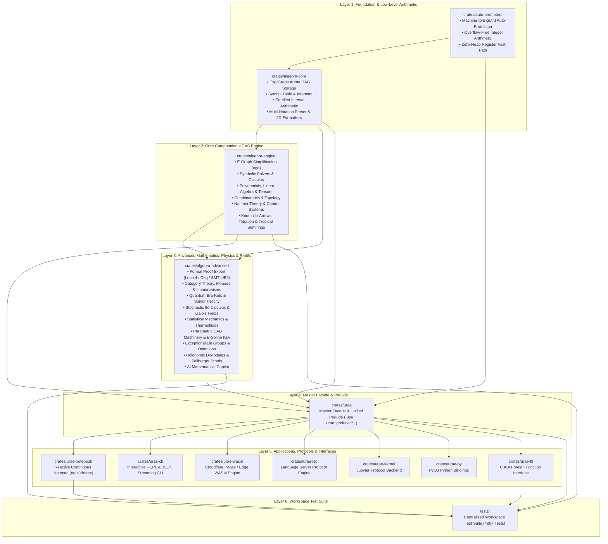

# Universal Rust Algebra Engine (URAE)

[](https://www.rust-lang.org/)
[](LICENSE.md)
[](tests/)
[](Cargo.toml)
[](crates/urae-wasm)

A high-performance, modular formal mathematics computer algebra system (CAS), multi-physics engineering analysis platform, and reactive computational notepad application built in pure Rust and WebAssembly.

Designed for dual deployment as an ultra-responsive **Native Desktop Application (Windows, macOS, Linux with hardware acceleration)** and a zero-cold-start **Serverless Web Application (WASM / Cloudflare Pages / PWA)**.

---

## 🏛️ Layered Architecture & Workspace Crates

The workspace is organized into **12 cohesive, modular crates** with a centralized integration test suite under `tests/`:



---

## 📦 Crate Breakdown

| Crate | Path | Description |
| :--- | :--- | :--- |
| **`auto-promoters`** | [`crates/auto-promoters`](crates/auto-promoters) | Fast-path machine word integer arithmetic (`usize`) with seamless automatic promotion to arbitrary-precision `BigUint` on arithmetic overflow. |
| **`algebra-core`** | [`crates/algebra-core`](crates/algebra-core) | Memory-safe arena DAG storage (`ExprGraph`), symbol table interning, certified interval arithmetic ($[a, b]$ with directed rounding), multi-notation parser (`nom`), and 2D Unicode / LaTeX formatters. |
| **`algebra-engine`** | [`crates/algebra-engine`](crates/algebra-engine) | Core symbolic CAS: non-greedy E-Graph equality saturation (`egg`), ODE/PDE solvers, calculus, dense/CSR sparse linear algebra, covariant/contravariant tensors, topological Betti numbers, Knuth up-arrows, and tropical semirings. |
| **`algebra-advanced`** | [`crates/algebra-advanced`](crates/algebra-advanced) | Advanced formal mathematical structures: formal proof certificates (Lean 4, Coq, SMT-LIB2), Category Theory, Quantum Spinors & Helicity, Parametric CAD & Isogeometric Analysis (IGA), Exceptional Lie Groups ($E_8, G_2$) & Octonions, Holonomic $D$-Modules, and AI copilot integration. |
| **`urae`** | [`crates/urae`](crates/urae) | Primary umbrella facade providing the unified prelude (`use urae::prelude::*;`) and complete CAS API. |
| **`urae-notebook`** | [`crates/urae-notebook`](crates/urae-notebook) | Reactive continuous mathematical notepad application built with `egui` and `eframe`. Features in-situ click-to-edit cards, 60 FPS slider updates, smart auto-ranging 2D plots, VM-accelerated feature extraction, 3D simulation viewport, matrix/ODE/units builder palettes, multi-level undo/redo, and in-app example gallery. |
| **`urae-cli`** | [`crates/urae-cli`](crates/urae-cli) | High-speed command-line REPL and JSON stream processing interface. |
| **`urae-wasm`** | [`crates/urae-wasm`](crates/urae-wasm) | WebAssembly edge runtime for Cloudflare Workers & Pages, enabling web notebook execution and sub-millisecond edge API endpoints. |
| **`urae-lsp`** | [`crates/urae-lsp`](crates/urae-lsp) | Language Server Protocol (LSP) backend for mathematical script editing, diagnostics, completions, and hover documentation in VS Code, Helix, and Neovim. |
| **`urae-kernel`** | [`crates/urae-kernel`](crates/urae-kernel) | Native Jupyter kernel implementation supporting `.ipynb` execution and MIME-type mathematical rendering. |
| **`urae-py`** | [`crates/urae-py`](crates/urae-py) | High-performance Python extension module powered by PyO3. |
| **`urae-ffi`** | [`crates/urae-ffi`](crates/urae-ffi) | Standard C ABI foreign function interface for cross-language integration (C, C++, Julia, Fortran). |

---

## ✨ Core Mathematical & Physics Capabilities

### 1. Symbolic CAS & Equality Saturation
- **E-Graph Equality Saturation (`egg`)**: Non-greedy pattern matching discovers the simplest canonical algebraic forms without getting trapped in local algorithmic minima.
- **Symbolic Calculus & Differential Algebra**: Symbolic limits, derivatives, Taylor/Laurent series, and automated Risch indefinite integration.
- **Polynomial Algebra & Gröbner Bases**: Multivariate polynomial arithmetic, Buchberger algorithm, and polynomial GCDs over finite fields and rationals.

### 2. Parametric CAD, Machinery & Isogeometric Analysis (IGA)
- **Parametric Machinery Generators**: Involute spur and helical gears with custom pressure angles and teeth count, ISO standard metric screws with thread profiles, and NACA 4-digit symmetric and cambered aerodynamic airfoils.
- **B-Spline & NURBS Geometry**: Knot vectors, basis function recurrence, B-spline curves, surfaces, and control net evaluation.
- **Isogeometric Analysis (IGA)**: Exact CAD geometry analysis integration, numerical quadrature, and stiffness matrix assembly for elasticity and thermal conduction.

### 3. Advanced Theoretical Physics & Abstract Algebra
- **Quantum Field Theory & Spinor Helicity**: Dirac gamma matrices, 4D Clifford algebra traces, Weyl 2-component spinor angle/square brackets $\langle p q \rangle [p q]$, and Parke-Taylor tree-level gluon scattering amplitudes.
- **Exceptional Lie Groups & Hypercomplex Algebras**: 8D non-associative Octonions $\mathbb{O}$, Albert Jordan algebras $H_3(\mathbb{O})$, and $E_8$ root systems with Cartan-Killing forms.
- **Holonomic $D$-Modules & Zeilberger's Algorithm**: Differential operators in Weyl algebra $A_n(\mathbb{C})$ ($[d, x] = 1$) with automated creative telescoping proofs for hypergeometric summation identities.
- **Certified Arithmetic & Complex Analysis**: Directed-rounding interval arithmetic $[a, b]$, and complex branch cut Riemann surface topological sheet visualizers ($\sqrt{z}, \ln(z), \arcsin(z)$).

### 4. Formal Proof Verification & Cross-System Export
- **Formal Proof Export**: Automatic translation of algebraic transformation traces to formal verification scripts in **Lean 4**, **Coq**, and **SMT-LIB2**.
- **Cross-Format Interoperability**: Dual `.urae` (compressed BSON/JSON) and `.ipynb` (Jupyter notebook format) import/export.

### 5. Automatic Differential Equations & Modern Control Systems
- **Automatic ODE vs. PDE Classification**: AST inspection automatically extracts independent variables ($1 \implies$ ODE, $\ge 2 \implies$ PDE), determines differentiation order, evaluates linearity (Linear, Semilinear, Quasilinear, Nonlinear), and recommends optimal solving strategies while respecting user manual overrides.
- **Closed-Form Nonlinear PDE Traveling Wave Reductions**: Exact analytical solutions for Korteweg-de Vries (KdV) $\operatorname{sech}^2$ solitons, Viscous Burgers $\tanh$ shock fronts, and Fisher-KPP reaction-diffusion invasion fronts.
- **Comprehensive State-Space Control Systems**: Complete SISO and MIMO support across continuous and discrete domains ($\dot{\mathbf{x}} = \mathbf{A}\mathbf{x} + \mathbf{B}\mathbf{u}$ and $\mathbf{x}_{k+1} = \mathbf{A}_d \mathbf{x}_k + \mathbf{B}_d \mathbf{u}_k$), Kalman Controllability and Observability Gramian / rank tests, Zero-Order Hold (ZOH) discretization via augmented block matrix exponentials, Ackermann state-feedback pole placement, and analytical Bode frequency response evaluation.

---

## 🖥️ URAE Continuous Reactive Notepad

The **URAE Notebook** (`urae-notebook`) is an interactive desktop and browser GUI environment built on `egui` and `eframe`:

### Key UI Features

- **Smart Dynamic 2D Plot Auto-Ranging & Graphing Defaults**:
  - **Baseline Domain Coverage**: Guarantees covering at least $x \in [-1.0, 1.0]$ when unconstrained.
  - **Automatic Root & Critical Point Framing**: Identifies all real $x$-intercepts ($f(x) = 0$) and critical points ($f'(x) = 0$, local minima, maxima, and inflection points) via bytecode execution, with 20% margin padding.
  - **Periodic Sub-Period & Harmonic Frequency Analysis**: Detects trigonometric components ($\sin, \cos, \tan, \sec, \csc, \cot, \text{sinc}$) and calculates base periods $T_k = 2\pi / \omega_k$. Ranges over 2–2.5 full periods for fundamental waves or 1.5 periods of the modulation envelope for multi-frequency carrier waves (e.g. $\sin(10x) + \cos(x)$).
  - **Natural Domain Clamping & Asymptote Handling**: Clamps non-negative functions ($\sqrt{x} \implies x \ge 0$, $\ln(x) \implies x > 0$) and splits curves across infinite poles into discrete segments without artificial vertical connection lines.
- **Function & Object Feature Inspector Hover Cards**:
  - **Symbolic vs. VM Hierarchy**: Resolves exact symbolic roots and extrema via `solveset` when algebraically accessible (`✓ Exact Symbolic`). Seamlessly falls back to fast BytecodeVM numerical approximations (`⚡ VM Discovered`) while solving is pending.
  - **Comprehensive Properties**: Displays domain, codomain, inferred range (e.g. $[-9.00, +\infty)$), even/odd parity symmetry ($f(-x) = \pm f(x)$), fundamental period $T$, and linearity status.
  - **Universal Domain Classifications (`ObjectKind`)**:
    - **Physical & Math Constants**: Exact 2019 SI Redefinition values ($c, h, \hbar, k_B, N_A, e$) and CODATA 2018 standards ($G, m_e, \pi, e, \tau, \gamma, \phi, \infty$).
    - **Linear Time-Invariant Transfer Functions $H(s)$**: Automated denominator/numerator order extraction, properness verification, complex pole-zero decomposition, and asymptotic stability testing ($\operatorname{Re}(p) < 0$).
    - **Itô Stochastic Differentials**: Automated decomposition of $dX_t = a(X, t) dt + b(X, t) dW_t$ into drift and diffusion terms with local martingale classification.
    - **Thermodynamic States & Cycles**: Real gas equations of state (Van der Waals, Ideal Gas), state relations, and dynamic Carnot efficiency computation $\eta = 1 - T_{\text{cold}} / T_{\text{hot}}$.
    - **Formal Logic Systems**: Multi-valued logics (Kleene $K_3$, Łukasiewicz $Ł_3$, Bochvar $B_3$, Gödel-Dummett $G_3$, Modal $S_5$ necessity $\Box$ and possibility $\Diamond$, and classical DPLL SAT).
    - **Differential Manifolds & General Relativity**: Spacetime dimension, metric signature, and Ricci curvature scalar $R$.
    - **CAD & Isogeometric Analysis (IGA)**: NURBS B-spline control net grids, parametric dimensions, and Gauss-Legendre quadrature stiffness properties.
    - **Probability Distributions**: Expectation $E[X]$, variance $\operatorname{Var}(X)$, standard deviation, and discrete PMF vs. continuous PDF classification.
    - **Cryptographic Curves & Networks**: Elliptic curve Weierstrass forms over finite fields $\mathbb{F}_p$ (`secp256k1`), and discrete graph algebraic connectivity / spectral gap $\lambda_2$.
    - **Canonical Algebraic Forms**: Horner polynomial complexity scoring, factored irreducibles, and tropical semirings.
- **In-Situ Interactive Parameter Sliders (`LineKind::SliderDef`)**:
  - Declaring assigned parameters (`a: Parameter = 2.00 [m]` or `mode_idx: Parameter = 0`) renders an interactive slider directly inside the document.
  - Coupled with domain declarations (e.g., `mode_idx in Integers [0, 3]`), sliders automatically clamp to bounds and snap to discrete integer steps.
  - Interactive **Alt + Drag Live Scrubbing** allows seamless numerical experimentation directly from the line text.
- **Reactive Results Stream & Vertical Fold-Outs**:
  - **Unhideable Resizable Bars**: Left parameter bar and right results stream feature collapsible tabs (`[▶ Params]`, `[◀ Results]`), adjustable width drag handles, and `Ctrl+B` / `Ctrl+J` shortcuts.
  - **Vertical Fold-Out Layout**: Inline plots and notes expand vertically **below** their fold-out headers, occupying full pane width without horizontal pushing.
  - **Transitive Upstream Dependency Highlighting**: Hovering any result in the right stream highlights the line itself and all previous upstream lines and results it depends on across the results column and gutter.
  - **Header-less Floating Tooltips**: Tooltips appear directly below the line without top window bars. Referenced variables and line tokens (`$N`) open individual floating inspector cards with a strict 1-window-per-object focus deduplication model.
- **Soft-Wrap Galley Line Number Gutter**:
  - Direct editor text galley inspection numbers only the initial visual row of each logical line (`1`, `2`, `3`, ...), keeping soft-wrapped continuation rows unnumbered to maintain precise row alignment.
- **8 Professional Themes**:
  - `Charcoal Dark`, `Slate Paper Light`, `Nordic Aurora`, `Dracula Classic`, `Catppuccin Mocha`, `Solarized Dark`, `Gruvbox Material`, `Monokai Pro`.
- **60 FPS Reactive Parameter Scrubbing**: Dragging sliders instantly updates downstream equations, plots, and domains with fine-grained delta invalidation.
- **Interactive 3D Viewport (`Viewport3D`)**: Hardware-accelerated / software-projected 3D wireframe and shaded mesh visualization with multi-mode shading (*Stress*, *Temperature*, *Pressure*, *Normals*, *Monochrome*) and orbital camera navigation.
- **Transactional Undo / Redo Subsystem**:
  - Immutable `HistorySnapshot` records document text, parameter values, symbol roles, and card modes.
  - Global physical keyboard shortcuts (`Ctrl+Z`, `Cmd+Z`, `Ctrl+Y`, `Ctrl+Shift+Z`, `Cmd+Shift+Z`).
  - Top navigation bar toolbar buttons `⮌ Undo` / `⮎ Redo` with action name preview tooltips.
  - Command Palette triggers (`undo`, `redo`).
- **Interactive Builder Palettes & Wizards**:
  - **Parametric CAD Machinery**: Generate gears, screws, and airfoils with live parameter tuning.
  - **Matrix Preset Generator**: Hilbert, Toeplitz, Vandermonde, Pauli, and Dirac matrices.
  - **ODE / PDE Boundary Condition Wizard**: Cauchy, Dirichlet, Neumann, and Robin conditions.
  - **Physical Units & Dimensions Palette**: SI unit selection and automatic dimensional consistency verification.
  - **Branch Cut & Interval Pickers**: Complex branch cut topology and domain bounds.
- **In-App Example Gallery & Interactive Tutorials**:
  - **29 production-grade mathematical example notebooks** across 10 STEM domains with one-click editor loading:
    1. *Advanced Calculus, Special Functions & ODEs*
    2. *Relativistic Kinematics & 4-Vector Dynamics*
    3. *Quantum Field Theory & Spinor Scattering*
    4. *Isogeometric Analysis & B-Spline CAD*
    5. *Non-Euclidean & Hyperbolic Geometry*
    6. *Exceptional Lie Algebras & Octonions*
    7. *Holonomic D-Modules & Zeilberger Proofs*
    8. *Finite Difference Wave Equations*
    9. *Coupled Chemical Kinetics*
    10. *Nonlinear FEA Structural Analysis*
    11. *Hamiltonian Phase Space Systems*
    12. *Stochastic Itô Calculus & Diffusion*
    13. *Transfer Functions & Control Engineering*
    14. *Thermodynamics & Statistical Mechanics*
    15. *Algebraic Forms & Horner Polynomials*
    16. *Formal Logic Systems & DPLL SAT*
    17. *Elliptic Curve Cryptography & Finite Fields*
    18. *Discrete Graph Topologies & Networks*
    19. *Number Theory & Modular Arithmetic*
    20. *Graph Theory & Network Topologies*
    21. *Differential Geometry & General Relativity*
    22. *Abstract Algebra & Finite Field Galois Extensions*
    23. *Complex Analysis & Contour Integration*
    24. *Fluid Dynamics & Incompressible Navier-Stokes*
    25. *Statistical Mechanics & Bayesian Inference*
    26. *Linear Algebra & Matrix Decompositions*
    27. *Silicon Photonics & Graphene Mode Distribution*
    28. *Automatic Differential Equation Solving (Linear & Nonlinear ODEs, PDEs & Solitons)*
    29. *Modern & Classical Control Systems (SISO, MIMO, Continuous, Discrete, ZOH & Ackermann)*
- **Fuzzy Command Palette (`Ctrl+K` / `Cmd+K`)**: Search and execute commands, templates, and example notebooks instantaneously.

---

## 🚀 Quickstart

### 1. Launch Native Desktop Notepad GUI
```bash
cargo run --release -p urae-notebook
```

### 2. Launch Interactive Command-Line REPL
```bash
cargo run --release -p urae-cli
```

### 3. Deploy WebAssembly & Cloudflare Pages
```bash
# Automated local build and deployment script
./deploy.sh
```

### 4. Use as a Rust Library
Add URAE to your `Cargo.toml`:
```toml
[dependencies]
urae = { path = "crates/urae" }
```

Use the unified prelude in your code:
```rust
use urae::prelude::*;

fn main() {
    let graph = ExprGraph::new();
    let x_sym = graph.symbols.get_or_intern("x");
    let parser = ExprParser::new(&graph);
    
    // Parse symbolic expression
    let expr = parser.parse("x^2 + 0").unwrap();

    // Differentiate & simplify via E-Graph equality saturation
    let diff = graph.diff(expr, x_sym);
    let simplified = Simplifier::simplify(&graph, expr).unwrap();

    // Format to LaTeX
    let latex = LatexFormatter.format(&graph, simplified).unwrap();
    println!("LaTeX: {}", latex); // {x}^{2}

    // Esoteric Knuth Up-Arrow tetration
    let tet = tetration(2, 3); // 2 ^^ 3 = 16
    println!("2 ^^ 3 = {}", tet);
}
```

---

## 🛠️ Build Requirements & Toolchains

- **Rust Toolchain**: Managed via [`rust-toolchain.toml`](rust-toolchain.toml) (Rust 2024 Edition, 1.85+ with `wasm32-unknown-unknown` target).
- **Node.js 24 LTS**: (Required for Cloudflare Pages edge builds, wasm-pack packaging, and asset minification pipelines; managed via [`.node-version`](.node-version)):
  ```bash
  nvm use # or fnm use
  ```
- *(Optional)* **WASM Tools & Bundlers**:
  ```bash
  cargo install wasm-pack
  cargo install trunk
  ```

---

## 🧪 Testing & Verification

All workspace integration and unit tests are centralized in the `tests/` directory:

```bash
# Run all 480+ workspace unit, integration, and doc tests
cargo test --workspace

# Run specific integration suites
cargo test --test notebook_suite    # GUI notepad, smart stream, plot bounds, sliders & inspector (100 tests)
cargo test --test engine_suite      # Core symbolic engine & physics (281 tests)
cargo test --test advanced_suite    # Category theory, proofs, CAD, IGA & quantum (50 tests)
cargo test --test core_suite        # ExprGraph, intervals, numbers & formatters (31 tests)
cargo test --test ecosystem_suite   # Python kernel, LSP & Jupyter integration (9 tests)
cargo test --test cli_suite         # CLI and REPL tests (3 tests)
cargo test --test facade_suite      # Umbrella facade & macro integration (11 tests)
cargo test --test ffi_suite         # C ABI & foreign function interface (2 tests)

# Verify zero compiler warnings & zero clippy lints
cargo clippy --workspace --all-targets -- -D warnings

# Verify WebAssembly target compilation
cargo check --target wasm32-unknown-unknown -p urae-wasm
```

---

## 🚀 Compilation & Optimization Profiles

The workspace defaults to `opt-level = 3` paired with `lto = "fat"`, `codegen-units = 1`, and `mimalloc` for uncompromising native calculation throughput, while delegating post-link `.wasm` compression to Binaryen `wasm-opt`:

```toml
[profile.release]
opt-level = 3
lto = "fat"
codegen-units = 1
panic = "abort"
strip = true
overflow-checks = false
```

### Hardware-Targeted Release Builds

- **Native Host Builds (`cargo build` / `cargo install`)**:
  Build with host-tailored vectorization (AVX2, AVX-512) for maximum native execution speed:
  ```bash
  RUSTFLAGS="-C target-cpu=native" cargo build --release
  ```

- **Broad Cross-Platform Binary Distribution (Windows / Linux / macOS)**:
  Target modern baseline instruction sets (SSE4.2, POPCNT) with complete backwards compatibility for modern x86_64 CPUs:
  ```bash
  RUSTFLAGS="-C target-cpu=x86-64-v2" cargo build --release
  ```

- **WebAssembly Deployment (Cloudflare Pages / GitHub Pages)**:
  Utilize WebAssembly 128-bit SIMD for browser execution:
  ```bash
  RUSTFLAGS="-C target-feature=+simd128" trunk build --release
  ```

---

## 📄 License & Commercial Rights

Licensed under the [PolyForm Noncommercial License 1.0.0](LICENSE.md). You may use,
change and share this software for any noncommercial purpose. For a
commercial license, contact [Spodeian](https://github.com/Spodeian). Earlier
releases keep the license they were published under.
