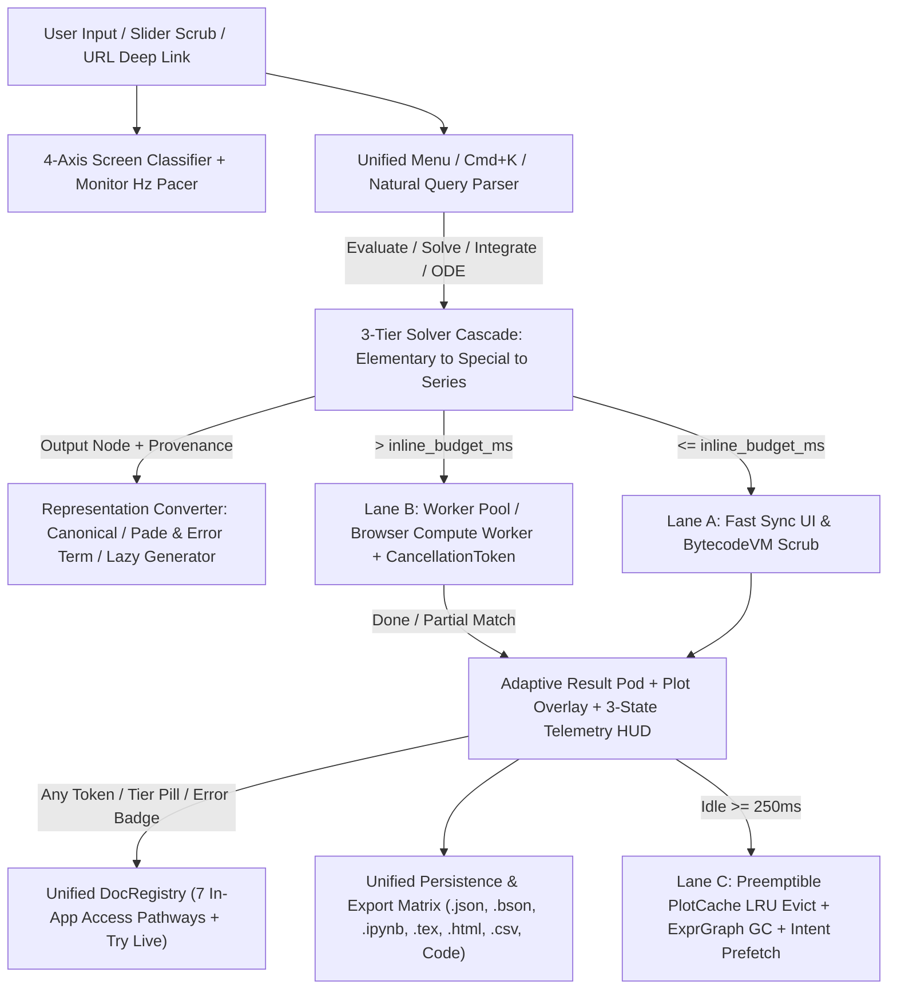
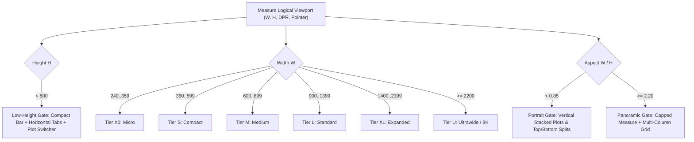
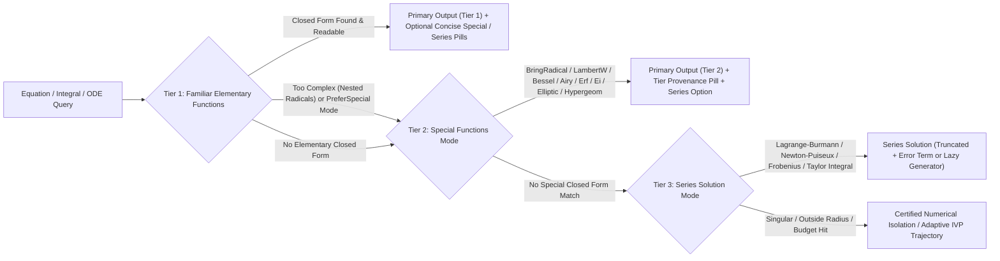
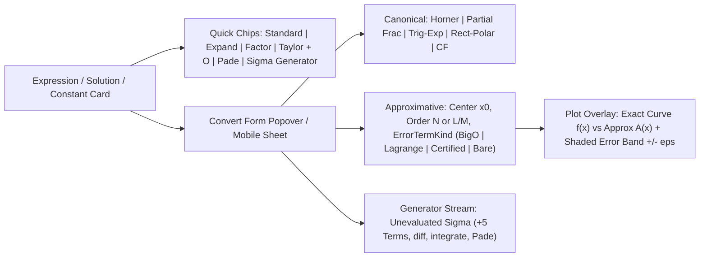
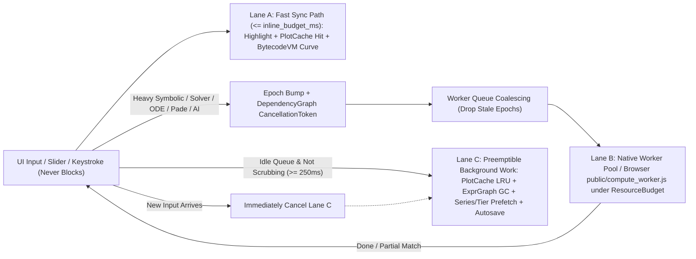

# URAE Cross-Platform GUI, Solver-Flow, Representation & Documentation Architecture Plan

**Universal Rust Algebra Engine (URAE)**  
*Unified UI/UX, Extreme-Viewport Resilience, Three-Tier Solution Modes, Universal Approximations & Series Generators, Multi-Modal In-App Documentation, Format Matrix, and Non-Blocking Monitor-Paced Execution across WebAssembly (`urae-wasm`), Native/Canvas `egui` (`urae-notebook`), CLI (`urae-cli`), LSP (`urae-lsp`), and Jupyter Kernel (`urae-kernel`)*

---

## Architecture Map (Table of Contents)

- **Part I — Foundation, Codebase Audit & Responsive Design Tokens**
  - Section 1: Executive Summary, Architectural Mandate & Unified End-to-End System Flow
  - Section 2: Audited Codebase Bottlenecks (`urae-wasm`, `urae-notebook`, PWA/Worker & State Gaps)
  - Section 3: Canonical 4-Axis Screen Classification & 15 Reference Profiles (`280×280` to `7680×4320`)
  - Section 4: Shared Design Tokens, WCAG AAA Parity, CVD Encodings & Font Asset Integrity
- **Part II — Chrome, Layout Topologies & High-DPI Interaction**
  - Section 5: Global Navigation, Chrome Budget & Unified `ViewMode` / `WorkspaceState` Reconciliation
  - Section 6: Component-by-Component Responsive Layout (Q&A, Pad, SmartStream, Workbench, Graph/3D, Modals)
  - Section 7: High-DPI Graphics, Bounded Canvas Memory (`4096 px` Cap), Adaptive Ticks & `ResizeObserver`
  - Section 8: Contained Mathematical Overflow, Pointer/Touch/Pinch Gestures & Mobile Keyboard Handling
  - Section 9: Accessibility (WCAG 2.2 AA/AAA), Reduced Motion & Print Publication Media
- **Part III — Complete Functional Breadth, Solution Modes & Universal Conversions**
  - Section 10: Complete Unified Menu, Tool & Subsystem Taxonomy (100% Crate Exposure)
  - Section 11: Three-Tier Solution Hierarchy & Solution Modes (`Elementary -> Special -> Series`)
  - Section 12: Universal Representation & Approximative Form Engine (Canonical, Padé `[L/M]`, Error Terms, Lazy `SeriesGenerator`)
- **Part IV — In-App Documentation of Everything**
  - Section 13: Unified `DocRegistry` Single Source of Truth & Seven Multi-Modal Discovery Pathways
- **Part V — Persistence, Guaranteed Speed, Reactivity Telemetry & Blind-Spot Closure**
  - Section 14: Comprehensive Save, Persistence, Import & Export Matrix (+ `urae-kernel` `.ipynb` & Client Storage Bridge)
  - Section 15: Guaranteed Speed, Auto-Detected Monitor FPS, Non-Blocking 3-Lane Runtime & Activity Telemetry
  - Section 16: Consolidated Blind-Spot Audit & Architectural Closure Matrix
- **Part VI — Unified Implementation Blueprint & Acceptance Verification**
  - Section 17: Concrete Source-to-Target File Blueprint (`urae-wasm`, `urae-notebook`, Core & Satellite Crates)
  - Section 18: Five-Phase Execution Plan & Automated 25-Viewport + Functional Acceptance Matrix

---

# Part I — Foundation, Codebase Audit & Responsive Design Tokens

## 1. Executive Summary, Architectural Mandate & Unified System Flow

URAE exposes a dual-endpoint graphical user interface backed by a single symbolic, categorical, and numerical ecosystem (`algebra-core`, `algebra-engine`, `algebra-advanced`, `cat-core`, `cat-tangent`, `urae`):

1. **Web Shell (`crates/urae-wasm`)**: Semantic HTML5, CSS3, KaTeX typography, 2D HTML5 Canvas plotters, PWA offline support ([sw.js](file:///c:/Users/Liam/Code/algebra-engine/crates/urae-wasm/public/sw.js)), serverless REST/JSON edge routing ([worker.js](file:///c:/Users/Liam/Code/algebra-engine/crates/urae-wasm/worker.js)), and an embedded `egui` canvas (`<canvas id="urae_canvas">`) defined across [index.html](file:///c:/Users/Liam/Code/algebra-engine/crates/urae-wasm/public/index.html) and [style.css](file:///c:/Users/Liam/Code/algebra-engine/crates/urae-wasm/public/style.css).
2. **Native & Canvas Application (`crates/urae-notebook`)**: Cross-platform `eframe` / `egui` immediate-mode desktop application (Windows, macOS, Linux) and `wasm32` canvas target defined across [lib.rs](file:///c:/Users/Liam/Code/algebra-engine/crates/urae-notebook/src/lib.rs), [app.rs](file:///c:/Users/Liam/Code/algebra-engine/crates/urae-notebook/src/app.rs), [workbench_ui.rs](file:///c:/Users/Liam/Code/algebra-engine/crates/urae-notebook/src/ui/workbench_ui.rs), [workspace.rs](file:///c:/Users/Liam/Code/algebra-engine/crates/urae-notebook/src/ui/workspace.rs), [theme.rs](file:///c:/Users/Liam/Code/algebra-engine/crates/urae-notebook/src/ui/theme.rs), [palettes.rs](file:///c:/Users/Liam/Code/algebra-engine/crates/urae-notebook/src/ui/palettes.rs), [command_palette.rs](file:///c:/Users/Liam/Code/algebra-engine/crates/urae-notebook/src/ui/command_palette.rs), and [viewport3d.rs](file:///c:/Users/Liam/Code/algebra-engine/crates/urae-notebook/src/ui/viewport3d.rs).

Both endpoints share the same mental model—a **Q&A Symbolic Solver**, a **Reactive Graphing Pad / SmartStream Notepad**, and a **Systems & Differential Equations Workbench**—but currently behave cleanly only inside a mid-sized landscape desktop window (`~1024×720` to `1920×1080`) while leaving major engine domains, tiered solver fallbacks, representation converters, async worker wiring, and in-app documentation fragmented or unexposed.

### 1.1 Five Non-Negotiable Architecture Invariants

1. **Logical Pixels Decoupled from Device Pixel Ratio (DPR)**: All responsive breakpoints evaluate in logical CSS `px` / `egui` points (`dp`), never hardware framebuffer pixels. A 4K laptop at `200%` OS scaling (`1920×1080` logical) resolves to desktop ergonomics; a 4K workstation at `100%` scaling (`3840×2160` logical) unlocks multi-pane studio grids with bounded prose width (`max-width: 75–90ch`).
2. **Orthogonal 4-Axis Screen Classification**: Layout decisions depend jointly on `(WidthTier, HeightClass, OrientationMode, PointerModality)`, avoiding failure on `844×390` mobile landscape, `1080×1920` portrait workstation monitors, and `1920×360` shallow docked strips.
3. **Principled Three-Tier Solve -> Universal Convert Loop**: Solutions attempt familiar elementary forms first (`Elementary`), promote or fall back cleanly to cleaner special-function forms (`SpecialFunction`), and degrade gracefully to power/Frobenius series (`Series`), with every output freely convertible between canonical forms, error-bounded approximants (Padé, Taylor, Chebyshev, asymptotic), and lazy unevaluated `SeriesGenerator` streams.
4. **Never-Blocked UI Thread Paced to Live Monitor Hz**: UI responsiveness automatically tracks display refresh (`30–360 Hz`) via dynamic frame budgets; only cache hits and `BytecodeVM` fast scrubs run inline, while heavy symbolic work runs preemptibly in Worker threads / Browser Dedicated Compute Web Workers and memory/prefetch housekeeping runs idle in interruptible slices.
5. **Everything Discoverable & Documented Offline-First**: Every mathematical object, solver tier, transformation, unit, error diagnostic, and shortcut maps to one compiled `DocRegistry` accessible via seven coordinated in-app pathways and shared across GUIs, `urae-cli`, `urae-lsp`, and `urae-kernel`.

### 1.2 Integrated End-to-End Data & Control Flow



---

## 2. Audited Codebase Bottlenecks (Verified Against Repository)

### 2.1 Web Shell Layout & Assets (`crates/urae-wasm/`)

| Component | Current Implementation | Failure Mode / Integration Gap |
| :--- | :--- | :--- |
| Global CSS queries | Zero `@media` and zero `@container` rules in [style.css](file:///c:/Users/Liam/Code/algebra-engine/crates/urae-wasm/public/style.css) | Identical desktop geometry enforced across `280 px` tiles and `5120 px` ultrawides |
| Viewport meta & root sizing | `width=device-width, initial-scale=1.0` ([index.html:5](file:///c:/Users/Liam/Code/algebra-engine/crates/urae-wasm/public/index.html#L5)); `#app_container { width: 100vw; height: 100vh; }` ([style.css:97-105](file:///c:/Users/Liam/Code/algebra-engine/crates/urae-wasm/public/style.css#L97)) | Bottom controls clipped by mobile browser URL bars (`100vh` vs `100dvh`); missing `viewport-fit=cover` and `env(safe-area-inset-*)` notch margins |
| Offline PWA KaTeX gap | [index.html:12-13](file:///c:/Users/Liam/Code/algebra-engine/crates/urae-wasm/public/index.html#L12) loads KaTeX CSS/JS from `cdn.jsdelivr.net`; [sw.js:5-13](file:///c:/Users/Liam/Code/algebra-engine/crates/urae-wasm/public/sw.js#L5) pre-caches only `./pkg/*` & local HTML/CSS | Offline PWA sessions lose KaTeX mathematical typesetting entirely unless KaTeX CSS, JS, and fonts are vendored locally into `PRECACHE_ASSETS` |
| Top navbar | `.qa-navbar` ([style.css:109](file:///c:/Users/Liam/Code/algebra-engine/crates/urae-wasm/public/style.css#L109)) with brand, 5 tabs, status pill, and 3 buttons | Clips/overflows tabs below `~980 px`; unnavigable on `< 600 px` mobile; wastes height on `< 420 px` landscape phones |
| Q&A measure & pods | `.qa-search-wrapper` (`L331`) & `.qa-results-container` (`L591`) fixed `max-width: 900px` | Excessive padding on `< 420 px` phones; wastes `> 75%` horizontal canvas on 4K/32:9 screens |
| Graphing Pad sidebar | `.pad-expr-sidebar` ([style.css:918](file:///c:/Users/Liam/Code/algebra-engine/crates/urae-wasm/public/style.css#L918)) fixed min-width inside horizontal flex | Leaves `0–100 px` for `#pad_graph_canvas` at `320–420 px`; breaks `.layout-split` below `~1050 px` |
| Systems Workbench | `.systems-sidebar` (`L1450`), `.sys-plots-split` (`L1557`), `.sys-slider-row` (`L1539`) | Horizontal overflow below `1024 px`; squeezes Time Series + Phase Plane on portrait monitors; slider tracks crush below `300 px` |
| Canvas `egui` bridge | `setViewMode('canvas')` sets `canvas.width = window.innerWidth; canvas.height = window.innerHeight` ([index.html:707-712](file:///c:/Users/Liam/Code/algebra-engine/crates/urae-wasm/public/index.html#L707)) | Ignores top navbar height (`56px`), ignores DPR, exceeds `4096 px` WebGL texture bounds on 5K/8K, and shares zero storage state with Web Pad (`urae_pad_lines` at `L1968`) |
| Touch & Pointer input | Mouse-only `mousedown`/`mousemove`/`mouseup`/`wheel` ([index.html:1779-1852](file:///c:/Users/Liam/Code/algebra-engine/crates/urae-wasm/public/index.html#L1779)); `.expr-visibility-btn` is `22×22px` | No touch drag pan or two-finger pinch zoom; interactive targets below WCAG/mobile `44×44 px` touch floor |
| Worker role boundary | [crates/urae-wasm/worker.js:1-80](file:///c:/Users/Liam/Code/algebra-engine/crates/urae-wasm/worker.js#L1) is a Cloudflare Edge HTTP handler, not a client browser worker | Browser UI still runs `wasm_structured_query` & systems analysis synchronously on the main thread |

### 2.2 Native & `egui` Canvas Bottlenecks (`crates/urae-notebook/`)

| Component | Current Implementation | Failure Mode / Integration Gap |
| :--- | :--- | :--- |
| Native window bounds | `.with_inner_size([1100.0, 750.0])` (`L190`) and `.with_min_inner_size([600.0, 400.0])` ([lib.rs:191](file:///c:/Users/Liam/Code/algebra-engine/crates/urae-notebook/src/lib.rs#L191)) | Blocks `320–580 px` OS quarter-screen snaps, embedded handheld panes, and narrow tiles |
| Web `egui` fallback | `canvas.set_width(1100); canvas.set_height(720)` ([lib.rs:257-258](file:///c:/Users/Liam/Code/algebra-engine/crates/urae-notebook/src/lib.rs#L257)) | Needs `ResizeObserver` client-rect synchronization rather than fixed fallback pixels |
| Layout state split-brain | `ViewMode` ([app.rs:58](file:///c:/Users/Liam/Code/algebra-engine/crates/urae-notebook/src/app.rs#L58)) vs `WorkspaceLayoutPreset` & `WorkspaceTab` ([workspace.rs:10,57](file:///c:/Users/Liam/Code/algebra-engine/crates/urae-notebook/src/ui/workspace.rs#L10)) | Two overlapping layout enums: `Cmd+K` sets presets (`app.rs:1919-1948`), while `ViewMode` switches major screens independently; `DependencyGraph` & `PresentationReport` lack top-bar mode buttons (`L1531-L1533`) |
| Sidebars & docked panels | Left sidebar `.default_size(280.0)` (`L1759`); Docked Settings `300/380.0` (`L1612,L1630,L1690`); Terminal `260.0` (`L1669`) | Crushes `CentralPanel` to `0 px` inside narrow (`< 760 px`) or short (`< 500 px`) windows |
| Fixed-width inputs & bars | `workbench_ui.rs`: Q&A `(avail - 120).max(240)` (`L113`), `240.0` (`L344`), `180.0` (`L597`); `app.rs`: AI Copilot `.desired_width(500.0)` (`L1551`), CLI Terminal `.desired_width(520.0)` (`L2973`) | Pushes Solve/Ask/Run/remove buttons off right edge on `< 580 px` panes; `ui.columns(2)` at `workbench_ui.rs:331,577` and `app.rs:6116` (`ExampleGallery`) overflow below `~700 px` |
| Synchronous UI bottlenecks | `NotebookState` does not route through `BackgroundEvaluator` (`worker.rs:221`); `agent.query(...)` runs synchronously inside AI bar (`app.rs:1558`) | Heavy symbolic/ODE tasks or network LLM calls stall the immediate-mode render loop |
| Modals, matrices & plots | `CommandPalette` `.fixed_size([540, 380])` at `y = 80` (`L318-321`); `Matrix` `10×10` grid (`45px` cells, `palettes.rs:103` & `app.rs:5241`) without scroll; fixed plot `130.0`/`200.0` (`app.rs:4799,4808`) & `plot_h` (`workbench_ui.rs:748`) | Clip outside `< 560 px` wide / `< 460 px` tall viewports; `60 FPS target: <16.6ms` (`app.rs:2618`) and `target_frame_budget_ms = 8.0` (`session.rs:1056`) are hardcoded rather than tracking display Hz |
| Brand token drift | Web uses orange/gold on `#0d1117`; `ThemeKind::Dark` ([theme.rs:10-115](file:///c:/Users/Liam/Code/algebra-engine/crates/urae-notebook/src/ui/theme.rs#L10)) uses cool blue accent while Web lacks the 10 `ThemeKind` presets | Inconsistent look between Web shell and `Canvas egui` tab; Web lacks `HighContrastDark/Light` AAA themes |

---

## 3. Canonical 4-Axis Screen Classification & 15 Reference Profiles

Every layout rule in CSS and `egui` derives from four orthogonal viewport axes:

1. **WidthTier ($W$)** (logical `px` / `dp`): `X0 Micro (240–359)` · `S Compact (360–599)` · `M Medium (600–899)` · `L Standard (900–1399)` · `XL Expanded (1400–2199)` · `U Ultrawide (≥ 2200, validated up to 7680)`
2. **HeightClass ($H$)**: `Cramped (< 360)` · `Short (360–499)` · `Standard (500–899)` · `Tall (≥ 900)`
3. **OrientationMode ($A = W/H$)**: `Portrait (< 0.85)` · `Square (0.85..1.35)` · `Landscape (1.35..2.20)` · `Panoramic (≥ 2.20)`
4. **PointerModality ($P$)**: `Fine` (mouse/trackpad) · `Coarse` (touch: enforces `44–48 px` targets) · `Hybrid` (2-in-1 / stylus + keyboard)

### 3.1 Classification Decision Flow



### 3.2 Fifteen Canonical Profiles: Common & Extreme-but-Feasible Screens

| Profile | Representative Devices / Windows | Logical `W × H` (DPR) | Tuple `(W, H, A, P)` | Top Chrome & Nav | Primary Workspace Topology | Systems & ODE Plot Strategy |
| :--- | :--- | :--- | :--- | :--- | :--- | :--- |
| **Wearable / Micro TFT** | Embedded Pi TFT, companion square frame | `280×280`, `320×240` (1x) | `X0 / Cramped / Square / Coarse` | `36px` bar: logo + cycler + `☰` | Single active pane only; zero sidebars; `Split` disabled | Segmented `[Setup \| Output \| Plot]`; `180px` canvas |
| **Small Legacy Phone** | iPhone SE (1st gen), narrow Android split | `320×568` (2x) | `X0 / Standard / Portrait / Coarse` | `44px` top bar + `48px` bottom dock | Tabbed `Expr \| Graph` toggle in Pad; full-width Q&A | Vertical accordions + single `220px` plot |
| **Narrow Fold Cover** | Z Fold cover screen | `344×882` (2.6x) | `X0 / Standard / Portrait / Coarse` | `44px` top bar + bottom 4-tab bar | `38dvh` pinned top graph + scrollable expression list below | Vertical accordions + `[Time \| Phase]` switcher |
| **Modern Phone Portrait** | iPhone 14–16, Pixel 8/9, Galaxy S24/S25 | `360×800`..`430×932` (3x) | `S / Standard–Tall / Portrait / Coarse` | `48px` header + `52px` thumb dock | Pad: `42dvh` top canvas + `1fr` card list below | Accordions -> full-width plot + `[Time \| Phase]` toggle |
| **Mobile Landscape** | Phones rotated sideways (w/ or w/o soft kbd) | `667×375`, `844×390` (2–3x) | `M–L / Short / Landscape–Pan / Coarse` | `40px` single-line bar | Pad: collapsible `36%` list + `64%` canvas | Collapsible left form + single active plot switcher |
| **Quarter Desktop Tile** | Narrow snap on 1080p/1440p monitor | `512×768`, `480×900` (1–1.25x) | `S / Standard–Tall / Portrait / Fine` | `46px` bar + `☰` overflow menu | Overlay parameter drawer; stacked Editor/Results | Vertical controls -> `[Time \| Phase]` plot toggle |
| **Inner Foldable & Mini Tablet** | Z Fold inner, iPad Mini portrait | `717×512`, `744×1133` (2–3x) | `M / Standard / Square–Port / Coarse` | `50px` bar + `16px` hinge clearance | `280px` collapsible drawer (or top plot in portrait) | Top setup + segmented or stacked plots |
| **Standard Tablet Portrait** | iPad 10th/Air, Surface Go portrait | `768×1024`, `820×1180` (2x) | `M / Tall / Portrait / Hybrid` | `52px` compact icon-label bar | Pad `45%` top plot / `55%` bottom cards; vertical `Split` | Top collapsible form + stacked Time & Phase plots |
| **Standard Laptop** | `1366×768`, MacBook Air scaled (`1280×800`) | `1280×720`, `1366×768` (1–2x) | `L / Standard / Landscape / Fine` | `52–56px` bar; compact status dot `< 1100px` | Dual-column Pad (`340px` list + plot); `Split` unlocked | Left controls (`340px`) + stacked/2-up plots |
| **FHD & Scaled 1440p Desktop** | `1920×1080`, 1080p@125% (`1536×864`) | `1440×900`..`1920×1200` | `XL / Standard–Tall / Landscape / Fine` | Full `56px` bar + shortcuts | `390px` resizable sidebar + plot; 2-col Q&A pods (`>= 1400px`) | Left (`380px`) + side-by-side Time Series & Phase (`1fr 1fr`) |
| **Portrait Workstation Monitor** | Vertical `1080×1920`, `1440×2560` | `1080×1920`, `1440×2560` | `L–XL / Tall / Portrait / Fine` | `56px` top bar | `Split` stacks Q&A above Pad; 1-col prose (`<= 900px`) | **Portrait Override**: `Controls` (`~38dvh`) above stacked plots |
| **QHD / 4K Native Workstation** | 27"–32" `2560×1440`, `3840×2160` | `2560×1440`, `3840×2160` | `U / Tall / Landscape / Fine` | Centered `1920–2200px` header container | 3-pane Studio + pin-able Docs Companion Rail; 2–3 pod masonry | 3-col studio: Config \| Time + Diagnostics \| Phase + Contours |
| **21:9 & 32:9 Super-Ultrawide** | `3440×1440`, `3840×1080`, `5120×1440` | `3440×1440`..`5120×1440` (1x) | `U / Tall / Panoramic / Fine` | Centered max inner chrome (`<= 2200px`) | 4-zone workspace (`Params \| Editor \| Plots \| 3D/Docs`) w/ prose caps | Wide 3-pane Workbench (`DPR` capped cleanly) |
| **8K Display Native** | `7680×4320` wall @ 100–200% | `7680×4320` (1–2x) | `U / Tall / Landscape / Fine` | `2200px` header cap + auto scale suggestion | Stage bounded at `2400px`; **canvas strictly capped `<= 4096 px/axis`** | 3-pane studio w/ vector chrome & bounded framebuffers |
| **Shallow Wide Ribbon** | Bottom IDE/dock strip, kiosk strip | `1280×320`, `1920×360`, `2560×480` | `L–U / Cramped–Short / Panoramic / Fine` | `38px` horizontal strip | `320px` slim list left + wide plot right | `320px` scrollable form + single wide `[Time \| Phase]` plot |

### 3.3 Dynamic Zoom Reflow, Foldables, and Mixed-DPI Monitors

- **WCAG 1.4.10 Reflow (`400%` Browser Zoom & Native `set_zoom_factor`)**: `1280×720` @ `400%` becomes `320×180` (`X0 / Cramped`); [app.rs:1254](file:///c:/Users/Liam/Code/algebra-engine/crates/urae-notebook/src/app.rs#L1254) (`zoom.clamp(0.5, 3.0)`) maps `1920×1080` to `640×360` at `3.0x`. Chrome bars auto-collapse by effective post-zoom logical `(W, H)` so vertical scroll remains 1-dimensional.
- **Hinged Dual-Screen Foldables**: When `@media (horizontal-viewport-segments: 2)` matches, `.pad-container` and `.systems-pane` snap left sidebars to `env(viewport-segment-width 0 0)` and right stages to `env(viewport-segment-left 1 0)`.
- **Heterogeneous Multi-Monitor & Hot-Unplug Clamping**: Recompute `UiMetrics` per frame from `ctx.pixels_per_point()`; clamp every floating `egui::Window` `min_pos` into `[8.0, available_w - 120.0] × [8.0, available_h - 60.0]` on monitor unplug.

---

## 4. Shared Design Tokens, WCAG AAA Parity, CVD Plots & Offline Fonts

### 4.1 Semantic Color, Contrast & Local Font Assets

- **Full Palette Parity**: Synchronize all 10 `ThemeKind` presets ([theme.rs:11](file:///c:/Users/Liam/Code/algebra-engine/crates/urae-notebook/src/ui/theme.rs#L11) — including `Dark`, `Light`, `CatppuccinMocha`, `Nord`, `Dracula`, `SolarizedDark`, `SolarizedLight`, `Cyberpunk`, `HighContrastDark`, `HighContrastLight`) between Web `[data-theme="..."]` and native `ThemeKind`, uniting around URAE's `#ff7e00` / `#f5a623` studio accent tokens.
- **WCAG 2.2 Contrast Floors**: `>= 4.5:1` text / `>= 3.0:1` UI borders in standard themes; `>= 7.0:1` pure `#000000`/`#ffffff` + `2px` crisp borders in `HighContrast*` presets.
- **CVD-Safe Multi-Curve Plots**: Pair the 6 curve colors (`--curve-blue..cyan`, [style.css:19-24](file:///c:/Users/Liam/Code/algebra-engine/crates/urae-wasm/public/style.css#L19)) with distinct stroke dashes (`solid`, `dashed`, `dotted`, `dash-dot`) and marker glyphs across all 2D plotters and `egui_plot`.
- **Offline Math Font Integrity**: Vendor local KaTeX `.css`/`.js`/`.woff2` files alongside native `NotoSansMath-Regular.ttf` in `crates/urae-wasm/public/vendor/katex/` and register them in [sw.js](file:///c:/Users/Liam/Code/algebra-engine/crates/urae-wasm/public/sw.js#L5) `PRECACHE_ASSETS` so air-gapped and offline PWA users retain full math rendering!

### 4.2 Fluid CSS Tokens & Native `UiMetrics`

```css
:root {
  --text-xs:   clamp(0.6875rem, 0.65rem + 0.15vw, 0.75rem);
  --text-sm:   clamp(0.75rem,   0.72rem + 0.20vw, 0.875rem);
  --text-base: clamp(0.875rem,  0.84rem + 0.22vw, 1.00rem);
  --text-lg:   clamp(1.00rem,   0.92rem + 0.35vw, 1.25rem);
  --text-hero: clamp(1.15rem,   0.95rem + 1.10vw, 1.85rem);
  --nav-h:     56px;
  --tap-min:   32px; /* Elevated to 44px under (pointer: coarse) */
  --pad-sidebar-w: clamp(290px, 28vw, 440px);
  --sys-sidebar-w: clamp(300px, 30vw, 460px);
}
```

| `UiMetrics` Field (`egui`) | `Micro (<360)` | `Compact (360–599)` | `Medium (600–899)` | `Standard (900–1399)` | `Expanded/U (>=1400)` |
| :--- | :--- | :--- | :--- | :--- | :--- |
| Base UI font (`dp`) | `12.0` | `13.5` | `14.0` | `14.5` | `15.0` (scaled) |
| Min interactive height (`dp`) | `36.0` (coarse `44.0`) | `36.0` (coarse `44.0`) | `30.0` (coarse `44.0`) | `26.0` (coarse `44.0`) | `26.0` |
| Auto-drawer left sidebar | `true` | `true` | `auto` (`< 760`) | `false` (`250–280`) | `false` (`280–340`) |
| Workbench split threshold | Vertical `1 col` | Vertical `1 col` | `1 col` (`< 720`) | 2-col (`340` + plot) | 2-col or 3-col (`>= 1800`) |

---

# Part II — Chrome, Layout Topologies & High-DPI Interaction

## 5. Global Navigation, Chrome Budget & Unified State Reconciliation

### 5.1 Vertical Chrome Discipline & Mobile Bottom Dock

- **Chrome Ratio Cap**: Persistent navigation bars never exceed **16%** of viewport height (`<= 58px` at `360px` height; `<= 40px` below `360px`).
- **Web Tiered Chrome**: Full `56px` navbar (`>= 900px`) $\to$ hidden subtitle & dot badge (`600–899px`) $\to$ `42px` compact bar (`H < 500px`) $\to$ `44–48px` header + `52px + env(safe-area-inset-bottom)` thumb dock (`< 600px`), automatically hidden while software keyboard is open (`visualViewport.height < 0.72 * innerHeight`).
- **URL Deep-Linking**: Encode restorable app state cleanly into query/hash links (`?q=...&mode=systems&tier=special&form=pade_3_3&doc=special.bessel_j`) for textbook sharing and reproducible bug reports.

### 5.2 Reconciling `ViewMode` & `WorkspaceState` Across Web & Native

Eliminate the split-brain between [app.rs:58](file:///c:/Users/Liam/Code/algebra-engine/crates/urae-notebook/src/app.rs#L58) (`ViewMode`), [workspace.rs:10,57](file:///c:/Users/Liam/Code/algebra-engine/crates/urae-notebook/src/ui/workspace.rs#L10) (`WorkspaceTab`, `WorkspaceLayoutPreset`), and Web `layout-*`:

| Canonical Workspace Role | Native Primary Surface | Web Shell Mode | Automatic Viewport Adaptation |
| :--- | :--- | :--- | :--- |
| **Q&A Solver** | `ViewMode::QaSolver` | `layout-qa` | 1-col (`< 1400px`) $\to$ 2-col balanced pods (`>= 1400px`) |
| **Reactive Notepad / Pad** | `SmartStream` + `FluidNotepad` / `DualHalves` | `layout-pad` | Dual split (`>= 900px` landscape) $\to$ top plot / bottom list (portrait/`M`) $\to$ `Expr \| Graph` toggle (`SimplifiedSingleTab` / `Micro < 360px`) |
| **Systems & ODE Workbench** | `ViewMode::SystemsWorkbench` | `layout-systems` | 2/3-col studio (`>= 900px` landscape) $\to$ vertical stack (portrait) $\to$ segmented plot tabs (`H < 520px` or `W < 600px`) |
| **Dual Split Study** | `WorkspaceLayoutPreset::SplitDual` / `TripleIDE` | `layout-split` | Horizontal `50/50` (`>= 1024px`) $\to$ vertical `50/50` (`720–1023px` or portrait) $\to$ redirects cleanly to active pane (`< 720px`) |
| **Graph / Focus / Zen** | `FocusEditor` + `WorkspaceLayoutPreset::ZenMode` | `layout-canvas` (`#canvas_pane`) | `100%` `<main>` area with DPR-bounded `ResizeObserver` sizing |
| **Dependency Graph & Presentation Report** | `DependencyGraph` & `PresentationReport` (**newly promoted directly into top `ViewMode` switcher!**) | Web Report / Graph modals + Standalone HTML preview | 2-col (`>= 780px`) $\to$ 1-col (`< 780px`); Presentation prose capped `<= 860dp` centered |
| **Native Top Bar Chrome Progression** | Full row (`>= 900px`) $\to$ `☰ Menu + 3 Tabs + 🔍` (`600–899px`) $\to$ `URAE + ComboBox + ☰ + 🔍` (`< 600px`) | Same logical menu taxonomy (Section 10) | Guarantees a single horizontal row (`<= 38dp` tall) on all screens |

---

## 6. Component-by-Component Responsive Layout Specification

### 6.1 Q&A Symbolic Solver & Unified Pod Anatomy

1. **Input Bar**: Replace `.desired_width((avail - 120).max(240))` ([workbench_ui.rs:113](file:///c:/Users/Liam/Code/algebra-engine/crates/urae-notebook/src/ui/workbench_ui.rs#L113)) with proportional calculation or two-row wrap below `360dp`. On Web, keep font size `>= 16px` (`1rem`) to prevent iOS Safari auto-zoom, and dock `.math-keypad.open` as a `44dvh` bottom sheet on `W < 600px` with `>= 48px` grid keys.
2. **Integrated Pod Stack** (combining Sections 11, 12, 13 & 15 into one predictable pod rhythm):
   - **Row 1 (Interpretation + Provenance Badges)**: Shows parsed statement + `SolveTier` pill (`Tier 1 · Elementary`, `Tier 2 · Special: BringRadical`, `Tier 3 · Series`), clickable to open the corresponding `DocRegistry` entry!
   - **Row 2 (Primary Output + Tier Switcher + `⇄ Convert Form` Bar)**: Shows result in KaTeX/2D Unicode + quick-flip tier tabs + `⇄ Convert Form` trigger (Section 12.3).
   - **Row 3 (Action Chain Strip)**: Wrap-safe chips for `📈 Plot / Compare Error Band`, `Verify Zero`, `Copy [LaTeX | Unicode | Python | Rust | JSON]`, `Send to Pad/Workbench`, `Open Docs`.
   - **Row 4+ (Collapsible Analysis Grid)**: `Step-by-step Derivation`, `Numerical / GUM Uncertainty Approximation`, `Alternate Forms / Padé / Generator`, `Calculus Companion`, and `Roots / Zeros` flow into 2 balanced columns on `>= 1400px` and cleanly accordion-collapse on `< 600px`.

### 6.2 Graphing Pad (`#pad_pane`), `SmartStream` (`app.rs:3916`) & Plot Parity

- **Web Pad Layout**: Replace fixed `320px` min-width with fluid `--pad-sidebar-w` + `4px` (`20px` hit-slop) draggable splitter on `>= 900px`; switch to `column-reverse` (canvas above cards) on `< 900px` or portrait aspect, with a 3-state height toggle (`18dvh` mini / `42dvh` split / `82dvh` plot focus), and `[Expressions | Graph]` sub-tabs at `< 360px`.
- **Native `SmartStream` Splitter**: Promote left Parameters sidebar into a toggleable drawer `< 760dp`; split horizontal (`>= 620dp` landscape) or vertical top/bottom (`< 620dp` or portrait), removing additive clamps (`available.max(300)` + `180` + `120`). Scale inline plots cleanly (`0.24 * avail_h` clamped `[110, 320]` for 2D, `0.32 * avail_h` clamped `[140, 440]` for 3D).
- **Web <-> Native Plotting Feature Parity**: Port native `PlotScaleMode` (`Linear | SemiLogY | SemiLogX | LogLog`, [app.rs:78](file:///c:/Users/Liam/Code/algebra-engine/crates/urae-notebook/src/app.rs#L78)), `ActiveScrubbing` numeric literal dragging ([app.rs:253](file:///c:/Users/Liam/Code/algebra-engine/crates/urae-notebook/src/app.rs#L253)), and `PeriodicAnalysis` frequency/period annotations ([plot_eval.rs:266](file:///c:/Users/Liam/Code/algebra-engine/crates/urae-notebook/src/notebook/plot_eval.rs#L266)) into Web `#pad_graph_wrapper`!

### 6.3 Systems of Equations & Differential Equations Workbench

Replace unconditional `ui.columns(2)` ([workbench_ui.rs:331,577](file:///c:/Users/Liam/Code/algebra-engine/crates/urae-notebook/src/ui/workbench_ui.rs#L331)) and fixed `240.0`/`180.0` `TextEdit` widths (`L344, L597`) with `metrics.adaptive_two_pane(...)`:
- **`XL–U` Landscape**: Left Config/Sliders (`380–420px`) | Center Diagnostics + Time Series | Right Phase Plane / Implicit Contours (height fluid `(avail_h * 0.45).clamp(160.0, 520.0)` when stacked, `<= 720.0` single).
- **Portrait Monitors (`aspect < 0.85`, even at `1080×1920`)**: Explicit top-controls (`<= 42dvh`) above stacked Diagnostics -> Time Series -> Phase Portrait (`1fr` vertical stack so phase portraits stay square/uncompressed).
- **`M / S / Short` (`W < 600px` or `H < 500px`)**: Compact left/top accordion controls (2-line ODE RHS rows under `340dp` width) + segmented `[Contours]` / `[y_i(t) | Phase]` plot switcher.

### 6.4 Dependency Graph, Report, 3D Viewport, Copilot/CLI Bars & Clamped Modals

- **`DependencyGraph` (`app.rs:6284`) & `PresentationReport` (`app.rs:6384`)**: Switch `L6309` horizontal columns to responsive 2-col (`>= 780dp`) / 1-col (`< 780dp`) stack; center Report body inside `max_width <= 860dp`.
- **AI Copilot (`app.rs:1551`) & CLI Terminal (`app.rs:2973`) Input Bars**: Replace hardcoded `.desired_width(500.0)` / `.desired_width(520.0)` with `(ui.available_width() - 64.0).max(120.0)` wrapped via `horizontal_wrapped` on narrow widths; dispatch `agent.query(...)` (`L1558`) asynchronously on Worker Lane B so network AI requests never freeze frames!
- **Global `clamp_window` Contract**: Enforce `.max_size(metrics.clamp_modal_size(...))` and `.vscroll(true)` on every `egui::Window` (`ExampleGallery` `L6071` collapsing `ui.columns(2)` at `L6116` below `640dp`, `CommandPalette` resizing dynamically from `(W - 24).clamp(240, 600)` × `(0.78*H).clamp(180, 420)`, `Matrix Builder` `10×10` / `6×6` grids wrapped in `ScrollArea::both()`, and `Settings` / `CLI` panels auto-demoting to floating drawers whenever central rect `< 340×280`).

---

## 7. High-DPI Graphics, Bounded Canvas Memory & `ResizeObserver`

```javascript
function computeSafeCanvasSize(cssW, cssH, rawDpr = window.devicePixelRatio || 1) {
  const MAX_EDGE = 4096;          // Prevents >16MP texture / OOM crashes in WASM/GPU
  const MAX_PIXELS = 8_388_608;   // ~33.5 MB RGBA8 per canvas ceiling
  let dpr = Math.min(rawDpr, cssW * cssH > 2_000_000 ? 1.5 : 2.0);
  dpr = Math.max(1.0, dpr);
  let w = Math.max(1, Math.round(cssW * dpr));
  let h = Math.max(1, Math.round(cssH * dpr));
  const scaleCap = Math.min(1.0, MAX_EDGE / Math.max(w, h), Math.sqrt(MAX_PIXELS / Math.max(1, w * h)));
  if (scaleCap < 1.0) { w = Math.max(1, Math.floor(w * scaleCap)); h = Math.max(1, Math.floor(h * scaleCap)); }
  return { backingW: w, backingH: h, scaleX: w / cssW, scaleY: h / cssH };
}
```

- Apply `computeSafeCanvasSize` uniformly to **ALL** canvases: `#pad_graph_canvas` ([index.html:1504](file:///c:/Users/Liam/Code/algebra-engine/crates/urae-wasm/public/index.html#L1504)), Systems plots (`L2109`, `L2150`), AND `#urae_canvas` ([index.html:707-712](file:///c:/Users/Liam/Code/algebra-engine/crates/urae-wasm/public/index.html#L707)), preventing 8K multi-canvas allocation crashes!
- **Adaptive Axis Ticks & Fractional DPI**: Replace fixed `pad = 40` and fixed `8` subdivisions with Wilkinson `1-2-5` nice stepping (`ticksX = clamp(plotW / 85, 3, 12)`, `ticksY = clamp(plotH / 65, 3, 10)`), lift legends above the plot when width `< 320px`, and snap `egui` grid hairlines to `0.5 / pixels_per_point`.
- **Shared `ResizeObserver`**: Replace `setTimeout(..., 50)` / `setTimeout(..., 40)` (`index.html:695,702`) with a single `ResizeObserver` triggering `requestAnimationFrame` on visible panes only.

---

## 8. Contained Mathematical Overflow, Unified Pointer Gestures & Keyboard Handling

- **Overflow Containment**: Enforce `min-width: 0; max-width: 100%;` on every Web flex/grid pod and `.katex-display { overflow-x: auto; }`, plus `ScrollArea::horizontal()` on native Q&A cards (`workbench_ui.rs:167+`), Matrices, and Systems diagnostics (`workbench_ui.rs:333+`).
- **Unified W3C Pointer Events (`touch-action: none`)**: Upgrade all canvases to a single `attachPointerPanZoom`: 1 pointer translates; 2 pointers pinch-zoom around midpoint `(mx, my)`; tap (`< 6px`, `< 280ms`) inspects special points with `12px` (`fine`) / `26px` (`coarse`) radius; parameter lists use `touch-action: pan-y` so vertical scrolling doesn't misfire sliders.
- **Mobile Viewport & Toast Safe-Area**: Update `<meta name="viewport">` ([index.html:5](file:///c:/Users/Liam/Code/algebra-engine/crates/urae-wasm/public/index.html#L5)) to `width=device-width, initial-scale=1.0, viewport-fit=cover, interactive-widget=resizes-content`, pad `.qa-navbar`, bottom dock, and `#urae_update_toast` ([index.html:571](file:///c:/Users/Liam/Code/algebra-engine/crates/urae-wasm/public/index.html#L571)) with `env(safe-area-inset-*)`, and adapt `#app_container` via `window.visualViewport`.

---

## 9. Accessibility (WCAG 2.2 AA/AAA), Reduced Motion & Print Media

- **Keyboard & Focus Restoration**: Full Tab order across modes, keypad, cards, and `Escape`-close restoration (`Cmd+K`, `Ctrl+1..4`, `F1` Docs, `Ctrl+I` Context Inspector).
- **Assistive Semantics**: `aria-live="polite"` + clean plain-text `aria-label` mirrors on `#qa_results`, `#sys_diag_output`, and Activity HUD state transitions; `26×26px` desktop / `44×44px` touch floor on `.expr-visibility-btn` and icon buttons.
- **Motion & Print**: Halt `.status-dot` pulses and slide animations under `@media (prefers-reduced-motion: reduce)`; enforce high-contrast white-paper `@media print` and `PresentationReport` rendering (`break-inside: avoid`, zero chrome clutter).

---

# Part III — Complete Functional Breadth, Solution Modes & Universal Conversions

## 10. Unified Menu, Tool & Subsystem Taxonomy (100% Ecosystem Exposure)

Every backend capability in `algebra-core`, `algebra-engine`, `algebra-advanced`, `cat-core`, and `cat-tangent` must be reachable cleanly through **matching desktop top menus (`☰ Menu` on `< 900px`)**, **Web `🛠 Tools` / Keypad drawers**, **searchable `Cmd+K` commands**, and **`DocRegistry` entries**:

| Unified Menu Category | Tools, Submenus & Domain Coverage | Backend Crate / Module Backing |
| :--- | :--- | :--- |
| **📐 Algebras & Structures** | • Number System Builder (`ℝ, ℂ, ℚ, ℤ, ℕ, ℍ, 𝕆, 𝕊, ℚ_p, No, 𝔸`)<br>• Discrete, Modular & Crypto (`ℤ/nℤ`, `GF(p^k)`, `ℤ[i]`, Elliptic Curves, P-adic Hodge `tate_twist`)<br>• Linear, Matrix & Tensor (`det`, `inv`, `rref`, `rank`, `nullspace`, `eigvals`, `e^(At)`, Sparse, Albert/Jordan, Tensor contraction)<br>• Geometric & Clifford (`Cl(p,q,r)` sandwich/rotor) & Tropical (`Max-Plus`, `Min-Plus`, `Log-Sum-Exp`)<br>• Combinatorics, Sets, Hyperops & Logic (Knuth Up-Arrow / Tetration, Exceptional Lie `E_8`, Galois, `sets`, SAT, SMT Solver) | [operation.rs](file:///c:/Users/Liam/Code/algebra-engine/crates/algebra-core/src/operation.rs), `algebra_engine::{matrix, tensor, sparse, hyperop, tropical, exceptional_lie, logic, sets, smt, combinatorics, padic_hodge}`, `algebra_advanced::{clifford, galois, finite, padic, surreal, adele, crypto}` |
| **🌐 Geometry, Coordinates & CAD** | • Active Coordinate Switcher (`active_coord_system`: `Cartesian \| Polar \| Cylindrical \| Spherical \| Custom Curvilinear`)<br>• Non-Euclidean Models (`Poincaré Disk ℍ²` geodesics/tessellations `{p, q}`, `Spherical 𝕊²`)<br>• Constructive Geometry, CAD & IGA (`2D/3D CSG`, Gear/Screw/Airfoil/Spring, Hex `Hecs`, `SE(3)` `urscript_pose`, Isogeometric `IGA`, `FEASolve`)<br>• Topology, TDA & Knots (`Euler χ`, `Vietoris-Rips` Persistence / Betti numbers, Jones Polynomial & Artin Braids) | `app.rs:90`, `geometry.rs`, `noneuclidean.rs`, `cad/`, `hecs.rs`, `urscript_pose.rs`, `iga.rs`, `topology.rs`, `tda.rs`, `algebra_advanced::knot` |
| **∫ Calculus, Forms & Physics** | • Classical & Special Calculus (`diff`, Risch `integrate`, directed `limit`, `sum`, `taylor/laurent/puiseux/lagrange`)<br>• Vector & Exterior Forms (`grad/div/curl/laplacian/jacobian/hessian`, Cartan `∧`, `dω`, `i_X`, `L_X`, `⋆`)<br>• Variational, Fractional, Jets & Weyl (`Euler-Lagrange`, `Caputo`, `Ritt-Wu`, `Weyl D-modules`, `cat-tangent` Weil-ideal Jets & Colombeau)<br>• Integral Transforms & Probability (`Laplace/InvLaplace/Fourier`, `Itô` SDEs, `distributions`, Statistical Mechanics, `QFT / CFT / Quantum Circuit`, SI Physics Units + GUM `±σ`) | `calculus.rs`, `risch.rs`, `limits.rs`, `series.rs`, `lagrange.rs`, `cartan.rs`, `diffalg.rs`, `transforms.rs`, `weyl_dmodules.rs`, `distributions.rs`, `physics.rs`, `qft.rs`, `cft.rs`, `quantum_circuit.rs`, `cat_tangent`, `algebra_advanced::{stochastic, quantum, statmech}` |
| **🔄 Transformations & Forms** *(Detailed in Sec 12)* | • E-Graph Simplifiers (`Standard`, `MinTree`, `MinOps`, `MinLeaf`) & Rigor (`Compare`, `Certified Zero ≡ 0`)<br>• Algebraic Forms (`Expand`, `Factor`, `Together`, `Cancel`, `Collect`, `Horner`, `PartialFractions`)<br>• Bridges & Converters (`Trig <-> Exp`, `Rect <-> Polar`, `ContinuedFraction`, **Padé `[L/M]`**, **Chebyshev**, **Error-Bounded Series**, **Unevaluated `SeriesGenerator`**) | `simplify/{mod.rs, transformations.rs, bridges.rs}`, `series.rs`, `cat_core::UncertaintyKind` |
| **⚖ Solvers & Solution Modes** *(Detailed in Sec 11)* | • Solution Policy Picker (`Auto: Elem -> Special -> Series`, `Elementary First`, `Prefer Special Functions`, `Series Only`, `Compare All`)<br>• Algebraic & Systems (`Deg <= 4` radicals, `BringRadical`, `LambertW`, `Gröbner`, Diophantine/Pell, `LinearProg`)<br>• ODEs & PDEs (Symbolic 1st/2nd/Cauchy-Euler, **Bessel/Airy/Orthogonal Special Modes**, **Frobenius/Power Series**, PDEs + Numerical IVP `Tsit5`, `DP5`, `RK4`, `Radau5`, `GL4`, Symplectic `Verlet`, `NeuralODE`, `PINN`)<br>• Provenance, Branch Cuts & Formal Proofs (`SolveOutcome`/`SolveTier`, Riemann Sheet `k`, `Lean 4`/`Coq`/`SMT2`) | `solver.rs`, `ode/`, `pde/`, `systems/`, `linprog.rs`, `symplectic.rs`, `neural_ode.rs`, `pinn.rs`, `branch.rs`, `algebra_advanced::proof` |
| **📊 Visualizations & Views** | • Direct `ViewMode` Buttons (`Notepad`, `Q&A`, `Systems & ODEs`, `Split View`, **`Dependency Graph`**, **`Presentation Report`**, `Canvas/Zen`)<br>• Plot Engines (`2D Linear/SemiLog/LogLog` `PlotScaleMode`, `ActiveScrubbing`, `PeriodicAnalysis`, `Implicit Contours`, `Time Series y(t)`, `Phase Portrait + Quiver`, `Approximation vs Exact + Error Band`, `Domain Coloring / Branch Cuts`, `Poincaré Disk`, `Control Bode/Nyquist`, `3D CAD/IGA/FEA Mesh`) | `app.rs:58,78,253,1531`, `workbench_ui.rs`, `plot_eval.rs`, `viewport3d.rs`, `control.rs`, `visualizer.rs` |
| **📖 Docs & Help** *(Detailed in Sec 13)* | • `Full Reference Knowledge Center (F1)`, `Inspect Symbol Under Cursor (Ctrl+I)`, `Cmd+K ?doc Search`, `Error & Tier Explainer`, `Live Try-It Sandbox`, & `Terminal doc <topic>` | Unified `DocRegistry` shared across GUIs, `urae-cli`, `urae-lsp`, `urae-kernel` |
| **⚙ Settings** | • Display & Performance (`10 Themes` + WCAG AAA, Zoom, **Monitor Hz Auto-Detect vs Manual Cap**, DPR/Canvas cap, `PlotCache` LRU ceiling)<br>• Compute & Math Semantics (`ReactiveComputeMode`, `ResourceBudget`, `SolutionPreference`, `DefaultErrorTermKind`, Angle `[Rad\|Deg\|Grad]`, Precision `15/50/100`, Complex Rect/Polar, Riemann Sheet `k`, `Idle Prefetch` toggle, AI Copilot config) | `session.rs:992`, `config.rs:40`, **synced across Desktop & Web Settings Drawer** |

---

## 11. Three-Tier Solution Hierarchy & Solution Modes (`Elementary -> Special -> Series`)

Real users expect familiar textbook functions whenever closed forms are readable, special functions when elementary formulas either fail or become bloated, and clean power/Frobenius series when closed forms are impossible.

### 11.1 Current Engine Baseline & Gaps (Verified)

- `SymbolicSolver` ([solver.rs:217-299,343-415,1729-1900](file:///c:/Users/Liam/Code/algebra-engine/crates/algebra-engine/src/solver.rs#L217)) produces rational/radical roots (`deg <= 4`), `lambert_w` (`L1010`), Bring-Jerrard `BringRadical` (`L1864`), and opaque `RootOf` (`L1897`), while mixed equations like $\sin(x) + x = 0$ fail cleanly as `SolveOutcome::Unsupported` (`L260, L2413`).
- `RischIntegrator` ([risch.rs:670-682](file:///c:/Users/Liam/Code/algebra-engine/crates/algebra-engine/src/risch.rs#L670)) handles elementary integrands and selected special cases (e.g., $\int e^{-x^2}\,dx = \frac{\sqrt{\pi}}{2}\operatorname{erf}(x)$), without falling back to Tier 3 term-by-term power-series integration.
- `SymbolicOdeSolver` ([ode/symbolic.rs:1-324](file:///c:/Users/Liam/Code/algebra-engine/crates/algebra-engine/src/ode/symbolic.rs#L1)) handles constant-coefficient, linear, Bernoulli, and Cauchy-Euler ODEs while **Frobenius series reduction is only noted in module docs (`L13`)**, and non-constant second-order Bessel/Airy/Legendre/Hermite forms are not surfaced automatically outside manual PDE calls (`pde/symbolic.rs:288`).

### 11.2 Canonical Three-Tier Cascade & Simplicity Override Heuristic



| Contract Type | Variants & Rules | User & Mathematical Rationale |
| :--- | :--- | :--- |
| **`SolveTier`** (result provenance) | `Elementary` \| `SpecialFunction` \| `Series` \| `ImplicitRootOf` \| `NumericalFallback` | Attached to every `SolveOutcome` and `OperationResult` so users never confuse an approximate series with an exact root or vice-versa. |
| **`SolutionPreference`** (solver mode) | `AutoCascade` **(default)** \| `ElementaryFirst` \| `PreferSpecialFunctions` \| `SeriesOnly` \| `CompareAllTiers` | `AutoCascade`: runs `Elementary -> SpecialFunction -> Series` sequentially.<br>`PreferSpecialFunctions`: emits clean special functions first when available.<br>`CompareAllTiers`: requests sibling tiers lazily in Lane B so users can compare compactness side-by-side. |
| **Conciseness Heuristic (`Nicer Form` surface rule)** | When Tier 1 produces `leaves > 48` or nested radical depth $\ge 3$ while Tier 2 compresses to `leaves <= 16` | In default `AutoCascade`, Tier 1 remains primary **and** URAE displays an inline `"✨ Cleaner Special Form"` toggle pill (e.g., compact trigonometric/hypergeometric or Bring form vs multi-line radical nests). |

| Problem Class | Tier 1: Familiar Elementary (Primary) | Tier 2: Special Functions (Secondary Mode) | Tier 3: Series Fallback (Tertiary Mode) |
| :--- | :--- | :--- | :--- |
| **Polynomials ($P(x)=0$)** | Rational roots, quadratic/binomial/biquadratic/reciprocal exact radicals (`deg <= 4`) | Bring-Jerrard quintics (+ Tschirnhaus reduction of general quintics) -> `BringRadical(a)` ([solver.rs:1864](file:///c:/Users/Liam/Code/algebra-engine/crates/algebra-engine/src/solver.rs#L1864)) | Lagrange-Bürmann / Newton power-series root branches around expansion point $x_0$ for arbitrary high-degree `RootOf` ([lagrange.rs](file:///c:/Users/Liam/Code/algebra-engine/crates/algebra-engine/src/lagrange.rs)) |
| **Transcendental ($f(x)=0$)** | `ln`/`exp`/trig/inverse-trig algebraic isolation (`2^x = 8`, exponential quadratics) | Mixed algebraic-exponential/log -> Lambert $W_k(z)$ (`lambert_w`), Wright $\omega$ across real/complex branches | Local series reversion $x = x_0 + \sum_{k \ge 1} c_k (w - w_0)^k$ when non-invertible in closed form (e.g. $\sin(x) + x/2 - 1 = 0$) |
| **Integrals ($\int f\,dx$)** | Risch differential tower, Hermite/Rothstein-Trager rational reduction, substitution & parts | Gaussian $\mathrm{erf}/\mathrm{erfc}/\mathrm{erfi}$, Fresnel $S/C$, $\mathrm{Si}/\mathrm{Ci}/\mathrm{Ei}/\mathrm{li}$, $\mathrm{Li}_s$, Incomplete $\Gamma$, Elliptic $F/E$ | Term-by-term Taylor / Laurent / Puiseux integration around $x_0$ yielding polynomial $+ O((x-x_0)^{N+1})$ or lazy `SeriesGenerator` |
| **Differential Equations** | 1st-order linear/separable/exact/Bernoulli, 2nd-order const-coeff, Cauchy-Euler, matrix $e^{At}$ | Bessel ($J_\nu, Y_\nu, I_\nu, K_\nu$), Airy ($\mathrm{Ai}, \mathrm{Bi}$), Legendre/Hermite/Laguerre/Chebyshev & holonomic $D$-module solutions | **Frobenius / Taylor Power-Series Method** around ordinary or regular singular point $x_0$ (indicial roots + coefficient recurrence + $O(x^N)$ or `SeriesGenerator`) |

### 11.3 Responsive Solution-Tier UI

- **Query Bar Mode Selector**: Desktop (`>= 900px`) shows a compact dropdown pill `[Solve: Auto ▾]` beside `SOLVE` (with Series Center `x0` / Order `N` sub-controls revealed only when needed); `< 900px` collapses into a `44px` touch sheet.
- **Pod Tier Switcher**: Result cards show `[1. Elementary]` / `[2. Special]` / `[3. Series]` tabs (`horizontal scroll` on `< 600px`, optional side-by-side diff view on `>= 1400px`); secondary/tertiary alternatives compute on-demand in Worker Lane B when clicked so fast queries stay instantaneous.

---

## 12. Universal Representation & Approximative Form Engine

Everything in URAE—expressions, algebraic/special roots, antiderivatives, ODE solutions, and numerical constants—can convert freely into any canonical form, error-bounded approximant, or unevaluated series generator.

### 12.1 Audit of Conversion Gaps (Verified)

- `SimplifyStrategy` ([operation.rs:16-39](file:///c:/Users/Liam/Code/algebra-engine/crates/algebra-core/src/operation.rs#L16)) covers E-graph, `Expand`, `Factor`, `Together`, `Cancel`, `Horner`, `PartialFractions`, `Collect`, yet [query.rs:206-236](file:///c:/Users/Liam/Code/algebra-engine/crates/algebra-engine/src/query.rs#L206) exposes only `Expanded` & `Simplified`, and `EulerBridgeGroup` / `TrigIdentityGroup` ([simplify/mod.rs:32](file:///c:/Users/Liam/Code/algebra-engine/crates/algebra-engine/src/simplify/mod.rs#L32)) lack direct user commands.
- `pade!` in [macros.rs:110-122](file:///c:/Users/Liam/Code/algebra-engine/crates/algebra-engine/src/macros.rs#L110) is a **stub** returning dummy symbols `P_num / Q_den` instead of computing rational Padé approximants.
- `ContinuedFraction::from_f64` ([numbertheory.rs:75-105](file:///c:/Users/Liam/Code/algebra-engine/crates/algebra-engine/src/numbertheory.rs#L75)) handles only floating-point scalars, not exact `BigRational` convergents or functional Stieltjes C-fractions.
- `taylor_series`/`laurent_series`/`puiseux_series` ([series.rs:11-213](file:///c:/Users/Liam/Code/algebra-engine/crates/algebra-engine/src/series.rs#L11)) materialize fixed sums eagerly; neither `ExprKind::Sum` ([expr.rs:113](file:///c:/Users/Liam/Code/algebra-engine/crates/algebra-core/src/expr.rs#L113)), `cat_tangent::WeilJet` ([cat-tangent/src/lib.rs:10](file:///c:/Users/Liam/Code/algebra-engine/crates/cat-tangent/src/lib.rs#L10)), nor `cat_core::UncertaintyKind::Asymptotic` ([enclosure.rs:64](file:///c:/Users/Liam/Code/algebra-engine/crates/cat-core/src/enclosure.rs#L64)) is wired into a unified conversion pipeline.

### 12.2 Target Conversion Architecture (`RepresentationForm`)

1. **Exact / Symbolic Canonical Forms**:
   - *Polynomial & Rational*: `Expanded`, `Factored`, `Horner(x)` ([transformations.rs:169](file:///c:/Users/Liam/Code/algebra-engine/crates/algebra-engine/src/simplify/transformations.rs#L169)), `Collect(x)`, `Together`, `Cancel`, `PartialFractions(x)` (`L268`), `SquareFree`.
   - *Transcendental & Structural*: `TrigToExp`, `ExpToTrig` (`EulerBridgeGroup`), `HyperbolicToExp`, `TrigReduce` / `TrigExpand`, `LogCombine` / `LogExpand`, `RectComplex (a+bi)` / `PolarComplex (r·e^{iθ})`.
   - *Special-Function & Continued Fraction Equivalences*: `RadicalsToBring` / `SpecialToHypergeometric`, `ContinuedFractionSimple` (exact integer/rational Euclidean quotients `[a_0; a_1, ...]`), `RationalConvergent` ($p_k/q_k$ with error $|x - p_k/q_k| < 1/q_k^2$), and `ContinuedFractionFunctional` (analytic Stieltjes/Jacobi C-fraction).

2. **Concrete Approximative Functions WITH Explicit Error Terms (`ApproximatedExpr`)**:
   - **Real Rational Padé Approximant $[L/M](x)$** *(replaces `macros.rs:110` stub)*: Extracts exact Taylor coefficients $c_0, \dots, c_{L+M}$ via symbolic derivatives or `cat_tangent::WeilJet` automatic differentiation jets, solves the Toeplitz/Hankel linear system $\sum_{j=1}^M q_j c_{L+i-j} = -c_{L+i}$ over exact `BigRational` arithmetic (with automatic rank-deficient fallback), returning $P_L(u)/Q_M(u)$ + residual order + spurious pole diagnostics.
   - **Taylor / Maclaurin / Laurent / Puiseux Approximant**: Reuses `SymbolicSeries`, centered at $x_0$, supporting removable singularities (`calculus.rs:489`).
   - **Chebyshev $T_k$ / Uniform Approximant on $[a, b]$** & **Large-$x$ Asymptotic Expansions ($x \to \pm\infty$)** for oscillatory/special functions (`bessel_j`, `airy_ai`, `erf`, `Ei`).
   - **Four User-Selectable `ErrorTermKind` Modes**:
     1. **`BigO`**: Symbolic Landau remainder $+ O((x - x_0)^{N+1})$ or $+ O((x - x_0)^{L+M+1})$ (`series.big_o(...)`).
     2. **`LagrangeRemainder`**: Symbolic intermediate-point formula $+ \frac{f^{(N+1)}(\xi)}{(N+1)!}(x - x_0)^{N+1}$.
     3. **`CertifiedBound`**: Verified supremum envelope $\varepsilon_{\max} = \max_{x \in [a,b]} |f(x) - A(x)|$ computed via interval arithmetic & `UncertaintyKind::Asymptotic` ([enclosure.rs:64](file:///c:/Users/Liam/Code/algebra-engine/crates/cat-core/src/enclosure.rs#L64)) for direct plot error bands!
     4. **`BareTruncated`**: Pure expression omitting the error token for downstream `BytecodeVM` plotting and Rust/C codegen.

3. **Unevaluated Series / Lazy Generator Form (`SeriesGenerator`)**:
   Represents infinite or arbitrary-order series without bloating the `ExprGraph` arena:
   ```rust
   pub enum SeriesRule {
       ClosedFormTerm { index_sym: SymbolId, term_expr: ExprId }, // General n-th term formula
       HolonomicRecurrence { operator: HolonomicFunction, seed_terms: Vec<ExprId> },
       LazyDeltaStream { generator_id: u64, computed_count: usize },
   }
   pub struct SeriesGenerator {
       pub var: SymbolId, pub center: ExprId,
       pub start_index: i64, pub fractional_denom_q: u32,
       pub rule: SeriesRule, pub preview_terms: Vec<ExprId>,
   }
   ```
   - Displays via `ExprKind::Sum` ([expr.rs:113](file:///c:/Users/Liam/Code/algebra-engine/crates/algebra-core/src/expr.rs#L113)) as $\sum_{n=n_0}^{\infty} a_n (x - x_0)^n$ in KaTeX/Unicode.
   - Supports lazy streaming (`nth_term(n)`, `take(k)`, `slice(m..n)`), materialization (`materialize(N, ErrorTermKind)`), direct rational conversion (`to_pade(L, M)`), and closed generator algebra (`diff_generator()`, `integrate_generator()`, Cauchy product) before ever unrolling terms!

### 12.3 Interactive Conversion & Plot-Comparison UX



---

# Part IV — In-App Documentation of Everything

## 13. Unified `DocRegistry` Single Source of Truth & Seven Discovery Pathways

### 13.1 Current Fragmentation (Verified)

Documentation is currently scattered and incomplete across [app.rs:2082-2171](file:///c:/Users/Liam/Code/algebra-engine/crates/urae-notebook/src/app.rs#L2082) (static 7-section `Help & Syntax Guide`), [command_palette.rs:29](file:///c:/Users/Liam/Code/algebra-engine/crates/urae-notebook/src/ui/command_palette.rs#L29), [urae-lsp/src/lib.rs:118](file:///c:/Users/Liam/Code/algebra-engine/crates/urae-lsp/src/lib.rs#L118), and Web `#examples_modal` ([index.html:516](file:///c:/Users/Liam/Code/algebra-engine/crates/urae-wasm/public/index.html#L516)). Special functions, solver tiers, Padé/approximation semantics, physical units, error codes, and UI workflows have no unified in-app reference.

### 13.2 Shared Compile-Time Indexed `DocRegistry` (`urae-docs`)

Create one zero-network, compile-time indexed registry shared by **Desktop `urae-notebook`**, **Web `urae-wasm`**, **`urae-cli`**, **`urae-lsp`**, and **`urae-kernel`**:

- **`DocEntry` Fields**: `id` & `aliases`, `category` (matching Section 10 taxonomy cleanly: every function, special function, solver/tier, representation/approximation method, algebra/domain, geometry/CAD/IGA tool, numerical ODE/PDE method, SI unit, error diagnostic, and shortcut), `signature`, `math_def_latex` (defining equation/ODE/recurrence), `domain_and_branch_cuts` (synced with [branch.rs](file:///c:/Users/Liam/Code/algebra-engine/crates/algebra-engine/src/branch.rs)), `tier_and_approximations` (canonical power-series/Padé/asymptotic properties), `runnable_examples` (`[Try Live]`, `[Insert in Pad]`, `[Open in Workbench]`), `related_ids`, and peer-reviewed academic references.
- **CI 100%-Coverage Gate**: Automated test asserts that every formatted built-in function, `MathOperation`, `SimplifyStrategy`, `SolveTier`, `RepresentationForm`, `NumericalOdeMethod`, `ThemeKind`, `WorkspaceTab`, and UI keybind has a valid `DocEntry`.

### 13.3 Seven Complementary Ways Users Access Documentation In-App

| Access Pathway | Interaction Trigger | Adaptive Viewport & Technical Integration |
| :--- | :--- | :--- |
| **1. Knowledge Center Browser (`Help -> Reference` / `F1`)** | Full faceted documentation browser with Category Tree + fuzzy search + KaTeX math articles + navigation history | `>= 900px`: `260px` category tree + `<= 75ch` article.<br>`< 600px`: full-screen search index -> single article w/ `< Back` pill. |
| **2. Cursor / Token Hover Inspector (`Ctrl+I` / Hover / Tap `?`)** | Hovering (`Fine`) or long-pressing / tapping `?` (`Coarse`) on any function/operator/solver token shows a lightweight signature + branch cut + definition popover with `[Open Full Doc ->]` | Shares exact text with `urae-lsp::hover`; clamped cleanly via `clamp_window` (zero layout shift). |
| **3. `Cmd+K` / `Ctrl+K` Docs Mode (`?topic`)** | Prefixing `?` (e.g. `?pade`, `?bessel`, `?frobenius`) filters `DocEntry` items inside `CommandPalette` alongside live preview (`L+`) | Reuses clamped responsive `CommandPalette` sizing down to `280px` tiles. |
| **4. Result-Pod Provenance Pills (`Why / About`)** | Output cards display clickable badges (`Used: Tier 2 · BringRadical`, `Approx: Padé [3/3]`, `Method: Tsit5`) that jump directly to the explanation of *why* URAE chose that path and how to switch tiers | Inline wrap-safe pill strip directly linking Documentation <-> Solver Hierarchy <-> Form Converter. |
| **5. Pin-able Studio Context Rail (`XL–U >= 1400px`)** | Optional right-hand Reference Companion rail follows the focused symbol, menu item, or keypad tab while writing | Auto-demotes cleanly into a toggleable drawer when `CentralPanel < 760dp`. |
| **6. Clickable Error & Diagnostic Explainers (`[ℹ Why?]`)** | Parse errors, `DimensionMismatchError`, `SolveOutcome::Unsupported`, and `BudgetStatus::SoftCapExceeded` render inline explanation links opening recovery tips & Tier 2/3 alternatives | Unified across Q&A pods, Pad gutter badges, Systems diagnostics, and CLI/Terminal output. |
| **7. Embedded `[Try Live]` Sandbox + Terminal `doc <topic>`** | Every doc article embeds runnable snippets in an isolated preview (or copies into active workspace); Terminal / `urae-cli` supports `doc <topic>` & `doc search <q>` | Works offline via WASM/native Core and satisfies WCAG screen-reader navigation (`aria-live`). |

---

# Part V — Persistence, Guaranteed Speed & Blind-Spot Closure

## 14. Comprehensive Save, Persistence, Import & Export Formats Matrix

### 14.1 Implemented Formats (Verified) & Unified Completeness Plan

| Category | Format / Extension | Current Support (Verified) | Unified Plan Enhancement |
| :--- | :--- | :--- | :--- |
| **Session & Sync Bridge** | `.json` (`SessionData`), browser `localStorage` + `IndexedDB` | Desktop `fs` + Web `egui` ([app.rs:570,592,2017](file:///c:/Users/Liam/Code/algebra-engine/crates/urae-notebook/src/app.rs#L570), [session.rs:1083,1169](file:///c:/Users/Liam/Code/algebra-engine/crates/urae-notebook/src/notebook/session.rs#L1083)); Web Pad saves separately under `urae_pad_lines` ([index.html:1968](file:///c:/Users/Liam/Code/algebra-engine/crates/urae-wasm/public/index.html#L1968)) | **Bridge Web Pad & `Canvas egui`** onto shared `SessionData` + `IndexedDB` store; add `schema_version`, `SolutionPreference`, `RefreshMonitor`, OS File Pickers, & browser `showSaveFilePicker`/`<input type="file">`. |
| **Compressed Archive** | `.bson` | Desktop & Web `IndexedDB` ([app.rs:566,760,1345](file:///c:/Users/Liam/Code/algebra-engine/crates/urae-notebook/src/app.rs#L760), [session.rs:1093](file:///c:/Users/Liam/Code/algebra-engine/crates/urae-notebook/src/notebook/session.rs#L1093)) | Expose unified Export/Import button & crash-recovery diff detector across both GUIs. |
| **Scripts & Plaintext** | `.math`, `.txt`, `.cat`, `.urae` | Desktop `.math`/`.txt` (`L2018`); Web `.cat` (`L1978`) | Preserve optional YAML/comment header for domain/tier/precision pragmas. |
| **Publications & Web Reports** | `.md`, `.tex`, `.html`, `.ipynb`, `<iframe>`, Print/PDF | `.md`/`.tex`/`<iframe>` (`app.rs:1217,1328,1351`); Engine `StandaloneHtmlExporter` ([html_export.rs:17](file:///c:/Users/Liam/Code/algebra-engine/crates/algebra-engine/src/html_export.rs#L17)); `urae-kernel::MimeBundle` ([urae-kernel/lib.rs:17](file:///c:/Users/Liam/Code/algebra-engine/crates/urae-kernel/src/lib.rs#L17)) | Emit evaluated KaTeX/LaTeX outputs (not only raw input text), expose **Standalone HTML (`KaTeX + Three.js`)** button, `@media print` PDF, & Jupyter **`.ipynb` export/import** via `urae-kernel`! |
| **Streams, Data & Plots** | `.csv`, `.ndjson`, `.svg`, `.png` | `StreamProcessor` ([stream.rs:288-473](file:///c:/Users/Liam/Code/algebra-engine/crates/algebra-engine/src/stream.rs#L288)); WASM `wasm_process_ndjson_stream` ([urae-wasm/src/lib.rs:362](file:///c:/Users/Liam/Code/algebra-engine/crates/urae-wasm/src/lib.rs#L362)) | Add **Batch Stream Runner modal** (drag/drop `.csv`/`.ndjson`), curve/ODE trajectory `.csv` export, and high-DPI **`.svg`/`.png`** plot capture. |
| **3D Meshes & CAD** | `.stl` (Bin/ASCII), `.obj`, `.step` | `Viewport3D` ([viewport3d.rs:30-52](file:///c:/Users/Liam/Code/algebra-engine/crates/urae-notebook/src/ui/viewport3d.rs#L30), [app.rs:1976](file:///c:/Users/Liam/Code/algebra-engine/crates/urae-notebook/src/app.rs#L1976)) | Mirror mesh download menu in Web HTML/WASM viewer. |
| **Code & Formal Proofs** | `.py` (Python SymPy), `.lean` (Lean 4), `.v` (Coq), `.rs`, `.c`, `.smt2` | `.py`/`.lean` ([app.rs:1333,1339](file:///c:/Users/Liam/Code/algebra-engine/crates/urae-notebook/src/app.rs#L1333)); `CodeGenerator` & `ProofTrace` ([json_api.rs:445,454](file:///c:/Users/Liam/Code/algebra-engine/crates/urae-cli/src/json_api.rs#L445)) | Group cleanly inside a 5-tab responsive **Unified Save & Export Dialog** (adding Rust, C, Coq `.v`, SMT-LIB2 `.smt2` alongside Python SymPy interop & Lean 4). |

---

## 15. Guaranteed Speed, Auto-Detected Monitor FPS, Non-Blocking Execution & Telemetry

### 15.1 Verified Architectural Gaps Today

- `BackgroundEvaluator` ([worker.rs:221](file:///c:/Users/Liam/Code/algebra-engine/crates/urae-notebook/src/notebook/worker.rs#L221)) and `ReactiveComputeMode` ([session.rs:178,1056](file:///c:/Users/Liam/Code/algebra-engine/crates/urae-notebook/src/notebook/session.rs#L178)) exist, **yet `NotebookState`/`UraeNotebookApp` do not route cell or AI evaluations (`app.rs:1558`) through `BackgroundEvaluator`**.
- [crates/urae-wasm/worker.js](file:///c:/Users/Liam/Code/algebra-engine/crates/urae-wasm/worker.js) handles Cloudflare Edge HTTP routes—there is **no browser Dedicated Compute Web Worker** (`public/compute_worker.js`), so browser WASM calls block the UI main thread.
- `PlotCache` ([cache.rs:36](file:///c:/Users/Liam/Code/algebra-engine/crates/urae-notebook/src/notebook/cache.rs#L36)) uses an unbounded `RwLock<HashMap<...>>`, and `8.0 ms` / `"60 FPS target: <16.6ms"` ([app.rs:2618](file:///c:/Users/Liam/Code/algebra-engine/crates/urae-notebook/src/app.rs#L2618)) are fixed constants ignoring higher-Hz (`120–360 Hz`) or power-saving (`30–48 Hz`) monitors.

### 15.2 Automatic Monitor Refresh Rate (FPS) Detection & Dynamic Frame Budgets

- **Web `RefreshMonitor`**: Samples `requestAnimationFrame(ts)` inter-frame deltas across active interaction/initial 20-frame calibration (filtering `> 100 ms` background tab sleeps), takes median $\Delta t_{\text{med}}$, snaps within $\pm 4\%$ to hardware cadences (`30, 48, 50, 60, 75, 90, 100, 120, 144, 165, 240, 360 Hz`) or tracks continuous VRR/ProMotion Hz, recalibrating cleanly on `visibilitychange` or `devicePixelRatio` changes.
- **Native `egui` `MonitorPacing`**: Measures active `App::update` presentation cadence (`i.stable_dt` / monotonic `Instant` ring buffer during repaints + OS display telemetry where exposed) and dynamically sets:
  $$\text{frame\_period\_ms} = \frac{1000}{\text{detected\_hz}}, \qquad \text{inline\_budget\_ms} = \min\!\left(8.0,\; 0.50 \times \text{frame\_period\_ms}\right)$$
  (`60 Hz` -> `8.0 ms`, `120 Hz` -> `4.1 ms`, `240 Hz` -> `2.0 ms`, `30 Hz` -> relaxes redundant slider curve recomputation cleanly).

### 15.3 Three-Lane Non-Blocking Architecture & Background Housekeeping



1. **Dual-Rate Scrubbing (`AdaptiveDualRate`)**: Lane A renders reduced-sample `BytecodeVM` curves (`64–120` pts, Marching Squares `grid = 24`, soft-capped IVP steps) at full monitor FPS while dragging; pointer release triggers exact Lane B symbolic/ODE convergence.
2. **Dependency-Selective Preemption**: `DependencyGraph::should_cancel_line` ([worker.rs:180](file:///c:/Users/Liam/Code/algebra-engine/crates/urae-notebook/src/notebook/worker.rs#L180)) cancels only transitive dependents of an edited line while coalescing stale slider epochs (`worker.rs:257`).
3. **Browser Compute Worker Isolation**: Dedicated `public/compute_worker.js` owns a WASM worker instance for `wasm_structured_query`, systems/ODE analysis, Padé/series generation, and batch streams, leaving the browser main thread strictly for `BytecodeVM` gestures & KaTeX DOM diffs.
4. **Hard & Soft Resource Envelopes (`ResourceBudget`)**: Worker loops poll cooperative `CancellationToken` plus [config.rs:40](file:///c:/Users/Liam/Code/algebra-engine/crates/algebra-core/src/config.rs#L40) node/timeout limits so adversarial inputs never wedge worker threads.
5. **Preemptible Lane C Housekeeping (`2–4 ms` idle slices when idle `>= 250 ms`)**:
   - Bounded `PlotCache` LRU eviction (`512` buffers / `24 MB` ceiling) + `ExprGraph` orphaned node compaction (`> 50k` unreachable nodes) via atomic swap.
   - **Predictive Intent Prefetch** (toggleable in Settings): low-priority precomputation of companion derivative/integral/factor/Padé/next-tier forms and initial `SeriesGenerator` terms `0..16`, immediately cancelled on input.
   - Debounced async `.json`/`.bson` autosave (`>= 400 ms` after last keystroke).

### 15.4 Explicit Activity Telemetry & Per-Cell Blocking Indicators

| State | Global Pill & Inline Indicator | Telemetry Popover Details | Interruptibility |
| :--- | :--- | :--- | :--- |
| **1. Idle / Ready** | **Green Dot (`#3fb950`)** + (`L+`) `Idle · 120 Hz (1.8ms)` | Last latency, measured Hz & budget, active `ResourceBudget`, `PlotCache` RAM (`MB`), worker state | Click to open **Telemetry & Memory HUD** (`Clear Cache`, `Run GC`, `Budget Profile`) |
| **2. Background Work (Non-Blocking)** | **Calm Cyan Sweep Ring (`#58a6ff`)** + `Background: Compacting memory…` / `Warming companion forms`; outputs stay **100% live** | Active Lane C job (`PlotCache LRU`, `ExprGraph GC`, `Prefetch`, `Autosave`) | Zero UI obstruction; instantly cancelled by any keystroke or pointer event |
| **3. Blocking Output (Critical Path)** | **Warm Amber Progress (`#ff7e00`)** globally + **Localized Blocking Overlay ONLY on affected pod/line/plot** (`Computing Line #5… [⏹ Cancel]`) | Exact blocking job (`Gröbner`, `Frobenius ODE`, `Padé [6/6]`, `Radau5`), elapsed time vs `timeout_secs` | **`[⏹ Cancel]`** / `Esc` triggers `CancellationToken`, restoring stale output while unrelated cells stay fluid |
| **4. Soft-Cap / Tier Fallback** | **Gold Warning Pill (`#f5a623`)** (`⚡ Budget Cap` / `⚠ Incomplete Roots` / `ℹ Tier 3 Series`) | `BudgetStatus::SoftCapExceeded` / `SolveOutcome` reason + doc link (`Sec 13.3 #6`) | One-click `[Retry HPC Budget]` or `[Switch Solution Mode]` |

- **Per-Cell Stale Shield**: Pending cells retain previous output at `65%` opacity with top-right `⟳ Updating… [×]` to preserve `CLS = 0`.

---

## 16. Consolidated Blind-Spot Audit & Architectural Closure Matrix

All 14 cross-cutting blind spots identified across both audits are resolved explicitly across Sections 2–15:

1. **Bounded Cache & Arena GC** ([cache.rs:36](file:///c:/Users/Liam/Code/algebra-engine/crates/urae-notebook/src/notebook/cache.rs#L36)): Fixed via Lane C LRU cap (`24 MB` / `512` entries) + atomic `ExprGraph` compaction.
2. **File Pickers & Drag-and-Drop**: OS native file dialogs on Desktop + HTML `<input type="file">`, drag-and-drop, & File System Access API (`showSaveFilePicker`) on Web.
3. **Interactive Batch Stream Modal**: Drop `.csv` / `.ndjson` / `.urae` files into GUI using `StreamProcessor` / `wasm_process_ndjson_stream` and export results.
4. **Offline PWA KaTeX Gap (`sw.js` vs `index.html:12`)**: Bundle KaTeX CSS/JS/fonts locally inside `PRECACHE_ASSETS`.
5. **Cloudflare Edge `worker.js` vs Browser `compute_worker.js`**: Separate serverless HTTP routing cleanly from client compute offload.
6. **Web Pad $\leftrightarrow$ `Canvas egui` Client Storage Sync + Schema Migration**: Unify Web `urae_pad_lines` and `SessionData` IndexedDB/localStorage under versioned schemas (`schema_version`) + crash recovery.
7. **Unified Undo/Redo (`history.rs`)**: Extend desktop's `UndoRedoHistory` ([history.rs:21](file:///c:/Users/Liam/Code/algebra-engine/crates/urae-notebook/src/notebook/history.rs#L21)) to Web Pad edits, slider bounds, and `⇄ Convert Form` actions.
8. **Plot Feature Parity (`PlotScaleMode`, `ActiveScrubbing`, `PeriodicAnalysis`)**: Bring log scales (`app.rs:78`), numeric scrubbing (`L253`), and period markers (`plot_eval.rs:266`) to Web Graphing Pad.
9. **Persistent Angle, Complex & Precision Controls**: Top/settings toggles for `Rad/Deg/Grad`, `a + bi` vs `r∠θ`, and `15/50/100` digits synchronized across all views.
10. **GUM Uncertainty Envelopes & Multivalued Riemann Sheet Picker**: Render $f(x) \pm \sigma(x)$ / approximation error bands on plots and surface interactive $k \in \mathbb{Z}$ sheet pills on $\ln, z^{1/n}, W_k(z)$.
11. **Multi-Document / Multi-Tab Workspace Comparison**: Dirty state (`• Unsaved`) + tab splitting (`L–U` screens).
12. **URL Deep-Linking & Embeddable Previews**: Deterministic restore from `?q=...&mode=...&tier=...&form=...&doc=...`.
13. **Scientific Keyboard, Unicode & LaTeX Clipboard Paste Normalization**: Consistent preprocessing (`normalize_latex_input` via [urae/src/prelude.rs:19](file:///c:/Users/Liam/Code/algebra-engine/crates/urae/src/prelude.rs#L19)) in Q&A, Pad, Systems ODE inputs, and `**` / `−` / `×` / `π` normalization.
14. **Printer Round-Trip Fidelity Invariant in UI**: UI copy/send-to-pad actions enforce parenthesization & unambiguous printing (`(x - 3)(x - 2)`, `(a + b)/(c - d)^2`) so any copied GUI output parses back identically.

---

# Part VI — Unified Implementation Blueprint & Acceptance Verification

## 17. Concrete Source-to-Target File Blueprint

### 17.1 Web Shell & Compute Worker (`crates/urae-wasm/`)

1. **`public/index.html` & vendored `public/vendor/katex/`**:
   - Update `<meta viewport>` (`L5`); switch KaTeX links (`L12-13`) to local vendored assets cleanly; update `#urae_update_toast` safe areas (`L571`).
   - Add mobile utility drawer + bottom thumb dock + Pad `<360px` `[Expr|Graph]` tabs + Systems portrait `[y(t)|Phase]` pills + Query Bar `[Solve: Auto ▾]` selector + inline Pod tier & `⇄ Convert Form` popover + unified `📖 Docs` Knowledge Center & token `?` inspector + 5-tab Export/Import modal + Batch Stream runner modal.
   - Replace `sizeCanvasToBox` (`L2048`), `resizePadGraph` (`L1504`), and `urae_canvas` init (`L707-712`) with `computeSafeCanvasSize`, shared `ResizeObserver`, `RefreshMonitor` Hz pacing, Wilkinson axis ticks, CVD stroke dashes, and unified Pointer Events `attachPointerPanZoom`.
2. **`public/style.css` & `public/sw.js`**:
   - Swap `100vh` $\to$ `100dvh`/`100svh`, add fluid tokens + container query roots + full `@media` ladder (`1400+`, `2200+`, `<=1023`, `<=899/portrait`, `<=599`, `<=359`, `max-height:499`, `horizontal-viewport-segments:2`, `pointer:coarse`, `prefers-reduced-motion`, `@media print`), plus all 10 `ThemeKind` variable blocks cleanly.
   - Add vendored KaTeX assets + `compute_worker.js` to `sw.js` `PRECACHE_ASSETS`.
3. **NEW `public/compute_worker.js` & `src/lib.rs`**:
   - Client Dedicated Web Worker running WASM (`wasm_structured_query`, solver tiers, conversions, Padé/generator streaming, systems/ODE analysis, NDJSON batch streams) separately from Cloudflare Edge HTTP handler [worker.js](file:///c:/Users/Liam/Code/algebra-engine/crates/urae-wasm/worker.js).
   - Export new JSON bindings in `urae-wasm/src/lib.rs` for tiered solve preferences, `RepresentationForm` + Padé + `SeriesGenerator` stepping, and `DocRegistry` lookup/search.

### 17.2 Native & `egui` Canvas Application (`crates/urae-notebook/`)

1. **NEW `src/ui/responsive.rs`** (exported in `ui/mod.rs`):
   - Frame classifier (`UiMetrics::from_ctx(ctx)`: `ScreenTier`, `HeightClass`, `OrientationMode`, `MonitorPacing`, dynamic `inline_budget_ms`), `clamp_modal_size`, `clamp_window_pos`, and `adaptive_two_pane`.
2. **Updated Existing Modules**:
   - [`lib.rs:190-191,257-258`](file:///c:/Users/Liam/Code/algebra-engine/crates/urae-notebook/src/lib.rs#L190): Lower min size to `[320.0, 240.0]` cleanly; sync Web `urae_canvas` resize events to bounded backing pixels.
   - [`ui/workspace.rs`](file:///c:/Users/Liam/Code/algebra-engine/crates/urae-notebook/src/ui/workspace.rs) & [`app.rs`](file:///c:/Users/Liam/Code/algebra-engine/crates/urae-notebook/src/app.rs): Reconcile `ViewMode` & `WorkspaceLayoutPreset`; upgrade top bar (`Full`/`Compact ☰`/`Micro`) with Section 10 complete menus + direct `DependencyGraph`/`PresentationReport` buttons + `active_coord_system` switcher; route cell & AI Copilot (`L1558`) execution asynchronously through `BackgroundEvaluator` + 3-state HUD + Stale Shield; fix `AI Copilot` (`L1551`), `CLI` (`L2973`), `SmartStream` (`L3916`), `DependencyGraph` (`L6284`), `Report` (`L6384`), and `ExampleGallery` (`L6116`); upgrade Help modal (`L2082`) to full `DocRegistry` Knowledge Center + hover/pin/provenance integration; clamp all modals across `app.rs`, `palettes.rs`, `command_palette.rs`.
   - [`ui/workbench_ui.rs`](file:///c:/Users/Liam/Code/algebra-engine/crates/urae-notebook/src/ui/workbench_ui.rs): Pass `&UiMetrics`; fix `L113`, `L331`, `L344`, `L577`, `L590`, `L597`, `L748`; add `SolveTier` mode selector + `⇄ Convert Form` popover + Series Generator widget + approximation error-band plotting.
   - [`notebook/{cache.rs, session.rs, worker.rs}`](file:///c:/Users/Liam/Code/algebra-engine/crates/urae-notebook/src/notebook/cache.rs): Add bounded LRU capacity + Lane C GC to `PlotCache`/`NotebookState`, `schema_version` + new preference fields to `SessionData`/`NotebookSettings`, and dynamic `MonitorPacing` budgets cleanly.

### 17.3 Shared Core, Solvers, Approximations & Documentation Ecosystem

1. **`crates/algebra-core/`**: Add `SolveTier`, `SolutionPreference`, `ErrorTermKind`, `RepresentationForm`, `TransformFormRequest`, plus structured `MathOperation::ConvertForm` / `MathOperation::Doc` variants cleanly in [operation.rs](file:///c:/Users/Liam/Code/algebra-engine/crates/algebra-core/src/operation.rs).
2. **`crates/algebra-engine/`**:
   - Upgrade [solver.rs](file:///c:/Users/Liam/Code/algebra-engine/crates/algebra-engine/src/solver.rs), [risch.rs](file:///c:/Users/Liam/Code/algebra-engine/crates/algebra-engine/src/risch.rs), and [ode/symbolic.rs](file:///c:/Users/Liam/Code/algebra-engine/crates/algebra-engine/src/ode/symbolic.rs) to enforce `Elementary -> SpecialFunction -> Series` cascade cleanly with Tier 2 Bessel/Airy/`BringRadical`/orthogonals + Tier 3 Frobenius/Lagrange-Bürmann/term-series fallback.
   - Upgrade [series.rs](file:///c:/Users/Liam/Code/algebra-engine/crates/algebra-engine/src/series.rs), [macros.rs:110](file:///c:/Users/Liam/Code/algebra-engine/crates/algebra-engine/src/macros.rs#L110) (`pade!` stub -> exact `BigRational` Padé `[L/M]`), [numbertheory.rs](file:///c:/Users/Liam/Code/algebra-engine/crates/algebra-engine/src/numbertheory.rs) (`BigRational`/C-fraction convergents), `cat_tangent` Weil-jet integration, and lazy `SeriesGenerator` (`ExprKind::Sum`) + `UncertaintyKind::Asymptotic` envelopes in [query.rs](file:///c:/Users/Liam/Code/algebra-engine/crates/algebra-engine/src/query.rs) & [executor.rs](file:///c:/Users/Liam/Code/algebra-engine/crates/algebra-engine/src/executor.rs).
3. **NEW Shared `DocRegistry` (`crates/urae-docs` or `algebra_core::docs`) + Satellite Consumers**: Consumed uniformly by `urae-notebook`, `urae-wasm`, `urae-cli` (`doc <topic>`), `urae-lsp` ([urae-lsp/src/lib.rs](file:///c:/Users/Liam/Code/algebra-engine/crates/urae-lsp/src/lib.rs)), and `urae-kernel` (`.ipynb` & `MimeBundle` export/import in [urae-kernel/src/lib.rs](file:///c:/Users/Liam/Code/algebra-engine/crates/urae-kernel/src/lib.rs)).

---

## 18. Five-Phase Execution Plan & Verification Matrix

### 18.1 Phased Delivery Roadmap

| Phase | Scope | Key Deliverables | Exit Criteria |
| :--- | :--- | :--- | :--- |
| **Phase 1: Responsive Tokens, State Reconciliation & Monitor Hz** | Web + Native Foundation | Update `<meta viewport>`, `100dvh`, vendored KaTeX offline `sw.js`, `style.css` fluid grid/media tokens; implement `ui/responsive.rs` (`UiMetrics`, `MonitorPacing`), lower min window `[320, 240]`, reconcile `ViewMode`/`WorkspaceState`. | Compiles cleanly (`clippy -D warnings`); offline PWA renders KaTeX; zero horizontal overflow at `280px` Web Q&A and `320×240` native `egui`; Monitor Hz calibrated accurately. |
| **Phase 2: Async Workers, 3-State Telemetry & Cache Governance** | Core Runtime & Both Frontends | Wire `BackgroundEvaluator` + async AI Copilot into `app.rs`/`NotebookState`; add Browser `public/compute_worker.js` cleanly separate from Edge `worker.js`; add `PlotCache` LRU + Lane C `ExprGraph` GC + intent prefetch; ship 3-State Telemetry HUD & Per-Cell Stale Shield. | UI & slider scrubbing stay locked to live Monitor Hz even during multi-second symbolic/ODE/AI operations and cancel cleanly via `[⏹ Cancel]`. |
| **Phase 3: 3-Tier Cascade, Representation Engine, Padé & Generators** | `algebra-core`, `algebra-engine`, `cat-tangent`, `urae-cli`, `urae-wasm` | Implement `SolveTier` / `SolutionPreference` + compactness override + Frobenius/Lagrange/series integration; replace `pade!` stub ([macros.rs:110](file:///c:/Users/Liam/Code/algebra-engine/crates/algebra-engine/src/macros.rs#L110)); add Chebyshev, `BigRational`/Stieltjes CF, 4 `ErrorTermKind` modes, & lazy `SeriesGenerator` algebra (`nth_term`, `take`, `diff`, `integrate`, `to_pade`). | All Tier 1/2/3 solver/ODE/integral tests pass; Padé `[L/M]` matches exact Taylor expansion cleanly; `SeriesGenerator` streams lazily within `ResourceBudget`; printer round-trips parse identically. |
| **Phase 4: Unified Menus, Exports, `DocRegistry` & Multi-Modal Docs UX** | Both Frontends, `urae-lsp`, `urae-cli`, `urae-kernel` | Build shared `DocRegistry` + CI 100%-coverage assertion; ship all 7 in-app doc surfaces; add complete Section 10 menus, Pod provenance pills, `⇄ Convert Form` popovers, unified Save/Export (`.json`, `.bson`, `.ipynb`, `.md`, `.tex`, `.html`, `.csv`, `.ndjson`, `.svg`/`.png`, `.stl`/`.obj`/`.step`, `.rs`/`.c`/`.py`/`.lean`/`.v`/`.smt2`) & Web+Canvas `SessionData` bridge. | Every module/symbol in Section 10 is documented and menu/palette-reachable cleanly; all modals/popovers fit `320×480` & `640×360`; `SessionData` migrations pass cleanly. |
| **Phase 5: Pad/Workbench Reflow, Plot Parity, Gestures & Extreme Matrix** | Both Frontends + Touch + 8K | Ship Pad column-reverse, `<360px` tabs, foldables `viewport-segments`, Portrait Workbench stacking, Web `PlotScaleMode` + `PeriodicAnalysis` + scrubbing + error-band overlays, Pointer Events pinch/pan, `computeSafeCanvasSize` (`4096 px` cap) incl. `#urae_canvas`, `HighContrast*`, `prefers-reduced-motion`, `@media print`, `aria-live`, & URL deep links. | Automated browser + `egui` test suite passes all **25 viewports (`280×280` to `7680×4320`)** cleanly with zero OOM, zero clipping, and verified non-blocking responsiveness. |

### 18.2 Automated 25-Viewport & Functional Acceptance Vectors

Every release asserts `scrollWidth <= clientWidth`, visible non-zero plot boxes, zero overlapping controls, full modal containment, bounded canvas allocation (`<= 4096 px/axis`), UI frame pacing `< frame_period_ms` under worker saturation, printer round-trip parse invariance, and `DocRegistry` 100% symbol coverage across all 25 test viewports:

1. **Extreme Small, Embedded & WCAG 400% Zoom (`X0` / `Cramped`)**: `280×280`, `320×180` (`1280×720` @ 400%), `320×240`, `320×568`, `344×882`
2. **Common & Tall Phones (`S`)**: `360×800`, `390×844`, `430×932`, `480×270` (`1920×1080` @ 400%)
3. **Landscape Phones & Shallow Splits (`M–L / Short`)**: `667×375`, `844×390`, `1280×320`
4. **Foldables, Quarter Snaps & Tablets (`S–M`)**: `480×900`, `717×512`, `768×1024`
5. **Common Laptops & Desktops (`L–XL`)**: `1280×720`, `1366×768`, `1536×864`, `1920×1080`
6. **Portrait Workstations (`XL / Portrait`)**: `1080×1920`, `1440×2560`
7. **Ultrawide, 4K & 8K (`U`)**: `2560×1440`, `3440×1440`, `5120×1440`, `7680×4320` (`canvas.width <= 4096`, `canvas.height <= 4096`)
