# URAE Unified Numerical Analysis, Parametric CAD, Continuum Multiphysics, Composable Discretization & Symbolic/Numerical AI Architecture Plan

> [!NOTE]
> **Specification, not a status report.** This document defines the long-range target architecture across numerical analysis, CAD and multiphysics, SciML and AI, formal proofs, generalized functions, `UraeScript` and the unified Context System. What exists today is in [`../DESIGN.md`](../DESIGN.md), what is wrong in [`../LEDGER.md`](../LEDGER.md), and how its eight waves map to milestones in [`../PLANNING.md`](../PLANNING.md) (waves 1 to 2 are milestones M3 and M4). Where its statements about the current code differ from those documents, they are right. Its section 2 table was brought up to v0.6.0 on 19 Nov 2026; test counts quoted in its exit gates (`720+`) are baselines from v0.3.2.

**Universal Rust Algebra Engine (URAE)**  
*Authoritative Engineering Specification for Composable Continuum, Polyhedral, Exterior, Fracture & Particle/Kinetic Discretizations (`FEA`/`FEM`, `IGA`, `VEM`/`HHO`/`HDG`, `FEEC`/`DEC`, `FVM`, `FDM`/`SBP`/`RBF-FD`, `BEM`/`FMM`, `SPH`/`MPM`/`LBM`, `DEM`/`VPM`/`DSMC`/`PIC`, `Peridynamics`, `CFD`, `Spectral`, `TT`/`MOR`/`AAA`/`gPC`), Dual-Mode Execution (Explicit User Composition vs. Autonomous Behind-the-Scenes Meta-Orchestration), Multi-Representation Differentiable CAD (`B-Rep`/`NURBS`/`Subdivision`/`SDF`/`TPMS`/`MAT`/`CAD-QE`), Deep Workspace Subsystem Integration, Time/Memory/Accuracy Engineering, User QoL, Scientific Machine Learning, and First-Class Symbolic & Numerical Analysis of AI Systems*

---

## Architecture Map (Table of Contents)

- **Part I — Executive Vision, Codebase Grounding & Core Abstraction Invariants**
  - Section 1: Executive Summary & Seven Non-Negotiable Architectural Invariants
  - Section 2: Grounded Audit of Existing URAE Numerical, CAD, Multiphysics & AI Modules (+ Section 2.1 Cross-Repository Gap Audit: `ai-designer` vs. `algebra-engine`; Section 2.2 Comparative Industry & Engine Architecture Matrix: `ANSYS`, `COMSOL`, `SolidWorks`, `Blender/Houdini`, Fabric/`C-IPC` & `Unreal/Godot/MuJoCo`; Section 2.3 Cross-Repository Gap Audit: `Risky Business` vs. `algebra-engine` & Federated Spodeian Ecosystem Loop; Section 2.4 Cross-Workspace Gap Audit: `spodeian-core`, `RainAI`, `Revisited IPIP-NEO` & `ai-tests` vs. `algebra-engine` + Audits `A12–C17`)
- **Part II — Unified Abstraction Layer: Composable Operators, Carriers & Coupling Algebra**
  - Section 3: Category-Theoretic & Operator-Algebraic Trait Hierarchy, Cross-Domain Algorithmic Spines & Dynamic Runtime Morphing (`3.3`)
  - Section 4: Cross-Method Transfer & Coupling Algebra (`CouplingMorphism`)
- **Part III — Comprehensive Numerical Analysis, Discretization & Expansion Zoo**
  - Section 5: Core Numerical Analysis Primitives, Solvers, Quadrature, Time Steppers, `AAA`, `MOR`/`DEIM`, `TT`, `UQ`, `Parareal`, Universal Expansion Engine (`5.9` + `MetricSpec`-Driven `SeriesDispatchMatrix`), Multi-Solution Discovery (`5.10`: Deflated Newton, Polyhedral Homotopy, `Krawczyk`, Bifurcation Branch-Switching & `MAP-Elites`/`SVGD`), and Heavy-Tailed EVT, Copulas, Econometrics, Higham PSD & ADMM Constrained QP (`5.11`)
  - Section 6: Detailed Discretization Paradigms (`FEA/FEM/DG`, `IGA`, `FDM/RBF-FD`, `FVM`, `BEM`, `SPH/MPM/LBM`, `CFD`, `VEM/HHO/HDG`, `FEEC/DEC`, `Fracture/Peridynamics`, `DEM/VPM/DSMC/PIC`, Thin-Shell/Fabric `C-IPC`, Real-Time `XPBD`/`Projective Dynamics`/`Featherstone` `6.12`, and Rough `fBM`/Jump-Diffusion/`Milstein` SDEs & Discrete-Event Queue/`LOB`/`ABM` Simulation `6.13`)
- **Part IV — Multi-Representation CAD Kernel, Envelopes, Format Hub & Differentiable Geometry**
  - Section 7: Interoperable Geometry Models (`B-Rep`, `NURBS`, `Subdivision`, `SDF`/`TPMS`, `CAD-QE`, `MAT`, `DiffCad`), Conjugate Envelopes & Bridges (`7.2`), and Universal Cross-Domain File Format & Zero-Copy Interchange Hub (`7.3`: CAD $\leftrightarrow$ FEA $\leftrightarrow$ CFD $\leftrightarrow$ Fabric $\leftrightarrow$ VFX/Game $\leftrightarrow$ `FMI 3.0` $\leftrightarrow$ Arrow/Parquet/DuckDB WASM Lake)
- **Part V — Dual-Control Execution: Explicit User Composition vs. Automagic Meta-Orchestration**
  - Section 8: Explicit User Composition DSL & Hypergraph Pipeline Builder
  - Section 9: Autonomous Behind-the-Scenes Meta-Orchestrator ("Automagic Mode") & Zero-Touch Dynamical Auto-Setup (`9.4`: Virtual Defeaturing, Mosaic Poly-Hexcore, Pantelides DAE Reduction, Island Sleeping & Physics-LOD)
- **Part VI — Machine Learning Tools for Numerical Analysis, Physics & CAD (SciML)**
  - Section 10: SciML Operators, Structure-Preserving Neural Architectures, Optimization-as-Architecture (`KAN`/`DEQ`/`OptNet`/`CBF-QP`), `Muon` Partitioning, `TGN` Temporal Spillover, `CrisisEngramBank` + Dual-Speed Online `RLS`, Monotonic Quantile Heads & Hybrid Solvers
- **Part VII — Symbolic Analysis AND Numerical Analysis of AI Systems**
  - Section 11: Symbolic Analysis of AI Systems (`NeuralSystemGraph` + `AiDesignSpec`, `Tropical` Polytopes, `CAD`/`SMT`/`CROWN`/`ZKML`/`CKKS`/`Lean 4`, Symmetries, SINDy & Identifiability)
  - Section 12: Numerical Analysis of AI Systems (Hessian/`eNTK` Spectra, Lyapunov Chaos, Zonotope/Taylor/`CROWN`, `TDA`, Quantization, `WeightWatcher` RMT, `LLC`/Grokking, `PurgedKFold`/`DSR`/`CSCV PBO` Overfit Guards, 4-Tier Budgeted XAI & Model Surgery)
- **Part VIII — Deep Integration Across Existing `algebra-engine` Subsystems**
  - Section 13: Symbolic-to-Numerical JIT & Compile-Time `const` Lowering (`BytecodeVM`, `E-Graph` Horner, `const fn` / `no_std` Embedded / WASM & `WGSL` Shaders)
  - Section 14: Functorial Domain Lifting, Transform Bridges, Non-Euclidean Manifolds, Holonomic $D$-Modules, Type-Guided Numerical $\to$ Symbolic Lifting (`14.4`) & Function-Family Equivalence Lattice (`14.5`: Switch/Sigmoid/`tanh`/`Heaviside`, Smooth `max`/`min` & Shared Approximations — connected to `Part XVIII §§38–41`)
  - Section 15: Control Systems, Robotics, Stochastic/StatMech, Quantitative Risk/Econometrics, Quantum/Clifford & Exact/Surreal Arithmetic Bridges
- **Part IX — Time & Memory Efficiency Engineering**
  - Section 16: Cache-Oblivious `SoA`/Morton Layouts, Sum Factorization, Mixed-Precision Refinement, `Revolve`, `ResourceBudget`, Anomaly-Pinned CAS Lake, Hardware Roofline / Pareto Search & Dynamic `AnalysisPlan` Arenas
- **Part X — Numerical Accuracy, Conditioning & Certified Mathematical Rigor**
  - Section 17: Compensated Arithmetic (`TwoSum`/`Dot2`), Multi-Precision Towers, Exact Geometric Predicates & 27-Format Precision Lattice (`E8LatticeQTIP`, `Posit`, `MXFP`)
  - Section 18: Positivity-Preserving, Entropy-Stable, Well-Balanced Schemes & Guaranteed Error Certificates (`Prager-Synge`, `Radii-Polynomials`)
- **Part XI — User Quality of Life (QoL), Explainable Auto-Pilot & Cross-Ecosystem Ergonomics**
  - Section 19: Progressive Disclosure, "Why This Method?" Provenance, Method Arena & 55+ Rule Self-Healing Diagnostics
  - Section 20: Live Interactive (`60 Hz` Default / `15 Hz` Soft Floor) Tangent Scrubbing, Seed-42 Parity, 6-Track Codegen, Curriculum Studio Telemetry & Federated Loop (`urae-aid-bridge`, `spodeian-lake`/`spodeian-ml`, `urae-lsp`, `urae-py`, `urae-ffi`, `cat-lang`, `urae-notebook`)
- **Part XII — Concrete Full-Stack Workspace Blueprint (Parts I–XVII), Eight-Wave Roadmap & Verification Matrix**
  - Section 21: Complete Crate, Module & Macro Architecture Blueprint (`quant!`, `cas!`, `sim!`, `D1–D14`, `SubsystemRegistry`)
  - Section 22: Eight-Wave Delivery Roadmap & Gold-Standard Verification Matrix Across All Domains
- **Part XIII — Universal Formal (`Lean 4`), Symbolic (`Wolfram/Mathematica`), Scientific Computing & Cutting-Edge Math/CS Completeness (`Sections 23–26`)**
  - Section 23: Formal Type Theory, `Lean 4`/`Mathlib` Kernel, Proof-Producing Tactics (`Farkas`, `Positivstellensatz` SOS, `Cooper` Presburger, `Nullstellensatz`, `EUF`) & Homotopy Type Theory (`HoTT`)
  - Section 24: Complete Symbolic CAS (`Bronstein–Risch–Trager`, `Meijer G`/`Fox H` Convolution, Residue Contours, `Gosper`/`Zeilberger`/`Karr` $\Pi\Sigma$, `Kovacic` ODE Galois, `F4`/`F5`/`FGLM`/`RUR`, `van Hoeij` LLL Factoring, Primary Decomposition, Syzygies, Group/Lie/Number Theory, Rota–Roman `Umbral` Calculus & DLMF/Function-Connection Atlas)
  - Section 25: Certified `Arb` Ball Arithmetic, `FLINT` Fast Multiprecision, Matrix Equations (`QZ`/`Sylvester`/`CARE`/`DARE`/`FEAST`), Acoustics (`HOA`/`HRTF`/Ray-Tracing), Psychometrics (`IRT`/`CFA`/`CAT`), `ZX`-Calculus, Cellular Sheaves, `DDG`/Optimal Transport & Sparse AD / `NUTS`
  - Section 26: The Certifying Algebra–Numeric–Formal Co-Mingling Spine (Zero Correctness Loss & Zero Time/Memory Overhead via Witness Certificates, Guarded `AssumptionsContext` & Unboxed `FlatPoly`/`SmallRational` Arenas)
- **Part XIV — Cross-Engine Algebraic Generalization & Residual Domain Completeness (`Sections 27–29`)**
  - Section 27: Cross-Crate Generalization Architecture: Unified Carriers (`Matrix`/`Csr`/`Tensor`/`Clifford`/`Padic`/`Adele`/`Weyl`/`Control`/`DimVector`) & Four Meta-Abstractions (`ChartedField`, `ContinuationSolver`, `ApproximationBasis`, `GroupAction`)
  - Section 28: Residual Domain Closures (`DDE`/`IDDE`/`FDE`/`DAE`, Conic `SDP`/`SOCP`/`MILP`/`CP`, `DSP`/`UKF`, Flows/Matroids/`Boyer–Myrvold`, Game Theory, Automata/`IC3`/`FPTaylor`, Covariant `ADM`/`Optics`, Homological Syzygies)
  - Section 29: Backend-to-Command (`MathOperation`) & Auto-Discovery Registry Contract (`SubsystemRegistry`)
- **Part XV — Universal Physics Domains & Covariant Analytical-to-Quantitative Pipelines (`Sections 30–32`)**
  - Section 30: Classical Analytical Mechanics (`Euler–Lagrange`, `Dirac–Bergmann`, `Noether`, `KAM`), Thermodynamics (`Bridgman` Maxwell Tables, `EOS`/`CALPHAD`, `BTE`, `RG`, `Fokker–Planck`, `LLG`, `Cahn–Hilliard`, Liquid Crystals)
  - Section 31: Quantum Many-Body & Condensed Matter (`DVR`/`Split-Step`, `KS-DFT`/`Hartree–Fock`, Bloch/Berry/Chern Bands, `DMRG`/`MPS`, `GPE`/`BCS`), Astrophysics/Cosmology (`FLRW`, `TOV`, `FMM+PN`, Radiative Transfer) & Nuclear/HEP (`Bateman`, `Mandelstam`, `DGLAP`, Gauge Anomalies)
  - Section 32: Geophysics/Climate (`FWI`, `QG`/`Rossby`), Biophysics (`Hodgkin–Huxley`/`Bidomain`) & Unified SI Dimensional Engine (`Audit D13`)
- **Part XVI — Universal Computer Science, Mathematics & Non-Classical Logic Completeness (`Sections 33–35`)**
  - Section 33: Computer Science (`SA-IS`/`FM-Index`/`rANS`, `Voronoi`/`Delaunay`/`Welzl`/`GJK`, Streaming Sketches/`Treewidth`, `NbE`/Polyhedral SSA, `Petri`/Bisimulation/`CRDT`/`Jackson`, `LDPC`/`LLL`/`R1CS`/`PLONK`, & Unified `AGM` Worst-Case Optimal Join/Tensor/Datalog Optimizer)
  - Section 34: Pure & Applied Math Extensions (Fredholm/Sobolev Spectra, `Hankel`/`Mellin`/`Abel`/`Hilbert`/`Radon` Tomography, Symbolic Asymptotics `WKBJ`/`Van Dyke`/Multiple Scales/`Ulam`, Inverse `TV`/`CS`/`EnKF`/`4D-Var`, `Barvinok` Polytopes, Symbolic Characteristic/Cumulant/`Girsanov`/`Hawkes`/`DoE`/`Conformal`/`Pearl do-Calculus`)
  - Section 35: Non-Classical Logics, Substructural Proof Theory & ATP (Modal `K/T/S4/S5/GL`/`DEL`, `LTL`/`CTL*`/`μ`-Calculus/Separation Logic, Girard Linear Logic, Fuzzy/Belnap 4-Valued/`ASP`/`Dung`, Superposition ATP, Gentzen `LK`/`LJ` Cut-Elimination, Ordinal Analysis)
- **Part XVII — High-Performance Quantitative Analysis, Symbolic CAS & Numerical Simulation Spine (`Sections 36–37`)**
  - Section 36: Three-Pillar Zero-Glue Convergence (`quant!` $\leftrightarrow$ `cas!` $\leftrightarrow$ `sim!`)
  - Section 37: High-Performance `AnalysisPlan` DAG Compiler (`E-Graph` CSE, `AGM`/Treewidth Ordering, Polyhedral `FMA`/SIMD/`WGSL`/`const`, `Revolve`, Dynamic `ExecutionObjective`)
- **Part XVIII — Generalized Function Universe, Inter-Family Analytic Bridges, Metric Lattice & Source-Mined Domain Contracts (`Sections 38–41`)**
  - Section 38: Canonical Function Registry (`FunctionId`), Arities, Unambiguous Signatures & Top-of-Script `define` Mappings
  - Section 39: Universal Inter-Family Analytic Connection Graph (`FunctionConnectionGraph`: Bessel $\leftrightarrow$ Trig/Spherical/$_0F_1$, Trig $\leftrightarrow$ Hyperbolic $\leftrightarrow$ Euler Exp $\leftrightarrow$ Gudermannian $\leftrightarrow$ Log Inverses & Master $_pF_q$/`MeijerG`/`FoxH` Hub)
  - Section 40: Cross-Cutting Metric/Norm Lattice (`MetricSpec`: $L_0$ Modal, $L_1$, $L_2$/Frobenius, $L_p$, Schatten-$p$, $L_\infty$ Minimax, Sobolev, Riemannian $g_{ij}$, Divergences) & Generalized `SeriesDispatchMatrix`
  - Section 41: Unified `MathDomain`, Two-Tier Source Mining & `FunctionContract` (`check_compatibility`, `infer_range_or_codomain`, `infer_properties`)
- **Part XIX — Canonical Permissive Language (`UraeScript`), Unified Context System & Polyglot Ingress Interop (`Sections 42–45`)**
  - Section 42: Codebase Language Audit (`cat-lang`, `parser.rs`, `query.rs`, `session.rs`, `urae-kernel`, `urae-py`, `urae-lsp`) & Core No-Regex `UraeScript` Architecture + Reconciled `define`/`let`/`assume`/`declare`
  - Section 43: Function-Aware Longest-Known Tokenization (`f(x+1)` Composition vs. Multiplication), Delimiter Collision Resolution & Zero-Clarity Defaults
  - Section 44: Unified Context System (`ExprGraph` Rayon Arena, JS-Style Isolated `ScopeFrame` Shadowing, `SyntaxFlags`, Auto-Detected `Calculus`/`Logic`-Probability Continuum, `NumericRep`, Demand-Driven Branching & `ExecutionObjective`)
  - Section 45: Unified NL Command Resolution, Multi-Cell Jupyter `%`/`%%` Magics, Server/FFI API Parity & Lockable GUI Cell Contexts (`PortableNotebookIR`)

---

# Part I — Executive Vision, Codebase Grounding & Core Abstraction Invariants

## 1. Executive Summary & Seven Non-Negotiable Architectural Invariants

URAE already unites an arena-allocated Computer Algebra System ([algebra-core](../../crates/algebra-core/src/lib.rs)), symbolic/numerical differential engines ([algebra-engine](../../crates/algebra-engine/src/lib.rs)), categorical open hypergraphs and anytime progressive enclosures ([cat-core](../../crates/cat-core/src/lib.rs), [cat-anytime](../../crates/cat-anytime/src/lib.rs), [cat-tangent](../../crates/cat-tangent/src/lib.rs), [cat-egraph](../../crates/cat-egraph/src/lib.rs)), and formal proof export ([algebra-advanced](../../crates/algebra-advanced/src/lib.rs)).

To elevate URAE into a world-class **unified quantitative analysis (`quant!`), symbolic CAS & formal proof (`cas!`), and dynamical numerical simulation (`sim!`) platform** spanning all of Physics, Mathematics, Computer Science, Logic, CAD, Continuum Multiphysics, and Scientific AI, isolated modules (`fea.rs`, `numerical.rs`, `iga.rs`, `pinn.rs`, `neural_ode.rs`, `matrix.rs`, `physics.rs`) must never operate as disconnected silos. Instead, every discretization, geometric kernel, algebraic carrier, formal theorem prover, and machine learning architecture shares one **orthogonal, composable, runtime-adaptive backbone** governed by seven non-negotiable invariants:

1. **Method-Agnostic Mathematical Problem Specification**: Users declare *what* physics, causal model, optimization, or formal conjecture holds—conservation laws $\partial_t \mathbf{u} + \nabla \cdot \mathbf{F}(\mathbf{u}) = \mathbf{S}$, weak forms $a(u,v) = L(v)$, boundary integral equations, variational Lagrangians $\mathcal{L}$, or Hamiltonian/GENERIC functionals $(\mathcal{H}, S, L, M)$—completely decoupled from *how* space, time, precision, or parameters are discretized.
2. **Dual-Control Paradigm (Explicit Composition $\leftrightarrow$ Automagic Meta-Orchestration)**:
   - **Explicit Mode**: Power users and researchers can freely snap together any combination of methods per subdomain, operator, or fidelity tier (e.g., `IGA(Solid) <-> MortarInterface <-> FVM(Fluid) <-> FreeSurfaceBreakup <-> SPH(Splash)`, or `FEM(Interior) <-> CalderonBEM(InfiniteExterior)`).
   - **Automagic Mode**: Domain users call `quant!` / `cas!` / `sim!` / `solve_auto!` with data, equations, and a `ResourceBudget` / `AnytimeBudget`. Behind the scenes, URAE infers SI dimensions (`DimVector<Ratio<i32>>`), extracts dimensionless `BuckinghamPi` signatures and `Pearl do`-causal structures, checks closed-form symbolic/formal solvability, compiles via `AnalysisPlan`, and streams progressive answers with certified a posteriori error bounds.
3. **Unified Categorical & Exterior Calculus Spine**: All spatial carriers expose discrete boundary/coboundary operators ($\partial_k, \mathrm{d}_k$) satisfying discrete de Rham cohomology ($\mathrm{d}_{k+1} \circ \mathrm{d}_k = 0$), backed by `cat-core::OpenHypergraph`, `cat-tangent::WeilJet`, and `cat-core::DimVector<Ratio<i32>>` exact rational dimensional safety.
4. **End-to-End Differentiability & Symbolic-Numerical-Formal Co-Mingling**: Every CAD primitive, mesh/particle operator, sparse/matrix-free solver, time stepper, and neural layer supports exact symbolic AST lifting (`NumericalLifter` + `FunctionFamilyLattice`), forward-mode derivatives (`Dual` / `HyperDual`), reverse-mode checkpoints (`Revolve`), `Arb` certified enclosures, and `CiC`/`SMT` formal witness checking (`< 1 ms`) with zero correctness or runtime overhead.
5. **Physical Structure Preservation by Construction**: Symplectic 2-forms ($\omega = \sum_i \mathrm{d}q_i \wedge \mathrm{d}p_i$), Port-Hamiltonian passivity ($\dot{\mathcal{H}} \le \mathbf{u}^T \mathbf{y}$), GENERIC thermodynamic degeneracy ($L \nabla S = 0, M \nabla E = 0$), Noether charges, divergence-free solenoidal flows ($\nabla \cdot \mathbf{v} \equiv 0$), and discrete Rankine-Hugoniot conservation are enforced structurally rather than left to fragile soft penalties.
6. **First-Class Symbolic & Numerical Analysis of AI Systems**: Neural networks, Neural ODEs/SDEs, LTC/CfC cells, PINNs, and Neural Operators lift directly into URAE's `ExprGraph` and `OpenHypergraph` IR—making AI systems subject to exact symbolic analysis (`Tropical` linear-region polytopes, `CAD`/`SMT-LIB2`/`Lean 4` formal verification, `WeilJet` equivariance checks, SINDy distillation, Gröbner/Ritt-Wu identifiability) *and* rigorous numerical analysis (Hessian/`eNTK` spectra, Lyapunov chaos exponents, `Interval`/`Zonotope`/`TaylorModel` abstract interpretation, `TDA` persistence, 27-format quantization bounds, and 4-tier XAI).
7. **Polymorphic Zero-Silo Carriers, Shared Algorithmic Spines & Dynamic Runtime Morphing (`D1–D14`)**: Core data structures generalize over arbitrary rings, fields, dynamic numeric representations (`NumericRep`: Posits, LNS, HW/SW floats, `Arb` balls, Rationals, Umbral integers), and dimensions (`DenseMatrix<R>`, `CsrMatrix<R>`, `SparseTensor<R>`, `GradedForm<K>`, `Multivector<K, S>`, `Padic<I>`, `Adele<K>`, `StateSpaceSystem<M>`, `MathValue`) and converge on **three shared high-performance kernels** (`TensorIndexGraph`/`AGM`, `StructuralNullspace<R>`, `SpectralEigenEngine`) discoverable through `SubsystemRegistry`. At runtime, `ExecutionPlanner` continuously optimizes method selection, spatial/temporal discretization, and numeric precision (`NumericRep` promotion) against **explicit `(TimeConstraint, AccuracyGoal, MemoryConstraint)` objectives, user overrides, and local hardware capabilities**—re-JITting `AnalysisPlan` seamlessly without halting active work.

### 1.1 Unified End-to-End Architecture & Control Flow

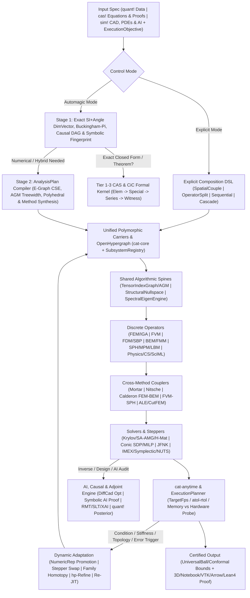

---

## 2. Grounded Audit of Existing URAE Numerical, CAD, Multiphysics & AI Modules

Every existing module verified in the workspace contributes building blocks—and carries concrete audited limitations (cross-referenced against [CODEBASE_AUDIT_AND_REMEDIATION_PLAN.md](../audits/CODEBASE_AUDIT_AND_REMEDIATION_PLAN.md)) that this architecture plan resolves systematically:

| Workspace Module | Verified Current Capabilities | Audited Gaps & Architectural Remediation Targets |
| :--- | :--- | :--- |
| [cad/mod.rs](../../crates/algebra-engine/src/cad/mod.rs), [cad/bvh.rs](../../crates/algebra-engine/src/cad/bvh.rs) | `CadCell`, `CadEngine`, `GeometricConstraintSolver`, `Mesh3D`, `BvhTree`, `Ray3D` ($O(\log N)$ ray casting & parity). | **Audit C3 (status at v0.6.0):** exact McCallum projection (leading coefficients, discriminants, resultants) with Sturm root isolation is shipped for one, two and three variables and four or more are rejected; `GeometricConstraintSolver` enforces every 2-D constraint kind, 3-D and N-D points, lines and planes in space. Still to do: Collins/Lazard for four or more variables and for input that is not well oriented, VAS isolation, B-Rep/SDF/Differentiable CAD. |
| [cad/engineering.rs](../../crates/algebra-engine/src/cad/engineering.rs) | `InvoluteGear::{spur, helical}`, `ThreadedScrew`, `NacaAirfoil`, `HelicalSpring`, stepped shafts. | **Audit C4 (status at v0.6.0):** bored gears, cycloidal gears, internal gears, profile shift and true involutes are shipped (closed, oriented solids); airfoils, springs and screws are closed solids and meshed for FEA as tetrahedra. Still to do: undercut relief and non-circular gears from [GEAR_PROFILE_CURVES.md](GEAR_PROFILE_CURVES.md), Litvin envelopes. |
| [iga.rs](../../crates/algebra-engine/src/iga.rs) | `CoxDeBoor` B-spline basis/derivatives, `NurbsPatchND`, `IgaStiffnessMatrix`, `MultiPatchBRep`. | **Audit C1**: `integrate_stiffness_entry_2d` uses placeholder weights (`1.0`/`0.1`) instead of physical Jacobian inverse $\mathbf{J}^{-T}\nabla_\xi R_{i,j}$ over Gauss-Legendre knot spans. Must add Bézier extraction, $k$-refinement, and mortar/Nitsche multi-patch coupling. |
| [pde/fea.rs](../../crates/algebra-engine/src/pde/fea.rs), [pipeline.rs](../../crates/algebra-engine/src/pipeline.rs) | `FeaMesh` (`Line2`, `Tri3`, `Tri6`, `Quad4`, `Tet4`, `Hex8`, `SimplexND`), `FeaEngine`, `CadFeaBridge`, `SimulationPipeline`. | **Audit C10 (status at v0.6.0):** sparse CSR assembly with Jacobi-preconditioned conjugate gradients, exact Dirichlet elimination, reaction forces, full 3-D von Mises, `Tet4`/`Tet10`/`Hex8`/`Quad4`/`Tri6` elements and volumetric tetrahedral meshes of gears, wings, springs and screws are shipped. Still to do: Cholesky, GMRES and SA-AMG, hyperelastic tensors, boundary-conforming volume meshing of arbitrary CAD. |
| [pde/numerical.rs](../../crates/algebra-engine/src/pde/numerical.rs) | `NumericalPdeSolver` (1D MOL, explicit FTCS, Crank-Nicolson, 1D linear FEM). | Lacks ND structured/curvilinear FDM, Summation-By-Parts (SBP), RBF-FD, FVM, BEM, SPH, MPM, LBM, CFD, and composable operator traits. |
| [ode/numerical.rs](../../crates/algebra-engine/src/ode/numerical.rs), [symplectic.rs](../../crates/algebra-engine/src/symplectic.rs) | `NumericalOdeSolver` (`Auto`, `Rk4`, `DormandPrince54`, `Tsitouras54`, `RadauIIA5`, `GaussLegendre4`, `VelocityVerlet`, `SelfOptimizingMeta`), `ButcherTableau`, `HamiltonianSystemND` (Verlet, Ruth3, Yoshida4). | Extend with IMEX-RK, exponential integrators (`ETD-RK4`, Krylov $\varphi_k$), `BDF1–6`, Rosenbrock-Wanner, Lie-group `RKMK` (`Se3Rotor`), and GENERIC discrete-gradient integrators. |
| [autodiff.rs](../../crates/algebra-engine/src/autodiff.rs), [pinn.rs](../../crates/algebra-engine/src/pinn.rs), [neural_ode.rs](../../crates/algebra-engine/src/neural_ode.rs), [geometric_dl.rs](../../crates/algebra-engine/src/geometric_dl.rs) | `Dual`, `HyperDual`, tape-free VJP, `PinnResidual` (Burgers, 2D Heat, 2D Poisson), `NeuralOde`, `AdjointSensitivitySolver`, `SphericalHarmonics`, `ClebschGordan`, `SteerableConvLayer`, `CliffordLayer`. | **Audit C6**: `AdjointSensitivitySolver::compute_gradient` ignores `_vector_field`, stores $O(T)$ forward states, and uses 1st-order Euler backward steps. Add checkpointed reverse ODE adjoints, arbitrary symbolic PDE compilation in `PinnResidual`, `FNO`, `DeepONet`, `MeshGraphNet`, `pHNN`/`GENERIC`/Solenoidal layers, `LTC`/`CfC`, and full AI analysis (`ai_analysis`). |
| [sparse.rs](../../crates/algebra-engine/src/sparse.rs), [analysis.rs](../../crates/algebra-engine/src/analysis.rs), [tda.rs](../../crates/algebra-engine/src/tda.rs) | Symbolic `CsrMatrix`, `FunctionAnalyzer` (zero multiplicity, Hessian spectral inertia), `VietorisRipsFiltration`, `PersistenceDiagram`, `DiscreteHodge`. | Add numerical `CsrMatrix<f64>` / `BlockCsrMatrix` / `HMatrix`, matrix-free Lanczos/SLQ spectral analyzers, and wire `tda.rs` + `analysis.rs` into both DWR mesh adaptivity and AI representation/loss-landscape analysis. |
| [smt.rs](../../crates/algebra-engine/src/smt.rs), [tropical.rs](../../crates/algebra-engine/src/tropical.rs), [mcts.rs](../../crates/algebra-engine/src/mcts.rs), [proof.rs](../../crates/algebra-advanced/src/proof.rs) | `SmtProblem` (`QF_NRA`, `QF_LRA`, `QF_BV`, `QF_NIA`), `MaxPlus`/`MinPlus`/LSE tropical semirings, `MctsNode`, `ProofTrace`. | **Audit A9 and C9 (status at v0.6.0):** Lean 4 and Coq proof export and Gröbner side-relation extraction are shipped, and the MCTS policy head has a trainable policy (`LearnedPolicy`, trained from the engine's own searches; no pretrained weights exist or are shipped). Still to do: connect tropical semirings, SMT, CAD and Gröbner/Ritt-Wu to AI network verification, SINDy distillation and parameter identifiability (see also B20 for the SMT bridge). |
| [cat-core](../../crates/cat-core/src/lib.rs), [cat-anytime](../../crates/cat-anytime/src/scheduler.rs), [cat-egraph](../../crates/cat-egraph/src/buckingham_pi.rs), [cat-tangent](../../crates/cat-tangent/src/lib.rs) | `OpenHypergraph`, `UniversalBall`, `DimVector`, `UncertaintyKind`, `MultiFidelityOp`, `FidelityStream`, `BuckinghamPi`, `WeilJet`, `GeneralizedDistribution`. | **Audit B9**: Fix geometric shrinking without re-evaluation in `AnytimeHandle::refine_step`; adopt `OpenHypergraph` + `MultiFidelityOp` + `BuckinghamPi` as the execution substrate for the Autonomous Meta-Orchestrator. |

### 2.1 Cross-Repository Gap Audit: `ai-designer` vs. `algebra-engine`

Inspection of sibling workspace [ai-designer](https://github.com/Spodeian/ai-designer/blob/dev/README.md) ([GLOSSARY_AND_NOTATION.md](https://github.com/Spodeian/ai-designer/blob/dev/docs/GLOSSARY_AND_NOTATION.md), [INDEX_BY_GOAL.md](https://github.com/Spodeian/ai-designer/blob/dev/docs/INDEX_BY_GOAL.md)) revealed rich ML/AI systems engineering features missing from `algebra-engine`—and inversely, exact symbolic/numerical primitives in `algebra-engine` that elevate `ai-designer` from analytical estimates/synthetic probes into mathematically rigorous engines:

| Feature Domain | Capabilities Present in `ai-designer` (Missing from `algebra-engine`) | Bidirectional Synergy & Integration Target in URAE |
| :--- | :--- | :--- |
| **55-Operator Catalog, 9 `TensorSpace`s & 59 Blueprints** | [operators.rs](https://github.com/Spodeian/ai-designer/blob/dev/crates/shared/src/spec/operators.rs), [io.rs](https://github.com/Spodeian/ai-designer/blob/dev/crates/shared/src/spec/io.rs), [graph.rs](https://github.com/Spodeian/ai-designer/blob/dev/crates/shared/src/spec/graph.rs): `KANLayer`, `DEQ`, `OptNetKKT`, `CBF_QP`, `InputConvexICNN`, `LISTA`, `ADMMNet`, `CRATE`, `MLA` + `DecoupledRoPE`, `MambaS6`/`Mamba2SSD`, `xLSTM`, `RWKV7DeltaRule`, `TitansMemory`/`TTT`, `CellularSheafConv`, `SimplicialHodgeConv`, `SphericalMeshGNN`, `PeriodicCrystalLattice`, `PairformerBlock`, `GaussianSplatting3D` + `PluckerRays`, `MultiresHashGrid`, `NextGenReservoir`, `SpikingLIF`, `PhotonicMZIMesh`, `SuperSmoothLipschitzLayer`, `LearnableQuantizerQAT`, `RevIN`/`Symlog`/`PLE`, `ContinuousRotation6D`. | Share `CoxDeBoor` ([iga.rs](../../crates/algebra-engine/src/iga.rs)) with `KANLayer`; solve `DEQ`/`OptNetKKT`/`CBF_QP` via URAE `JFNK`/`linprog`; unify `SimplicialHodgeConv`/`CellularSheafConv` with `tda.rs`/`FEEC`; bridge `GaussianSplatting3D`/`MultiresHashGrid` into `SdfField` & `Viewport3D`. |
| **27-Format Numeric & Precision Lattice** | [precision.rs](https://github.com/Spodeian/ai-designer/blob/dev/crates/shared/src/spec/precision.rs): `TF32`, `FP8` (`E4M3FN`/`E4M3FNUZ`/`E5M2`/`E5M2FNUZ`), `FP4E2M1`, `MXFP8`/`MXFP6`/`MXFP4`, `NF4`, `SF4`, `INT2`, `BitNet158b` ternary, `BinaryXnor`, `Posit(8/16)`, `LNS8`, `E8LatticeQTIP`, `ZKMLFiniteFieldFp`, `CKKSRingLWE`, `IBPCROWNIntervalBounds`. | Extend `algebra-core` quantization/interval tower to all 27 formats; connect `E8LatticeQTIP` to `E8Lattice` ([exceptional_lie.rs](../../crates/algebra-engine/src/exceptional_lie.rs)), `ZKMLFiniteFieldFp` to [finite.rs](../../crates/algebra-advanced/src/finite.rs), and `CKKSRingLWE` to `poly/`. |
| **RMT, SLT, Mechanistic Interp, XAI & Model Surgery** | [surgery/mod.rs](https://github.com/Spodeian/ai-designer/blob/dev/crates/shared/src/surgery/mod.rs), [abliteration.rs](https://github.com/Spodeian/ai-designer/blob/dev/crates/shared/src/surgery/abliteration.rs), [soups.rs](https://github.com/Spodeian/ai-designer/blob/dev/crates/shared/src/surgery/soups.rs), [grafting.rs](https://github.com/Spodeian/ai-designer/blob/dev/crates/shared/src/surgery/grafting.rs), [adapters.rs](https://github.com/Spodeian/ai-designer/blob/dev/crates/shared/src/surgery/adapters.rs), [mediator.rs](https://github.com/Spodeian/ai-designer/blob/dev/crates/shared/src/training/mediator.rs): `WeightWatcher` MP/power-law $\alpha$, Neural Collapse `ETF`, Singular Learning Theory `LLC`, `GrokkingPhase`, `SAE` (`Top-K`/`JumpReLU`), `Integrated Gradients`/`SHAP`/`TCAV`/`LiSSA`, `LEACE`/`CAA`/`ROME`/`MEMIT`, Model Soups (`SLERP`/`TIES`/`DARE`), `Frankenmerge`, `LoRA`/`DoRA`. | Add to `ai_analysis`: compute exact `Integrated Gradients` via URAE Gauss–Legendre quadrature, exact Hessian-vector `LiSSA` influence functions via `autodiff.rs`, and exact spectral/SVD surgery on real weights. |
| **Roofline, Pareto, `Muon` Optimizer & 6-Track Codegen** | [roofline.rs](https://github.com/Spodeian/ai-designer/blob/dev/crates/shared/src/analysis/roofline.rs), [pareto_search.rs](https://github.com/Spodeian/ai-designer/blob/dev/crates/shared/src/advisor/pareto_search.rs), [optimizer_partitioner.rs](https://github.com/Spodeian/ai-designer/blob/dev/crates/shared/src/analysis/optimizer_partitioner.rs), [training.rs](https://github.com/Spodeian/ai-designer/blob/dev/crates/shared/src/spec/training.rs), [diagnostics.rs](https://github.com/Spodeian/ai-designer/blob/dev/crates/shared/src/advisor/diagnostics.rs), [parity_verifier.rs](https://github.com/Spodeian/ai-designer/blob/dev/crates/shared/src/analysis/parity_verifier.rs), [bridge/src/lib.rs](https://github.com/Spodeian/ai-designer/blob/dev/crates/bridge/src/lib.rs), [universal.rs](https://github.com/Spodeian/ai-designer/blob/dev/crates/shared/src/format/universal.rs). | Generalize `Roofline` + 5-tier Utopia-Knee `Pareto` across both AI and PDE/CAD solvers; adopt `Muon2DGEMM`/`AdamW1D`/`ZeroWeightDecay` + `Sophia-G`/`Grokfast`/`AutoClip`; bridge `.aid`/`.aidpkg`, 55+ rule diagnostics, Seed-42 parity checks, and 6-track codegen (`PyTorch 2`, `JAX`, `Candle`, `WGSL`, `Triton`, `GGUF`) via `crates/urae-aid-bridge`. |

### 2.2 Comparative Industry & Engine Architecture Matrix (`ANSYS`, `COMSOL`, `SolidWorks`, `Blender/Houdini`, Fabric/`C-IPC` & `Unreal/Godot/MuJoCo`)
To combine maximum automation, speed, physical versatility, and mathematical rigor, URAE synthesizes architectural patterns from commercial CAE, procedural DCC tools, fabric/garment engines, real-time game physics, and robotics simulators—while eliminating their silos:

| Ecosystem / Engine | Core Data Representation | Setup & Meshing Automation | Solver & Contact Strengths | Known Blind Spots / Silos | Concrete URAE Adoption (`Part` / `Section`) |
| :--- | :--- | :--- | :--- | :--- | :--- |
| **ANSYS** *(Workbench, Mechanical, Fluent, SpaceClaim)* | Proprietary `Parasolid`/`SpaceClaim` B-Rep linked to associative mesh databases & `Fluent .cas.h5` | **Mosaic Poly-Hexcore** (conformal polyhedra bridging prism boundary layers to Cartesian hex cores); auto-$y^+$ inflation; Named Selections | Industrial coupled pressure-velocity `CFD`, cyclic symmetry, nonlinear contact & `System Coupling` (`FSI`) | Closed binary formats; hard CAD–mesh sync breaks on topology edits; slow cold startup; zero CAS/DWR symbolic proofs or multi-solution deflation | Adopt **Persistent Topological Naming**, **SpaceClaim virtual defeaturing**, **Mosaic Poly-Hexcore** + auto-$y^+$ prisms (`Sec 9.4`), and **System Coupling** hypergraphs (`Sec 4, 8`) |
| **COMSOL Multiphysics** | Unified geometric sequence DAG + weak-form equation expressions | **Virtual Geometry Operations** (compositing tiny/sliver faces without editing CAD); physics-controlled mesh sequences | Symbolic weak-form expressions; automatic global coupled block Jacobian assembly; **Port/Lumped boundaries** | Closed kernel; slow scalar assembly on GPU (`WGSL`); struggles on violent free-surface splashes (`SPH`/`VOF`) or $10^6$-particle granular/cloth contact | Adopt **COMSOL-style symbolic weak forms compiled to `BytecodeVM`/`WGSL`** (`Sec 3, 13`), **Virtual Composite Faces** (`Sec 9.4`), and automatic coupled multiphysics Jacobian graphs (`Sec 4.5`) |
| **SolidWorks** *(Parasolid, Simulation, Motion)* | Parametric feature-tree B-Rep + **Mate** assembly constraints | Automatic thin-shell midplane extraction; auto-fastener/bolt/pin connectors; Design Study tables | Clean **Mate-to-Joint (`URDF`/kinematic) lowering** (`ADAMS`/Motion); effortless CAD parametric sweeps | Mesh-tied linear-static bias; struggles with aero-acoustics, shocks, cloth, and topological shape changes without feature rebuild failures | Adopt **Mate-to-Joint kinematic synthesis**, **Parametric Design Tables**, `MAT` midplane shell reduction (`Sec 7.1`), and differentiable `DiffCad` sensitivities (`Sec 7.1–7.2`) |
| **Blender & Houdini** *(Geometry Nodes, Vellum, OpenVDB)* | Non-destructive procedural modifier/SOP DAG + **`OpenVDB`/`NanoVDB`** sparse tile grids + `USD`/`Alembic` | One-click `Remesh`/Voxel/QuadriFlow; procedural `Vellum` constraint generation (`Stretch`, `Bend`, `Stitch`, `Hair`, `Grains`) | Fast GPU-friendly **`XPBD` (`Vellum`)** unifying cloth, hair, granular grains & soft bodies; memory-lean sparse **`OpenVDB`** volumes | Heuristic penalty stiffness (not unit-verified); no `DWR`/`Prager–Synge` error control; no `BEM`/`FEM` continuum convergence; weak CAD `B-Rep` accuracy | Adopt **Procedural Modifier/Hypergraph DAG**, **Sparse `OpenVDB`/`NanoVDB` grids**, unified multi-material `XPBD` constraints (`Sec 6.12`), and **`OpenUSD`/`Alembic`/`VDB`** interchange (`Sec 7.3`) |
| **Fabric & Garment Simulators** *(Marvelous Designer, Clo3D, Projective Dynamics, C-IPC)* | **2D `DXF-AAMA` flat CAD patterns** + sewing seam topology linked bijectively to 3D draped triangle/quad meshes | Automatic dart/pleat triangulation; anisotropic warp/weft/bias orthotropic fabric library (`KES`/`FAST` measurements) | **Baraff–Witkin** semi-implicit cloth; **Projective Dynamics** (local–global constant Cholesky); **Discrete Shells**; **`C-IPC`** codimensional barrier guarantees zero tunneling | Disconnected from aerodynamic `CFD`/`FSI` (flag flutter), high-order `IGA` composites, and mechanical assemblies | Adopt **2D Pattern-to-3D Sewing + Discrete Shells**, **Projective Dynamics**, **Yarn-Level `Cosserat` homogenization**, and **Zero-Interpenetration `C-IPC` + `CCD`** (`Sec 6.12`) |
| **Game Engines** *(UE5 Chaos/Niagara/Nanite, Godot 4 Jolt/Rapier)* | Hierarchical Scene Graph + convex hulls / `SDF` proxy bounds + GPU particle buffers (`SoA`) | **Active Island Sleeping/Wakeup** graphs; broadphase BVH/SAP swept AABBs; **`Nanite`-style continuous LOD** scaling | $60\text{–}360\text{ Hz}$ deterministic frame budgets; **compliance-calibrated `XPBD`**; SIMD batch constraints; GPU compute particles (`Niagara`) | Visual plausibility only—huge energy/momentum drift, penetration tunneling at thin shells, and non-convergent under refinement | Adopt **Island Sleeping/Wakeup**, **`Nanite`-inspired Continuous Physics-LOD** (`Sec 9.4`), **Compliance-Calibrated `XPBD`** + `glTF`/`USDPhysics` interop (`Sec 6.12, 7.3`), and `60 Hz` default / `15 Hz` soft-floor tangent scrubbing (`Sec 20`) |
| **Robotics & Multibody Engines** *(MuJoCo, Drake, Project Chrono)* | Kinematic trees (`URDF`/`SDFormat`/`MJCF`) + **`FMI 3.0`** causal/acausal System Blocks | Symbolic **Pantelides DAE index reduction** (`Modelica`/`Drake`); smooth analytical convex contact margins (`MuJoCo`) | $O(N)$ **Featherstone Articulated Body Algorithm (`ABA`)**; exact analytical contact derivatives for RL/MPC | Weak continuum fluid/thermal/electromagnetic field coupling unless bridged externally | Adopt **$O(N)$ Featherstone `ABA`**, **Pantelides DAE Index Reduction** (`Sec 9.4`), analytical contact Jacobians (`Sec 6.12, 15`), and **`FMI 3.0` / `URDF` / `MJCF`** co-simulation (`Sec 7.3`) |

#### Continuous Constraint-Driven Fidelity Optimizer (`ExecutionObjective`, Replacing Fixed Rungs)
Rather than forcing users into 3 rigid coarse buckets ("game engine vs CAE"), URAE places all solvers on one **continuous resource-aware constraint optimizer (`ExecutionObjective`)** parameterized by optional latency (`TimeConstraint`), numerical accuracy (`AccuracyGoal`), and memory (`MemoryConstraint`) targets paired with `UserOverrides` and live local hardware capabilities (`CPU`/`SIMD`/`WGSL`/`WASM` RAM/Monitor Hz):

```rust
pub struct ExecutionObjective {
    pub time: TimeConstraint,         // None (batch/exact) | TargetFps { target_hz, min_hz } | MaxWallTime(Duration)
    pub accuracy: AccuracyGoal,       // Exact | Tolerance { atol, rtol, confidence } | MinRep(NumericRep) | BestEffort
    pub memory: MemoryConstraint,     // SoftLimitBytes | HardLimitBytes | StreamingPreferred
    pub overrides: SolverOverrides,   // Optional explicit method, NumericRep, step cap, or mesh resolution
}
```
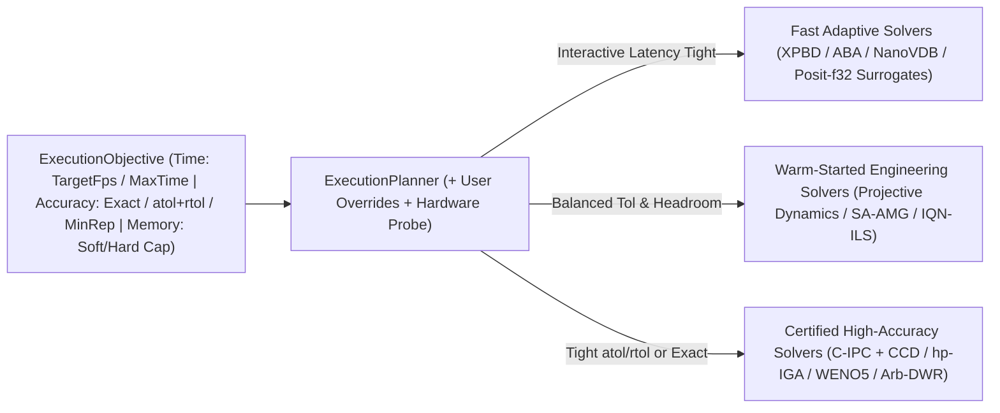
Every binary (`urae-notebook`, `urae-wasm`, `urae-cli`, `urae-kernel`, `urae-ffi`, `urae-py`, `urae-lsp`) exposes the exact same `ExecutionObjective` schema—differing only in sensible default objectives (`urae-notebook` GUI initializes `TargetFps` from live display Hz; `CLI`/`Server`/formal proofs initialize `TimeConstraint::None` + `AccuracyGoal::Exact` or strict `atol`/`rtol`). During slider drags, `ExecutionPlanner` automatically dials sub-iterations/LOD/`NumericRep` to meet the frame target without freezing, and smoothly refines to the full requested tolerance/accuracy as interaction pauses.

### 2.3 Cross-Repository Gap Audit: `Risky Business` vs. `algebra-engine` & Federated Spodeian Loop
Comparing the sister Rust repository [Risky Business](https://github.com/Spodeian/Risky-Business/blob/dev/README.md) ([Cargo.toml](https://github.com/Spodeian/Risky-Business/blob/dev/Cargo.toml), 6 workspace crates `shared`, `data`, `factors`, `ai`, `backtest`, `cli` powered by `spodeian-core` / `spodeian-lake` / `spodeian-stats` / `sml-runtime` and `candle-core` with `unsafe_code = "deny"`) against [algebra-engine](../../Cargo.toml) reveals **six concrete mathematical, statistical, discrete-event, AI-adaptation, and data-lake capabilities** present in `Risky Business` that are missing or only stubbed in URAE:

| Capability Domain | Present in `Risky Business` (Grounded Modules & Docs) | Current `algebra-engine` Gap & Generalization Opportunity |
| :--- | :--- | :--- |
| **1. Heavy-Tailed EVT, Copulas, Spectral Risk & Non-Parametric Densities** | [extreme_value_theory.md](https://github.com/Spodeian/Risky-Business/blob/dev/docs/quantitative/extreme_value_theory.md), [tail_risk.rs](https://github.com/Spodeian/Risky-Business/blob/dev/crates/factors/src/tail_risk.rs), [continuous_density.rs](https://github.com/Spodeian/Risky-Business/blob/dev/crates/factors/src/continuous_density.rs), [moments.rs](https://github.com/Spodeian/Risky-Business/blob/dev/crates/factors/src/moments.rs): GEV MLE (Nelder–Mead + observed Fisher Information SEs), POT Generalized Pareto (`GpdParams`) closed-form `VaR`/`CVaR`, Hill plot threshold estimator, bivariate tail-dependence copulas (`Gaussian`, `StudentT`, `Gumbel`, `Clayton`), coherent `RiskSpectrum` measures (`ExpectedShortfall`, exponential/power-law), `GaussianKde` (Silverman bandwidth + exponential temporal decay), `CRPS`/`KL` density reconciliation, 1st–4th central moments + kinematic velocity/acceleration. | [distributions.rs](../../crates/algebra-engine/src/distributions.rs) only has `EmpiricalDistributionMut` with dummy constant `pdf = 1/count`, `cdf = 0.5` (**Audit A7**), and URAE `UQ` (`Sec 5.7`) assumes Wiener–Askey thin tails. Generalize `EVT/GPD/Copula/Spectral Risk/KDE/CRPS` across engineering reliability (rare structural extremes, rogue waves, fat-tailed turbulence), sensor outliers, and quantitative risk (`Sec 5.11`). |
| **2. Rough Fractional Volatility, Jump-Diffusion, Adaptive Milstein & Higham PSD** | [stochastic_processes.md](https://github.com/Spodeian/Risky-Business/blob/dev/docs/quantitative/stochastic_processes.md), [fractional_brownian.rs](https://github.com/Spodeian/Risky-Business/blob/dev/crates/factors/src/fractional_brownian.rs), [jump_diffusion.rs](https://github.com/Spodeian/Risky-Business/blob/dev/crates/factors/src/jump_diffusion.rs), [ito_calculus.rs](https://github.com/Spodeian/Risky-Business/blob/dev/crates/factors/src/ito_calculus.rs), [monte_carlo.rs](https://github.com/Spodeian/Risky-Business/blob/dev/crates/backtest/src/monte_carlo.rs), [validation.rs](https://github.com/Spodeian/Risky-Business/blob/dev/crates/backtest/src/validation.rs): Rough Bergomi ($H \in (0,1)$), log-lag structure-function `HurstEstimator`, $O(1)$-per-tick `MarkovianOuSumApproximation` of singular Volterra kernel $K(u)=\sqrt{2H}u^{H-1/2}$, $O(N\log N)$ Volterra convolution, `MertonJumpDiffusionParams` + `JumpDiffusionAdaptiveStepper`, `AdaptiveMilsteinSolver` (strong 1.0), `FokkerPlanckSolver` conservative PDE ping-pong buffers, Barndorff–Nielsen–Shephard `RealizedQuadraticVariation` (Bipower Variation `BV` separating continuous diffusion vs jumps + Realized Quarticity `RQ`), exact AR(1) `OrnsteinUhlenbeckParams` calibration, Higham (2002) `nearest_psd_matrix`, and `SelfOptimizingMetaIntegrator` (`Heston`). | [stochastic.rs](../../crates/algebra-advanced/src/stochastic.rs) is purely symbolic Itô/Stratonovich conversion (**Audit B10** in `weil_ideal.rs`). Generalize $O(1)$ Markovian rough-memory kernels (also isomorphic to fractional viscoelasticity/damping!), adaptive Milstein/jump SDEs, `BV`/`RQ` shock-vs-diffusion decomposers, and Higham PSD projection for corrupted covariance matrices in `UQ`, `Kalman`, and `POD` (`Sec 5.11, 6.13`). |
| **3. Econometrics, Shrinkage Covariance, ADMM $L_1$-QP & Overfitting Firewalls** | [FACTOR_MODELS_REFERENCE.md](https://github.com/Spodeian/Risky-Business/blob/dev/docs/FACTOR_MODELS_REFERENCE.md), [econometrics.rs](https://github.com/Spodeian/Risky-Business/blob/dev/crates/factors/src/econometrics.rs), [convex_opt.rs](https://github.com/Spodeian/Risky-Business/blob/dev/crates/factors/src/convex_opt.rs), [comparison.rs](https://github.com/Spodeian/Risky-Business/blob/dev/crates/factors/src/comparison.rs), [sorts.rs](https://github.com/Spodeian/Risky-Business/blob/dev/crates/factors/src/sorts.rs), [validation.rs](https://github.com/Spodeian/Risky-Business/blob/dev/crates/backtest/src/validation.rs), [metrics.rs](https://github.com/Spodeian/Risky-Business/blob/dev/crates/backtest/src/metrics.rs), [fama_macbeth.rs](https://github.com/Spodeian/Risky-Business/blob/dev/crates/backtest/src/fama_macbeth.rs): `ols_newey_west_hac`, `adf_test_statistic`, `kpss_test_statistic`, `ljung_box_q`, `hurst_rs_exponent`, `ledoit_wolf_shrinkage`, `ADMM` Markowitz QP w/ exact $L_1$ + simplex + box (`optimize_portfolio`), `erc_risk_parity_weights`, López de Prado `hrp_inverse_variance_weights` dendrogram bisection, Rockafellar–Uryasev `cvar_min_risk_weights`, `whites_reality_check_pvalue`, `hansen_spa_pvalue`, `black_litterman_posterior`, `efficient_frontier_pareto`, `PointInTimeRecord` (`available_at <= as_of`), `purged_embargoed_kfold_splits`, `probabilistic_sharpe_ratio`, `deflated_sharpe_ratio`, `cscv_pbo`, and stationary block bootstrap CIs. | [linprog.rs](../../crates/algebra-engine/src/linprog.rs) only provides basic Simplex LP. Generalize `ADMM` $L_1$-regularized simplex/box QP (for sparse MPC, topology constraints & regression), `Ledoit–Wolf` covariance regularization, `HAC`/unit-root/bootstrap tests, and **`PurgedKFold` + `DSR`/`CSCV PBO` anti-leakage/overfit statistical certificates** across SciML & parameter sweep validation (`Sec 5.11, 12.7`). |
| **4. Discrete-Event `L3` Priority Queue (`LOB`), `ABM` & Execution Drag** | [agent_market_simulation.md](https://github.com/Spodeian/Risky-Business/blob/dev/docs/microstructure/agent_market_simulation.md), [lob.rs](https://github.com/Spodeian/Risky-Business/blob/dev/crates/data/src/lob.rs), [validation.rs](https://github.com/Spodeian/Risky-Business/blob/dev/crates/backtest/src/validation.rs): Price-time FIFO `LimitOrderBook` (`BTreeMap<i64, VecDeque<Order>>`, integer-tick exact matching, VWAP slippage), heterogeneous multi-agent economy (`Avellaneda–Stoikov` market maker, fundamental OU+jump trader, Hurst-gated trend follower, noise trader, online-RLS neural agent), endogenous flash-crash / ARCH clustering dynamics, and `AlmgrenChrissImpact` ($\eta \sqrt{\sigma} + \gamma$). | URAE (`Sec 6.11`) handles continuum/particle mechanics (`DEM`/`DSMC`/`PIC`), not **discrete-event integer-tick matching queues or socioeconomic Agent-Based Models (`ABM`)**. Generalizing the L3 matching queue + `ABM` carrier (`DiscreteQueueABM`) unlocks supply-chain/network queueing, traffic, and market microstructure co-simulation inside `OpenHypergraph` (`Sec 6.13`). |
| **5. `CrisisEngramBank`, Dual-Speed Online `RLS`, `TGN`, Quantile Heads & 4-Tier XAI** | [crisis_engram.rs](https://github.com/Spodeian/Risky-Business/blob/dev/crates/ai/src/crisis_engram.rs), [explainability.rs](https://github.com/Spodeian/Risky-Business/blob/dev/crates/ai/src/explainability.rs), [gnn_spillover.rs](https://github.com/Spodeian/Risky-Business/blob/dev/crates/ai/src/gnn_spillover.rs), [tgn_spillover.rs](https://github.com/Spodeian/Risky-Business/blob/dev/crates/ai/src/tgn_spillover.rs), [online_adapter.rs](https://github.com/Spodeian/Risky-Business/blob/dev/crates/ai/src/online_adapter.rs), [neural_alpha.rs](https://github.com/Spodeian/Risky-Business/blob/dev/crates/ai/src/neural_alpha.rs), [losses.rs](https://github.com/Spodeian/Risky-Business/blob/dev/crates/ai/src/losses.rs): `CrisisEngramBank` episodic cosine-matched memory + `SAM` test-time adaptation; `DualSpeedAdaptationManager` (slow `SAM` encoder + fast `OnlineRlsFilter`/`OnlineRlsFilter64` + `ExperienceReplayBuffer`); `MonotonicQuantileHead` + `ContinuousHorizonHead`; `TemporalSpilloverGraph` (`TgnNodeMemory`) + `SpilloverGraph`; and `MultiTierExplainer` (`Level0Off`, `Level1Inline`, `Level2Surrogate` whitebox OLS/$R^2$, `Level3DeepAsync` 8-pt Gauss–Legendre IG). | `Sec 10` & `Sec 12.6` cover static `GNNs` and slow offline `IG`/`SHAP`, lacking **episodic regime recall (`CrisisEngramBank`)**, **$O(d^2)$ online `RLS` readout adaptation without catastrophic forgetting**, **event-driven `TGN` temporal contagion**, **non-crossing `MonotonicQuantileHead`**, and **4-level frame-budgeted XAI (`XaiLevel 0–3`)** mapped to URAE's `60 Hz / 15 Hz` Rung-0 frame budget (`Sec 10.6, 12.6`). |
| **6. Federated Loop, Arrow/DuckDB WASM Lake, Anomaly-Pinned `CAS` & Curriculum Studio** | [federated_ecosystem_blueprint.md](https://github.com/Spodeian/Risky-Business/blob/dev/docs/microstructure/federated_ecosystem_blueprint.md), [arrow_duckdb.rs](https://github.com/Spodeian/Risky-Business/blob/dev/crates/data/src/arrow_duckdb.rs), [pipeline.rs](https://github.com/Spodeian/Risky-Business/blob/dev/crates/shared/src/pipeline.rs), [studio.rs](https://github.com/Spodeian/Risky-Business/blob/dev/crates/cli/src/studio.rs), [tearsheet.rs](https://github.com/Spodeian/Risky-Business/blob/dev/crates/backtest/src/tearsheet.rs), [backtesting_and_streaming_guide.md](https://github.com/Spodeian/Risky-Business/blob/dev/docs/quantitative/backtesting_and_streaming_guide.md): 4-repo closed feedback loop (`Risky Business` $\leftrightarrow$ `spodeian-lake` $\leftrightarrow$ `spodeian-ml` $\leftrightarrow$ `algebra-engine`); `ArrowColumnarBatch` `SoA` + client-side `DuckDbQueryBuilder` WASM SQL over Parquet; `SHA-256` `CAS` with anomaly-pinned LRU immunity; `UniverseRegistry` point-in-time constituent filter; compressed BSON/HTML Chart.js `TelemetryDashboard`; and interactive `StudioSessionState` (`CurriculumPhase` progression). | `Sec 7.3` & `Sec 20` integrate `ai-designer` (`urae-aid-bridge`), but omit the **documented `algebra-engine <-> spodeian-ml <-> spodeian-lake <-> Risky Business` federated closed loop**, **WASM DuckDB Parquet SQL inspection**, **anomaly-pinned `CAS` eviction**, and **`CurriculumPhase` automated staging** (`Cache Replay -> SDE Shocks -> Continuous TGN Ticks`) (`Sec 7.3, 16.6, 20.6`). |

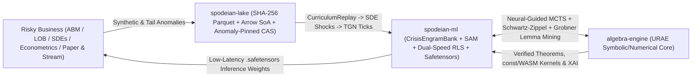

### 2.4 Cross-Workspace Gap Audit: `spodeian-core`, `RainAI`, `Revisited IPIP-NEO` & `ai-tests` vs. `algebra-engine` (+ Audits `A12–C17`)
Evaluating the remaining workspace repositories in `c:\Users\Liam\Code` alongside a second deep source audit of `algebra-engine` exposes **both sister-repo mathematical/domain primitives missing from URAE** and **15 additional symbolic/theorem defects (`A12–A16`, `B13–B20`, `C16–C17`)** detailed in [CODEBASE_AUDIT_AND_REMEDIATION_PLAN.md](../audits/CODEBASE_AUDIT_AND_REMEDIATION_PLAN.md):

| Source / Audit Scope | Grounded Files & Capabilities Inspected | Missing from / Defective in `algebra-engine` & Architectural Integration |
| :--- | :--- | :--- |
| **`spodeian-core`** *(Discrete Umbral, `LNS`, Uncertainty-Gated Flows, Forecasting & Tiered Provenance)* | [umbral.rs](https://github.com/Spodeian/spodeian-core/blob/dev/crates/sml-runtime/src/umbral.rs) (Rota–Roman umbral calculus $D \leftrightarrow \frac{1}{h}\ln(I+h\Delta_h)$, falling factorials $(x)_{n,h}$, Newton–Gregory series, `RationalResidue` integer sub-lattice carries eliminating `f32` master shadow weights), [logarithmic.rs](https://github.com/Spodeian/spodeian-core/blob/dev/crates/sml-runtime/src/logarithmic.rs) (`Log8`, `Log16`, `Log32` LNS scalars + WGSL kernels), [solvers.rs](https://github.com/Spodeian/spodeian-core/blob/dev/crates/sml-runtime/src/solvers.rs) & [integrator.rs](https://github.com/Spodeian/spodeian-core/blob/dev/crates/sml-runtime/src/integrator.rs) & [trajectory.rs](https://github.com/Spodeian/spodeian-core/blob/dev/crates/sml-runtime/src/trajectory.rs) (`InputErrorEstimate`, online directional Lipschitz estimation, `InformationRateGatingPolicy`, `DenseHermiteTrajectory`), [spodeian-forecast](https://github.com/Spodeian/spodeian-core/blob/dev/crates/spodeian-forecast/src/lib.rs) (`Garch11` QML fitting, `holt_linear_forecast`, `KalmanFilter1D`, `conformal_prediction_interval`, `pinball_loss`), [spodeian-stats](https://github.com/Spodeian/spodeian-core/blob/dev/crates/spodeian-stats/src/lib.rs) & [pareto.rs](https://github.com/Spodeian/spodeian-core/blob/dev/crates/spodeian-stats/src/pareto.rs) (`engle_granger_cointegration`, Acklam `normal_ppf`, `hypervolume_2d`), [preferential_store.rs](https://github.com/Spodeian/spodeian-core/blob/dev/crates/spodeian-cache/src/preferential_store.rs) & [tiered_memory.rs](https://github.com/Spodeian/spodeian-core/blob/dev/crates/spodeian-cache/src/tiered_memory.rs), and [spodeian-provenance](https://github.com/Spodeian/spodeian-core/blob/dev/crates/spodeian-provenance/src/lib.rs) & [citation.rs](https://github.com/Spodeian/spodeian-core/blob/dev/crates/sml-lake/src/citation.rs). | `algebra-engine` lacks **Rota–Roman discrete umbral calculus & `RationalResidue` sub-lattice accumulators** (`Sec 24.4`), **16/32-bit Logarithmic Number System (`LNS`) kernels** (`Sec 25.1`), **`InputErrorEstimate` noise-propagating adaptive ODE/flow steppers** with `InformationRateGatingPolicy`, **`Garch11` QML + conformal intervals + Engle–Granger cointegration** (`Sec 5.11`), and cryptographic citation/preferential tiered caching (`Sec 16.6`). |
| **`RainAI`** *(Physical Acoustics, `HOA` Ambisonics, `SOFA HRTF` & Wave Ray-Tracing)* | [physical.rs](https://github.com/Spodeian/RainAI/blob/dev/crates/audio/src/physical.rs) (Gunn–Kinzer terminal fall velocity, Ulbrich Gamma drop-size distributions, Minnaert bubble acoustics, modal surface resonance), [hoa.rs](https://github.com/Spodeian/RainAI/blob/dev/crates/audio/src/hoa.rs) (`Hoa3Frame` 16-channel 3rd-order `ACN`/`SN3D` spherical harmonics rotation & ITU 7.1.4 decoding), [hrtf_sofa.rs](https://github.com/Spodeian/RainAI/blob/dev/crates/audio/src/hrtf_sofa.rs) (`SOFA HRTF` binaural convolution), [ray_tracing.rs](https://github.com/Spodeian/RainAI/blob/dev/crates/audio/src/ray_tracing.rs) (3D specular/diffuse acoustic ray-tracing), [stft_loss.rs](https://github.com/Spodeian/RainAI/blob/dev/crates/utilities/src/stft_loss.rs) (multi-resolution `STFT` spectral convergence + log-magnitude + phase losses). | `algebra-engine` covers interior/exterior Helmholtz `BEM` (`Sec 6.5`), but omits **Higher-Order Ambisonics (`HOA`) spherical-harmonic field rotation**, **`SOFA HRTF` binaural transfer functions**, **geometric acoustic ray-tracing**, **Minnaert/modal aero-vibro-acoustics**, and **multi-resolution `STFT` spectral losses** (`Sec 25.3`). |
| **`Revisited IPIP-NEO`** *(Hierarchical Psychometrics & Latent Measurement)* | [questionnaire.rs](https://github.com/Spodeian/Revisited-IPIP-NEO/blob/dev/crates/shared/src/questionnaire.rs): 3-tier psychometric latent construct hierarchy (`Facet -> Trait -> MetaTrait`) over signed item weights, analytical scale standard error estimation, and Gaussian population norming. | `algebra-engine` lacks latent-variable **Psychometrics & Measurement Theory**: generalize into **1PL/2PL/3PL/Graded-Response Item Response Theory (`IRT`)**, reliability indices (**Cronbach's $\alpha$**, **McDonald's $\omega_t$**), **Exploratory/Confirmatory Factor Analysis (`EFA`/`CFA`)**, and **Computerized Adaptive Testing (`CAT`)** (`Sec 25.3`). |
| **`ai-tests`** *(Pathological Stiff Frontiers & Learned Step Controllers)* | [pathological_analytical_frontier.rs](https://github.com/Spodeian/ai-tests/blob/dev/09_benchmarks/src/bin/pathological_analytical_frontier.rs), [stiff_pathological.rs](https://github.com/Spodeian/ai-tests/blob/dev/09_benchmarks/src/bin/stiff_pathological.rs), [10_trained_integrators/src/lib.rs](https://github.com/Spodeian/ai-tests/blob/dev/10_trained_integrators/src/lib.rs): stiff chemical/oscillator analytical frontiers (Robertson, Van der Pol, Oregonator) and neural step-size controllers. | Fold directly into URAE's `stiff_ode` and `AutoOrchestrator` benchmark suites (`Sec 22.2`) pairing `RadauIIA5`/`BDF` with learned/analytical error gating (`Sec 25.1, 26`). |
| **Newly Uncovered `algebra-engine` Defects (`A12–A16`, `B13–B20`, `C16–C17`)** | [poly/mod.rs](../../crates/algebra-engine/src/poly/mod.rs), [morphism.rs](../../crates/algebra-advanced/src/morphism.rs), [topology.rs](../../crates/algebra-engine/src/topology.rs), [galois.rs](../../crates/algebra-advanced/src/galois.rs), [finite.rs](../../crates/algebra-advanced/src/finite.rs), [crypto.rs](../../crates/algebra-advanced/src/crypto.rs), [diophantine.rs](../../crates/algebra-engine/src/systems/diophantine.rs), [lyndon.rs](../../crates/cat-numbers/src/lyndon.rs), [surreal.rs](../../crates/algebra-advanced/src/surreal.rs), [colombeau.rs](../../crates/cat-tangent/src/colombeau.rs), [functor.rs](../../crates/cat-tangent/src/functor.rs), [elaborator.rs](../../crates/cat-lang/src/elaborator.rs), [smt.rs](../../crates/algebra-engine/src/smt.rs), [polynomial.rs](../../crates/algebra-engine/src/systems/polynomial.rs), [domain.rs](../../crates/algebra-core/src/domain.rs), [bridges.rs](../../crates/algebra-engine/src/simplify/bridges.rs). | **15 newly verified stubs and theorem violations** (`groebner_basis` no-op `A12`; unsound `EquivalenceClassifier` fallback `A13`; heuristic `betti_numbers` `A14`; missing Galois/$\mathbb{F}_{p^n}$ ops `A15`; missing EC group law/`SEA`/`RS` `A16`; non-divisibility SNF `B13`; `GrLex` labeled `Grevlex` `B14`; reversed Shirshov suffix order `B15`; broken transfinite `SurrealNo::leq` `B16`; wrong Colombeau $\delta^2/\Theta^2$ orders `B17`; disconnected `TangentFunctor` wildcard wires `B18`; missing `"^"` dimensions & complex `im` drop in `cat-lang` `B19`; `0.0`-mapped `Pi`/`E`/`BigRational` in `SmtExpr` `B20`; Shape-Lemma-only `PolynomialSystemSolver` `C16`; `Domain::Adeles` field mislabel + missing header identities in `bridges.rs` `C17`)—remediated across Waves 1–8 & `Part XIII` (`Secs 23–26`). |

---

# Part II — Unified Abstraction Layer: Composable Operators, Carriers & Coupling Algebra

## 3. Category-Theoretic & Operator-Algebraic Trait Hierarchy

To allow arbitrary user composition *and* dynamic behind-the-scenes orchestration across **FEA/FEM, IGA, FVM, FDM, BEM, SPH, MPM, LBM, Spectral, and SciML**, all methods implement a shared categorical-functional trait spine where **Domains**, **Carriers**, **Function Spaces**, **Operators**, **Couplings**, and **Steppers** are orthogonal, composable morphisms in `cat-core::OpenHypergraph`.

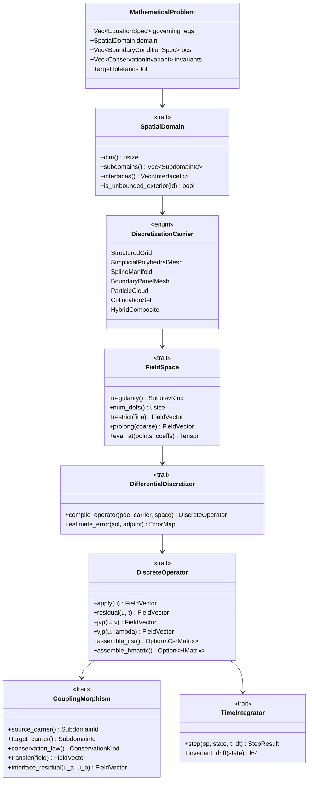

### 3.1 Core Rust Trait & Data Model Blueprint

```rust
/// Sobolev / Functional regularity classification of a discrete or neural field space.
#[derive(Debug, Clone, Copy, PartialEq, Eq, Hash)]
pub enum SobolevSpaceKind {
    /// Continuous piecewise smooth / NURBS / spectral: H^1(\Omega)
    H1Conforming { order: usize },
    /// Smoothness k >= 1 (Kirchhoff plates, Cahn-Hilliard, IGA C^{p-1}): H^2(\Omega)
    H2Conforming { continuity: usize },
    /// Tangential continuity (Maxwell electric/magnetic fields): H(curl; \Omega)
    HCurlNedelec { order: usize },
    /// Normal flux continuity (Darcy, mixed Poisson, compressible flux): H(div; \Omega)
    HDivRaviartThomas { order: usize },
    /// Broken discontinuous space (DG, FVM cell averages): L^2(\Omega)
    L2Broken { order: usize },
    /// Boundary trace spaces for BEM: H^{1/2}(\Gamma) or H^{-1/2}(\Gamma)
    BoundaryTrace { fractional_order_half_steps: i8 },
    /// Meshfree reproducing kernel / SPH particle space
    ReproducingKernel { kernel_order: usize },
    /// Neural / Reproducing Kernel Hilbert / Barron parametric space
    NeuralParametric { architecture_id: u64 },
}

/// Abstract spatial carrier unifying grids, meshes, NURBS patches, panels, and particles.
pub enum DiscretizationCarrier {
    StructuredGrid(StructuredGridND),
    PolyMesh(SimplicialPolyhedralMesh),
    SplineManifold(MultiPatchNurbs),
    BoundaryPanels(BoundaryPanelTree), // Surface panels + Octree/ClusterTree for FMM/H-matrices
    ParticleCloud(ParticleCloudND),    // Lagrangian SPH / MPM / RBF-FD particles + BVH/Hash
    CollocationSet(CollocationCloud),  // Gauss-Lobatto / Sobol / PINN collocation points
    Composite(Vec<(SubdomainId, Box<DiscretizationCarrier>)>),
}

/// Unified discrete operator contract: every method (FEM, IGA, FVM, FDM, BEM, SPH, SciML)
/// exposes matrix-free action, residual, exact JVP/VJP, and optional sparse/H-matrix assembly.
pub trait DiscreteOperator: Send + Sync {
    fn input_dofs(&self) -> usize;
    fn output_dofs(&self) -> usize;
    fn capabilities(&self) -> OperatorCapabilities;

    /// Evaluate residual R(u, t) = A(u, t) - b(t).
    fn residual(&self, u: &[f64], t: f64, out: &mut [f64]) -> AlgebraResult<()>;

    /// Matrix-free linear/linearized action y = A * x (or J(u) * v).
    fn apply(&self, x: &[f64], out: &mut [f64]) -> AlgebraResult<()>;

    /// Exact forward Jacobian-Vector Product (JVP): out = (dR/du) * v (via Dual/analytical).
    fn jvp(&self, u: &[f64], v: &[f64], t: f64, out: &mut [f64]) -> AlgebraResult<()>;

    /// Exact reverse Vector-Jacobian Product (VJP): out = (dR/du)^T * lambda (for adjoints).
    fn vjp(&self, u: &[f64], lambda: &[f64], t: f64, out: &mut [f64]) -> AlgebraResult<()>;

    /// Optional explicit CSR assembly (for direct sparse / AMG preconditioners).
    fn assemble_csr(&self, _u: Option<&[f64]>, _t: f64) -> Option<AlgebraResult<CsrMatrixF64>> {
        None
    }

    /// Optional Hierarchical H-Matrix assembly (for fast O(N log N) BEM / dense kernels).
    fn assemble_hmatrix(&self) -> Option<AlgebraResult<HMatrix>> {
        None
    }
}
```

### 3.2 Method-to-Abstraction Mapping

| Method | Native `DiscretizationCarrier` | Primary `SobolevSpaceKind` | Operator Storage / Evaluation Mode | Exact Discrete Conservation / Invariant |
| :--- | :--- | :--- | :--- | :--- |
| **FEM / FEA** | `PolyMesh` (`Tri`/`Quad`/`Tet`/`Hex`) | $H^1$, $H(\operatorname{curl})$, $H(\operatorname{div})$ | `CsrMatrixF64` or Matrix-Free sum-factorized | Variational energy orthogonality; mixed LBB $\nabla \cdot \mathbf{u}_h = 0$ |
| **DG-FEM** | `PolyMesh` | $L^2_{\text{broken}}$ | Block-diagonal mass + face flux CSR / Matrix-Free | Element-wise local mass/momentum conservation + entropy stability |
| **IGA** | `SplineManifold` (`NurbsPatchND`) | $H^1 / H^2$ ($C^{p-1}$ splines) | Bézier-extracted `CsrMatrixF64` or sum-factorized | Exact CAD boundary geometry; Kirchhoff-Love $C^1$ bending |
| **FVM** | `PolyMesh` or `StructuredGrid` | $L^2_{\text{broken}}$ (order 0 + MUSCL/WENO) | Face-loop flux accumulation / Matrix-Free + Jacobian | Strict integral conservation $\sum_f \mathbf{\Phi}_f A_f$; Rankine-Hugoniot shocks |
| **FDM / SBP** | `StructuredGrid` (Cartesian / MAC) | Pointwise nodal grid | Stencil matrix-free / banded CSR | Summation-By-Parts discrete energy stability; MAC $\nabla_h \cdot \mathbf{u} = 0$ |
| **RBF-FD** | `ParticleCloud` / `CollocationSet` | Local polynomial + PHS | Sparse stencil CSR ($k$-NN via `BvhTree`) | Exact polynomial reproduction up to degree $k$ |
| **BEM (FMM / $\mathcal{H}$)** | `BoundaryPanels` | $H^{1/2}(\Gamma) \times H^{-1/2}(\Gamma)$ | `HMatrix` (ACA) or Matrix-Free FMM multipole tree | Exact fundamental solution satisfaction in infinite exterior $\mathbb{R}^D \setminus \bar{\Omega}$ |
| **SPH** | `ParticleCloud` | `ReproducingKernel` ($C^2 / C^4$) | Spatial-hash / `BvhTree` symmetric pair loop | Exact Lagrangian mass ($m_p$), linear & angular momentum (with symmetric $\nabla W_{ij}$) |
| **MLS-MPM** | `ParticleCloud` + `StructuredGrid` | Particle-to-Grid quadratic/cubic B-spline | Hybrid P2G / G2P affine APIC transfer | Exact linear + angular momentum conservation; automatic self-contact |
| **LBM** | `StructuredGrid` ($D_2Q_9, D_3Q_{19}, D_3Q_{27}$) | Discrete velocity distribution $f_i(\mathbf{x}, t)$ | Stream-collide lattice kernel (GPU/SIMD ideal) | Exact mass & momentum collision invariants; Chapman-Enskog Navier-Stokes limit |
| **Spectral** | `CollocationSet` (Chebyshev / Fourier) | Global $C^\infty$ / periodic Sobolev | Fast FFT / Chebyshev DCT ($O(N \log N)$) | Exponential spectral convergence for smooth solutions |
| **SciML (`PINN`/`FNO`/`GNN`)** | `CollocationSet` / `StructuredGrid` / Graph | `NeuralParametric` | Autodiff / FFT spectral layers / `OpenHypergraph` | Hard algebraic constraints (HNN, pHNN, GENERIC, Solenoidal $\nabla \times \mathbf{A}_\theta$) |

### 3.3 Cross-Domain Carrier Generalization (`D1–D14`), Three Unified Kernels & Dynamic Runtime Morphing

Rather than duplicating linear algebra, eigensolvers, tensor contractions, or continuation logic separately across CAD, multiphysics, symbolic CAS, quantum physics, computer science, and `quant!` data analysis, URAE binds every trait above onto **polymorphic zero-silo carriers (`D1–D14`, detailed in `Section 27`)** split cleanly into **`ScalarRing`** (unboxed zero-context primitives) and **`ContextualAlgebra`** (`ExprId`/arena values executing over a **Rayon-compatible lock-free segmented `ExprGraph` slab**—wait-free `get()` reads with decoupled syntactic `ExprNode`s free of baked-in `Domain` duplication, thread-local scratch batching via sharded `intern_batch`, and `Ternary` `is_zero` pivoting — resolving **`Audit G2`/`J2`** and guarding against `u32::MAX` sentinel overflow **`Audit E4`**) and routes computation through **three shared algorithmic spines** with **live runtime adaptation**:

1. **Three Shared Algorithmic Spines (Write Once, Reuse Everywhere)**:
   - **`TensorIndexGraph` & `AGM` Contraction Engine (`Section 33, 37`)**: One hypergraph treewidth planner (`Tamaki` + Atserias–Grohe–Marx `GenericJoin`) serves Einstein/Ricci curvature contractions, quantum `DMRG`/`MPS`/`ZX`-calculus networks, Bayesian factor graphs, `E-Graph` Datalog rule matching, `DuckDB`/`Arrow` relational joins, and sparse nested-dissection ordering.
   - **`StructuralNullspace<R: Ring>` Exact Kernel (`Section 32`)**: Fraction-cleared Hermite/Smith Normal Form (`Kannan–Bachem`) and sparse rational nullspace solving power exact dimensional **`BuckinghamPi`** (`Audit D13`), chemical stoichiometry & Law of Mass Action equilibriums, **`Petri` Net P/T-invariants**, **`Pantelides` DAE index reduction**, Kirchhoff circuit/flux loops, and exact $\mathbb{Z}$-homology Betti/torsion (`Audit A14`/`B13`).
   - **`SpectralEigenEngine` (`FEAST`/Contour + `LOBPCG`/Lanczos/Arnoldi + `QZ`)**: One shift-and-invert / Krylov-Schur / contour-integral eigensolver backs structural FEM vibration modes, quantum `KS-DFT`/Bloch bands/`DVR` bound states, **`Ulam` Perron–Frobenius** invariant measures, **`Fiedler`/`Cheeger`** spectral graph cuts, **`Koopman`/`DMD`** dynamical modes, and AI Hessian/`eNTK`/`WeightWatcher` RMT spectra.
2. **Dynamic Runtime Morphing Protocols (Zero-Restart Self-Adaptation)**:
   - **`DynamicCarrierPromotion` (`Posit`/`LNS`/`f32` $\to$ `f64` $\to$ `DoubleDouble` $\to$ `Arb` $\to$ `Exact` Umbral/Rational)**: Precision scales dynamically with data representation (`NumericRep`) by monitoring local element/block condition numbers $\kappa_{\text{local}}$ and compensated `Dot2` defect norms at runtime; promotes ill-conditioned subdomains live without reallocating or halting well-conditioned regions.
   - **Mid-Trajectory Stepper & Formulation Hot-Swap (`ConservativeHandoff` & `IpcSafeEntryProjection`)**: Automatically transitions explicit $\leftrightarrow$ `IMEX-ARK` $\leftrightarrow$ `RadauIIA5`/`BDF` on stiffness growth, switches `DVR` $\leftrightarrow$ `WKBJ` near classical turning points, and transfers fields across `FVM` $\leftrightarrow$ `SPH` or `FEM` $\leftrightarrow$ `Peridynamics` via conservative `CouplingMorphism` handoffs (`ConservativeHandoff` dense Hermite/momentum projection, **`Audit G7`**) whenever breakup or fracture topology evolves. Transitions from compliant `XPBD`/`ProjectiveDynamics` interactive frames into `C-IPC` precision solves unconditionally invoke **`IpcSafeEntryProjection`** (minimum-norm `CCD` separation restoring $d \ge d_{\min} > 0$) before activating logarithmic barrier potentials so zero/negative gaps never trap with `NaN`/`+∞` (**`Audit G5`**).
   - **Continuous `FunctionFamilyLattice` Homotopy Annealing**: Sweeps sharpness $\beta \to \infty$ inside `ContinuationSolver` (`Sigmoid(βx)` $\to$ `Heaviside`, `LogSumExp(x; β)` $\to$ `max`, `p-Norm` $\to$ contact barrier) so Newton iterations stay globally convergent across nonsmooth physics, CAD constraints, and ReLU networks while updating Lipschitz & remainder bounds cleanly into `AssumptionsContext` / `UncertaintyKind` (`Audit G7`).
   - **Live `AnalysisPlan` Dynamic Re-JIT & Incremental DAG Invalidation**: Recompiles hot paths on the fly as `(TimeConstraint, AccuracyGoal, MemoryConstraint)` tradeoffs shift between interactive FPS budgets and `Arb`-certified tight tolerances (`Section 37`), invalidating only downstream `SHA-256` subgraph signatures touched by a user edit to `AssumptionsContext`, `DimVector`, or boundary conditions.

---

## 4. Cross-Method Transfer & Coupling Algebra (`CouplingMorphism`)

Combining heterogeneous methods requires mathematically sound **interface morphisms** so no mass, momentum, energy, or convergence order is lost across boundaries. Every interface in URAE selects from five canonical `CouplingMorphism` operators:

### 4.1 Non-Conforming Mesh & Spline Coupling (FEM $\leftrightarrow$ FEM, IGA $\leftrightarrow$ FEM, IGA $\leftrightarrow$ IGA)
- **Mortar Projection ($L^2$ Dual Lagrange Multipliers)**: Given traces $u_1|_{\Gamma}$ and $u_2|_{\Gamma}$ on mismatched discretizations, introduce dual multiplier space $M_h$ on the slave side and enforce weak continuity:
  $$
  \int_\Gamma \lambda_h \left(u_{1,h} - u_{2,h}\right) \mathrm{d}\Gamma = 0 \quad \forall \lambda_h \in M_h
  $$
  Biorthogonal dual basis functions yield a diagonal mortar mass matrix $\mathbf{D}$, allowing static condensation $\mathbf{u}_{\text{slave}} = \mathbf{D}^{-1}\mathbf{M}\,\mathbf{u}_{\text{master}}$ without extra saddle-point DOFs!
- **Symmetric Nitsche Weak Coupling**: Penalty-stabilized weak interface terms avoiding multipliers altogether:
  $$
  a_{\text{Nitsche}}(u, v) = -\int_\Gamma \langle \boldsymbol{\sigma}(u)\mathbf{n} \rangle \cdot \llbracket v \rrbracket \, \mathrm{d}\Gamma - \int_\Gamma \llbracket u \rrbracket \cdot \langle \boldsymbol{\sigma}(v)\mathbf{n} \rangle \, \mathrm{d}\Gamma + \sum_{F \subset \Gamma} \frac{\gamma p^2}{h_F} \int_F \llbracket u \rrbracket \cdot \llbracket v \rrbracket \, \mathrm{d}F
  $$
  Automatically extends to multi-patch NURBS (`MultiPatchBRep` in [iga.rs](../../crates/algebra-engine/src/iga.rs)) with $C^1$ bending continuity for thin shells.

### 4.2 Interior-to-Exterior Symmetric Coupling (FEM / FVM $\leftrightarrow$ BEM)
- **Costabel / Johnson-Nédélec Calderón Coupling**: Couples a bounded heterogeneous/nonlinear interior $\Omega_{\text{int}}$ (modeled by FEM, IGA, or FVM) to an unbounded linear exterior $\Omega_{\text{ext}} = \mathbb{R}^D \setminus \bar{\Omega}_{\text{int}}$ (modeled by FMM-BEM) across $\Gamma = \partial \Omega_{\text{int}}$ using the symmetric boundary integral block system:
  $$
  \begin{bmatrix} \mathbf{A}_{\text{FEM}} + \mathbf{M}_\Gamma^T \mathcal{W} \mathbf{M}_\Gamma & \mathbf{M}_\Gamma^T \left(\mathcal{K}' - \frac{1}{2}\mathbf{I}\right) \\ \left(\mathcal{K} - \frac{1}{2}\mathbf{I}\right)\mathbf{M}_\Gamma & -\mathcal{V} \end{bmatrix} \begin{bmatrix} \mathbf{u} \\ \mathbf{t}_\Gamma \end{bmatrix} = \begin{bmatrix} \mathbf{f} \\ \mathbf{0} \end{bmatrix}
  $$
  where $\mathcal{V}, \mathcal{K}, \mathcal{K}', \mathcal{W}$ are the single-layer, double-layer, adjoint double-layer, and hypersingular boundary integral operators. This preserves positive definiteness / symmetry and **eliminates artificial far-field box truncation and PML tuning** in acoustics, electromagnetics, and soil-structure elasticity.

### 4.3 Eulerian-to-Lagrangian & Continuum-to-Particle Coupling (FVM / FEM $\leftrightarrow$ SPH / MPM)
- **Conservative Kernel Interpolation & APIC Transfer**: Transfers conserved fields $\mathbf{U} = (\rho, \rho\mathbf{v}, \rho E)$ between Eulerian FVM/FEM cells $V_c$ and Lagrangian SPH/MPM particles $p$ via normalized Moving Least Squares (MLS) / Wendland $C^4$ kernels:
  $$
  \mathbf{U}_p = \sum_{c \in \mathcal{N}(p)} \mathbf{U}_c \, \psi_c(\mathbf{x}_p), \quad \mathbf{U}_c = \frac{1}{|V_c|} \sum_{p \in \mathcal{N}(c)} m_p \, \mathbf{u}_p \, \phi_p(\mathbf{x}_c) \quad \text{with} \quad \sum_c \psi_c(\mathbf{x}_p) = 1
  $$
  Using affine velocity gradient matrices $\mathbf{B}_p$ (APIC), both **linear momentum** and **angular momentum** are conserved exactly during grid-particle transfer.
- **Dynamic Hybrid FVM–SPH Domain Switching**: Smooth bulk flow runs on high-speed Eulerian FVM cells; a dimensionless regime indicator $\chi_{\text{breakup}} = \max(\text{We}_{\text{cell}} / \text{We}_{\text{crit}}, \, h_{\text{cell}} \|\nabla \alpha_{\text{VOF}}\| \cdot |\kappa|)$ detects ligament breakup, splashing, or fragmentation. Cells exceeding $\chi_{\text{breakup}} > 1$ spawn conservative Lagrangian SPH particles in an overlap buffer zone; particles re-entering coherent bulk fluid coalesce cleanly back into FVM volume fractions $\alpha_c$.

### 4.4 Fluid-Structure Interaction (FSI: IGA / FEA $\leftrightarrow$ CFD FVM / SPH)
- **Arbitrary Lagrangian-Eulerian (ALE)**: Harmonic or biharmonic pseudo-elastic mesh smoothing moves CFD grid vertices to match structural surface displacements $\mathbf{u}_s|_\Gamma$, incorporating grid velocity $\mathbf{v}_{\text{mesh}}$ into convective fluxes $(\mathbf{v} - \mathbf{v}_{\text{mesh}})$ while satisfying the Geometric Conservation Law (GCL).
- **CutFEM / Immersed Boundary Method (IBM)**: Fixed Cartesian/octree background CFD grids intersected by moving CAD/FEA/IGA boundaries $\Gamma(t)$ with ghost-penalty face stabilization $\gamma_g h^{2k-1} \int_{F_{\text{cut}}} \llbracket \partial_n^k \mathbf{u} \rrbracket \llbracket \partial_n^k \mathbf{v} \rrbracket \,\mathrm{d}F$—preventing ill-conditioning when cut cells have arbitrarily small volume fraction $|K \cap \Omega| \ll |K|$.
- **Added-Mass Stability Acceleration**: Partitioned Dirichlet-Neumann / Robin-Robin iterations use **IQN-ILS** (Interface Quasi-Newton with Inverse Least Squares) and **Aitken $\Delta^2$ dynamic relaxation** so lightweight structures in dense fluids (e.g., heart valves, hydrofoils) converge without divergence.

### 4.5 Monolithic vs. Partitioned Coupling Orchestration

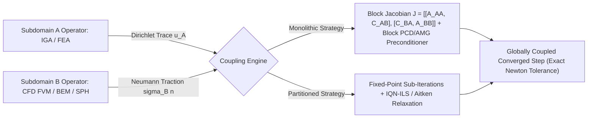

---

# Part III — Comprehensive Numerical Analysis & Continuum Discretization Zoo

## 5. Core Numerical Analysis Primitives, Linear/Nonlinear Solvers, Quadrature & Time Steppers

### 5.1 Linear Algebra, Preconditioning & Hierarchical Solvers (`crates/algebra-engine/src/solvers/`)
Replace dense $O(n^3)$ elimination in [pde/fea.rs](../../crates/algebra-engine/src/pde/fea.rs) (Audit C10) and unify linear/nonlinear solving across all physics modules:

1. **Direct Sparse Solvers**:
   - **Sparse Cholesky ($LL^T$ / $LDL^T$)** with Approximate Minimum Degree (AMD) / Nested Dissection fill-reducing permutation for SPD FEM/IGA stiffness and pressure Poisson systems.
   - **Sparse LU** with threshold partial pivoting for non-symmetric advection-diffusion and saddle-point systems.
2. **Krylov Subspace Methods** (operating strictly through `DiscreteOperator::apply`, supporting both CSR and matrix-free GPU/WGSL):
   - **PCG** (Preconditioned Conjugate Gradient) for SPD systems.
   - **MINRES** for symmetric indefinite saddle-point systems (mixed Stokes / Darcy / Mortar).
   - **GMRES($m$)**, **Flexible GMRES (FGMRES)** (essential when preconditioners vary nonlinearly per iteration, such as inner AMG/Krylov cycles), **BiCGSTAB**, and **IDR($s$)**.
3. **Multigrid, Domain Decomposition & $\mathcal{H}$-Matrices**:
   - **SA-AMG (Smoothed Aggregation Algebraic Multigrid)**: Unstructured strength-of-connection graphs, tentative prolongators preserving rigid-body/nullspace modes (translations + rotations in 3D elasticity!), Chebyshev / Gauss-Seidel smoothers—delivering $O(N)$ optimal scaling independent of mesh size.
   - **GMG / $p$-Multigrid**: Geometric coarsening across $p$-orders (`IGA` / high-order `FEM` / `DG`) down to a low-order `SA-AMG` coarse grid.
   - **Block Physics Preconditioners**: Schur-complement **PCD** (Pressure Convection-Diffusion) and **LSC** (Least-Squares Commutator) for incompressible Navier-Stokes; **Block-Jacobi / Schwarz (RAS)** domain decomposition for multi-physics coupling.
   - **Hierarchical Matrices ($\mathcal{H}$-Matrices with ACA+)**: Low-rank block compression $O(k N \log N)$ of dense integral operators (BEM, nonlocal fractional operators, kernel matrices) supporting $\mathcal{H}$-LU preconditioning.
4. **Nonlinear Solvers & Continuation**:
   - **Newton-Raphson** with backtracking Armijo/Wolfe line search and dogleg trust-region globalization.
   - **Jacobian-Free Newton-Krylov (JFNK)**: Solves $\mathbf{J}(\mathbf{u}_k) \delta\mathbf{u} = -\mathcal{R}(\mathbf{u}_k)$ via FGMRES using exact forward-mode `Dual` JVP ($\mathbf{J}(\mathbf{u})\mathbf{v} = \operatorname{eps}(\mathcal{R}(\mathbf{u} + \epsilon\mathbf{v}))$) with zero Jacobian storage.
   - **Anderson Acceleration (DIIS)** for fixed-point iterations (`SIMPLE`, `IISPH`, partitioned FSI).
   - **Pseudo-Arclength Continuation**: Tracks nonlinear equilibrium branches $(\mathbf{u}(s), \lambda(s))$ smoothly past snap-through / buckling limit points and detects Hopf/pitchfork bifurcations via bordered Newton systems.

### 5.2 Quadrature, Singular Integration & Spectral Approximation
- **Standard Rules**: Gauss-Legendre, Gauss-Lobatto-Legendre (GLL, enabling diagonal lumped mass matrices in spectral FEM), Clenshaw-Curtis, symmetric Dunavant/Grundmann-Möller simplex rules up to degree 20 in $\mathbb{R}^D$, and Smolyak sparse grids for high-dimensional parametric UQ.
- **Singular & Nearly-Singular BEM Quadrature**: Duffy variable transformation (collapsing singular triangle vertices to lines to cancel $1/r$ singularities), Telles polynomial coordinate stretching, **Sinh-Tanh** transformation for near-boundary evaluations, and analytical Hadamard finite-part / Cauchy principal value rules tied to `algebra_engine::distributions`.
- **Spectral & Pseudospectral Primitives**: Radix-2/3/5 FFT / Real-to-Complex FFT, Fast Chebyshev DCT-I/II differentiation matrices, and $2/3$-rule / Hou-Li spectral exponential filtering for alias-free nonlinear PDEs.

### 5.3 Unified Time-Stepping & Geometric Integration Engine
Expanding [ode/numerical.rs](../../crates/algebra-engine/src/ode/numerical.rs) and [symplectic.rs](../../crates/algebra-engine/src/symplectic.rs):

| Integrator Family | Specific Schemes | Order & Stability | Best-Fit Regime |
| :--- | :--- | :--- | :--- |
| **Explicit Adaptive RK** | `DormandPrince54`, `Tsitouras54`, `Vern7/8`, `SSPRK(3,3)`, `SSPRK(5,4)` | Order 3–8; Strong Stability Preserving (TVD) | Non-stiff ODEs, hyperbolic shock FVM/DG with limiters |
| **Implicit Stiff** | `RadauIIA5`, `BDF1–6`, `SDIRK3/4`, `Rosenbrock-Wanner` (`Rodas4/5`) | $A$-stable & $L$-stable; stiffly accurate | Chemical kinetics, implicit diffusion, parabolic heat, stiff CFD |
| **IMEX Additive RK** | `ARS(2,3,2)`, `ARK4(3)6L[2]SA`, `SBDF2/3` | Treats stiff linear diffusion implicitly, nonlinear advection explicitly | Convection-diffusion-reaction, Navier-Stokes, incompressible acoustics |
| **Exponential Integrators** | `ETD-RK4`, `ExpRosenbrock`, Krylov $\varphi_k(h\mathbf{L})\mathbf{v}$ | Integrates stiff linear part $\mathbf{L}\mathbf{u}$ *exactly* | Dispersive KdV/NLS, stiff reaction-diffusion, Maxwell/wave propagation |
| **Symplectic & Variational** | `Verlet`, `Yoshida4`, `GaussLegendre4/6`, Marsden-West Variational | Preserves $\omega = \mathrm{d}\mathbf{q}\wedge\mathrm{d}\mathbf{p}$, $O(h^{2k})$ bounded energy error | Orbital mechanics, molecular dynamics, HNN rollouts |
| **Lie-Group Integrators** | `RKMK` (Runge-Kutta-Munthe-Kaas), `Crouch-Grossman` on $SO(3), SE(3)$ | Exact manifold preservation ($\mathbf{R}^T\mathbf{R} = \mathbf{I}$) via `Se3Rotor` | Rigid-body dynamics, robotics (`urscript_pose.rs`), geometrically exact beams |
| **GENERIC Discrete Gradient** | Gonzalez / Itoh-Abe Discrete Gradient | Exact discrete $\Delta E = 0$ and $\Delta S \ge 0$ | Non-isothermal viscoelasticity, dissipative continuum mechanics |

### 5.4 Barycentric `AAA` Rational Approximation & Nonlinear Eigenvalue Problems (`NEP`)
- **Adaptive Antoulas–Anderson (`AAA`) Approximation**: Constructs near-minimax rational approximants $r(z) = \frac{\sum_{j=1}^m \frac{w_j f_j}{z - z_j}}{\sum_{j=1}^m \frac{w_j}{z - z_j}}$ in barycentric form via greedy support-point selection and minimal singular vectors of the Loewner matrix, eliminating Runge oscillations on complex geometries.
- **Analytic Continuation, Poles & Inverse Transforms**: Extracts poles, residues, and zeros from an $O(m^3)$ generalized companion eigenvalue problem; integrates with [branch.rs](../../crates/algebra-engine/src/branch.rs) for analytic continuation near branch cuts and with [transforms.rs](../../crates/algebra-engine/src/transforms.rs) for high-accuracy Talbot / AAA numerical inverse Laplace transforms.
- **Nonlinear Eigenvalue Solvers (`NEP`)**: Solves $\mathbf{T}(\lambda)\mathbf{v} = \mathbf{0}$ (e.g., frequency-dependent BEM acoustics, viscoelastic damping, delay differential equations, photonic waveguides) via **Beyn contour integration**, **AAA-rational Krylov linearization (`NLEIGS`)**, and block Jacobi–Davidson.

### 5.5 Model Order Reduction (`POD-Galerkin`, `LSPG`, `DMD`) & `DEIM`/`ECSW` Hyper-Reduction
- **Projection-Based ROMs**:
  - **POD–Galerkin**: Extracts dominant spatial modes $\mathbf{\Phi} \in \mathbb{R}^{N \times r}$ ($r \ll N$) via randomized SVD / snapshot correlation matrices.
  - **Least-Squares Petrov-Galerkin (`LSPG`)**: Minimizes discrete residual $\|\mathcal{R}(\mathbf{\Phi}\mathbf{q})\|_2$ directly over nonlinear manifolds, restoring stability for convection-dominated CFD where naive Galerkin projection destabilizes.
  - **Dynamic Mode Decomposition (`DMD` / Extended Koopman)**: Extracts coherent spatio-temporal growth rates, frequencies, and linear Koopman observables from unsteady trajectories without requiring governing PDE source code.
- **Structure-Preserving Hyper-Reduction (`Q-DEIM` & `ECSW`)**:
  - Naive nonlinear ROM evaluation still scales as $O(N)$ to assemble $\mathcal{R}(\mathbf{\Phi}\mathbf{q})$. **Q-DEIM** (QR-pivoted Discrete Empirical Interpolation) and **ECSW** (Energy-Conserving Sampling and Weighting) sample only $m \ll N$ "magic" mesh elements/cells with positive quadrature weights—achieving true $O(m)$ runtime ($500\text{–}2000\times$ speedup) while preserving symplectic/Lagrangian mechanical symmetry!

### 5.6 Tensor-Train (`TT` / `MPS`) & Hierarchical Tucker High-Dimensional Solvers
- Breaks the curse of dimensionality ($O(N^D) \to O(D N r^2)$) for PDEs in $D \ge 4$ dimensions (6D Vlasov-Boltzmann kinetic equations, high-dimensional Fokker-Planck, Schrödinger, Hamilton-Jacobi-Bellman optimal control, and multi-parameter UQ):
  $$
  \mathcal{U}(i_1, \dots, i_D) = \sum_{\alpha_1=1}^{r_1} \cdots \sum_{\alpha_{D-1}=1}^{r_{D-1}} \mathbf{G}_1(i_1, \alpha_1)\, \mathbf{G}_2(\alpha_1, i_2, \alpha_2) \cdots \mathbf{G}_D(\alpha_{D-1}, i_D)
  $$
- **Algorithms**: `TT-SVD`, `TT-Rounding`, black-box `TT-Cross` interpolation (requiring only sparse fiber evaluations), and **AMEn** (Alternating Minimal Energy) linear/eigenvalue solvers operating purely in compressed TT-core form.

### 5.7 Stochastic Methods & Uncertainty Quantification (`gPC`, `MLMC`, `QMC`)
- **Generalized Polynomial Chaos (`gPC`)**: Wiener–Askey orthogonal polynomial expansions (Hermite for Gaussian, Legendre for Uniform, Laguerre for Gamma, Jacobi for Beta) computed via both **intrusive Stochastic Galerkin** coupling and **non-intrusive Smolyak sparse-grid collocation**, exporting exact mean/variance/Sobol sensitivity indices into `cat_core::SpreadKind::PolynomialChaos`.
- **Multi-Level Monte Carlo (`MLMC`) & Quasi-Monte Carlo (`QMC`)**: Telescoping variance-reduced estimators across URAE's geometric mesh hierarchies ($h_0 > h_1 > \dots > h_L$):
  $$
  \mathbb{E}[Q_L] = \mathbb{E}[Q_0] + \sum_{\ell=1}^{L} \mathbb{E}\!\left[Q_\ell - Q_{\ell-1}\right]
  $$
  combined with Owen-scrambled Sobol low-discrepancy sequences (`QMC`) for $O(N^{-1 + \epsilon})$ convergence on smooth functionals.

### 5.8 Parallel-in-Time Integration (`Parareal`, `MGRIT`, `PFASST`)
- When spatial parallelism saturates on long transient CFD/structural runs, URAE decomposes the time axis $[t_0, t_F]$ into $P$ time-slices solved concurrently across CPU threads or GPU workgroups:
  $$
  \mathbf{U}_{n+1}^{(k+1)} = \mathcal{G}_{\Delta T}(\mathbf{U}_n^{(k+1)}) + \mathcal{F}_{\delta t}(\mathbf{U}_n^{(k)}) - \mathcal{G}_{\Delta T}(\mathbf{U}_n^{(k)})
  $$
- **ML-Accelerated Coarse Propagator $\mathcal{G}_{\Delta T}$**: Couples classical fine-grid integrators $\mathcal{F}_{\delta t}$ with ultra-fast `FNO`/`POD-ROM`/`LTC` Tier-0 coarse propagators (or **MGRIT** multigrid reduction in time / **PFASST** spectral deferred corrections) to achieve parallel speedups across time itself.

### 5.9 Universal Curve, Surface, Spline, Series & Resummation Expansion Engine (`ExpansionRepresentation`)
- Beyond scalar function evaluation, URAE unifies geometric curves/surfaces, local/singular series, rational/algebraic approximants, resummation, and global spectral bases behind a common `ExpansionRepresentation` conversion graph (with cost/accuracy certificates `ErrorCertificate` bridging to the Section 12 GUI conversion UX in [GUI_DESIGN_PLAN.md](GUI_DESIGN_PLAN.md)):

#### Group A — Piecewise Polynomial, Rational & Adaptive Local-Refinement Splines
1. **Bernstein–Bézier & Triangular Patches**: Exact de Casteljau evaluation, blossom polar forms, degree elevation/reduction, convex-hull bounding (`BVH` acceleration), and tensor/simplex Bézier extraction operators connecting directly to finite elements (`FEM`) and [iga.rs](../../crates/algebra-engine/src/iga.rs).
2. **`B-Spline` & `NURBS` Upgrade Path**: Upgrades `CoxDeBoor` and `NurbsPatchND` in [iga.rs](../../crates/algebra-engine/src/iga.rs) with Boehm knot insertion, Oslo refinement, degree elevation, exact rational hodographs $\mathbf{C}'(u), \mathbf{C}''(u)$, projective lifting $\mathbb{P}^3 \leftrightarrow \mathbb{R}^3$, and trimmed boundary loops.
3. **Adaptive Local-Refinement Splines (`AS-T-Splines`, `LR B-Splines`, `THB-Splines`, `PHT-Splines`)**: Eliminates global tensor-product DOF blowup during `IGA` adaptivity by supporting T-junctions without hanging-node cracks:
   - **`AS-T-Splines`** (Analysis-Suitable T-Splines with linear independence + partition of unity),
   - **`LR B-Splines`** (Locally Refined B-splines via mesh-segment splits),
   - **`THB-Splines`** (Truncated Hierarchical B-splines retaining non-negativity and sparse condition numbers), and
   - **`PHT-Splines`** ($C^1$ polynomial splines over hierarchical T-meshes with explicit geometric continuity).
4. **Interpolating, Shape-Preserving & Tension Splines**:
   - Parametric splines: Cubic/Quintic **Hermite**, centripetal **Catmull–Rom** ($\alpha = 0.5$, provably cusp- and loop-free), **Kochanek–Bartels** (`TCB`: tension, continuity, bias), and **$G^2$ $\beta$-splines** (bias/tension shape parameters);
   - Monotone/shape-preserving 1D splines: **PCHIP** (Fritsch–Carlson), **Akima**, and **Steffen** (strictly monotonic between knots without overshoot);
   - **Exponential / Tension Splines**: Basis $\operatorname{span}\{1, t, e^{\sigma t}, e^{-\sigma t}\}$ parameterized by tension $\sigma \ge 0$ ($\sigma \to 0$ recovers cubic splines; $\sigma \to \infty$ approaches linear polylines), suppressing Gibbs oscillations near shock fronts, boundary layers, and gear root fillets;
   - **Smoothing `P-Splines` & Polyharmonic `TPS`**: B-splines regularized by discrete $d$-th order difference penalties tuned via Generalized Cross-Validation (`GCV`), alongside **Thin-Plate Splines (`TPS`)** $\phi(r) = r^{2k}\ln r$ for scattered surface fitting.

#### Group B — Intrinsic Curvature, Arc-Length & Exact-Offset Curves
1. **Pythagorean-Hodograph (`PH`) Curves & Rotation-Minimizing Frames (`RMF`)**:
   - Encodes planar curves via complex polynomial preimage $\mathbf{r}'(t) = w(t)^2 \in \mathbb{C}[t]$ and spatial 3D curves via quaternion/Hopf preimage $\mathbf{r}'(t) = \mathcal{A}(t)\mathbf{i}\mathcal{A}^*(t) \in \mathbb{H}[t]$.
   - Guarantees $\|\mathbf{r}'(t)\| = \sigma(t)$ is an **exact polynomial** (never containing $\sqrt{\cdot}$), making arc length $s(t) = \int \sigma(t)\,\mathrm{d}t$ an exact polynomial, yielding **exact rational/`NURBS` offset curves** $\mathbf{r}_d(t) = \mathbf{r}(t) \pm d\,\mathbf{n}(t)$ (crucial for CNC cutter compensation, shell offsets, and gear tooth profile shifts), and producing twist-free Bishop `RMF` frames for swept tubes/ducts.
2. **Clothoids (Cornu Spirals), Biarcs & Polynomial Spirals ($\kappa(s)$ Expansions)**:
   - Evaluates intrinsic Cesàro equations $\kappa(s) = \sum_{k=0}^m c_k s^k$ (circular arcs/biarcs for $m=0$, Euler–Cornu clothoids $\kappa(s) = \kappa_0 + \kappa_1 s$ for $m=1$, $G^2$/$G^3$ polynomial spirals for $m \ge 2$) via high-precision Fresnel $C(u), S(u)$ and oscillatory Clenshaw–Curtis quadrature in [special.rs](../../crates/algebra-engine/src/special.rs).
3. **Nonlinear Elastica, Minimal-Energy Curves & Log-Aesthetic Curves (`LAC`)**:
   - Solves variational fairing problems for nonlinear Euler–Bernoulli **elastica** ($\min \int \kappa^2\,\mathrm{d}s$), minimum variation curves ($\min \int (\kappa')^2\,\mathrm{d}s$), and **Log-Aesthetic Curves (`LAC`)** where $\log \rho(s) = \alpha \log s + c$ produces monotone curvature combs for Class-A industrial styling and cam/vane profiles.
4. **Bidirectional Arc-Length Re-parameterization ($t \leftrightarrow s$)**: Exact `PH` polynomial reversion, guarded Newton–Halley + `Chebyshev` inverse spline $t(s)$, and arc-uniform quadrature generation for `IGA` and `BEM`.

#### Group C — Local, Singular, Fractional & Transseries Expansions *(remediating `Audit A6`, `B5`, `C12`)*
1. **Taylor, Maclaurin, Multivariate Jets & Guarded `Bürmann–Lagrange` Inversion**: Exact arbitrary-order jets via `cat_tangent::WeilJet` alongside [series.rs](../../crates/algebra-engine/src/series.rs), multivariate implicit series reversion, guarded `lagrange_inversion` (`c_1 != 0` check fixing `Audit B5`), and Laurent principal-part / residue extraction.
2. **Frobenius ODE Series (Regular Singular Points w/ Logarithmic Terms)**: Indicial-equation solver in [solver.rs](../../crates/algebra-engine/src/solver.rs) and [series.rs](../../crates/algebra-engine/src/series.rs) constructing $y(z) = \sum_{n=0}^\infty a_n z^{n+r_1} + C\,y_1(z)\ln(z)$ when $r_1 - r_2 \in \mathbb{Z}_{\ge 0}$, coupled to D-finite `HolonomicFunction` recurrences (`Audit C12`).
3. **Two-Point `Lidstone` Expansions**: Expands $f(t)$ on $[0, 1]$ solely from even endpoint derivatives $f^{(2k)}(0), f^{(2k)}(1)$ via Lidstone polynomials $\Lambda_k(t)$—tailored for clamped/pinned structural beam solutions.
4. **Newton–Polygon Algebraic `Puiseux` Series**: Replaces the placeholder stub in [series.rs](../../crates/algebra-engine/src/series.rs) (`Audit A6`) with an exact Newton-Polygon algorithm solving $F(x, y) = 0$ near branch points, cusps, and gear undercut roots in fractional powers $x^{p/q}$ over `BigRational` / algebraic field extensions.
5. **Écalle–Hardy `Transseries` ($\mathbb{T}$) & `WKBJ` / Matched Asymptotics**: Supports ordered transmonomials $\sum a_{\mathbf{k},n} e^{-\lambda \Phi(x)} x^{-\alpha_n}(\ln x)^{\beta}$ to capture beyond-all-orders exponential terms, turning-point Airy `WKBJ` connection formulas, and Prandtl/Van Dyke inner-outer **Matched Asymptotic Expansions (`MAE`)**.

#### Group D — Rational, Algebraic Padé, Continued Fractions & Divergent Resummation
1. **SVD-Regularized, Multipoint & Matrix Padé**: Replaces the stub in [macros.rs](../../crates/algebra-engine/src/macros.rs) with exact `BigRational` `[L/M]` Padé, Gonnet–Güttel–Trefethen **`SVD` Froissart-doublet filtering** in `f64` (removing noise-induced pole-zero pairs), **Multipoint Padé** (simultaneously matching multiple centers $z_k$ and $z \to \infty$), and **Matrix / Vector Padé** for coupled transfer matrices and multi-field PDE responses.
2. **Quadratic & Algebraic `Hermite–Padé` (Shafer / Padé–II)**: Solves $P_0(z) f(z)^2 + P_1(z) f(z) + P_2(z) = O(z^N)$ (and degree-$d$ algebraic/differential Hermite–Padé relations) to represent square-root and logarithmic **branch cuts** and multi-sheeted Riemann surfaces cleanly—avoiding the dense pole lines produced by single-valued rational Padé.
3. **Continued Fractions (`S`/`J`/`T`-Fractions & `Thiele` CF)**: Rutishauser quotient-difference (`QD`) / Viscovatov conversion from formal power series to analytic **Stieltjes** and **Jacobi $J$-fractions** (exposing orthogonal polynomial three-term recurrences and spectral measures), plus **Thiele** reciprocal-difference continued fractions for scattered data interpolation.
4. **Divergent Asymptotic Resummation & Sequence Extrapolators**:
   - **Borel–Padé & Borel–Conformal Summation**: Applies Borel transform $\mathcal{B}[f](\zeta) = \sum \frac{a_n}{\Gamma(n+\beta)}\zeta^n$, analytically continues via `Padé`/`AAA` or conformal disk map $\zeta \mapsto w(\zeta)$, and Laplace-integrates back along ray $\theta$—taming $n!$ factorial-divergent perturbation and WKB series;
   - **Nonlinear Sequence Accelerators**: **Wynn $\varepsilon$-algorithm**, **Shanks**, **Levin $u/t/v$**, **Weniger $\delta$**, and **Richardson / Euler–Maclaurin** extrapolation for accelerating slowly convergent eigenvalue, summation, and mesh-refinement sequences.

#### Group E — Global Spectral, Orthogonal, Minimax & Exponential Sums
1. **Orthogonal Polynomial & Unit-Disk Bases**: $O(N \log N)$ DCT/FFT evaluation, Clenshaw summation, spectral differentiation/integration matrices, and exact product linearization across **Chebyshev** ($T_k, U_k$), **Legendre** ($P_k$), **Gegenbauer** ($C_k^{(\lambda)}$), **Jacobi** ($P_k^{(\alpha,\beta)}$), **Laguerre** ($L_k^{(\alpha)}$), **Hermite** ($H_k$), and unit-disk **Zernike** ($Z_n^m(\rho,\theta)$) bases.
2. **`Remez` $L_\infty$ Minimax Exchange (Polynomial & Rational)**: Computes optimal equioscillating minimax polynomial $p_n^*$ and rational $p_m^*/q_k^*$ approximations on $[a,b]$, compiling directly to minimal-ULP kernels inside `BytecodeVM` and SIMD/GPU evaluators.
3. **Elliptic Fourier Descriptors (`EFD`) & Multi-Resolution Wavelets / Curvelets**: Kuhl–Giardina `EFD` harmonic expansions of closed 2D CAD loops (`GUI` shape cards, airfoils, gear tooth profiles) invariant to translation, rotation, and scale; plus semi-orthogonal **B-spline wavelets** and directional **Curvelets** for anisotropic shock/edge compression.
4. **Exponential Sum Fitting (`Prony`, Matrix Pencil & `ESPRIT`)**: Decomposes ringdown time series, viscoelastic relaxation kernels, and BEM delay Green's functions into damped complex exponentials $\sum_{k=1}^M c_k e^{s_k t}$ using SVD-stabilized Matrix Pencil / `ESPRIT` alongside frequency-domain `AAA` rational pole fitting.

#### Group F — `MetricSpec`-Coupled Function Expansion, Dirichlet & Umbral Series Dispatch
- Every expansion mechanism in Groups A–E plus **Dirichlet series** ($\sum_{n=1}^\infty a_n n^{-s}$), **Umbral / Newton–Gregory factorial series** ($\sum_{n=0}^\infty \frac{\Delta_h^n f(x_0)}{n!}(x-x_0)_{n,h}$), and **Stokes-aware Asymptotic / Transseries** dispatches cleanly through **`SeriesDispatchMatrix` (`Section 40`)**, automatically matching function singularity geometry (`Regular`, `Pole`, `BranchPoint`, `RegularSingular`, `IrregularInfinity`, `Piecewise`) and cross-cutting **`MetricSpec`** optimality ($L_\infty$ minimax $\to$ `Remez`/Chebyshev; $L^2_w$ $\to$ orthogonal Galerkin/Padé; $L_1$ $\to$ `FISTA`/LAD; $L_0$ $\to$ sparse `OMP`/`SINDy`/`PSLQ`).

### 5.10 Multi-Solution Discovery, Deflated Newton, Polyhedral Homotopy, Bifurcation Branch-Switching & Quality-Diversity Explorer
Real physics, nonlinear PDEs, inverse CAD problems, and optimization landscapes routinely possess *multiple* valid equilibria (post-buckling modes, bistable fluid jets, transonic non-uniqueness, multi-root kinematic mechanisms, and distinct Pareto-optimal geometries). Standard single-shot Newton–Raphson silently converges to whichever basin contains the initial guess, hiding alternative solutions. URAE provides a first-class **`MultiSolutionExplorer`** (`discover_solutions!`) that uncovers, classifies, and presents *all* distinct branches cleanly:

1. **Farrell–Beentjes–Birkisson (`FBB`) Deflated Newton for Nonlinear PDEs & Mechanics**:
   - Once solutions $\mathbf{u}_1^*, \dots, \mathbf{u}_k^*$ are found in Banach/Hilbert space $\mathcal{U}$, URAE constructs the shifted deflation operator $\mathcal{M}(\mathbf{u}; \mathbf{u}_1^*, \dots, \mathbf{u}_k^*) = \prod_{i=1}^k \left(\|\mathbf{u} - \mathbf{u}_i^*\|_{\mathcal{U}}^{-p} + \sigma_{\text{shift}}\right)$ and solves the deflated residual:
     $$
     \mathcal{G}(\mathbf{u}) = \mathcal{M}(\mathbf{u}; \{\mathbf{u}_i^*\})\,\mathcal{R}(\mathbf{u}) = \mathbf{0}
     $$
   - Uses **$O(N)$ Sherman–Morrison rank-1 Krylov updates** so the exact same linear solver/preconditioner (`SA-AMG` / `GMRES`) from $\mathcal{R}'(\mathbf{u})$ computes deflated Newton steps without destroying sparsity—driving restarts away from already-discovered branches until a systematic sweep finds remaining equilibria.
2. **Polyhedral Homotopy Continuation & `BKK` Mixed-Volume Root Finding**:
   - For multivariate polynomial, kinematic closure ($SE(3)$ linkage loops), and rationalized `ExprGraph` systems over [poly/grobner.rs](../../crates/algebra-engine/src/poly/grobner.rs), computes the Bernstein–Khovanskii–Kushnirenko (`BKK`) mixed volume (tight upper bound on isolated roots in $(\mathbb{C}^*)^n$), tracks all homotopy paths from generic start systems via adaptive predictor-corrector continuation with `Puiseux` / Cauchy endgames at singular roots, and filters real/physical branches with `Interval` certification.
3. **Certified Complete `Krawczyk` & Taylor-Model Branch-and-Bound**:
   - Recursively bisects bounded parameter boxes $\mathcal{B}_0 \subset \mathbb{R}^d$ via interval `Krawczyk` / Hansen–Sengupta operators and `cat-tangent` Taylor-Model bounds (`enclosure.rs`), pruning empty boxes ($\mathbf{0} \notin \mathcal{R}(\mathcal{B})$) and proving contraction ($\|\mathbf{I} - \mathbf{Y}\mathbf{J}(\mathcal{B})\|_\infty < 1$) on root-containing boxes—returning a mathematical **`CompletenessCertificate::AllSolutionsIsolated`** (zero missed roots).
4. **Automated Bifurcation Detection & Branch-Switching (`Pseudo-Arclength` + `Moore–Spence`)**:
   - Monitors signed determinant / smallest singular values and bordered `Moore–Spence` / `Lyapunov–Schmidt` test functions along continuation paths $\lambda \mapsto \mathbf{u}(\lambda)$ to pinpoint **Fold (Saddle-Node)**, **Pitchfork**, **Transcritical**, **Hopf** (spawning periodic limit-cycle shooting/harmonic-balance solvers), and **Period-Doubling** bifurcations—automatically computing nullspace tangent vectors $\boldsymbol{\phi}_0 \in \ker \mathcal{R}_{\mathbf{u}}$ to launch parallel workers onto all emerging daughter branches simultaneously.
5. **Riemann Conservation-Law Multi-Branch Selector**:
   - Distinguishes Lax / Oleinik / Liu entropy-admissible physical shocks from vanishing-viscosity capillarity weak solutions and non-classical phase-transition/undercompressive shock branches in multiphase FVM.
6. **Quality-Diversity (`MAP-Elites` & Stein Variational Gradient Descent `SVGD`) for Multi-Modal Inverse & CAD Design**:
   - For under-determined shape optimization and inverse design, replaces collapse-prone single-optimum gradient descent with (a) **`SVGD`** kernel-repelled particle ensembles discovering distinct modes simultaneously, and (b) **`MAP-Elites`** topological behavior descriptors (volume fraction, symmetry order, `TDA` Betti numbers $H_0, H_1$ from [tda.rs](../../crates/algebra-engine/src/tda.rs)) populating a clean design gallery of structurally distinct winners.
7. **Global Basin-of-Attraction & `FTLE` Separatrix Mapping**:
   - Evaluates Finite-Time Lyapunov Exponent (`FTLE`) ridges and generalized cell-to-cell mapping over phase space to chart basin boundaries and unstable saddle separatrices connecting multiple attractors.

### 5.11 Heavy-Tailed Extreme Value Theory (`EVT`), Tail-Dependence Copulas, Shrinkage Econometrics, Higham PSD & `ADMM` Constrained `QP`
Remediating `Audit A7` ([distributions.rs](../../crates/algebra-engine/src/distributions.rs)) and extending [linprog.rs](../../crates/algebra-engine/src/linprog.rs), while generalizing [tail_risk.rs](https://github.com/Spodeian/Risky-Business/blob/dev/crates/factors/src/tail_risk.rs), [continuous_density.rs](https://github.com/Spodeian/Risky-Business/blob/dev/crates/factors/src/continuous_density.rs), [econometrics.rs](https://github.com/Spodeian/Risky-Business/blob/dev/crates/factors/src/econometrics.rs), and [convex_opt.rs](https://github.com/Spodeian/Risky-Business/blob/dev/crates/factors/src/convex_opt.rs) across reliability engineering, rogue/fat-tailed physics, and quantitative risk:

1. **Generalized Extreme Value (`GEV`) & Peaks-Over-Threshold (`GPD`) Tail Analysis**:
   - **Block-Maxima `GEV` MLE + Observed Fisher SEs**: Fits $(\mu, \sigma, \xi)$ across block maxima via bounded Nelder–Mead + analytical/hyperdual log-likelihood Hessians, returning Fisher-information standard errors and exact `Catmull`/quantile extrapolations for structural wind/wave/load extremes and drawdowns.
   - **`POT` Generalized Pareto (`GpdParams`) & Hill Estimator**: Selects optimal tail threshold $u$ via automated **Hill-plot stability detection**, fitting $(\xi, \beta)$ for closed-form extreme quantile (`VaR`) and conditional tail expectation (`CVaR` / Expected Shortfall) bounds far beyond empirical sample support.
2. **Bivariate & Multivariate Tail-Dependence Copulas & Spectral Risk Measures**:
   - Models joint extremal cascades (multi-component failure correlation, turbulent burst synchronization, asset drawdowns) via **`Gaussian`**, **`Student-t`** (symmetric upper/lower tail dependence $\lambda_L = \lambda_U > 0$), **`Gumbel`** (upper tail dependence $\lambda_U = 2 - 2^{1/\theta}$), and **`Clayton`** (lower tail dependence $\lambda_L = 2^{-1/\theta}$) Archimedean/elliptical copulas calibrated via Kendall's $\tau$ inversion or Pseudo-MLE.
   - Unifies tail-weighted functionals under coherent **`RiskSpectrum` Spectral Risk Measures** (`ExpectedShortfall`, `ExponentialAversion`, `PowerLaw`) satisfying subadditivity and convexity for robust design optimization.
3. **Non-Parametric `GaussianKde`, Moments & Probabilistic Density Reconciliation (`Audit A7` Fix)**:
   - Replaces constant stub `pdf/cdf` in `distributions.rs` with adaptive **Silverman-rule `GaussianKde`** (supporting optional exponential recency decay), exact 1st–4th central moments plus kinematic velocity/acceleration derivatives ([moments.rs](https://github.com/Spodeian/Risky-Business/blob/dev/crates/factors/src/moments.rs)), and strict scoring rules—**Continuous Ranked Probability Score (`CRPS`)**, KL divergence, categorical cross-entropy, and cross-validation (`reconcile_rolling_density`) reconciling empirical histograms, weighted KDE, and PDE `FokkerPlanckSolver` densities.
4. **Higham (`2002`) Nearest PSD Matrix Projection & `Ledoit–Wolf` Shrinkage Covariance**:
   - **Higham Alternating Projections (`nearest_psd_matrix`)**: Projects corrupted, asynchronous, or noisy symmetric empirical covariance/correlation matrices onto the positive semidefinite cone ($\mathbf{\Sigma} \succeq \epsilon \mathbf{I}$) via alternating Frobenius projections onto symmetric PSD matrices and unit-diagonal correlation manifolds prior to Cholesky factorization—essential for `UQ`, `Kalman` filtering, `POD`, and correlated Monte Carlo sampling ([monte_carlo.rs](https://github.com/Spodeian/Risky-Business/blob/dev/crates/backtest/src/monte_carlo.rs)).
   - **Analytic `Ledoit–Wolf` Optimal Shrinkage**: Contracts high-dimensional ill-conditioned sample covariances toward structured equicorrelation/identity targets with optimal analytical MSE intensity $\delta^* \in [0, 1]$.
5. **General `ADMM` $L_1$-Penalized Simplex/Box `QP`, Risk Parity (`ERC`/`HRP`) & Bayesian `Black–Litterman`**:
   - **Constrained `ADMM` Quadratic Program (`ConvexOptConfig` / `optimize_portfolio`)**: Solves general strictly/semi-definite QPs $\min_{\mathbf{w}} \frac{1}{2}\mathbf{w}^T\mathbf{\Sigma}\mathbf{w} - \boldsymbol{\mu}^T\mathbf{w} + \lambda_1 \|\mathbf{w} - \mathbf{w}_0\|_1$ subject to budget simplex ($\sum w_i = 1$) and arbitrary per-coordinate box constraints ($\mathbf{l} \le \mathbf{w} \le \mathbf{u}$) via cached Cholesky KKT factorization and soft-thresholding proximal splits—reusable identically for sparse MPC, elastic-net regularization, structural load allocation, and portfolio construction.
   - **Minimum-CVaR, Equal Risk Contribution (`ERC`), & Hierarchical Risk Parity (`HRP`)**: Includes Rockafellar–Uryasev empirical `CVaR` simplex subgradient optimization (`cvar_min_risk_weights`), Newton/CCD Euler-decomposition Risk Parity (`erc_risk_parity_weights`), López de Prado dendrogram single-linkage clustering + recursive inverse-variance bisection (`hrp_inverse_variance_weights`, zero matrix inversion!), **`black_litterman_posterior`** Bayesian view fusion, and **Utopia-Knee 3-Objective Pareto (`efficient_frontier_pareto`)**.
6. **Time-Series Econometrics, False-Discovery & Out-of-Sample Statistical Certificates**:
   - **Structural Diagnostics & Inference**: **`ols_newey_west_hac`** (Bartlett kernel Heteroskedasticity- and Autocorrelation-Consistent covariance SEs), **`adf_test_statistic`** (unit root), **`kpss_test_statistic`** (trend stationarity), **`ljung_box_q`** (residual whiteness), **`hurst_rs_exponent`**, Fama–MacBeth two-stage cross-sectional regressions ([fama_macbeth.rs](https://github.com/Spodeian/Risky-Business/blob/dev/crates/backtest/src/fama_macbeth.rs)), `GRS` joint invariant tests, and AIC/BIC/residual-KL model selection ([comparison.rs](https://github.com/Spodeian/Risky-Business/blob/dev/crates/factors/src/comparison.rs)).
   - **Multiple-Testing & Stationarity Bootstraps**: Controls data-snooping across surrogate sweeps and model arenas using **`whites_reality_check_pvalue`**, studentized **`hansen_spa_pvalue`** (Superior Predictive Ability with sample recentering), and Politis–Romano **`stationary_block_bootstrap_ci`**.

---

## 6. Detailed Discretization Paradigms (`FEA/FEM`, `IGA`, `FDM`, `FVM`, `BEM`, `SPH`, `CFD`, `VEM/HDG`, `FEEC/DEC`, `Fracture/Peridynamics`, `DEM/VPM/DSMC/PIC`, Thin-Shell/Fabric `C-IPC` & `XPBD`/`Projective Dynamics`/`Featherstone`)

### 6.1 Finite Element Analysis (`FEA` / `FEM` / `DG` / `CutFEM`)
- **Isoparametric & Mixed Element Library**:
  - Scalar/Vector $H^1$: `Line2/3`, `Tri3/6/10`, `Quad4/8/9`, `Tet4/10`, `Hex8/20/27`, `Prism6/15`, and arbitrary-order `SimplexND(D, p)` / `HypercubeND(D, p)`.
  - Mixed & Electromagnetic Elements: Taylor-Hood ($P_k\text{–}P_{k-1}$), MINI, Crouzeix-Raviart, Raviart-Thomas $\mathbf{RT}_k$ ($H(\operatorname{div})$), Brezzi-Douglas-Marini $\mathbf{BDM}_k$, and Nédélec 1st/2nd-kind edge elements $\mathbf{ND}_k$ ($H(\operatorname{curl})$).
- **Nonlinear Finite-Strain Continuum Mechanics & Symbolic Constitutive Laws**:
  - Users write arbitrary hyperelastic strain energy densities $W(\mathbf{F})$ or $W(I_1, I_2, J)$ symbolically in `ExprGraph` (e.g., Neo-Hookean, Mooney-Rivlin, Ogden, Arruda-Boyce, anisotropic Holzapfel-Gasser-Ogden).
  - URAE computes the exact 1st Piola-Kirchhoff stress $\mathbf{P} = \frac{\partial W}{\partial \mathbf{F}}$ and 4th-order consistent material tangent $\mathbb{C}_{ijkl} = \frac{\partial^2 W}{\partial F_{ij}\partial F_{kl}}$ automatically via `HyperDual` / symbolic differentiation—eliminating manual tensor-calculus errors in nonlinear FEA!
  - Includes $J_2$ von Mises elastoplasticity (radial return mapping + consistent algorithmic tangent) and contact mechanics (penalty / augmented Lagrangian / mortar contact).
- **Discontinuous Galerkin (DG) & CutFEM**:
  - Nodal/Modal DG on arbitrary polyhedra with Lax-Friedrichs / HLLC inviscid fluxes and Bassi-Rebay 2 (BR2) / Symmetric Interior Penalty (SIPG) viscous fluxes.
  - **CutFEM / XFEM**: Unfitted background meshes cut by implicit CAD `SdfField` or B-Rep surfaces with ghost-penalty stabilization for crisp crack propagation and moving boundaries without remeshing.

### 6.2 Isogeometric Analysis (`IGA`)
Resolves Audit C1 ([iga.rs](../../crates/algebra-engine/src/iga.rs)) and elevates IGA into a production continuum solver:
- **Exact Physical Geometry & Pullbacks**: On each knot span $[\xi_i, \xi_{i+1}] \times [\eta_j, \eta_{j+1}] \times [\zeta_k, \zeta_{k+1}]$, evaluate rational NURBS basis $R_A(\boldsymbol{\xi})$ and parametric gradients, compute physical Jacobian $\mathbf{J} = \frac{\partial \mathbf{x}}{\partial \boldsymbol{\xi}}$, pullback spatial gradients $\nabla_{\mathbf{x}} R_A = \mathbf{J}^{-T} \nabla_{\boldsymbol{\xi}} R_A$, and integrate stiffness/mass matrices with $(p+1)^D$ Gauss-Legendre quadrature.
- **Bézier Extraction Operators**: Precompute sparse element-local extraction matrices $\mathbf{C}^e$ mapping NURBS basis to $C^0$ Bernstein polynomials—allowing standard parallel FEM assembly loops and WebGPU/SIMD vectorization directly on CAD geometry.
- **Hierarchy & $k$-Refinement**: Supports knot insertion ($h$-refinement), degree elevation ($p$-refinement), and **$k$-refinement** (degree elevation before knot insertion for maximum inter-element continuity $C^{p-1}$), plus **Trimmed NURBS** integration via quadrature over trimmed implicit/subdivision cells and **Kirchhoff-Love Thin Shells** exploiting natural $C^1$ NURBS continuity without rotational DOFs.

### 6.3 Finite Difference Method (`FDM`), `SBP-SAT`, and Meshless `RBF-FD`
- **Symbolic Arbitrary-Stencil Generator**: Given any partial derivative operator $\partial_x^a \partial_y^b \partial_z^c$ and arbitrary grid/scattered offsets $\{\Delta \mathbf{x}_j\}_{j=1}^m$, solve the symbolic/rational Vandermonde Taylor-series matching system (`series.rs`) to yield exact rational weights $w_j$ *and* the exact leading truncation error term (e.g., $\frac{h^4}{30} u^{(5)}$).
- **Staggered MAC Grids & Curvilinear Coordinates**: Marker-and-Cell staggered velocity/pressure placement eliminating checkerboard pressure modes in incompressible flows; algebraic/elliptic body-fitted grid transformations preserving metric conservation identities.
- **Summation-By-Parts + Simultaneous Approximation Terms (`SBP-SAT`)**: High-order finite difference operators satisfying discrete integration by parts ($\mathbf{P}\mathbf{D} + \mathbf{D}^T\mathbf{P} = \mathbf{B}$) with weak boundary penalty `SAT` terms guaranteeing strict discrete energy stability for wave, acoustic, and CFD problems.
- **Meshless `RBF-FD`**: Polyharmonic Splines ($\phi(r) = r^{2m+1}$) augmented with multivariate polynomials $P_k(\mathbf{x})$ over $k$-nearest neighbor `BvhTree` stencils on scattered point clouds—providing high-order PDE solving on arbitrary CAD point sets with zero mesh generation!

### 6.4 Finite Volume Method (`FVM`)
General cell-centered unstructured polyhedral and structured block FVM solving systems of conservation laws:
$$
\frac{\mathrm{d}}{\mathrm{d}t}\bar{\mathbf{U}}_i + \frac{1}{|V_i|} \sum_{f \in \partial V_i} \left[ \mathbf{\Phi}_{\text{conv}}(\mathbf{U}_f^-, \mathbf{U}_f^+, \mathbf{n}_f) - \mathbf{\Phi}_{\text{diff}}(\nabla \mathbf{U}_f, \mathbf{n}_f) \right] A_f = \bar{\mathbf{S}}_i
$$
- **Gradient & High-Order Reconstruction**: Least-squares and Green-Gauss cell gradients; 2nd-order **MUSCL** reconstruction with TVD slope limiters (`Minmod`, `VanLeer`, `Superbee`, `Venkatakrishnan`, `BarthJespersen`); and 5th-order **WENO5-JS / WENO5-Z** (and unstructured multi-dimensional WENO) for sharp shock resolution.
- **Riemann Flux Library**:
  - `Rusanov` (Local Lax-Friedrichs) for robust prototyping and arbitrary hyperbolic systems (automatically computing spectral radius $\max |\lambda(\mathbf{J}_F)|$ via symbolic/autodiff flux Jacobian!).
  - `Roe` with Harten-Hyman entropy fix.
  - `HLL` and `HLLC` (restoring contact discontinuity and shear waves for Euler / Navier-Stokes / Shallow Water / MHD).
  - `AUSM+-up` (all-speed Mach-uniform flux splitting for low-Mach-to-supersonic CFD).
- **Non-Orthogonal Skewness Corrections**: Over-relaxed minimum-correction decomposition $\mathbf{S}_f = \mathbf{E}_f + \mathbf{T}_f$ preserving 2nd-order accuracy on skewed/tetrahedral/polyhedral CAD meshes.

### 6.5 Boundary Element Method (`BEM` with $\mathcal{H}$-Matrices & `FMM`)
Reduces linear homogeneous boundary-value problems in $\mathbb{R}^D$ to boundary integral equations (BIE) on the $(D-1)$-dimensional CAD surface $\Gamma = \partial \Omega$, making exterior infinite-domain problems effortless:
$$
c(\mathbf{x}) u(\mathbf{x}) + \int_\Gamma T(\mathbf{x}, \mathbf{y}) u(\mathbf{y}) \,\mathrm{d}\Gamma_y = \int_\Gamma G(\mathbf{x}, \mathbf{y}) q(\mathbf{y}) \,\mathrm{d}\Gamma_y
$$
- **Symbolic Fundamental Solution (`GreensKernel`) Registry**:
  - 2D/3D **Laplace / Potential**: $G(\mathbf{r}) = -\frac{1}{2\pi}\ln r$ (2D), $\frac{1}{4\pi r}$ (3D).
  - 2D/3D **Helmholtz / Acoustics**: $G(\mathbf{r}) = \frac{i}{4} H_0^{(1)}(kr)$ (2D), $\frac{e^{ikr}}{4\pi r}$ (3D), using Burton-Miller combined-field integral equations ($\text{CBIE} = \text{BIE} + i\eta\,\text{HBIE}$) to eliminate fictitious interior resonance frequencies!
  - **Stokes Creeping Flow (Stokeslet / Stresslet)** & **Navier-Cauchy Linear Elastostatics (Kelvin fundamental tensor)**.
  - Custom user-supplied symbolic Green's functions via `ExprGraph` + `Dual`/`HyperDual` directional normal derivatives.
- **Singular Integral Evaluation**: Analytical constant/linear triangle formulas for close self-elements, Duffy coordinate transformations for weakly singular $O(1/r)$, Guiggiani-Gigante / `distributions.rs` regularization for Cauchy Principal Value ($\operatorname{p.v.} O(1/r^2)$) and Hadamard finite-part hypersingular ($\operatorname{f.p.} O(1/r^3)$) kernels.
- **Fast $O(N \log N)$ & $O(N)$ Acceleration**:
  - Spatial hierarchical cluster tree (`BvhTree` octree) classifying panel pairs into **admissible** (far-field, $\operatorname{diam}(X) + \operatorname{diam}(Y) \le \eta \operatorname{dist}(X, Y)$) vs. **inadmissible** (near-field dense).
  - **Adaptive Cross Approximation (ACA+)** compressing admissible blocks into low-rank $\mathbf{U}\mathbf{V}^T$ factors inside an `HMatrix` (reducing $O(N^2)$ memory/flops to $O(N \log N)$).
  - **Kernel-Independent Fast Multipole Method (KIFMM)** using Chebyshev/equivalent-density upward/M2L/downward passes for $O(N)$ matrix-free FGMRES matvecs over $10^6+$ surface panels.

### 6.6 Smoothed Particle Hydrodynamics (`SPH`) & Particle-Grid Methods (`MLS-MPM`, `LBM`)
- **SPH Kernel & Consistency Operators**:
  - Compact-support kernels $W(r, h)$ (`CubicSpline`, `QuinticSpline`, `WendlandC2`, `WendlandC4`, `WendlandC6`) with spatial hash grid + Morton Z-order sorting for cache-coherent neighbor loops ($> 10\text{M}$ particle pairs/s on CPU/SIMD, WebGPU WGSL compute for $10^6+$ particles).
  - **Kernel Gradient Correction (KGC)** $\mathbf{L}_i = \left(\sum_j \frac{m_j}{\rho_j} \nabla W_{ij} \otimes (\mathbf{x}_j - \mathbf{x}_i)\right)^{-1}$ restoring exact 1st-order linear consistency near free surfaces.
- **SPH Solver Variants**:
  - **`WCSPH` ($\delta$-SPH)**: Weakly compressible Tait equation of state $p = \frac{\rho_0 c_0^2}{\gamma}\left((\rho/\rho_0)^\gamma - 1\right)$ with diffusive density stabilization $\delta h c_0 \nabla^2 \rho$ eliminating spurious pressure checkerboarding.
  - **`IISPH` & `DFSPH`**: Implicit Incompressible & Divergence-Free SPH enforcing both $\nabla \cdot \mathbf{v} = 0$ and $\rho = \rho_0$ via matrix-free Jacobi/PCG pressure Poisson solves, permitting $5\text{–}10\times$ larger time steps.
  - Boundary treatment via Adami dummy particles and exact signed-distance CAD wall forces (`SdfField`).
- **`MLS-MPM` (Moving Least Squares Material Point Method)**: Quadratic/Cubic B-spline background grid coupled to Lagrangian material points carrying deformation gradient $\mathbf{F}_p$, supporting hyperelasticity, Drucker-Prager granular soils, von Mises plasticity, and multi-material fracture.
- **`LBM` (Lattice Boltzmann Method)**: `D2Q9`, `D3Q19`, `D3Q27` lattices with BGK and Multi-Relaxation-Time (MRT) / Cumulant collision operators, Bouzidi interpolated bounce-back curved CAD boundaries, and WGSL compute kernel generation for GPU execution.

### 6.7 Computational Fluid Dynamics (`CFD`) Multiphysics Suite
Brings `FVM`, `FEM/IGA`, `SPH`, and `LBM` under one unified fluid dynamics driver:
- **Incompressible Navier-Stokes**:
  - `SIMPLE` / `PIMPLE` / `PISO` segregated pressure-velocity solvers (FVM) with Rhie-Chow momentum interpolation.
  - Monolithic coupled $(\mathbf{v}, p)$ Newton-FGMRES with PCD/LSC block preconditioning (`FEM`/`IGA` Taylor-Hood $P_2\text{–}P_1$ or `SUPG`/`PSPG` stabilized $P_1\text{–}P_1$).
- **Compressible Euler & Navier-Stokes**: Density-based conserved variables $(\rho, \rho\mathbf{v}, \rho E)$ with `HLLC`/`AUSM+-up`, `MUSCL`/`WENO5`, Sutherland viscosity, and Ducros shock sensors.
- **Turbulence Closures**: Algebraic wall functions ($y^+$ adaptive), RANS ($k\text{–}\epsilon$, Spalart-Allmaras, $k\text{–}\omega$ SST), LES (Smagorinsky, Dynamic Germano, WALE), and Tensor-Basis Neural Network (`TBNN`) Galilean-invariant Reynolds stress anisotropy closures.
- **Multiphase & Free-Surface**: Geometric PLIC Volume-of-Fluid (VOF), Level-Set with WENO5 reinitialization, Cahn-Hilliard phase field, and coupled `FVM <-> SPH` droplet breakup/splashing.

### 6.8 Polyhedral & Static-Condensation Methods (`VEM`, `HHO`, `HDG`)
- **Virtual Element Method (`VEM`) & Hybrid High-Order (`HHO`)**: Solve PDEs directly on arbitrary convex or *non-convex* polyhedral meshes—including trimmed CAD CSG boolean cells and hanging-node octrees—without tetrahedralization! Shape functions remain virtual inside elements; elliptic and $L^2$ polynomial projections $\Pi^\nabla_k, \Pi^0_k$ are evaluated purely from element boundary moments and stabilization terms.
- **Hybridizable Discontinuous Galerkin (`HDG`)**: Introduces single-valued trace unknowns $\hat{u}_h$ on mesh faces $\mathcal{E}_h$, allowing exact parallel element-by-element Schur complement static condensation of all interior DOFs so the global sparse matrix scales with skeleton faces ($O(N p^{D-1})$) rather than volumes ($O(N p^D)$), while enabling superconvergent $O(h^{p+2})$ local post-processing.

### 6.9 Discrete Exterior Calculus (`DEC`) & Finite Element Exterior Calculus (`FEEC`)
- Implements the exact discrete de Rham cochain complex directly over `PolyMesh` and [cartan.rs](../../crates/algebra-engine/src/cartan.rs):
  $$
  0 \longrightarrow \Omega_h^0 \xrightarrow{\;\mathrm{d}_0\;} \Omega_h^1 \xrightarrow{\;\mathrm{d}_1\;} \Omega_h^2 \xrightarrow{\;\mathrm{d}_2\;} \Omega_h^3 \longrightarrow 0, \qquad \mathrm{d}_{k+1} \circ \mathrm{d}_k \equiv \mathbf{0}
  $$
- **Dual Complexes & Discrete Hodge Star**: Builds primal simplicial meshes alongside circumcentric/barycentric dual Voronoi meshes with diagonal/Galerkin Hodge stars $\star_k$ and discrete codifferentials $\delta_k = \pm \star_{k-1}^{-1}\mathrm{d}_{k-1}^T \star_k$.
- **Physical Payoff**: Eliminates spurious eigenvalues in curl-curl Maxwell cavities, preserves discrete $\nabla_h \cdot \mathbf{B} \equiv 0$, and conserves kinetic energy, circulation (Kelvin's theorem), and vorticity helicity in geophysical and plasma flows.

### 6.10 Fracture, Damage & Nonlocal Continuum Mechanics (`Phase-Field`, `XFEM`, `Peridynamics`)
- **Variational Phase-Field Fracture**: Coupled displacement–damage fields $(\mathbf{u}, d)$ using AT1/AT2 crack-surface regularization $\Gamma_\ell(d) = \int_\Omega \frac{1}{4c_w}\left(\frac{w(d)}{\ell} + \ell|\nabla d|^2\right)\mathrm{d}\Omega$ with spectral/volumetric-deviatoric strain energy splits $\psi^+_0(\boldsymbol{\varepsilon})$ preventing unphysical crack closure interpenetration and capturing complex crack branching without remeshing.
- **Extended FEM (`XFEM`) & Cohesive Zone Models (`CZM`)**: Enriches standard FEM nodes near cracks via level-set Heaviside jumps $H(\phi)$ and asymptotic crack-tip bases $\left\{\sqrt{r}\sin\frac{\theta}{2}, \sqrt{r}\cos\frac{\theta}{2}, \sqrt{r}\sin\frac{\theta}{2}\sin\theta, \sqrt{r}\cos\frac{\theta}{2}\sin\theta\right\}$.
- **State-Based Peridynamics**: Solves nonlocal integro-differential horizon momentum balance over neighbor neighborhoods $\mathcal{H}_\delta(\mathbf{x})$:
  $$
  \rho \ddot{\mathbf{u}}(\mathbf{x}, t) = \int_{\mathcal{H}_\delta(\mathbf{x})} \left\{\underline{\mathbf{T}}[\mathbf{x}]\langle \mathbf{x}'-\mathbf{x}\rangle - \underline{\mathbf{T}}[\mathbf{x}']\langle \mathbf{x}-\mathbf{x}'\rangle\right\}\mathrm{d}V_{\mathbf{x}'} + \mathbf{b}(\mathbf{x}, t)
  $$
  naturally modeling spontaneous brittle/ductile fragmentation and seamlessly bridging to local `FEM` via **Arlequin / Morphing coupling** away from fracture zones.

### 6.11 Granular, Vortex & Kinetic Particle Methods (`DEM`, `VPM`, `DSMC`, `PIC`)
- **Discrete Element Method (`DEM`)**: Rigid and deformable granular mechanics with Hertz–Mindlin–Deresiewicz viscoelastic normal/tangential contact, rolling friction, bonded-particle breakage, and GJK/EPA/SDF contact detection for non-spherical polyhedra; four-way coupled to `CFD FVM`/`SPH` via Ergun / Wen–Yu / Di Felice drag closures.
- **Vortex Particle Method (`VPM` / `VIC`)**: Lagrangian vorticity elements $\boldsymbol{\alpha}_p = \boldsymbol{\omega}_p V_p$ evaluated in $O(N)$ via `KIFMM` Biot–Savart kernels $\mathbf{u}(\mathbf{x}) = -\frac{1}{4\pi}\sum_p \frac{(\mathbf{x}-\mathbf{x}_p)\times\boldsymbol{\alpha}_p}{(r^2+\sigma_p^2)^{3/2}}$ with Particle Strength Exchange (`PSE`) diffusion and periodic particle redistribution—ideal for rotorcraft wakes, wind turbines, and external aerodynamics with zero far-field grid dissipation.
- **Kinetic `DSMC` & Plasma `PIC`**: Bird's No-Time-Counter (`NTC`) Direct Simulation Monte Carlo for rarefied hypersonics and MEMS ($\operatorname{Kn} > 0.05$), automatically hybrid-coupled to continuum Navier–Stokes `FVM` across the gradient-length Knudsen breakdown criterion $\operatorname{Kn}_{\text{GLL}} = \frac{\lambda}{\rho}|\nabla\rho|$; plus electromagnetic **Particle-In-Cell (`PIC`)** pairing `FEEC`/`FDTD` Maxwell solvers with relativistic symplectic Boris pushers and exact charge-conserving Villasenor–Buneman current deposition.

### 6.12 Thin-Shell, Cloth/Fabric Draping, Intersection-Free `C-IPC` & Real-Time `XPBD` / `Projective Dynamics` / `Featherstone` Multibody
To span interactive VFX/game physics, technical textiles/composites, and zero-penetration mechanical assemblies cleanly on one continuum ladder:
1. **2D Pattern-to-3D Garment, Technical Textile & Composite Draping**:
   - Imports flat 2D `DXF-AAMA` / `SVG` / NURBS panels with parametric darts, pleats, and sewing seam pairs; solves virtual zippering & gravity drape using **Discrete Shells** dihedral-angle hinge bending ($\psi_{\text{bend}} = k_b(\theta - \bar{\theta})^2\|\bar{\mathbf{e}}\|/h_e$) alongside orthotropic warp/weft/bias shear constitutive laws (`StVK` / `Baraff–Witkin` / measured `KES`/`FAST` curves).
   - Supports multi-scale **Yarn-Level `Cosserat` Rod Homogenization** resolving weave topology (plain, twill, satin), yarn crimp, twist, and inter-yarn static/kinetic sliding friction to synthesize macro-scale anisotropic composite/fabric constitutive tensors automatically!
2. **Codimensional Incremental Potential Contact (`C-IPC`) & Exact `CCD`**:
   - Formulates contact across mixed codimension-1 shells/membranes, codimension-2 rods/yarns, and codimension-3 points via Li et al.'s $C^2$ smooth logarithmic barrier potential $b(d) = -(d - \hat{d})^2\ln(d/\hat{d})$ ($0 < d < \hat{d}$) coupled with tight-inclusion interval/cubic-root **Continuous Collision Detection (`CCD`)** filtering Newton line-search steps.
   - Guarantees **strict zero self-intersection** and convergent static/kinetic Coulomb friction under violent buckling, knotting, airbag unfolding, parachute inflation, and two-way `CFD`/`FSI` flag flutter.
3. **Compliance-Calibrated `XPBD`, `Projective Dynamics` & `IpcSafeEntryProjection` (Fast Frame Mode $\leftrightarrow$ Certified `C-IPC` Escalation)**:
   - **`XPBD` (`WGSL` & `SIMD`)**: Graph-colored constraint solver unifying distance/isometric bending, neo-Hookean tetrahedra, seam stitching, rigid constraints, and granular/fluid coupling using unit-consistent inverse compliance $\tilde{\alpha} = \alpha / \Delta t^2$ calibrated to physical moduli $(E, \nu, t)$—powering $60\text{–}360\text{ Hz}$ interactive manipulation whose state warm-starts higher rungs.
   - **Projective Dynamics**: Alternates embarrassingly parallel local strain-manifold projections with a single pre-factored constant global SPD Cholesky solve ($\mathbf{L}\mathbf{L}^T$) for unconditionally stable, $10\text{–}50\times$ faster soft-body & cloth dynamics prior to `C-IPC` / `IGA` refinement.
   - **`IpcSafeEntryProjection` (`Audit G5`)**: Because compliant `XPBD` or imported meshes may contain tiny overlaps ($d \le 0$) where `C-IPC`'s $\ln(d/\hat{d})$ barrier evaluates to `NaN`/`+∞`, every transition into `C-IPC` first executes a bounded minimum-norm `CCD` untangling / interior-point feasibility projection ensuring strict positive clearance $d \ge d_{\min} > 0$.
4. **Articulated Multibody Dynamics (`Featherstone` $O(N)$ `ABA` & Convex Contact)**:
   - Minimal-coordinate recursive **Articulated Body Algorithm (`ABA`)** and **Composite Rigid Body Algorithm (`CRBA`)** over [urscript_pose.rs](../../crates/algebra-engine/src/urscript_pose.rs) and `Se3Rotor` kinematic trees (handling closed-loop constraints via Baumgarte/augmented-Lagrangian multipliers), paired with smooth convex `GJK`/`EPA` contact (`MuJoCo`/`Jolt` formulation), exact analytical contact Jacobians (`DiffCad`/RL/MPC), and bidirectional anchors to flexible `IGA`/`FEM`/`XPBD` subsystems.

### 6.13 Stochastic SDEs, Rough Fractional Volatility, Jump-Diffusion & Discrete-Event Queue / Agent-Based Simulation (`ABM`/`LOB`)
Complementing continuum/particle physics (`Sec 6.1–6.12`), URAE elevates stochastic trajectories and discrete-event interaction graphs ([stochastic_processes.md](https://github.com/Spodeian/Risky-Business/blob/dev/docs/quantitative/stochastic_processes.md), [fractional_brownian.rs](https://github.com/Spodeian/Risky-Business/blob/dev/crates/factors/src/fractional_brownian.rs), [jump_diffusion.rs](https://github.com/Spodeian/Risky-Business/blob/dev/crates/factors/src/jump_diffusion.rs), [ito_calculus.rs](https://github.com/Spodeian/Risky-Business/blob/dev/crates/factors/src/ito_calculus.rs), [agent_market_simulation.md](https://github.com/Spodeian/Risky-Business/blob/dev/docs/microstructure/agent_market_simulation.md), [lob.rs](https://github.com/Spodeian/Risky-Business/blob/dev/crates/data/src/lob.rs)) into first-class `DiscretizationCarrier` and `TimeIntegrator` primitives:

1. **Rough Fractional Brownian Motion (`fBM`) & $O(1)$-Per-Tick Markovian Volterra Kernels (`RoughVolatilityParams`)**:
   - **Multiscale Structure-Function `HurstEstimator`**: Measures roughness $H \in (0, 1)$ robustly via $q$-th order log-lag moments $\mathbb{E}[|X_{t+\Delta} - X_t|^q] \propto \Delta^{q H}$ across `Hurst` anti-persistent ($H < 0.5$) and persistent ($H > 0.5$) regimes.
   - **$O(N \log N)$ Volterra & $O(1)$ Markovian `OU` Sum (`MarkovianOuSumApproximation` / `VolterraConvolution`)**: Approximates singular power-law Volterra memory kernels $K(u) = \sqrt{2H} u^{H - 1/2}$ using a weighted geometric superposition of $M$ classical Ornstein–Uhlenbeck states:
     $$K(u) \approx \sum_{m=1}^{M} c_m e^{-\gamma_m u}, \qquad \mathrm{d}Y_t^{(m)} = -\gamma_m Y_t^{(m)}\,\mathrm{d}t + \mathrm{d}W_t$$
     collapsing quadratic $O(N^2)$ hereditary history integrals to **`O(M) = O(1)` per tick** for rough volatility, Caputo fractional diffusion, and viscoelastic Prony-memory polymers (`Sec 5.9, 14.1`)!
2. **Jump-Diffusion (`MertonJumpDiffusionParams`), Adaptive Strong-1.0 `Milstein` & `Fokker–Planck` Density Evolution**:
   - **`AdaptiveMilsteinSolver` & `JumpDiffusionAdaptiveStepper`**: Integrates multiplicative Itô SDEs $\mathrm{d}X_t = \mu\,\mathrm{d}t + \sigma\,\mathrm{d}W_t$ with strong order-1.0 Milstein correction $\frac{1}{2}\sigma \sigma'\left((\Delta W)^2 - \Delta t\right)$, deterministic `XorShift64Star` streams, Poisson compound jumps with adaptive step throttling (`JumpDiffusionAdaptiveStepper`), and **`SelfOptimizingMetaIntegrator` (`integrate_heston_drift_meta`)**.
   - **Realized Diffusion vs. Jump Decomposition (`RealizedQuadraticVariation` & `OrnsteinUhlenbeckParams`)**: Implements Barndorff–Nielsen & Shephard **Bipower Variation (`BV`)** and **Realized Quarticity (`RQ`)** to separate continuous diffusive variance from discrete jump shocks, alongside exact AR(1) Itô recovery (`calibrate_ornstein_uhlenbeck`) and optimal Kelly growth/barrier depletion analytics (`ContinuousDriftDiffusion`).
   - **Conservative `FokkerPlanckSolver`**: Evolves full transition probability densities $\partial_t p + \partial_x(\mu p) - \frac{1}{2}\partial_{xx}(\sigma^2 p) = 0$ on ping-pong conservative grids (1D explicit / $N$-D `FEM`/`FVM` / `TensorTrain`), verifying mass $\int p\,\mathrm{d}x \equiv 1$ against `GaussianKde` (`CRPS` / `KL`).
3. **Discrete-Event Integer-Tick Priority Queues (`LimitOrderBook`), Multi-Agent `ABM` & Execution Drag**:
   - **Exact Price-Time FIFO `LimitOrderBook` (`DiscreteQueueABM` Carrier)**: Maintains integer-tick bid/ask `BTreeMap<i64, VecDeque<Order>>` matching queues free of floating-point key drift, computing exact depth, order-flow imbalance, and multi-level VWAP execution slippage.
   - **Heterogeneous Agent Ecology**: Supports event-coupled multi-agent populations pairing analytical optimal-control **`Avellaneda–Stoikov` market makers** (reservation price + optimal bid-ask spread), **fundamental OU+jump value agents**, **Hurst-gated trend followers**, **Poisson noise flow**, and **dual-speed online `RLS` neural agents**, reproducing endogenous flash crashes, liquidity blowouts, and ARCH volatility clustering cleanly alongside **`AlmgrenChrissImpact`** nonlinear square-root temporary ($\eta\sqrt{\sigma}$) + linear permanent ($\gamma$) market/routing drag.

---

# Part IV — Multi-Representation CAD Kernel, Envelopes, Format Hub & Differentiable Geometry

## 7. Interoperable Geometry Models (`B-Rep`, `NURBS`, `Subdivision`, `SDF`/`TPMS`, `CAD-QE`, `MAT` Dimensional Reduction & `DiffCad`)

CAD in URAE unifies **exact algebraic geometry** (`cad/mod.rs`), **parametric engineering machinery** (`cad/engineering.rs`), **NURBS** (`iga.rs`), **implicit signed distance fields**, and **volume/surface meshes** under a single `GeometricEntity` registry with bidirectional converters:

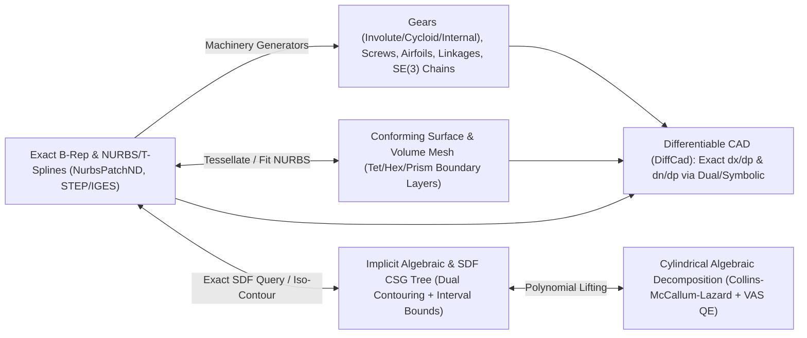

### 7.1 Concrete Improvements & Extensions
1. **Exact B-Rep & NURBS Kernel**:
   - Full winged-edge / half-edge topological `BRepSolid` (`Solid -> Shell -> Face -> Loop -> CoEdge -> Edge -> Vertex`) with Euler operators (`MVFS`, `MEV`, `MEF`, `KEV`) ensuring manifold validity ($\chi = V - E + F = 2 - 2g$).
   - Robust surface-surface intersection (marching + Newton refinement), constant/variable radius rolling-ball fillets & chamfers, loft/sweep/revolve, and **STEP (`ISO-10303-21` AP203/AP214)** + IGES parsers/exporters.
2. **Implicit Algebraic & Signed Distance (`SdfField` & `ImplicitSurface`)**:
   - Arbitrary symbolic inequalities $f(x, y, z; \mathbf{p}) \le 0$ in `ExprGraph` plus smooth/sharp CSG primitives ($\min, \max, \operatorname{smin}_k$), sweeping, and twisting.
   - **Certified Sphere Tracing & Isosurfacing**: Uses `algebra-core::Interval` / `cat-core::UniversalBall` range enclosures to guarantee zero missed thin features; **Dual Contouring** with Quadratic Error Functions (QEF) preserves sharp CAD creases and corners when extracting `Mesh3D` or `CutFEM` surfaces.
3. **Rigorous Cylindrical Algebraic Decomposition (`cad/mod.rs` Remediation — Audit C3)**:
   - Complete **Collins / McCallum / Lazard** projection operator with subresultant Polynomial Remainder Sequences (`PRS`), discriminants, and Lazard valuation handling nullification/curtains over $\mathbb{Q}[x_1, \dots, x_n]$.
   - Exact real-root isolation using **Sturm sequences** and **Vincent-Akritas-Strzeboński (VAS)** continued-fraction bisection with certified `Interval` bounds.
   - **Nonlinear Geometric Constraint Solver**: Translates sketch/assembly constraints (`Distance`, `Angle`, `Coincident`, `Tangent`, `Parallel`, `Perpendicular`, `Concentric`, `FixedArea`) into Gröbner triangular systems / sparse Levenberg-Marquardt solvers, backed by CAD quantifier elimination ($\forall, \exists$) for parametric feasibility bounds and provably collision-free robot/mechanism motion corridors.
4. **Watertight & Expanded Engineering Machinery (`cad/engineering.rs` Remediation — Audit C4)**:
   - Watertight gear bore inner walls and ear-clipped/constrained-Delaunay endcap triangulation (eliminating invalid tooth fan triangles).
   - Complete gear math per [GEAR_PROFILE_CURVES.md](GEAR_PROFILE_CURVES.md): **Cycloidal** (`Epicycloid` addendum + `Hypocycloid` dedendum), **Internal Ring Gears**, **Profile Shift** ($x$) and automatic **undercut prevention** ($z_{\min} = 2 / \sin^2\alpha$ or automatic positive shift $x_{\min} = 1 - \frac{z \sin^2\alpha}{2}$), planetary gearsets, involute splines, NACA 4/5-digit + Joukowski airfoils, and `SE(3)` robotic linkages (`urscript_pose.rs`).
5. **Conforming Volumetric & Boundary-Layer Meshing**:
   - Upgrades `CadFeaBridge` ([pipeline.rs](../../crates/algebra-engine/src/pipeline.rs)) from surface-shell extraction to true **3D Boundary-Conforming Tet4/Tet10 (constrained Delaunay / Bowyer-Watson + sliver exudation)**, **Hex-dominant advancing-front** meshing, and **anisotropic viscous boundary-layer prism inflation** for CFD wall modeling ($y^+ \le 1$).
6. **Differentiable CAD (`DiffCad`) for Shape & Topology Optimization**:
   - Every geometric surface point $\mathbf{x}(\boldsymbol{\xi}; \mathbf{p})$ and normal $\mathbf{n}(\boldsymbol{\xi}; \mathbf{p})$ computes exact parameter sensitivities $\frac{\partial \mathbf{x}}{\partial \mathbf{p}}$ via `Dual` / `HyperDual` / symbolic `ExprGraph` differentiation.
   - Chains seamlessly with discrete/continuous adjoints of FEA/IGA/CFD/BEM ($\frac{\mathrm{d}\mathcal{J}}{\mathrm{d}\mathbf{p}} = \frac{\partial \mathcal{J}}{\partial \mathbf{p}} + \boldsymbol{\lambda}^T \frac{\partial \mathcal{R}}{\partial \mathbf{x}} \frac{\partial \mathbf{x}}{\partial \mathbf{p}}$) to optimize gear tooth stresses, airfoil lift-to-drag ratio $C_L / C_D$, acoustic scattering cross-sections, or **SIMP / Level-Set Topology Optimization** under stress and manufacturing overhang constraints!
7. **Subdivision Surfaces (`Catmull-Clark` & `Loop`) with Exact Stam Evaluation**:
   - Supports watertight $C^2$-almost-everywhere arbitrary-topology control meshes with exact $O(1)$ Stam eigenstructure parameter evaluation near extraordinary vertices, unifying organic sculpting/meshes with smooth `IGA` Kirchhoff–Love shell analysis without NURBS multi-patch trimming headaches.
8. **Triply Periodic Minimal Surfaces (`TPMS`) & Stress-Aligned Field Lattices**:
   - Built-in implicit metamaterial primitives (Gyroid $\sin X\cos Y + \sin Y\cos Z + \sin Z\cos X = c(\mathbf{x})$, Schwarz-P, Schwarz-D, Lidinoid, Neovius) spatially graded by FEA principal stress tensors and thermal flux fields for additive manufacturing, heat exchangers, and bone scaffolds.
9. **Medial Axis Transform (`MAT`) & Automatic Dimensional Reduction (3D $\to$ 2D Shell / 1D Beam)**:
   - Extracts the Voronoi/distance-field medial skeleton and local wall thickness $2 r_{\text{MAT}}(\mathbf{x})$ of CAD parts. Whenever slender aspect ratios ($L / 2r_{\text{MAT}} > 15$) are detected, the engine can automatically reduce thin-walled or slender regions to 2D `Reissner–Mindlin`/`Kirchhoff–Love` shells or 1D `Timoshenko`/`Cosserat` beams, coupling seamlessly back to 3D solid junctions via **Arlequin / Kinematic Multipoint Constraints (`MPC`)**—cutting DOF counts by $10\text{–}100\times$ with no loss of structural accuracy.

### 7.2 Litvin Conjugate Envelopes, `PH` Exact Offsets, Implicit/Parametric Algebraic Bridges & Class-A Fairing
1. **Litvin Differential-Geometric Conjugate Envelope Synthesis (Gearing, Cams & Rotors)**:
   - Elevates [cad/engineering.rs](../../crates/algebra-engine/src/cad/engineering.rs) and [GEAR_PROFILE_CURVES.md](GEAR_PROFILE_CURVES.md) (`Audit C4`) from discrete spur/helical involute generators to arbitrary 2D/3D conjugate surface families via Litvin's **Equation of Meshing**:
     $$
     \mathbf{n}_1(\mathbf{u}) \cdot \mathbf{v}_1^{(12)}(\mathbf{u}, \phi) = 0
     $$
   - Supports **asymmetric involutes**, convex-concave **Wildhaber–Novikov** profiles, **non-circular gears** (conjugate pitch centrodes $r_1(\phi_1) + r_2(\phi_2) = C$), hypoid/spiral-bevel spherical geometries, worm-wheel spatial flanks, trochoidal/Gerotor pumps, and cam-follower mechanisms.
   - Automatically computes **undercutting cusp boundaries** ($\|\mathbf{v}_r^{(1)}\| = 0$ / vanishing Jacobian determinant), true cycloidal/trochoidal root fillets (including profile shift $x$ and internal gear ring teeth), contact ratio, sliding velocity ratios, and **exact `NURBS`/`PH` boundary fitting** ready for direct `IGA`, `FEM`, `BEM` acoustics, and Elastohydrodynamic Lubrication (`EHL`).
2. **Exact-Offset `PH` Curves, Clothoid Transitions & Twist-Free Swept Manifolds**:
   - Uses `Section 5.9` **Pythagorean-Hodograph (`PH`)** curves and **Cornu Clothoids** so offset rails ($\mathbf{r}_d = \mathbf{r} \pm d\,\mathbf{n}$ for toolpaths, gear backlash/profile shifts, and stiffener ribs) remain exact rational `NURBS` rather than tolerance-polygonalized approximations, paired with quaternion `RMF` Bishop frames for twist-free ducts and manifolds.
3. **Bidirectional Algebraic Implicitization $\leftrightarrow$ Rational / `Puiseux` Parameterization**:
   - **Parametric $\to$ Implicit**: Eliminates parameters $t$ or $(u,v)$ using **Sylvester**, **Bézout**, and **Dixon** resultants ([geometry.rs](../../crates/algebra-engine/src/geometry.rs)) and Gröbner bases ([poly/grobner.rs](../../crates/algebra-engine/src/poly/grobner.rs)) to obtain exact implicit algebraic curves/surfaces $F(\mathbf{x}) = 0$ for point-in-solid (`PMC`), Boolean trimming, and `CAD-QE` ([cad/mod.rs](../../crates/algebra-engine/src/cad/mod.rs)).
   - **Implicit $\to$ Parametric**: Resolves algebraic genus-$0$ curves/surfaces into exact **rational `NURBS`** parameterizations, and resolves singular loci ($\nabla F = \mathbf{0}$, cusps, self-intersections, tangent pinches) via **Newton–Polygon `Puiseux` branches** seamlessly stitched into adaptive Bézier/`NURBS` splines.
4. **Variational Class-A Surface Fairing, Curvature Combs & Optical Diagnostics**:
   - Optimizes control-point smoothness under $G^0/G^1/G^2$ boundary locks by minimizing bending energy $\int \kappa^2\,\mathrm{d}s$, jerk $\int (\kappa')^2\,\mathrm{d}s$, thin-plate variation, or **Willmore energy** $\int H^2\,\mathrm{d}A$ via `L-BFGS` / `SQP`.
   - Computes exact differential invariants via [curvature.rs](../../crates/algebra-engine/src/curvature.rs) and [cartan.rs](../../crates/algebra-engine/src/cartan.rs): planar curvature $\kappa(s)$, spatial torsion $\tau(s)$, normal **curvature combs**, principal/Gaussian/Mean curvatures $(\kappa_1, \kappa_2, K, H)$, highlight lines, and virtual **zebra reflection stripes**.

### 7.3 Universal Cross-Domain File Format & Zero-Copy Interchange Hub (`CAD <-> FEA <-> CFD <-> Fabric <-> VFX/Game <-> FMI 3.0`)
CAD kernels (`B-Rep`/`NURBS`), `FEA` solvers (element–node incidence tables + quadratics), `CFD` solvers (face-owner-neighbor polyhedral graphs), fabric tools (`2D` patterns + seams), game/VFX engines (`USD`/`glTF` triangular render/physics proxies), and system co-simulators (`FMI`/`Modelica`) speak incompatible dialects. Building $N^2$ pairwise converters loses boundary labels and geometry tolerances. Instead, `algebra_engine::io_hub` routes everything through one **Hub-and-Spoke Canonical Scene & Physics IR (`UraeSceneBundle`, `.urae` / `.catb`)**:

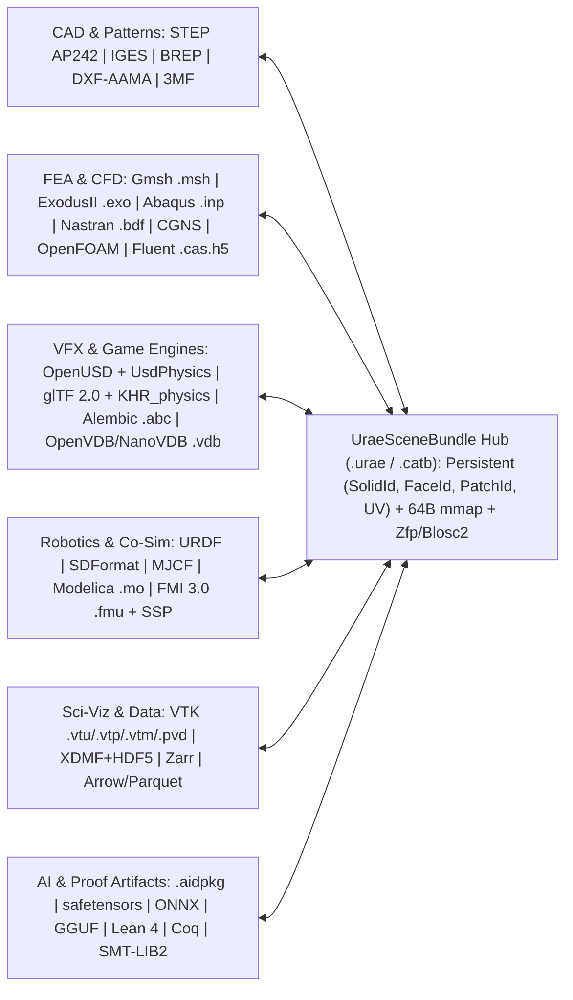

1. **Canonical Hub Invariants & Zero-Copy Memory Architecture**:
   - **Bijective Topological Provenance `(SolidId, FaceId, PatchId, u, v)`**: Every discretized triangle, tetrahedron, `CGNS` boundary patch, `USD` prim, or cloth seam retains an immutable topological key back to the source CAD face/edge/pattern—preventing "broken BC selection" when re-meshing or defeating CAD assemblies.
   - **Zero-Copy `mmap` & Scientific Compression**: Bulk `SoA` field/coordinate arrays map 64-byte aligned buffers straight from disk via `mmap` (zero allocation spike on 100M-cell `CGNS`/`HDF5` datasets), paired with chunked **`Zfp`** (floating-point accuracy-bounded compression) and **`Blosc2`/`LZ4`**, plus **Automatic Compatibility Lifting** (e.g., lifting orphan `STL`/`OBJ` meshes into watertight `SdfField` + `VEM`/`CutFEM` without failing on dirty triangles, or converting `SolidWorks`/`URDF` mates directly to `Featherstone` joints).

2. **Complete 7-Category Cross-Domain File Format Matrix**:

| Category | Supported Formats (`Read / Write / Stream`) | Primary Semantic Contents | Automatic URAE Cross-Domain Compatibility Bridge |
| :--- | :--- | :--- | :--- |
| **1. CAD & 2D Garment Patterns** | `STEP` (`ISO-10303-21` AP203 / AP214 / **AP242** PMI), `IGES`, native `B-Rep`, `DXF-AAMA`/`ASTM` (garment patterns), `SVG`, `3MF` | Exact trimmed `NURBS` B-Rep solids, tolerance curves, assembly mates, 2D fabric darts/notches/seams, material PMI tags | Converts `NURBS <-> IGA`; extracts `MAT` midplane shells; feeds `Mosaic` auto-mesher; lifts `DXF-AAMA` sewing patterns straight into `C-IPC`/`XPBD` cloth (`Sec 6.12`) |
| **2. FEA Structural Meshes & Solver Decks** | `Gmsh .msh` (v2/v4), **Sandia `ExodusII .exo`**, `Abaqus .inp`, `ANSYS .cdb`, `Nastran .bdf`/`.op2`, `Salome MED` | Higher-order `Tet10`/`Hex27`/`Prism15`, side sets, node sets, orthotropic/hyperelastic material cards, contact pairs | Maps side/node sets bijectively to `CouplingMorphism` BCs; translates hyperelastic/plastic material cards into compiled `ExprGraph` `W(F)` laws; exports back to Abaqus/Nastran for legacy sign-off |
| **3. CFD Grids & Flow Solutions** | **`CGNS`** (HDF5 structured/unstructured + sliding interfaces), **`OpenFOAM`** (`polyMesh` + field dictionaries), `ANSYS Fluent .cas.h5/.dat.h5`, `Plot3D` | Arbitrary polyhedral cell-face-owner-neighbor graphs, prism wall layers, moving overset/sliding zones, conserved $(\rho, \rho\mathbf{v}, \rho E, k, \omega)$ | Imports `OpenFOAM`/`CGNS` grids zero-copy into URAE `FVM`/`LBM`/`CutFEM`; converts volume boundaries directly into `IGA`/`FEM` FSI traction loads and `BEM` acoustic sources |
| **4. VFX, Cloth, Volumes & Game Engines** | **`OpenUSD` (`.usd`, `.usda`, `.usdc`, `.usdz` + `UsdPhysics` / `UsdGeomCurves`)**, **`glTF 2.0 / .glb` (`KHR_physics_rigid_bodies`)**, **`Alembic .abc`**, **`OpenVDB / NanoVDB .vdb`**, `OBJ`, `STL`, `PLY` | Skinned/rigid hierarchies, physics colliders/joints, time-sampled cloth/hair caches, hierarchical sparse 3D grids (`VDB` level sets/fog/velocity) | Streams high-FPS **`XPBD`/`ABA`/`SPH`** simulations under `TargetFps` objectives to UE5/Godot/Blender/Houdini via `OpenUSD`/`glTF`/`NanoVDB`; ingests dirty `STL` triangles safely via `Dual Contouring SDF`, `VEM`, or `CutFEM` |
| **5. Robotics, Multibody & Co-Simulation** | **`URDF`**, **`SDFormat .sdf`**, **MuJoCo `MJCF`**, **`Modelica .mo`**, **`FMI 2.0 / 3.0 .fmu`** (`ModelExchange` + `CoSimulation` + `ScheduledExecution`) & **`SSP`** | Articulated rigid-body trees, actuator/sensor limits, collision convex hulls, equation-based acausal `DAE` networks, FMU state capsules | Lowers `URDF`/`MJCF`/`SDFormat` directly into $O(N)$ `Featherstone ABA` + `Se3Rotor`; runs **Pantelides DAE index reduction** on `Modelica`; exports URAE `CFD`/`IGA`/`pHNN` subsystems as standalone **`FMI 3.0` FMUs** |
| **6. Scientific Visualization, Columnar Lake & Telemetry** | **`VTK`** (`.vtu`, `.vtp`, `.vts`, `.vti`, `.vtm` multiblock, `.pvd` time series), **`XDMF + HDF5`**, **`Zarr`**, **`Apache Arrow` (`ArrowColumnarBatch`) / `Parquet` / `DuckDB WASM`**, **`BSON`/`CSV`/`HTML` Chart.js `TelemetryDashboard`** | Unstructured multi-physics field snapshots, multipatch curvilinear grids, chunked N-D arrays (`POD` snapshots), `SoA` columnar tick/sweep partitions with `SHA-256` `CAS` manifests, `PointInTimeRecord` (`UniverseRegistry`) histories, and static HTML tearsheets | Powers zero-copy ParaView inspection (`urae-ffi`), chunked `DMD`/`POD-DEIM`/`TensorTrain` snapshot loading (`Zarr`/`HDF5`), **client-side WASM SQL inspection (`DuckDbQueryBuilder` over `Parquet`)** ([arrow_duckdb.rs](https://github.com/Spodeian/Risky-Business/blob/dev/crates/data/src/arrow_duckdb.rs)), Python/PyTorch `DLPack`/`Arrow` pipelines (`urae-py`), and `TelemetryDashboard` export ([tearsheet.rs](https://github.com/Spodeian/Risky-Business/blob/dev/crates/backtest/src/tearsheet.rs)) |
| **7. AI Models, Federated Artifacts & Formal Proofs** | **`.aid` / `.aidpkg`**, **`safetensors`**, **`ONNX`**, **`GGUF`**, **`Lean 4 .lean`**, **`Coq .v`**, **`SMT-LIB2 .smt2`** | Neural operator weights (`FNO`, `KAN`, `pHNN`, `CrisisEngramBank`, `TGN`), `AiDesignSpec` architectures (`ai-designer`), quantized tensors, constructive verification proofs | Bidirectional lossless `urae-aid-bridge` sync + **4-repo `spodeian-lake <-> spodeian-ml <-> Risky Business <-> algebra-engine` `.safetensors` federated deployment (`Sec 20`)**, Seed-42 parity verification, 6-track GPU export, and machine-checked conservation/safety certificates |

---

# Part V — Dual-Control Execution: Explicit User Composition vs. Automagic Meta-Orchestration

## 8. Explicit User Composition DSL & Hypergraph Pipeline Builder

Users who know *exactly* how they want to combine numerical, symbolic, CAD, and ML tools can compose them directly as nodes and edges in an executable `cat-core::OpenHypergraph` pipeline—whether in Rust, Python (`urae-py`), CLI (`urae-cli`), or the reactive notepad (`urae-notebook` / `urae-wasm`).

### 8.1 Four Fundamental Composition Combinators

1. **`Sequential(A >> B)` (Chained Multiphysics / Surrogate-to-Exact)**:
   Pipes output fields, CAD deformations, or initial guesses from method `A` into `B` (e.g., `SteadyRansCFD(FVM) >> ThermalConvection(IGA) >> StructuralStress(FEM)` or `FnoSurrogate >> NewtonKrylovCorrector(FEM)`).
2. **`SpatialCouple { domains, interfaces, scheduler }` (Domain-Partitioned Hybrid Physics)**:
   Assigns distinct discretization methods to distinct geometric subdomains $\Omega_k$ and binds an explicit `CouplingMorphism` on each shared interface $\Gamma_{ij}$ (with choice of `MonolithicBlock` vs. `PartitionedIqnIls`).
3. **`OperatorSplit { scheme, operators }` (Temporal / Physics Operator Splitting)**:
   Splits an evolution equation $\partial_t u = (\mathcal{L}_1 + \mathcal{L}_2 + \mathcal{L}_3) u$ via `LieTrotter` (1st order), `Strang` (2nd order: $\frac{\Delta t}{2} \mathcal{L}_1 \circ \Delta t \mathcal{L}_2 \circ \frac{\Delta t}{2} \mathcal{L}_1$), `Yoshida4`, or `IMEX-RK`—e.g. combining `FVM(WENO5)` for fluid advection + `RadauIIA5` or `LTC/CfC` for stiff chemical reactions + `FEM` for solid conduction.
4. **`MultiFidelityCascade { predictor, corrector, error_metric }`**:
   Combines a fast low-order/ML predictor (Tier 0) with a certified numerical corrector (Tier 1/2), verifying residual reduction against a user tolerance.

### 8.2 Ergonomic Rust & Notebook DSL Example (User-Composed Hybrid Simulation)

```rust
// Explicit composition: Gear-box fluid-structure-acoustic multiphysics pipeline
let pipeline = compose_solvers! {
    // Subdomain 1: Smooth NURBS gear teeth modeled with exact-geometry IGA
    domain("gear_solid", gear_nurbs) => Method::Iga { order: 3, physics: Elasticity::FiniteStrainNeoHookean },
    // Subdomain 2: Oil-bath bulk fluid via conservative FVM + dynamic SPH splash zone
    domain("lubricant_bulk", oil_box) => Method::Fvm { flux: RiemannFlux::Hllc, limiter: Limiter::MusclVanLeer },
    domain("splash_free_surface", oil_box) => Method::Sph { variant: SphVariant::Dfsph, kernel: Kernel::WendlandC4 },
    // Subdomain 3: Infinite exterior air domain around gearbox housing via FMM-BEM acoustics
    domain("exterior_air", housing_exterior) => Method::Bem { kernel: GreensKernel::Helmholtz(freq), accel: BemAccel::Kifmm },

    // Explicit interface coupling rules
    couple("gear_solid", "lubricant_bulk") via Coupling::CutFemNitscheFsi { accel: FsiAccel::IqnIls },
    couple("lubricant_bulk", "splash_free_surface") via Coupling::DynamicFvmSphSwitch { weber_crit: 12.0 },
    couple("gear_solid", "exterior_air") via Coupling::CostabelSymmetricFemBem,

    // Explicit time-stepping & acceleration
    step: TimeStepper::ImexArk4,
    preconditioner: Preconditioner::LearnedAmgWarmStart(fno_surrogate),
};
let result = pipeline.run(budget)?;
```

---

## 9. Autonomous Behind-the-Scenes Meta-Orchestrator ("Automagic Mode")

When a user simply supplies a problem (`solve_auto!(problem)` or `simulate_auto!(cad_model, physics, bcs)`), the **Autonomous Meta-Orchestrator** (`algebra_engine::orchestrator`) automatically selects, couples, accelerates, and adapts the optimal pipeline behind the scenes in three stages—delivering a fast interactive preview in milliseconds and converging to a mathematically certified answer.

### 9.1 Stage 1 — Symbolic, Dimensional & Structural Fingerprinting (`< 0.5 ms`)
1. **Dimensional Analysis (`cat-egraph::BuckinghamPi`)**: Extracts all independent dimensionless $\Pi$-groups ($\operatorname{Re}, \operatorname{Ma}, \operatorname{Pe}, \operatorname{Kn}, \operatorname{Fr}, \operatorname{We}, \operatorname{Bi}, \operatorname{St}$) from `DimVector` quantities.
2. **Symbol & PDE Principal-Part Classification**: Upgrades [diffeq.rs](../../crates/algebra-engine/src/diffeq.rs) (Audit C8) to classify ODE/PDE type (`Elliptic`, `Parabolic`, `Hyperbolic`, `Dispersive`, `Mixed`), linearity (`Linear`, `Semilinear`, `Quasilinear`, `Nonlinear`), Jacobian stiffness ratio $\kappa(\mathbf{J})$, and geometric symmetries (`Hamiltonian`, `PortHamiltonian`, `GENERIC`, `Solenoidal`).
3. **Exact Symbolic Fast-Path**: Checks Tier 1–3 symbolic solvers (`Elementary -> Special -> Series`, Green's functions, traveling-wave solitons, separation of variables). If an exact or analytical series solution satisfies the requested accuracy within `< 2 ms`, it returns immediately with zero discretization error!

### 9.2 Stage 2 — Dynamic Regime Decomposition & Method Selection Matrix

If numerical or hybrid simulation is required, the orchestrator partitions the geometry and selects methods dynamically using the following decision graph and rule matrix:

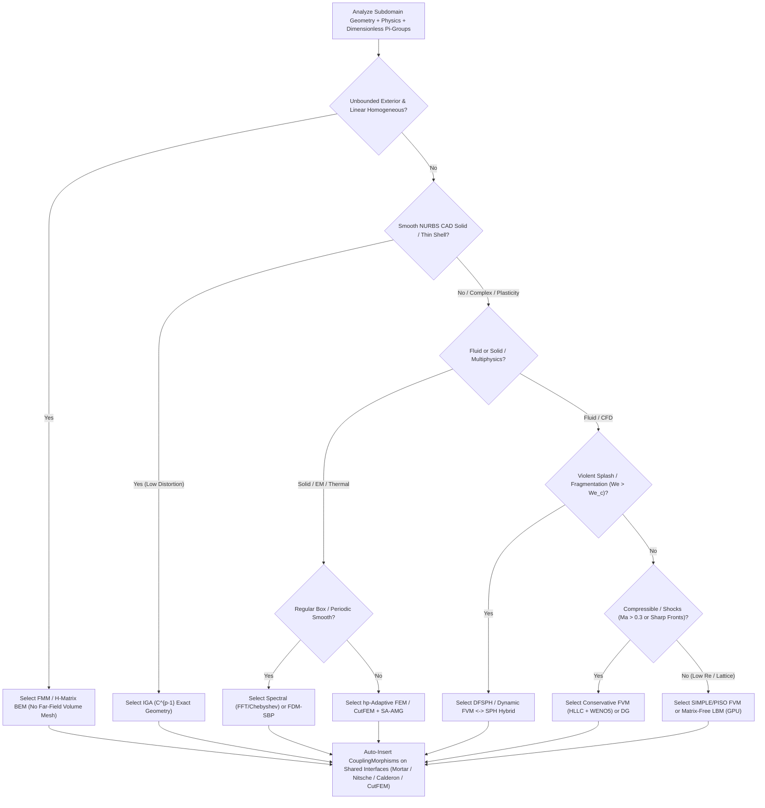

| Physical / Geometric Signature Detected | Dynamically Selected Method(s) | Acceleration & Time-Stepping Chosen Behind the Scenes |
| :--- | :--- | :--- |
| **Linear homogeneous unbounded exterior** ($\nabla^2 u = 0, (\nabla^2+k^2)u=0$, elasticity) | **FMM / $\mathcal{H}$-Matrix BEM** | Burton-Miller (Helmholtz) + FGMRES + $\mathcal{H}$-LU preconditioner |
| **Smooth NURBS CAD part under linear/hyperelastic load** | **IGA** (with Bézier extraction) | `HyperDual` symbolic tangent + `SA-AMG` PCG |
| **Inhomogeneous/nonlinear solid adjacent to infinite air/soil** | **Hybrid `FEM <-> Costabel-BEM`** | Symmetric Calderón coupling + Block Schur GMRES |
| **High-$\operatorname{Ma}$ ($\operatorname{Ma} > 0.3$) or shock-capturing flow** | **FVM (`HLLC` + `WENO5`)** or **DG** | `SSPRK(3,3)` / `IMEX-ARK` + AMR shock-sensor refinement |
| **Low-$\operatorname{Ma}$ viscous flow around moving CAD machinery** | **CutFEM / ALE `FVM <-> IGA` FSI** | `PIMPLE` + `IQN-ILS` interface acceleration |
| **Dam break, sloshing, impact breakup ($\operatorname{We} \gg 1$)** | **Hybrid `FVM <-> DFSPH`** (or `MLS-MPM`) | Adaptive breakup switching + spatial-hash `BvhTree` GPU kernel |
| **Interactive 60 FPS slider scrub / parametric sweep** | **SciML (`FNO`/`DeepONet`) + Defect Corrector** | Tier-0 ML prediction (`< 2 ms`) + 2–3 Krylov-Newton defect steps |

### 9.3 Stage 3 — Anytime Progressive Refinement, `ExecutionObjective` Planning & DWR Error Certification
Integrating directly with [cat-anytime/src/scheduler.rs](../../crates/cat-anytime/src/scheduler.rs) and `ExecutionPlanner`:
- **Latency-Bounded Interactive Path (`TimeConstraint::TargetFps` / `MaxWallTime`)**: Evaluates `const`/compile-time precomputed kernels, dimensional scaling, and pre-trained `FNO`/`DeepONet`/POD-ROM or `XPBD`/`ABA` steps using compact `NumericRep`s (`f32`/`Posit`/`LNS`), producing an immediate `UniversalBall` enclosure calibrated to local hardware headroom and frame target.
- **Warm-Started Mid-Budget Path**: When latency headroom widens or moderate `atol`/`rtol` tolerances apply, warm-starts **Projective Dynamics**, `f32`-preconditioned `SA-AMG` FEM/FVM/IGA, or `IQN-ILS` directly from the interactive state $\mathbf{u}^{(0)}$, typically cutting Newton/Krylov iterations by $5\text{–}10\times$.
- **Tight Tolerance / Exact Certified Path (`AccuracyGoal::Exact` or Tight `atol`/`rtol` within `MemoryConstraint`)**: Computes **Dual Weighted Residual (DWR)** a posteriori error estimates with respect to the user's goal functional $J(u)$ (e.g., peak von Mises stress, drag coefficient $C_D$, tip deflection):
  $$
  |J(u) - J(u_h)| \le \sum_{K} \eta_K, \qquad \eta_K = \left| \langle \mathcal{R}(u_h), z - \mathcal{I}_h z \rangle_K \right|
  $$
  solving the linear adjoint problem $(\mathcal{R}'(u_h))^T z = J'(u_h)$ via `DiscreteOperator::vjp` while actively retaining matrix-free sum factorization (`O(3p^4)`), mixed-precision preconditioners, `ECSW` hyper-reduction, and `Parareal` concurrency so maximum precision remains computationally lean. Regions with largest $\eta_K$ trigger **$hp$-refinement**, **particle splitting**, or **local method promotion** until $\sum_K \eta_K \le \epsilon_{\text{target}}$.

### 9.4 Zero-Touch Dynamical Simulation Auto-Setup (Virtual Defeaturing, Mosaic Poly-Hexcore, Pantelides DAE Reduction, Island Sleeping & Physics-LOD)
To match or surpass commercial automation in `ANSYS`, `COMSOL`, `SolidWorks`, `Houdini Vellum`, and `Unreal/Jolt` without manual mesh babysitting or silent stability failures:
1. **Automatic CAD Healing, Virtual Defeaturing & Persistent Topological Naming**:
   - Runs pre-flight geometric hygiene: detects open naked loops and sliver triangles, seals tolerances automatically or diverts dirty triangle soups (`STL`/`OBJ`) into `Dual Contouring SDF`, `CutFEM`, or polyhedral `VEM`.
   - Applies **COMSOL/SpaceClaim-style Virtual Composite Faces** to suppress simulation-negligible fillets, chamfers, logos, and sub-resolution bolt holes ($\ell < \eta_{\text{def}} h_{\min}$) purely in the discretization abstraction without altering underlying `NURBS`, while **Persistent `(SolidId, FaceId, PatchId, UV)` Naming** preserves all boundary conditions across CAD regeneration and optimization steps.
2. **Physics-Controlled Auto-Meshing: `Mosaic Poly-Hexcore`, Auto-$y^+$ Prism Inflation & `NanoVDB` Sparse Grids**:
   - Derives local boundary-layer first-cell height $\Delta y_1 = \frac{y^+ \mu}{\rho u_\tau}$ directly from Stage-1 $\operatorname{Re}_x$ and turbulence regime ($y^+ \le 1$ for wall-resolved LES/DNS; $30 \le y^+ \le 300$ for wall functions), inflating anisotropic prism stacks into conformal **Mosaic Poly-Hexcore** octree hex cores (`2–4×` fewer cells than pure tets).
   - Automatically selects sparse hierarchical **`NanoVDB`/`OpenVDB` block grids** whenever moving interfaces, smoke plumes, or `SDF` obstacles occupy $< 15\%$ of the bounding domain volume.
3. **Symbolic `Pantelides` + Dummy-Derivative `DAE` Index Reduction & Compile-Time `const` Specialization**:
   - Builds the bipartite equation–variable incidence graph in [diffeq.rs](../../crates/algebra-engine/src/diffeq.rs) for closed-loop mechanical joints, contact holonomic constraints, and `Modelica`/`FMI 3.0` differential-algebraic systems $\mathbf{F}(\dot{\mathbf{x}}, \mathbf{x}, \mathbf{y}, t) = \mathbf{0}$.
   - Executes **Pantelides' structural index-reduction algorithm** with Mattsson–Söderlind **dummy derivatives**—automatically differentiating constraint invariants down to index $\le 1$ (`RadauIIA5`/`BDF`) with exact manifold projection, lowering static/parameterized kernels to `const fn` / `BytecodeVM` (`Section 13`), and smoothing hard non-differentiable branches ad-hoc via `FunctionFamilyLattice` (`Section 14.5`) for robust Jacobian convergence.
4. **Runtime Autopilot: Active Island Sleeping, Exact Event Location, `SAV` & Multi-Rate Subcycling**:
   - **Active Island Sleeping & Predictive Lookahead**: Decomposes rigid, cloth (`XPBD`/`C-IPC`), and granular domains into connected contact islands; quiescent components sleep at `0 FLOPs` while swept-AABB `BvhTree` bounds wake sleeping islands cleanly *before* impending impacts or shock fronts arrive.
   - **Dense-Output Event Location**: Brackets sliding/sticking Coulomb transitions, zero-crossing collisions, valve triggers, and `FMI` clocks ($g(\mathbf{x}, t) = 0$) to machine precision along dense-output polynomials without shrinking the entire simulation step.
   - **`SAV` Stability & Asynchronous Multi-Rate Subcycling (`AVI`)**: Uses **Scalar Auxiliary Variable (`SAV`)** energy reformulation for unconditionally stable large-step gradient/phase-field evolution, plus asynchronous multi-rate subcycling so stiff local contact patches or tiny cells step finely while bulk domains advance smoothly.
5. **`Nanite`-Style Continuous Physics-LOD & Automatic Multi-Solution Trigger**:
   - Continuously adapts fidelity and `NumericRep` per viewport ROI importance, `(TimeConstraint, AccuracyGoal, MemoryConstraint)` bounds, and local `DWR` error indicators—shifting smoothly between `XPBD`/`Featherstone ABA`/`FNO` interactive solves, `Projective Dynamics`/`SA-AMG`, and `C-IPC`/`hp-IGA`/`WENO5` certified accuracy—and automatically invokes **`MultiSolutionExplorer` (`Section 5.10`)** whenever vanishing Jacobian determinants ($\det \mathbf{J} \to 0$) signal symmetry-breaking bifurcations or multiple equilibrium branches.

---

# Part VI — Machine Learning Tools for Numerical Analysis, Physics & CAD (SciML)

## 10. SciML Operators, Structure-Preserving Neural Architectures & Hybrid Solvers

### 10.1 Generalized Physics-Informed Neural Networks (`pinn.rs` Expansion)
Currently [pinn.rs](../../crates/algebra-engine/src/pinn.rs) supports three hardcoded scalar equations (`Burgers`, `Heat2D`, `Poisson2D`). Upgrade to a **Universal Symbolic-to-PINN Compiler**:
- **Symbolic Residual Compilation**: Takes *any* PDE system from `ExprGraph` / `Cartan` / `WeilJet` and compiles exact 1st- and 2nd-order differential residuals $\mathcal{R}_\theta(\mathbf{x}, t)$ via `HyperDual` / forward-over-reverse AD (`autodiff.rs`).
- **Four PINN Formulations**:
  1. **Collocation PINN**: Pointwise strong-form residuals on Sobol/Halton + residual-adaptive refinement (`RAR`) points.
  2. **Variational PINN (`VPINN`)**: Integrates PDE residuals against Legendre/B-spline test functions $\int_{\Omega_e} \mathcal{R}(u_\theta) v_k \,\mathrm{d}\Omega$, lowering required derivative order from $2$ to $1$ and handling discontinuous coefficients!
  3. **Conservative & Extended PINNs (`cPINN` / `XPINN`)**: Decomposes complex CAD domains into subdomains with separate local sub-networks coupled via interface flux conservation $\llbracket \mathbf{F}(u_\theta)\cdot\mathbf{n} \rrbracket = 0$, integrating seamlessly as a `DiscretizationMethod` inside URAE's `CouplingMorphism`!
- **Stiffness-Aware Optimization**: Replaces naive Adam-only loops with **NTK Eigenvalue Self-Adaptive Loss Weighting** (balancing boundary vs. residual convergence speeds) followed by **L-BFGS / Gauss-Newton** natural gradient steps.

### 10.2 Neural Operators for Parametric CAD & Real-Time Surrogates
To enable instant 60 FPS field previews over arbitrary CAD designs and boundary conditions:
- **Fourier Neural Operator (`FNO` & `FactorizedFNO`)**: Learns mesh-invariant mappings $\mathcal{G}_\theta : a(\mathbf{x}) \mapsto u(\mathbf{x})$ via spectral linear transforms $\mathcal{F}^{-1}(R_\theta \cdot \mathcal{F}v)$ on `StructuredGrid` / `LBM` domains.
- **Geometry-Aware `DeepONet`**: Branch network encodes boundary loads, material tensors, or CAD design parameters $\mathbf{p}$; Trunk network encodes physical coordinates + `SdfField` distance $(x, y, z, \phi_{\text{SDF}})$, evaluating solutions continuously anywhere inside arbitrary CAD shapes.
- **`MeshGraphNet` & $SE(3)$-Equivariant Graph Neural Operators**: Built directly atop [geometric_dl.rs](../../crates/algebra-engine/src/geometric_dl.rs) (`SphericalHarmonics`, `ClebschGordan`, `SteerableConvLayer`, `CliffordLayer`), operating natively on `PolyMesh`, `BRepSolid`, and `ParticleCloud` graphs with exact 3D rotational and translational equivariance ($SE(3)$)—meaning a turbine blade or involute gear rotated in 3D yields an *identically rotated* stress and velocity tensor field!

### 10.3 Structure-Preserving Neural Dynamics (Grounded in `docs/physics_informed_benchmarks/`)
Implement the verified continuous and thermodynamic architectures documented in [05_structure_preserving_hamiltonian_port_generic_and_divergence_free.md](physics_informed_benchmarks/05_structure_preserving_hamiltonian_port_generic_and_divergence_free.md) and [07_numerical_integration_pcec_rk45_neural_ode_ltc_and_sde.md](physics_informed_benchmarks/07_numerical_integration_pcec_rk45_neural_ode_ltc_and_sde.md):
- **Hamiltonian (`HNN`) & Port-Hamiltonian Neural Networks (`pHNN`)**:
  $$\dot{\mathbf{z}} = \left[\mathbf{J}(\mathbf{z}) - \mathbf{R}(\mathbf{z})\right] \nabla_{\mathbf{z}} \mathcal{H}_\theta(\mathbf{z}) + \mathbf{G}(\mathbf{z}) \mathbf{u}_{\text{ext}}, \quad \mathbf{J} = -\mathbf{J}^T, \; \mathbf{R} = \mathbf{B}\mathbf{B}^T \succeq 0$$
  Integrated exclusively with URAE's `SymplecticIntegrator` (`Verlet`/`Yoshida4`/`GaussLegendre4`) to eliminate secular energy drift.
- **Thermodynamic `GENERIC` Neural Networks**:
  $$\dot{\mathbf{z}} = \mathbf{L}(\mathbf{z}) \nabla E_\theta(\mathbf{z}) + \mathbf{M}(\mathbf{z}) \nabla S_\theta(\mathbf{z}), \quad \mathbf{L} = \mathbf{P}_S \mathbf{L}_0 \mathbf{P}_S, \quad \mathbf{M} = \mathbf{P}_E \mathbf{M}_0 \mathbf{P}_E$$
  guaranteeing First Law ($\dot{E} \equiv 0$) and Second Law ($\dot{S} \ge 0$) by algebraic construction.
- **Divergence-Free Solenoidal Networks**: Parameterizing 2D stream potentials $\psi_\theta(x,y)$ or 3D vector potentials $\mathbf{A}_\theta(\mathbf{x})$ so $\mathbf{v} = \nabla \times \mathbf{A}_\theta \implies \nabla \cdot \mathbf{v} \equiv 0$ to machine precision.
- **Checkpointed `NeuralOde`, `NeuralSde` (Milstein), and `LTC`/`CfC` Networks**: Upgrade [neural_ode.rs](../../crates/algebra-engine/src/neural_ode.rs) (Audit C6) to $O(\sqrt{T})$ binomial-checkpointed (`Revolve`) continuous reverse RK4/DOPRI5 adjoints, add Milstein Itô-corrected `NeuralSde` integration, and implement Closed-Form Continuous-time (`CfC`) networks for $O(1)$ real-time control loops.

### 10.4 Neural-Accelerated Classical Numerical Solvers ("Best of Both Worlds")
Never ask users to blindly trust an unverified ML black box when rigor matters. Combine ML speed with classical convergence guarantees:
1. **Neural Warm-Start + Classical Defect Correction**: `FNO`/`DeepONet` produces initial guess $\mathbf{u}^{(0)}$ in `~1 ms`; classical Newton-FGMRES/SA-AMG solves $\mathbf{J}(\mathbf{u}^{(k)}) \delta\mathbf{u} = -\mathcal{R}(\mathbf{u}^{(k)})$ to $10^{-12}$ residual in 2–3 iterations. **Result**: ML speed with *exact classical numerical accuracy*.
2. **Learned Multigrid Prolongation & Preconditioners**: GNN predicts problem-dependent AMG prolongation $\mathbf{P}_\theta$ or sparse approximate inverse $\mathbf{M}_\theta^{-1}$ trained to minimize $\kappa(\mathbf{M}_\theta^{-1} \mathbf{A})$ across CAD shape families.
3. **Physics-Consistent Subgrid Closures (`LES` / `RANS` / `WENO`)**: Differentiable `DiscreteOperator::vjp` trains Galilean-invariant neural closures or WENO smoothness weights directly *inside* the PDE time stepper via end-to-end adjoint backpropagation.
4. **Asymptotic-Numerical Hybrid Solvers (`MAE–FEM/BEM/IGA`)**: Matches inner analytical `Puiseux` crack/corner asymptotics, `WKBJ` boundary layers, or `Borel–Padé`-resummed perturbation cores (from `Section 5.9`) to outer coarse `FEM`/`FVM`/`BEM`/`IGA` discretizations via Dirichlet-to-Neumann (`DtN`) / enriched partition-of-unity basis functions—resolving singular stresses, Stokes layers, and high-frequency turning points without extreme mesh refinement.

### 10.5 `ai-designer` Frontier Operator & Optimization-as-Architecture Integration
Integrating the 55-operator architecture zoo, structural constraints, and optimization suite from [operators.rs](https://github.com/Spodeian/ai-designer/blob/dev/crates/shared/src/spec/operators.rs), [io.rs](https://github.com/Spodeian/ai-designer/blob/dev/crates/shared/src/spec/io.rs), [graph.rs](https://github.com/Spodeian/ai-designer/blob/dev/crates/shared/src/spec/graph.rs), [optimizer_partitioner.rs](https://github.com/Spodeian/ai-designer/blob/dev/crates/shared/src/analysis/optimizer_partitioner.rs), and [training.rs](https://github.com/Spodeian/ai-designer/blob/dev/crates/shared/src/spec/training.rs):
- **Multi-Basis Generalized `KAN` (`B-Spline`/`Chebyshev`/`Rational`/`Wavelet`/`Zernike`) $\leftrightarrow$ `IGA` & `ExpansionRepresentation`**: Generalizes `KANLayer` beyond vanilla B-splines to share the entire `Section 5.9` basis library—unifying `CoxDeBoor` / `NURBS` ([iga.rs](../../crates/algebra-engine/src/iga.rs)), **Chebyshev / Jacobi** orthogonal polynomials (spectral PINNs without knot-grid bottlenecks), **Rational `Padé`/`AAA` Activation Units** (`PAU` / pole-capturing sharp shock & singularity approximants), **B-Spline Wavelets** (`WavKAN` multi-scale localization), and unit-disk **`Zernike` polynomials** (circular/optical SciML)—all exposing exact symbolic differentiation and direct pruning into `ExprGraph` closed-form formulas.
- **Optimization-as-Architecture & Differentiable Constraints (`DEQ`, `OptNetKKT`, `CBF_QP`, `ICNN`, `LISTA`, `ADMMNet`, `CRATE`)**:
  - **`DEQ` (Deep Equilibrium Models)**: Solves implicit fixed-point layers $\mathbf{z}^* = f_\theta(\mathbf{z}^*, \mathbf{x})$ using URAE's `JFNK` and Anderson acceleration with $O(1)$-memory implicit differentiation via `DiscreteOperator::vjp`.
  - **`OptNetKKT` & `CBF_QP`**: Differentiable KKT quadratic programming layers and **Control Barrier Function** safety filters ($\dot{h}(\mathbf{x}) + \alpha(h(\mathbf{x})) \ge 0$) guaranteeing forward-invariant safe robotics, contact, and CFD/FEA constraints by construction.
  - **`InputConvexICNN` & `OT-CFM`**: Enforces convexity in neural constitutive laws (guaranteeing polyconvex hyperelastic strain potentials $W(\mathbf{F})$) and Sinkhorn Optimal Transport Conditional Flow Matching (`OT-CFM`).
- **Volumetric INRs, Topological GNNs, Reservoirs & Frontier Sequence Models**:
  - **Volumetric 3D & Geometric Layers**: Bridges `GaussianSplatting3D` + 6D `PluckerRays`, Instant-NGP `MultiresHashGrid` + `Snake`/`SIREN` periodic activations directly into URAE's `SdfField` CAD and `Viewport3D`; unifies `SimplicialHodgeConv` & `CellularSheafConv` with `FEEC`/`DEC` and [tda.rs](../../crates/algebra-engine/src/tda.rs); connects `SphericalMeshGNN`, `PeriodicCrystalLattice` ($SO(3) \times \mathbb{Z}^3$), `PairformerBlock` (`EvoformerTriangle`/`IPA`/`FAPE`), and `PhotonicMZIMesh`.
  - **Next-Gen Reservoir & Continuous Sequence Backbones**: Integrates `NextGenReservoir` (`NG-RC` polynomial delay taps over [poly/multivariate.rs](../../crates/algebra-engine/src/poly/multivariate.rs)), `EchoStateNetwork`, `MambaS6`/`Mamba2SSD`, `S4D`, `LRU`, `xLSTM`, `RWKV7DeltaRule`, `MLA` (`DecoupledRoPE`), `DiffAttn`, `TitansMemory`/`TTT`, `SpikingLIF`, `SuperSmoothLipschitzLayer` (Björck orthonormalization + $C^\infty$ Sobolev $H^2$), and `LearnableQuantizerQAT` (`LSQ+`/`FracBits`).
  - **Coordinate Encodings, Normalizers & Tails**: Adopts `RevIN`, `Symlog`, `PLE` (Piecewise Linear Embeddings), `ContinuousRotation6D` (Gram–Schmidt $SO(3)$), `Sparsemax`/`Entmax15`, `EvidentialDirichlet`, and `QuantileCRPS_GPD` Generalized Pareto tail-risk losses.
- **`Muon` Orthogonalization & Online Meta-Optimization**: Adopts `optimizer_partitioner.rs` 3-way partitioning (`Muon2DGEMM` Newton–Schulz polar orthogonalization + `AdamW1D` + `ZeroWeightDecay`), `Sophia-G` Hessian-diagonal clipping, `Lion`, `Schedule-Free`, `Grokfast` low-pass SNR filtering, `AutoClip`, and `Hypergradient Descent` ([mediator.rs](https://github.com/Spodeian/ai-designer/blob/dev/crates/shared/src/training/mediator.rs)) for SciML and inverse-design training.

### 10.6 Continual Regime Memory (`CrisisEngramBank`), Dual-Speed Online `RLS`, Temporal Spillover Graphs (`TGN`) & Monotonic Quantile Heads
Incorporating online regime adaptation and event-graph contagion architectures from [crisis_engram.rs](https://github.com/Spodeian/Risky-Business/blob/dev/crates/ai/src/crisis_engram.rs), [online_adapter.rs](https://github.com/Spodeian/Risky-Business/blob/dev/crates/ai/src/online_adapter.rs), [neural_alpha.rs](https://github.com/Spodeian/Risky-Business/blob/dev/crates/ai/src/neural_alpha.rs), [losses.rs](https://github.com/Spodeian/Risky-Business/blob/dev/crates/ai/src/losses.rs), [gnn_spillover.rs](https://github.com/Spodeian/Risky-Business/blob/dev/crates/ai/src/gnn_spillover.rs), and [tgn_spillover.rs](https://github.com/Spodeian/Risky-Business/blob/dev/crates/ai/src/tgn_spillover.rs) into URAE's non-stationary SciML runtime:

- **Episodic Stress Archetypes (`CrisisEngramBank` + `SAM` Test-Time Adaptation)**: Maintains a curated memory bank of normalized extreme-regime signatures (turbulence stall, shock bifurcation, market crash, grid outage) queried in microseconds via cosine similarity; blends matched engram responses into live surrogates and stabilizes adaptation basins via **Sharpness-Aware Minimization (`SAM`)** perturbations ($\theta + \rho \nabla \mathcal{L} / \|\nabla \mathcal{L}\|$).
- **Dual-Speed Continual Learning (`DualSpeedAdaptationManager`)**: Decouples representation plasticity from stability by pairing a **slow `SAM`-regularized deep backbone** (rehearsed over `ExperienceReplayBuffer` + `Huber` / Cross-Entropy losses) with a **fast online Recursive Least Squares readout (`OnlineRlsFilter` / `OnlineRlsFilter64`)** updating Sherman–Morrison rank-1 covariance inverses at sub-millisecond streaming latency without catastrophic forgetting.
- **Temporal & Directed Spillover Graphs (`SpilloverGraph` & `TemporalSpilloverGraph`)**: Upgrades static `MeshGraphNet` to handle asynchronous impulse shocks (`TemporalInteractionEvent`) updating persistent per-node recurrent states (`TgnNodeMemory`) across coupled engineering, supply, or financial contagion networks.
- **Calibrated Multi-Horizon & Non-Crossing Distributional Heads**: Combines **`DynamicMultiHorizonHead`**, continuous-time **`ContinuousHorizonHead`**, and strictly non-crossing **`MonotonicQuantileHead`** ($\hat{q}_{\tau_1} \le \hat{q}_{\tau_2} \le \dots$ via positive cumulative deltas) so neural SciML surrogates emit calibrated prediction intervals compatible with `cat_core::UncertaintyKind` and `GPD` tail extensions (`Sec 5.11`).

---

# Part VII — Symbolic Analysis AND Numerical Analysis of AI Systems

A defining strength of URAE is treating **AI systems themselves as first-class mathematical objects** to be dissected both **symbolically** (exact algebraic structure, logic, symmetries, formal proofs) and **numerically** (spectra, chaos, certified bounds, topology, finite-precision stability).

## 11. Symbolic Analysis of AI Systems (`algebra_engine::ai_analysis::symbolic`)

### 11.1 Unified Neural System Intermediate Representation (`NeuralSystemGraph`)
Any neural architecture—native URAE layers (`NeuralOde`, `CfC`, `CliffordLayer`, `SteerableConvLayer`, `PinnResidual`), imported `safetensors` / ONNX weights, **or any [AiDesignSpec](https://github.com/Spodeian/ai-designer/blob/dev/crates/shared/src/spec/mod.rs) (`.aid`, `.aidpkg`, `.yaml`, and all 59 starter blueprints in `ai-designer/templates/`)** covering all 55 `OperatorKind`s, 6 `WiringPattern`s (`ReversibleSplitStream`, `HyperConnections`, `RecurrentDepthLoop` with `PonderNetKL`), `NormalizerSpec`s, and `StructuralConstraint`s—lifts into a unified dual IR:
- **`ExprGraph` Symbolic AST** (`algebra-core`): Exact closed-form algebraic representation (or piecewise guarded `Piecewise` DAG for ReLU/MaxPool networks).
- **`cat-core::OpenHypergraph`**: Coordinate-free categorical wiring diagram preserving tensor contraction topology, weight sharing, and residual skip symmetries.

### 11.2 Exact Tropical & Polyhedral Geometry of Piecewise-Linear Networks
Leveraging [tropical.rs](../../crates/algebra-engine/src/tropical.rs):
- **Tropical Rational Decomposition**: Every feedforward or convolutional network with `ReLU`, `LeakyReLU`, `MaxPool`, or `HardTanh` activations is an exact tropical rational function over $\mathbb{T}_{\max} = (\mathbb{R} \cup \{-\infty\}, \max, +)$:
  $$f_\theta(\mathbf{x}) = P_\theta(\mathbf{x}) \ominus Q_\theta(\mathbf{x}) = \max_{i} (\mathbf{a}_i^T \mathbf{x} + b_i) - \max_{j} (\mathbf{c}_j^T \mathbf{x} + d_j)$$
- **Exact Linear Region Enumeration & Polytope Extraction**: Given an input region or activation signature $\boldsymbol{\sigma} \in \{0, 1\}^M$, extracts the exact convex polytope $H$-representation $\{\mathbf{x} : \mathbf{A}_{\boldsymbol{\sigma}} \mathbf{x} \le \mathbf{b}_{\boldsymbol{\sigma}}\}$, computes exact active affine map $\mathbf{W}_{\text{eff}}(\boldsymbol{\sigma}) \mathbf{x} + \mathbf{b}_{\text{eff}}(\boldsymbol{\sigma})$, counts active linear regions across slices (measuring expressivity), and extracts exact piecewise-linear decision boundaries as CAD semi-algebraic sets.

### 11.3 Formal Verification via `CAD`, `SMT-LIB2`, `CROWN`, `ZKML`/`CKKS` & `Lean 4`/`Coq`
Compiles formal AI verification queries directly into URAE's existing theorem-proving and real-algebraic geometry infrastructure ([cad/mod.rs](../../crates/algebra-engine/src/cad/mod.rs), [smt.rs](../../crates/algebra-engine/src/smt.rs), [proof.rs](../../crates/algebra-advanced/src/proof.rs)):
- **Adversarial & Range Safety**: Encodes $\forall \mathbf{x} \in \mathcal{B}_\epsilon(\mathbf{x}_0) : c^*(\mathbf{x}) = y_0$ into `SmtLogic::QfLra` (exact for piecewise-linear nets) or `SmtLogic::QfNra` (for polynomial/rational activations and Taylor-enclosed smooth activations `GELU`/`tanh`/`softmax`), paired with $\alpha$-$\beta$-`CROWN` branch-and-bound linear relaxations (`IBPCROWNIntervalBounds` in [precision.rs](https://github.com/Spodeian/ai-designer/blob/dev/crates/shared/src/spec/precision.rs)).
- **Control & Lyapunov Certification**: Uses `QuantifierEliminator` (`CAD`) to synthesize or formally verify Lyapunov barrier certificates and `CBF_QP` invariance for low-dimensional neural controllers:
  $$\forall \mathbf{x} \in \mathcal{D} \setminus \{\mathbf{0}\}: \quad V_\theta(\mathbf{x}) > 0 \;\land\; \nabla V_\theta(\mathbf{x}) \cdot \mathbf{f}_\theta(\mathbf{x}) < 0$$
- **Cryptographic Verifiable & Encrypted AI (`ZKML` / `CKKS`)**: Compiles polynomial/quantized `KAN` and integer neural layers to finite-field arithmetic circuits over `GaloisField` ([finite.rs](../../crates/algebra-advanced/src/finite.rs)) with Freivalds' $O(n^2)$ randomized matrix-multiplication verification (`ZKMLFiniteFieldFp`), and supports Ring-LWE polynomial evaluation (`CKKSRingLWE`) over cyclotomic polynomial rings.
- **Constructive Proof Export**: Emits verified `Lean 4` / `Coq` proof scripts via `ProofTrace` certifying monotonic safety bounds, conservation invariants, and piecewise equivalence after pruning/distillation.

### 11.4 Symbolic Symmetry, Equivariance & Conservation Verification
- **Infinitesimal Lie Symmetry Testing**: Given any continuous symmetry group $G$ with Lie algebra generators $\{X_a\}$ (e.g., $\mathfrak{so}(3)$, $\mathfrak{se}(3)$, scaling, gauge, or permutation group), computes the exact symbolic equivariance defect using `cat-tangent::WeilJet` and `egg` E-Graph rewriting:
  $$\mathcal{E}_a(\mathbf{x}) = \mathbf{J}_{f_\theta}(\mathbf{x}) \left(X_a^{\text{in}} \mathbf{x}\right) - X_a^{\text{out}} f_\theta(\mathbf{x}) \stackrel{?}{\equiv} \mathbf{0}$$
- **Fast Algebraic Zero-Testing (`cat-anytime` + `probabilistic.rs`)**: Uses Schwartz-Zippel multi-prime modular fingerprinting for polynomial/rational neural layers to prove exact invariance ($\mathcal{E}_a \equiv \mathbf{0}$) or emit an explicit counterexample input $\mathbf{x}^*$ where equivariance breaks.
- **Conservation Law Auditing**: Symbolically evaluates $\frac{\mathrm{d}\mathcal{H}}{\mathrm{d}t} = (\nabla \mathcal{H})^T \mathbf{f}_\theta$, $\nabla \cdot \mathbf{v}_\theta$, and GENERIC degeneracy $(L \nabla S, M \nabla E)$ as symbolic expressions to certify whether an AI surrogate obeys physical laws globally rather than merely on test points.

### 11.5 Symbolic Mechanistic Distillation, `SINDy` & Structural Identifiability
- **Neural-to-Symbolic Distillation**: Extracts interpretable governing equations or compact closed-form expressions from trained neural circuits / PINNs / Neural ODEs via **Sparse Identification of Nonlinear Dynamics (`SINDy`)** + E-Graph-guided MCTS expression search ([mcts.rs](../../crates/algebra-engine/src/mcts.rs)) + [lemma_miner.rs](../../crates/algebra-engine/src/lemma_miner.rs), respecting `BuckinghamPi` dimensional consistency!
- **Algebraic & Differential Structural Identifiability**: Given an AI/mechanistic parameterized ODE $\dot{\mathbf{x}} = \mathbf{f}(\mathbf{x}, \theta), \mathbf{y} = \mathbf{h}(\mathbf{x}, \theta)$, applies **Ritt-Wu differential characteristic sets** ([diffalg.rs](../../crates/algebra-engine/src/diffalg.rs)) and **Gröbner bases** ([poly/grobner.rs](../../crates/algebra-engine/src/poly/grobner.rs)) to input-output differential polynomials to determine whether weights $\theta$ are globally identifiable or possess hidden gauge symmetries (e.g., continuous ReLU positive scaling $c \mathbf{w}_1, \frac{1}{c}\mathbf{w}_2$ or attention $Q K^T$ orthogonal gauge transformations).

---

## 12. Numerical Analysis of AI Systems (`algebra_engine::ai_analysis::numerical`)

### 12.1 Spectral Analysis of Loss Landscapes, Hessians & Empirical Neural Tangent Kernels (`eNTK`)
Extending [analysis.rs](../../crates/algebra-engine/src/analysis.rs) to high-dimensional parameter spaces $\theta \in \mathbb{R}^P$:
- **Matrix-Free Hessian-Vector Products (`HVP`)**: Computes $\mathbf{H}_\theta \mathbf{v} = \nabla_\theta \left(\langle \nabla_\theta \mathcal{L}(\theta), \mathbf{v} \rangle\right)$ in $O(1)$ forward+reverse pass memory using `Dual` forward-over-reverse AD (`autodiff.rs`).
- **Lanczos Tridiagonalization & Stochastic Lanczos Quadrature (`SLQ`)**: Extracts top-$k$ eigenvalues $\lambda_1 \ge \dots \ge \lambda_k$, smallest eigenvalue $\lambda_{\min}$, condition number $\kappa(\mathbf{H})$, bulk spectral density $\rho(\lambda)$ across $M$ Rademacher probes (`Hutchinson`), and negative-inertia saddle index (`CriticalPointKind::SaddlePoint`).
- **Empirical Neural Tangent Kernel (`eNTK`) & Spectral Bias**: Evaluates $\hat{\Theta}_\theta(\mathbf{x}_i, \mathbf{x}_j) = \mathbf{J}_\theta(\mathbf{x}_i)\mathbf{J}_\theta(\mathbf{x}_j)^T$ and its eigen-decomposition $\hat{\Theta} = \mathbf{Q}\boldsymbol{\Lambda}\mathbf{Q}^T$, diagnosing PINN high-frequency convergence bottlenecks, lazy vs. feature-learning drift $\|\hat{\Theta}_t - \hat{\Theta}_0\|_F / \|\hat{\Theta}_0\|_F$, and optimal learning-rate bounds $\eta < 2/\lambda_{\max}(\mathbf{H})$.

### 12.2 Dynamical Stability, Lyapunov Exponents & Bifurcation Analysis of AI Dynamics
For any recurrent network, State-Space Model (SSM), `NeuralOde`, `LTC`/`CfC`, or closed-loop neural controller $\mathbf{x}_{k+1} = \mathbf{F}_\theta(\mathbf{x}_k, \mathbf{u}_k)$ / $\dot{\mathbf{x}} = \mathbf{f}_\theta(\mathbf{x}, t)$:
- **Lyapunov Spectrum & Finite-Time Lyapunov Exponents (`FTLE`)**: Integrates the tangent variational equations $\dot{\mathbf{\Phi}}(t) = \mathbf{J}_{\mathbf{x}}\mathbf{f}_\theta(\mathbf{x}(t)) \mathbf{\Phi}(t)$ with periodic QR re-orthogonalization to extract the full Lyapunov spectrum $\{\lambda_1 \ge \lambda_2 \ge \dots \ge \lambda_d\}$, Kaplan-Yorke attractor dimension, and edge-of-chaos proximity ($\lambda_1 \approx 0$).
- **Fixed-Point, Limit-Cycle & Bifurcation Tracking**: Uses URAE's Newton-Krylov + Pseudo-Arclength Continuation engine to locate neural attractors $\mathbf{f}_\theta(\mathbf{x}^*) = \mathbf{0}$, compute Jacobian Floquet multipliers, and detect pitchfork/saddle-node/Hopf bifurcations as inputs or weights vary.

### 12.3 Certified Abstract Interpretation: Interval, `CROWN`, Zonotope & Taylor-Model Bounds
Propagates mathematically rigorous geometric sets through arbitrary neural layers without sampling blind spots:
- **Box Intervals (`Interval` / `UniversalBall`) & `CROWN` Linear Bound Propagation**: $O(1)$ per neuron `IBP` plus backward linear relaxation (`CROWN` / `alpha-CROWN`, `IBPCROWNIntervalBounds`) bounding arbitrary non-linear activations cleanly.
- **Zonotope Domain**: $\mathcal{Z} = \mathbf{c} + \sum_{k=1}^p \epsilon_k \mathbf{g}_k$ ($\epsilon_k \in [-1, 1]$), preserving linear correlations across affine/convolutional layers *exactly* with zero wrapping effect, plus optimal minimum-area triangle/parallelotope relaxations (`DeepZ`) across `ReLU`, `GELU`, `tanh`, `sigmoid`, and `softmax` attention!
- **Degree-$k$ Taylor Models (`cat-tangent` + `Interval`)**: Represents layer outputs as multivariate polynomial $P_k(\mathbf{x}) + I_{\text{rem}}$, yielding ultra-tight enclosures for smooth `PINN`, `HNN`, and `NeuralOde` networks.
- **Certified Lipschitz Constants**: Rigorous local and global upper bounds $L_{\text{cert}} \ge \sup_{\mathbf{x}\in\Omega} \|\mathbf{J}_{f_\theta}(\mathbf{x})\|_p$ via interval/zonotope Jacobian enclosures, `SuperSmoothLipschitzLayer` (Björck/Cayley orthonormalization), and layer spectral products ($\prod_\ell \|\mathbf{W}_\ell\|_2$ tightened via LipSDP).

### 12.4 Topological Data Analysis (`TDA`) of Representations & Loss Basins
Wiring [tda.rs](../../crates/algebra-engine/src/tda.rs) into AI diagnostics:
- **Activation Manifold Persistence**: Applies `VietorisRipsFiltration` and $\mathbb{F}_2$ `PersistenceDiagram` ($H_0, H_1, H_2$) across hidden-layer activation clouds to measure topological simplification across depth (e.g., disentanglement of linked input manifolds) and intrinsic manifold dimension.
- **Loss Basin Connectivity & Hodge Cycles**: Computes `DiscreteHodge` harmonic modes and $H_0/H_1$ persistence over sampled weight-space sublevel sets $\mathcal{L}(\theta) \le c$ to detect mode connectivity vs. topological barriers between trained checkpoints.

### 12.5 Finite-Precision Numerical Conditioning & Quantization Backward Error
- **Condition Number & Gradient Flow Health**: Computes local Jacobian condition numbers $\kappa_f(\mathbf{x}) = \frac{\|\mathbf{x}\|\|\mathbf{J}_f(\mathbf{x})\|}{\|f(\mathbf{x})\|}$ and layerwise singular value spectra to diagnose rank collapse and ill-conditioned attention layers.
- **Quantization & Mixed-Precision Sensitivity Analysis**: Simulates/analyzes IEEE-754 `FP64`, `FP32`, `FP16`, `BF16`, `FP8` (`E4M3`/`E5M2`), `MXFP8`/`MXFP4`, `BitNet158b`, and `INT8`/`INT4` rounding noise covariance $\mathbf{\Sigma}_{\Delta \theta}$ using `cat_core::UncertaintyKind` and second-order Hessian sensitivity:
  $$\mathbb{E}[\Delta \mathcal{L}] \approx \frac{1}{2} \operatorname{Tr}(\mathbf{H}_\theta \mathbf{\Sigma}_{\Delta \theta})$$
  automatically recommending optimal mixed-precision bit allocations per layer to preserve accuracy within a certified loss-drift budget!

### 12.6 WeightWatcher RMT, Singular Learning Theory (`LLC`), Mechanistic Interpretability, XAI & Model Surgery
Integrating the analysis and model-surgery suites from [ai-designer/docs/INDEX_BY_GOAL.md](https://github.com/Spodeian/ai-designer/blob/dev/docs/INDEX_BY_GOAL.md), [surgery/mod.rs](https://github.com/Spodeian/ai-designer/blob/dev/crates/shared/src/surgery/mod.rs), [abliteration.rs](https://github.com/Spodeian/ai-designer/blob/dev/crates/shared/src/surgery/abliteration.rs), [soups.rs](https://github.com/Spodeian/ai-designer/blob/dev/crates/shared/src/surgery/soups.rs), [grafting.rs](https://github.com/Spodeian/ai-designer/blob/dev/crates/shared/src/surgery/grafting.rs), [adapters.rs](https://github.com/Spodeian/ai-designer/blob/dev/crates/shared/src/surgery/adapters.rs), and [mediator.rs](https://github.com/Spodeian/ai-designer/blob/dev/crates/shared/src/training/mediator.rs):
- **Data-Free Random Matrix Theory (`WeightWatcher`) & Neural Collapse (`ETF`)**: Computes empirical spectral densities of weight correlation matrices $\mathbf{W}^T\mathbf{W}$ via Lanczos/SVD, fitting **Marchenko–Pastur** bulk edges and heavy-tailed power-law exponents $\alpha \in [2, 4]$ to diagnose layer under-training/over-regularization without touching test data, alongside Neural Collapse ($\mathcal{NC}_1\text{–}\mathcal{NC}_4$) Equiangular Tight Frame (`ETF`) geometry checks.
- **Singular Learning Theory (`LLC`) & `GrokkingPhase` Tracking**: Estimates the Local Learning Coefficient $\hat{\lambda}_{\text{LLC}}$ (measuring effective geometric degeneracy of the loss basin) and monitors weight-norm compression, stable rank collapse, and phase transitions (`FittingMemorization -> WeightNormCompression -> AlgorithmicGrokking -> GeneralizationConsolidation`).
- **Mechanistic Interpretability, Axiomatic XAI & Data Attribution**:
  - **Dictionary & Circuit Analysis**: Sparse Autoencoders (`SAE` — $L_1$, `Top-K`, `JumpReLU`), Transcoders, Direct Logit Attribution (`DLA`), Logit/Tuned Lens, and Fast Attribution Patching ($\Delta \mathcal{L} \approx \Delta \mathbf{a}^T \nabla_{\mathbf{a}} \mathcal{L}$).
  - **Exact Quadrature, `MultiTierExplainer` (4-Tier Budgeted XAI) & Data Attribution**: Evaluates **Integrated Gradients** ([explainability.rs](https://github.com/Spodeian/Risky-Business/blob/dev/crates/ai/src/explainability.rs) `IntegratedGradientsExplainer` — 8-point Gauss–Legendre quadrature, generalized to adaptive URAE quadrature), `Exact/KernelSHAP`, `LRP`, `TCAV`, and `HVP`-backed **LiSSA**/`TracIn`/`TRAK` inside a latency-budgeted **`MultiTierExplainer` ladder**:
    - `Level0Off`: Zero overhead (high-frequency inference path);
    - `Level1Inline`: $O(d)$ local sensitivity/readout attribution fitting natively inside interactive **`TargetFps`** frame budgets;
    - `Level2Surrogate`: Distills a white-box `OLS` linear surrogate over neighborhood probes with live goodness-of-fit $R^2$ verification;
    - `Level3DeepAsync`: Dispatches full Gauss–Legendre Integrated Gradients & `LiSSA`/`SHAP` asynchronously on background worker lanes without stalling UI/control frames.
- **Mathematical Model Surgery, Weight-Space Algebra & AI Forensics**:
  - **Subspace & Rank-1 Editing**: Directional Weight Orthogonalization ($\mathbf{W}' = \mathbf{W} - \mathbf{r}\mathbf{r}^T\mathbf{W}$), **LEACE** least-squares concept erasure ($\operatorname{Cov}(\mathbf{P}^T\mathbf{X}, \mathbf{Y}) = \mathbf{0}$), Contrastive Activation Addition (`CAA`), Safety Circuit Breakers, and rank-1 associative updates (**ROME** / **MEMIT**).
  - **Parameter-Space Merging & Grafting**: `Uniform`, `Greedy`, and `Fisher`-weighted Model Soups; **SLERP** hyperspherical interpolation; `TaskArithmetic`; **TIES-Merging**; **DARE-Linear / DARE-TIES**; `FrankenmergeDepthStacking`; redundant-layer cosine pruning; and `LoRA`/`DoRA`/`PiSSA`/`QLoRA` adapter rank planning & algebraic fusion.
  - **Machine Unlearning, Backdoor Defense, Privacy & Watermarking**: `NPO`/`RMU` unlearning, `Neural Cleanse` $L_1$ trigger inversion, `DP-SGD` Rényi privacy accounting, and `Fast-DetectGPT` likelihood-curvature synthetic detection.

### 12.7 Anti-Leakage Point-in-Time Firewalls, `PurgedKFold` Cross-Validation & Overfitting Certificates (`PSR`/`DSR`/`PBO`)
Preventing temporal lookahead, survivorship drift, and hyperparameter-search p-hacking across both SciML surrogates and quantitative time-series models ([validation.rs](https://github.com/Spodeian/Risky-Business/blob/dev/crates/backtest/src/validation.rs), [pipeline.rs](https://github.com/Spodeian/Risky-Business/blob/dev/crates/shared/src/pipeline.rs), [backtesting_and_streaming_guide.md](https://github.com/Spodeian/Risky-Business/blob/dev/docs/quantitative/backtesting_and_streaming_guide.md)):
- **Strict Point-in-Time Causal Firewall (`PointInTimeRecord` / `UniverseRegistry`)**: Enforces hard causal visibility `available_at <= as_of` (`filter_point_in_time`) alongside historical entity membership timelines (`UniverseRegistry`), blocking future label leakage and survivorship bias before data reaches training or `DuckDB` queries.
- **Purged & Embargoed Cross-Validation (`purged_embargoed_kfold_splits`)**: Automatically purges training samples whose horizon/memory window overlaps any validation fold *and* inserts an embargo buffer behind each test fold—preventing label-overlap inflation in recurrent `NeuralOde`/`TGN` and multi-step surrogate splits.
- **Deflated Performance & CSCV Overfitting Probability (`PSR`, `DSR`, `cscv_pbo`)**: Computes non-normal **`probabilistic_sharpe_ratio`** (accounting for sample skewness $\gamma_3$ and kurtosis $\gamma_4$), **`deflated_sharpe_ratio`** (`DSR` discounting across $N$ search trials using Euler–Mascheroni EVT `expected_max_sharpe`), **`cscv_pbo`** (Combinatorially Symmetric Cross-Validation Probability of Backtest Overfitting across $\binom{S}{S/2}$ splits), and Politis–Romano **`stationary_block_bootstrap_ci`** confidence intervals.

---

# Part VIII — Deep Integration Across Existing `algebra-engine` Subsystems

URAE's decisive advantage over standalone FEA, CFD, or ML packages is that every numerical solver, CAD entity, and neural system lives inside the **same unified mathematical workspace**. Part VIII connects these newly unified continuum/AI methods into every remaining subsystem across all 20 workspace crates.

## 13. Symbolic-to-Numerical JIT, Compile-Time `const` Lowering, Embedded/`no_std` & `WGSL` Shaders

Every symbolic expression, constitutive law $W(\mathbf{F})$, boundary condition, SDF primitive, DAE invariant, control policy, and spline/neural activation lowers through one **Zero-Overhead Symbolic-to-Numerical Compilation Pipeline** spanning [vm.rs](../../crates/algebra-core/src/vm.rs), [simplify/mod.rs](../../crates/algebra-engine/src/simplify/mod.rs), [butler_portugal.rs](../../crates/cat-numbers/src/butler_portugal.rs), [codegen.rs](../../crates/algebra-advanced/src/codegen.rs), and [gpu.rs](../../crates/algebra-engine/src/gpu.rs):

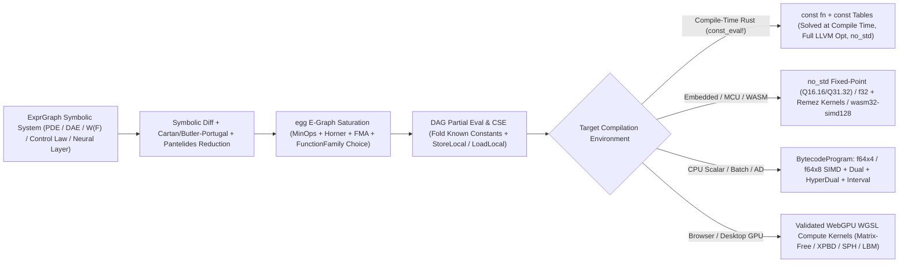

- **Audit C13, E6, F3 & F16 Remediation (`codegen.rs`, `vm.rs`)**: Replaces `CodeGenerator::compile_fn*` ([codegen.rs](../../crates/algebra-advanced/src/codegen.rs)) per-call `ExprGraph` cloning (which leaks nodes permanently into the shared `Arc<RwLock<Vec<ExprNode>>>` arena) and recursive tree `evalf` with distilled `BytecodeProgram` closures; fixes `emit_code` language-specific C99/Rust syntax (`1.powf`, `std::f64` leakage into C, `Constant::I -> 1.0`, `Neg`); completes `BytecodeVM::eval_dual` across all `Instruction` variants (`Sqrt`, `Pow`, `Tan`, `Abs`, `Atan2`, `Tanh`, `Fma`); and guards `eval_scalar` `.clamp()` against `min > max`/`NaN` alongside multi-target `TargetLanguage::{Rust, RustConstNoStd, C99, WasmSimd, Wgsl}` validation.
- **`const fn` Two-Stage `ConstLoweringPass` (`const_eval!` / `compile_const_solver!`, `Audit G3`)**:
  - Because `ExprGraph` uses `Arc<RwLock<Vec<ExprNode>>>` and heap strings/`BigInt`, symbolic arenas cannot execute directly in Rust `const fn`. Instead, lowering runs as a strict **two-stage `ConstLoweringPass`**: Stage 1 evaluates symbolic reductions, `Pantelides` index elimination, `Butler–Portugal` canonicalization, and `Remez` $L_\infty$ minimax coefficients *at proc-macro / codegen time*; Stage 2 emits pure stack-value Rust `const fn` evaluators and static lookup tables (`#![no_std]`) containing **zero `ExprGraph` or heap references**.
  - Transcendentals and non-`const` intrinsic calls (`exp`, `sin`, `erf`) lower automatically into pure-arithmetic **`const fn` `Remez` minimax rational/polynomial kernels** (plus Cody–Waite range reduction), unlocking full LLVM constant folding and dead-branch stripping with zero heap allocation.
- **`#![no_std]` Embedded & Minimal `WASM` Deployment**: Emits deterministic `#![no_std]` code over `f64`, `f32`, or fixed-point `Q16.16`/`Q31.32` integers (for DSPs and `ARM Cortex-M`/`RISC-V` MCUs lacking hardware FPU) and compact `wasm32-simd128` modules—meaning a controller or field evaluator compiled from a symbolic derivation runs inside an embedded autopilot or browser worker without bundling the symbolic CAS runtime!
- **Polynomial & Quadrature Speedup (`BytecodeVM`)**: Horner factoring + FMA fusion (`Instruction::Fma` in [vm.rs](../../crates/algebra-core/src/vm.rs)) cuts FLOP counts by $3\text{–}8\times$, executing identically across `f64`, `f64x4`/`f64x8` SIMD, `Dual<f64>` (JVP), `HyperDual<f64>` (Hessian), and directed-rounding `Interval`.

## 14. Functorial Domain Lifting, Transform Bridges, Non-Euclidean Manifolds & Holonomic $D$-Modules

### 14.1 Operator & PDE Domain Lifting (`lifting/router.rs`, `transforms.rs`, `branch.rs`, `pde/reduction.rs`)
Before defaulting to expensive brute-force meshing, the Orchestrator and explicit pipelines leverage URAE's algebraic transformation channels ([router.rs](../../crates/algebra-engine/src/lifting/router.rs), [transforms.rs](../../crates/algebra-engine/src/transforms.rs)):
- **Laplace–Fourier–Mellin Frequency Lifting**: Transforms linear viscoelasticity, transient wave equations, and Caputo fractional PDEs ([calculus.rs](../../crates/algebra-engine/src/calculus.rs), fixing Audit B2) into algebraic frequency-domain Helmholtz/elliptic systems, solving or preconditioning cleanly and retracting via FFT or Talbot/`AAA` rational Laplace inversion.
- **Conformal Mapping & Branch-Cut Geometry (`noneuclidean.rs`, `branch.rs`)**: Uses `SchwarzChristoffel` ([noneuclidean.rs](../../crates/algebra-engine/src/noneuclidean.rs)), Joukowski airfoil transforms, and `BranchCutManager` ([branch.rs](../../crates/algebra-engine/src/branch.rs)) to lift 2D potential flow, electrostatics, and fracture stress-intensity problems on complex polygonal/slotted domains to canonical circles/half-planes.
- **Exact Linearizing Transformations (`pde/reduction.rs`)**: Automatically applies **Cole–Hopf** ($u = -2\nu \partial_x \ln \phi$ reducing nonlinear viscous Burgers to the linear heat equation), **Kirchhoff transformation** (for temperature-dependent thermal conductivity $\kappa(T)$), and Bäcklund/Darboux soliton reductions.

### 14.2 Riemannian Manifolds, Cartan Forms & Non-Euclidean PDEs (`curvature.rs`, `cartan.rs`, `hecs.rs`)
- **Surface & Curved-Spacetime Continuum Mechanics**: Any parametric CAD surface or `MetricTensor` ([curvature.rs](../../crates/algebra-engine/src/curvature.rs)) supplies exact Christoffel symbols $\Gamma^\sigma_{\mu\nu}$ to formulate covariant conservation laws ($\nabla_\mu T^{\mu\nu} = 0$), Laplace–Beltrami diffusion $\Delta_g u = \frac{1}{\sqrt{|g|}}\partial_\mu(\sqrt{|g|} g^{\mu\nu}\partial_\nu u)$, and General Relativistic / shell bending equations directly on curved manifolds.
- **Symbolic Exterior Forms (`cartan.rs`, Audit C5)**: Upgrades `DifferentialForm` ([cartan.rs](../../crates/algebra-engine/src/cartan.rs)) from constant `f64` weights to `ExprId` coordinate-dependent coefficients so `d`, $\iota_X$, $\mathcal{L}_X$, and $\star$ symbolically generate weak forms before lowering to `FEEC`/`DEC` cochain matrices.
- **Non-Euclidean Spatial Carriers (`noneuclidean.rs`, `hecs.rs`)**: Unifies spherical weather/climate shallow-water FVM (`SphericalPoint`), icosahedral/hexagonal geodesic grids ([hecs.rs](../../crates/algebra-engine/src/hecs.rs)), and hyperbolic Poincaré-disk metamaterial/graph embeddings (`PoincareDiskPoint`).

### 14.3 Holonomic $D$-Modules & Special Function Recurrences (`weyl_dmodules.rs`, `special.rs`)
- Integrates [weyl_dmodules.rs](../../crates/algebra-engine/src/weyl_dmodules.rs) and [special.rs](../../crates/algebra-engine/src/special.rs) with `BEM` and `Spectral` solvers: holonomic differential equations and Almkvist–Zeilberger creative telescoping synthesize recurrence relations for oscillatory Hankel/Bessel/Spherical-Harmonic (`SphericalHarmonics`) kernels and high-frequency Filon/Levin oscillatory integrals—preventing catastrophic numerical cancellation at high wavenumbers $k \gg 1$.

### 14.4 Type-Guided Numerical $\to$ Symbolic Lifting & Structural Reconstruction (`NumericalLifter`)
To close the full bidirectional loop **Symbolic $\leftrightarrow$ Numerical**, URAE lifts opaque numeric values, arrays, compiled solver outputs, neural circuits, and black-box `FMU` trajectories back into symbolic `ExprGraph` forms guided by optional **`TypeHint`** metadata:

1. **Structured Type Hints (`TypeHint` / `SymbolicDomainHint`)**:
   - *Scalar & Arithmetic Domain Hints*: `IntegerOrHalfInt`, `ExactRational { max_denom }`, `QuadraticRadical` ($\mathbb{Q}(\sqrt{d})$), `AlgebraicNumber { max_deg }`, `PiMultiple` ($q\pi$), `EulerLog` ($e^r, \ln r$), `ComplexPolar`, and `PhysicalUnits(DimVector)`.
   - *Structural & Functional Hints*: `PolynomialDegree(d)`, `RationalOrder(l, m)`, `TrigonometricHarmonic`, `ExponentialSum`, `ContinuityClass` ($C^{-1}, C^0, C^k, C^\infty$), `PurelyAlgebraic` (no transcendentals), `CompactSupport`, `Monotonic`, `Convex`, `Parity` (`Even`/`Odd`/`Periodic(T)`), and `SymmetryGroup` ($SO(3), SE(3)$).
2. **Five Hint-Guided Lifting Engines**:
   - **`PSLQ` / `LLL` Integer-Relation & Hint-Constrained Continued Fractions**: Uses [numbertheory.rs](../../crates/algebra-engine/src/numbertheory.rs) plus multi-precision lattice reduction (`PSLQ`/`LLL` in `DoubleDouble`/`BigFloat`) so hinted floats recover exact canonical constants rather than giant arbitrary denominators (e.g., `0.7071067811865476` + `QuadraticRadical` $\to \frac{\sqrt{2}}{2}$; `2.356194490192345` + `PiMultiple` $\to \frac{3\pi}{4}$).
   - **Symbolic Trace Overloading (`TraceExpr`)**: Executes generic numeric Rust algorithms with a lightweight dual scalar tracking both runtime `f64` (to resolve branches) and symbolic `ExprId` DAG provenance, automatically emitting exact branched `Piecewise` expressions.
   - **Rational / Algebraic Kernel Lifting**: Fits opaque 1D/complex response curves via `AAA`, SVD `Padé`, quadratic `Hermite–Padé`, or `Prony` Matrix-Pencil, then snaps coefficients via `PSLQ` + `TypeHint`.
   - **Hint-Filtered `SINDy` & `MCTS` Distillation**: Discovers governing ODEs/PDEs and constitutive laws from time-series snapshots via [mcts.rs](../../crates/algebra-engine/src/mcts.rs) and `SINDy`, pruning dimensionally inconsistent ([buckingham_pi.rs](../../crates/cat-egraph/src/buckingham_pi.rs)) or `TypeHint`-violating candidate bases *before* sparse regression.
   - **Interval & Schwartz–Zippel Verification**: Validates every lifted expression back against the numeric source using directed-rounding `Interval` bounds and probabilistic zero-testing.

### 14.5 `FunctionFamilyLattice`: Ad-Hoc Semantic Swapping & Shared Approximations Across Step, Extremum, Impulse & Wave Families
Functions playing analogous mathematical roles frequently share the **exact same local Taylor, Padé, or `Remez` approximations**, yet exhibit vastly different symbolic tractability, smoothness, tail decay, and support properties. Extending [bridges.rs](../../crates/algebra-engine/src/simplify/bridges.rs) and [router.rs](../../crates/algebra-engine/src/lifting/router.rs), URAE encodes these families in a queryable **`FunctionFamilyLattice`** so lifting and lowering can choose *ad hoc* whichever member best fits the downstream solver:

#### Family A — Step, Switch, Gate & Activation Functions (Matched Origin Slope $\approx k$)
For unit transitions matching centered slope around $x=0$—e.g. $\sigma(2kx) = \frac{1+\tanh(kx)}{2}$, and $\tanh(kx),\; \operatorname{erf}(\frac{\sqrt{\pi}}{2}kx),\; \frac{2}{\pi}\arctan(\frac{\pi}{2}kx),\; \frac{kx}{\sqrt{1+(kx)^2}}$ all expand identically to $kx + O((kx)^3)$:

| Member Form | Regularity / Range | Support & Tail Decay | Downstream Trade-Offs & Best Symbolic/Numerical Target |
| :--- | :--- | :--- | :--- |
| **`Heaviside` $\Theta(x)$ / `Signum`** | $C^{-1}$; $\{0,1\}$ / $\{-1,1\}$ | Exact binary switch | Zero gradient a.e. (stalls Newton/AD); native to **SMT/CAD piecewise logic** |
| **Logistic `Sigmoid` $\sigma(kx) = \frac{1}{1+e^{-kx}}$** | $C^\infty$; $(0, 1)$ | Global; $O(e^{-k\|x\|})$ | Self-differentiating ($\sigma(1-\sigma)$); links via $\sigma(2x) = \frac{1+\tanh x}{2}$ |
| **Hyperbolic $\tanh(kx)$** | $C^\infty$; $(-1, 1)$ | Global; $O(e^{-2k\|x\|})$ | Zero-centered parity; sharp saturation; standard NN/PINN activation & Gudermannian link |
| **Gaussian $\operatorname{erf}(kx)$** | $C^\infty$; $(-1, 1)$ | Super-exponential $O(e^{-k^2 x^2}/x)$ | Closed-form Gaussian convolutions & heat/diffusion integrals |
| **Inverse Tangent $\frac{2}{\pi}\arctan(kx)$** | $C^\infty$; $(-1, 1)$ | Algebraic heavy tail $O(1/\|x\|)$ | Pure rational derivative $\frac{1}{1+(kx)^2}$; clean partial-fraction integration |
| **Algebraic Sigmoid $\frac{kx}{\sqrt{1+(kx)^2}}$ / $\frac{kx}{1+\|kx\|}$** | $C^\infty$ / $C^1$; $(-1, 1)$ | Algebraic tail $O(x^{-2})$ | **Purely algebraic (no $\exp/\ln/\operatorname{erf}$)** — keeps **`CAD` QE, `BKK` homotopy, `Puiseux`, and `no_std`/`const`** exact! |
| **`SmoothStep` / `SmootherStep` & `HardSigmoid`** | $C^1$ ($3t^2-2t^3$) / $C^2$ ($6t^5-15t^4+10t^3$) | **Exact compact $[0, 1]$** | Zero far-field leakage; ideal for finite-element CutFEM windows and CAD blending |

#### Family B — Extremum, Clamp, Contact & Envelope Variants (`max`, `min`, `abs`, `clamp`, `ReLU`)
Hard extrema $m(a,b) = \max(a,b)$ (and $\min$, $|x| = \max(x,-x)$, $\operatorname{ReLU}(x)=\max(0,x)$) admit multiple smooth surrogates with distinct structural guarantees:

| Variant | Analytical Formula (Pairwise / Vector) | Regularity & Bias | Convexity, Support & Best Fit |
| :--- | :--- | :--- | :--- |
| **Exact `max` / `min` / `\|x\|`** | $\max(a, b) = \frac{a+b+\|a-b\|}{2}$ | $C^0$; exact bounds, kink at $a=b$ | **Tropical semiring** ($\mathbb{T}_{\max}$), simplex/LP exactness |
| **LogSumExp / `KS` (`Boltzmann` LSE)** | $\operatorname{LSE}_\beta(\mathbf{x}) = \frac{1}{\beta}\ln\sum_i e^{\beta x_i}$ | $C^\infty$; $0 \le \operatorname{LSE}_\beta - \max \le \frac{\ln n}{\beta}$ | **Globally convex** (`InputConvexICNN`); standard aerospace **Kreisselmeier–Steinhauser** stress constraint |
| **Normalized Boltzmann Weighted Avg** | $\frac{\sum_i x_i e^{\beta x_i}}{\sum_i e^{\beta x_i}}$ | $C^\infty$; zero bias when $x_i = x_j$ | Unbiased at ties, **non-convex** (can dip slightly below $\max$ near boundary) |
| **Polynomial Compact `Quilez smin_k`** | $\max(a,b) + h^2\frac{k}{4}$ (quad) or $h^3\frac{k}{6}$ (cubic), $h=\max(k-\|a-b\|,0)/k$ | $C^1$ / $C^2$; **exact compact** $|a-b|>k$ | Zero warp outside radius $k$; gold standard for **CAD SDF fillets** and bounded blending |
| **$p$-Norm / Power Mean** | $(\sum_i |x_i|^p)^{1/p}$ ($p>1$) | $C^\infty$ (away from $0$); positive bias on equal args | **Positively homogeneous** & convex; algebraic gradients without $\exp/\ln$ for even integer $p$ |
| **Algebraic Radical Soft-Max / Soft-Abs** | $\frac{a+b+\sqrt{(a-b)^2+\epsilon^2}}{2}$,\; $\sqrt{x^2+\epsilon^2}$ | $C^\infty$; convex, monotone in $\epsilon \to 0$ | **Purely algebraic** — enables exact **`CAD`, Gröbner, `BKK` homotopy & `Puiseux`** analysis of smooth contact |
| **`Softplus` / `Huber` / `Charbonnier` / `GELU`** | $\frac{1}{\beta}\ln(1+e^{\beta x})$,\; `Huber`($C^1$ quad–linear),\; $x\sigma(\beta x)$ | $C^\infty$ / $C^1$; matches `ReLU` asymptotically | `Softplus`/`Huber` preserve convexity; `GELU`/`SiLU` allow smooth negative curvature near zero |

#### Family C — Impulse, Singularity, Friction & Wave Kernels + Ad-Hoc Lifting Policy
- **Connected Auxiliary Families**: Dirac impulses ($\delta \leftrightarrow$ Gaussian $\leftrightarrow$ rational Lorentzian $\frac{\epsilon}{\pi(x^2+\epsilon^2)}$ $\leftrightarrow$ compact Wendland/B-spline window), Coulomb $1/r$ softening (Plummer $\frac{1}{\sqrt{r^2+\epsilon^2}}$ $\leftrightarrow$ spectral Ewald $\frac{\operatorname{erfc}(\alpha r)}{r}$), dry friction ($\operatorname{sgn}(v) \leftrightarrow \tanh(v/v_0) \leftrightarrow \frac{v}{\sqrt{v^2+\epsilon^2}} \leftrightarrow$ `C-IPC` $C^1$ piecewise mollifier), and periodic waves ($\sin/\cos \leftrightarrow e^{i\theta} \leftrightarrow$ **Weierstrass rational** $\frac{2t}{1+t^2}$ $\leftrightarrow$ `Chebyshev` polynomials).
- **Ad-Hoc Context Selection Rule**: When `NumericalLifter` fits numeric samples to an accuracy band where multiple family members agree within noise or share the same truncated Padé/`Remez` polynomial, URAE delays hard commitment and resolves the member *ad hoc* against the target solver's `TargetConstraint` (`NeedsAlgebraicForCAD` $\to$ radical/Lorentzian/Weierstrass; `NeedsCompactSupport` $\to$ `SmoothStep`/`smin_k`/Wendland; `NeedsConvexity` $\to$ `LSE`/`Softplus`/radical; `NeedsConstEmbedded` $\to$ `Remez`/algebraic polynomial), while allowing immediate user override via `swap_family!` or the UI `⇔ Family Swap` pill.
- **Unification with Canonical Analytic Connections & Domain Contracts (`Part XVIII §§38–41`)**: Local smooth surrogate swapping integrates cleanly atop the canonical **`FunctionId`** registry (`Sec 38`), exact branch-guarded **`FunctionConnectionGraph`** bridges (`Bessel <-> Trig/Spherical`, `Trig <-> Hyperbolic <-> Euler Exp <-> Gudermannian <-> Log Inverses`, `_pF_q`/`MeijerG`/`FoxH`, `Sec 39`), cross-cutting **`MetricSpec`** policy (`Sec 40`), and source-mined **`FunctionContract`** domain/range/property verification (`Sec 41`).

## 15. Control Systems, Robotics, Stochastic/StatMech, Quantum/Clifford & Exact/Surreal Arithmetic Bridges

| Connected URAE Subsystem | Integration Mechanism with Continuum / CAD / AI Stack | Concrete Cross-Domain Payoff |
| :--- | :--- | :--- |
| **Control Systems & Robotics** ([control.rs](../../crates/algebra-engine/src/control.rs), [urscript_pose.rs](../../crates/algebra-engine/src/urscript_pose.rs), [se3_rotor.rs](../../crates/cat-anytime/src/se3_rotor.rs)) | Projects `FEA`/`CFD`/`IGA` systems via `POD`/`ECSW` or `pHNN` into continuous/discrete MIMO state-space models $(\mathbf{E}\dot{\mathbf{x}} = \mathbf{A}\mathbf{x} + \mathbf{B}\mathbf{u}, \, \mathbf{y} = \mathbf{C}\mathbf{x} + \mathbf{D}\mathbf{u})$ (remediating Audit C7 for general $n$-state stability, LQR/Ackermann pole placement, and Bode/Nyquist margins); couples `DiffCad` flexible deformations to `SE(3)` rigid-body links. | Closed-loop active flutter suppression on NACA airfoils, compliant soft-robot control, and CAD-verified collision-free trajectories. |
| **Stochastic, Rough Volatility & Statistical Mechanics** ([stochastic.rs](../../crates/algebra-advanced/src/stochastic.rs), [statmech.rs](../../crates/algebra-advanced/src/statmech.rs), [weil_ideal.rs](../../crates/cat-tangent/src/weil_ideal.rs), [distributions.rs](../../crates/algebra-engine/src/distributions.rs)) | Fixes Itô drift/quadratic-variation propagation in `weil_ideal.rs` (Audit B10) and empirical Silverman `GaussianKde`/CDF/CRPS/`EVT` in `distributions.rs` (Audit A7); adds `AdaptiveMilsteinSolver`, `MertonJumpDiffusionParams`, $O(1)$ `MarkovianOuSumApproximation` rough `fBM`/Volterra kernels, Bipower Variation `BV`, exact AR(1) OU calibration, and maps `ItoProcess`/`CanonicalPartitionFunction` into conservative `FokkerPlanckSolver` PDEs and `GENERIC` tensors. | Brownian microfluidics, rough turbulence/viscoelastic hereditary memory, rogue-wave/fatigue EVT tail reliability, and thermodynamically consistent fluctuations. |
| **Quantitative Risk, Econometrics & Discrete `ABM`/`LOB`** ([tail_risk.rs](https://github.com/Spodeian/Risky-Business/blob/dev/crates/factors/src/tail_risk.rs), [econometrics.rs](https://github.com/Spodeian/Risky-Business/blob/dev/crates/factors/src/econometrics.rs), [convex_opt.rs](https://github.com/Spodeian/Risky-Business/blob/dev/crates/factors/src/convex_opt.rs), [lob.rs](https://github.com/Spodeian/Risky-Business/blob/dev/crates/data/src/lob.rs), [validation.rs](https://github.com/Spodeian/Risky-Business/blob/dev/crates/backtest/src/validation.rs)) | Connects URAE linear/LP/polyhedral solvers (`linprog.rs`) to Higham `nearest_psd_matrix`, `Ledoit–Wolf` shrinkage, `ADMM` $L_1$-simplex/box `QP`, `ERC`/`HRP`/`CVaR`/`Black–Litterman`, `Newey–West HAC`/`ADF`/`KPSS`/`White`/`Hansen SPA`, `PurgedKFold` + `PSR`/`DSR`/`cscv_pbo`, and `LimitOrderBook` / `ABM` (`Avellaneda–Stoikov` + `AlmgrenChrissImpact`). | Audited out-of-sample SciML/sweep significance without lookahead bias, constrained sparse control allocation, and coupled physical-socioeconomic queue simulation. |
| **Clifford Algebra, Quantum & Tensor Networks** ([clifford.rs](../../crates/algebra-advanced/src/clifford.rs), [quantum.rs](../../crates/algebra-advanced/src/quantum.rs), [quantum_circuit.rs](../../crates/algebra-engine/src/quantum_circuit.rs), [qft.rs](../../crates/algebra-engine/src/qft.rs)) | Wires `CliffordMultivector` (Audit A2) into singularity-free Cosserat rods, geometrically exact shells, and `DEM` rigid orientations; shares the compressed `TT`/`MPS` tensor-network engine across high-dimensional Fokker–Planck PDEs and multi-qubit quantum/spin-chain simulations. | Singularity-free 3D large-rotation FEA/DEM without Euler gimbal lock; shared MPS acceleration for quantum & kinetic physics. |
| **Exact `auto-promoters`, $p$-Adics & Surreals** ([auto-promoters](../../crates/auto-promoters/src/lib.rs), [padic.rs](../../crates/algebra-advanced/src/padic.rs), [surreal.rs](../../crates/algebra-advanced/src/surreal.rs), [grobner.rs](../../crates/algebra-engine/src/poly/grobner.rs)) | Uses `auto-promoters` arbitrary-precision integers and `HenselLifter` ($p$-adic lifting) to solve ill-conditioned rational linear systems, exact `CAD` projections, and `Gröbner` bases (fixing Audit C12) cleanly; uses `SurrealNo` infinitesimals $\epsilon$ to organize matched asymptotic boundary-layer expansions. | Exact rational CAD/constraint invariants with zero float breakdown; formal multi-scale boundary-layer asymptotic matching. |
| **Legacy Strangler Bridge & Formal Proofs** ([cat-bridge](../../crates/cat-bridge/src/lib.rs), [proof.rs](../../crates/algebra-advanced/src/proof.rs)) | `ShadowVerifyHarness` validates refactored matrix-free/SIMD paths against legacy AST oracles; `ProofTrace` (fixing Audit A9) emits genuine `Lean 4`/`Coq` verification theorems for algebraic simplifications, conservation identities, and AI bounds. | Zero-regression incremental migration and end-to-end formally certified pipelines. |

---

# Part IX — Time & Memory Efficiency Engineering

## 16. Cache-Oblivious Layouts, Sum Factorization, Mixed-Precision Refinement, `Revolve` Checkpointing & `ResourceBudget` Envelopes

### 16.1 Cache-Oblivious `SoA` Arenas & Space-Filling Curves
- **Structure-of-Arrays (`SoA`) & 64-Byte Cache Alignment**: All mesh vertices, cell states $(\rho, \rho u, \rho v, \rho w, \rho E)$, NURBS control points, and SPH/DEM/PIC particles are stored in contiguous `SoA` buffers (`Vec<f64>` per component) rather than pointer-chasing `Vec<Vec<f64>>` (eliminating heap fragmentation in current `FeaMesh::nodes` in [pde/fea.rs](../../crates/algebra-engine/src/pde/fea.rs)).
- **3D Morton (Z-Order) & Hilbert Space-Filling Curves**: Periodically reorders mesh elements, sparse matrix rows (`RCM` / nested dissection + Hilbert), and particle arrays so 3D spatial neighbors sit adjacent in L1/L2 cache and SIMD registers, achieving $>90\%$ cache-line utilization and $O(N)$ parallel radix-tree `BvhTree` rebuilds.

### 16.2 Matrix-Free Tensor-Product Sum Factorization
Assembling dense or CSR global stiffness matrices on high-order 3D hex/NURBS meshes ($p \ge 3$) requires $O(p^{2D}) = O(p^6)$ operations and memory per element. URAE's matrix-free operator applies element integrals using **1D tensor-product sum factorization**:
$$
\mathbf{y}_e = \sum_{\alpha,\beta,\gamma} \mathbf{B}_1^T \mathbf{B}_2^T \mathbf{B}_3^T \left[ \mathbf{D}_{\alpha\beta\gamma} \, \mathbf{B}_3 \mathbf{B}_2 \mathbf{B}_1 \mathbf{u}_e \right]
$$
reducing per-element FLOPs from $O(p^6)$ to $O(3 p^4)$ and eliminating element-matrix memory allocation altogether ($O(N_{\text{dof}})$ footprint)—enabling $10^7+$ DOF `IGA`/`FEM`/`DG` solves on single workstations and GPUs.

### 16.3 Mixed-Precision Iterative Refinement & Compute Lanes
- **Mixed-Precision Preconditioned Krylov**: Stores heavy preconditioners (`SA-AMG` hierarchy, `ILU(k)`, `HMatrix` low-rank $\mathbf{U}\mathbf{V}^T$ blocks, `KIFMM` M2L translations) in `f32` (cutting memory bandwidth and RAM by $50\%$ and doubling SIMD width), while computing outer Krylov inner products, matrix-vector products, and defect updates $\mathbf{r}_k = \mathbf{b} - \mathbf{A}\mathbf{x}_k$ in `f64` (or `DoubleDouble`), recovering full 53-bit `f64` convergence in 1–2 outer refinement steps.
- **Tiered Execution Backends**: Rayon work-stealing multi-core CPU (`f64x4`/`f64x8` SIMD), `wgpu`/WGSL compute shaders for regular grids / `LBM` / `SPH` / matrix-free `FEM`, and bounded `wasm32-simd128` execution in browsers.

### 16.4 Optimal `Revolve` Adjoint Checkpointing & Extended `ResourceBudget` Envelopes
- **Binomial `Revolve` Adjoint Checkpointing**: Unsteady transient CFD, FSI, and `NeuralOde` adjoint backpropagation (remediating Audit C6 in [neural_ode.rs](../../crates/algebra-engine/src/neural_ode.rs)) never caches all $N_t$ time steps in RAM. Using Griewank–Walther binomial checkpointing (`Revolve`), storing just $c \approx O(\log N_t)$ or $O(\sqrt{N_t})$ snapshots bounds peak memory while incurring at most a $1.5\text{–}3\times$ recomputation factor.
- **Resource-Aware Soft & Hard Cap Integration ([config.rs](../../crates/algebra-core/src/config.rs))**:

| Subsystem Resource | `EMBEDDED` (WASM `64 MB`) Soft / Hard | `DEFAULT` (Desktop `512 MB`) Soft / Hard | `HPC` (Workstation `32 GB`) Soft / Hard | Graceful Degradation on Soft Cap |
| :--- | :--- | :--- | :--- | :--- |
| **Mesh / Grid DOFs** | `25k` / `100k` | `250k` / `2M` | `10M` / `100M` | Freeze $hp$-refinement; coarsen far-field via `MAT`/ROM; switch to matrix-free `f32` preconditioner |
| **Particles (`SPH`/`DEM`/`PIC`)** | `10k` / `50k` | `150k` / `1M` | `10M` / `100M` | Merge distant bulk particles back into `FVM` cells; switch `DFSPH` to relaxed tolerance |
| **Krylov / `HMatrix` Memory** | `16 MB` / `48 MB` | `128 MB` / `384 MB` | `4 GB` / `24 GB` | Cap `GMRES(m)` restart $m \le 20$; coarsen `ACA+` tolerance $\epsilon_{\mathcal{H}} \leftarrow 10\epsilon_{\mathcal{H}}$ |
| **Transient Adjoint Tape (`Revolve`)** | `8` / `16` checkpoints | `32` / `128` checkpoints | `256` / `2048` checkpoints | Spill compressed `f32` snapshots to disk/IndexedDB or trigger binomial re-partitioning |
| **AI Verification (`Zonotope`/`CAD`)** | `64` / `256` generators | `512` / `4096` generators | `4096` / `65536` generators | Apply Girard order-reduction merging collinear zonotope generators safely outward |

### 16.5 Unified Hardware Roofline, Memory Waterfall & 5-Tier Utopia-Knee Pareto Search
Generalizing [roofline.rs](https://github.com/Spodeian/ai-designer/blob/dev/crates/shared/src/analysis/roofline.rs) and [pareto_search.rs](https://github.com/Spodeian/ai-designer/blob/dev/crates/shared/src/advisor/pareto_search.rs) from `ai-designer` across *both* neural networks and numerical PDE/CAD discretizations:
- **Generalized Roofline & Memory Waterfall (`RooflineReport`)**: Computes operational intensity ($\text{FLOPs/Byte}$), compares against the detected CPU/GPU ridge point to classify `ComputeBound` vs. `MemoryBandwidthBound`, predicts critical sequence/mesh size before OOM, and decomposes total RAM/VRAM across **Mesh/Model Weights**, **Solver States / Optimizer Moments** (`Muon` 4 bytes/param vs. `AdamW` 8 bytes/param vs. Krylov basis vectors), **Transient Checkpoints / Activations**, and **Cache / Multipole Trees**.
- **5-Tier Pareto Frontier & Utopia-Knee Selection**: Automatically synthesizes 5 calibrated solver/model candidates (*1. Edge-Minimal*, *2. Latency-Optimal*, *3. Workstation-Balanced*, *4. High-Capacity/Accuracy*, *5. Frontier-Extreme*), computing the exact non-dominated Pareto front and Utopia-knee configuration for `ResourceBudget`.

### 16.6 Anomaly-Pinned `SHA-256` Content-Addressed Storage (`CAS`), `ArrowColumnarBatch` & `DuckDB WASM` Streaming Lake
Generalizing the lake and columnar streaming abstractions from [arrow_duckdb.rs](https://github.com/Spodeian/Risky-Business/blob/dev/crates/data/src/arrow_duckdb.rs), [pipeline.rs](https://github.com/Spodeian/Risky-Business/blob/dev/crates/shared/src/pipeline.rs), and [federated_ecosystem_blueprint.md](https://github.com/Spodeian/Risky-Business/blob/dev/docs/microstructure/federated_ecosystem_blueprint.md) for high-volume simulation and time-series workloads:
- **Zero-Copy Columnar `ArrowColumnarBatch` & Client-Side `DuckDbQueryBuilder`**: Stores high-frequency event ticks, ensemble trajectories, and parameter-sweep snapshots in contiguous `SoA` Arrow buffers serialized as `Parquet` partitions, exposing SQL analytics cleanly inside both desktop workspaces and WASM browser sandboxes (`DuckDB WASM`).
- **Cryptographic `SHA-256` `CAS` with Anomaly-Pinned Eviction Immunity**: Extends LRU/byte-budget cache management (alongside `.catb` / `Zarr`) with deterministic `SHA-256` content addressing where high-rarity tail events, solver bifurcation cusps, flash-crash anomalies, and verified theorem traces are **pinned exempt from LRU eviction**, preventing catastrophic forgetting in rehearsal/replay loops (`ExperienceReplayBuffer` / `CrisisEngramBank`).

### 16.7 Dynamic `AnalysisPlan` Compilation (`AGM`/Polyhedral), Depth-Bounded Arenas & `PortableExpr` Determinism (`E4`, `E8`, `G4`)
Complementing physical storage layouts (`16.1–16.6`), all symbolic, tensor, relational, and numerical execution paths compile through **`AnalysisPlan` (`Section 37`)** over shared low-overhead arenas:
- **Depth-Capped Iterative Walkers & DAG Memoization (`Audit E4`)**: Every AST traversal (`graph.rs::{substitute, has_symbol}`, `parser.rs`, `vm.rs::compile_expr` populating `subexpr_cache`, `format.rs`, `simplify/*`, `calculus`, `risch`, `solver`, `limits`) executes via an explicit heap worklist + `FxHashMap` DAG memo table bounded by `ResourceBudget::max_ast_depth` (`Err(DepthLimitExceeded)`), preventing $O(2^D)$ blowup and `wasm32` `1–2 MB` stack overflows, while `ExprGraph::intern` enforces `len < u32::MAX - 1` (`Audit E4`) and `ComputeFuture::block_on` (`stream.rs`) pairs async polling on WASM with an RAII `Drop` wake guard on native (`Audit E2`).
- **Zero-Heap Unboxed Algebraic Arenas (`FlatPoly`/`SmallRational`, `Section 26.2`)**: Symbolic CAS loops (`F4`, `van Hoeij`, `Risch`) operate on contiguous bump-allocated `SmallVec` coefficient arenas rather than recursive `ExprId` trees when pure polynomial/modular arithmetic suffices, eliminating heap churn.
- **`PortableExpr` Self-Contained Serialization & `BTreeMap` Determinism (`Audit E8, G4`)**: Raw `ExprId(u32)`/`SymbolId`/`DomainId` arena indices never cross IPC, `SHA-256 CAS`, `Seed-42`, or disk boundaries; all persisted lemmas, `MathStep` traces, coordinate transforms, and session files serialize canonical content-addressed `PortableExpr` mini-DAGs over sorted `BTreeMap` iteration (`SessionData::schema_version`).
- **Treewidth `AGM` Contraction + Polyhedral Loop Tiling**: Tensor `einsum`, Kalman/Bayesian factor marginalizations, FEM sum-factorized kernels, and `Arrow`/`DuckDB` SQL joins share `Tamaki` treewidth ordering (`Section 33`) paired with affine polyhedral loop tiling for L1/L2 cache residency and `WGSL`/`SIMD` register coalescing.
- **Incremental DAG Invalidation & Dynamic Constraint Re-Planning (`Section 3.3`)**: When interactive parameters, `AssumptionsContext` (`ScopeFrame`), `ExecutionObjective`, or `DynamicCarrierPromotion` precision requirements change at runtime, `AnalysisPlan` hashes affected subgraphs (`SHA-256`), hot-swaps only downstream compiled blocks across `(TimeConstraint, AccuracyGoal, MemoryConstraint)` targets, and preserves unaffected memoized subtrees intact.

---

# Part X — Numerical Accuracy, Conditioning & Certified Mathematical Rigor

## 17. Compensated Arithmetic (`TwoSum`/`Dot2`), Portable Outward Rounding, Multi-Precision Towers & Exact Predicates

### 17.1 Compensated Summations & Error-Free Transformations
- **Ogita–Rump–Oishi `Dot2` & `TwoSum`/`TwoProd` (Hardware `FMA`)**: Accumulates all Krylov dot products $(\mathbf{r}, \mathbf{r})$ and $(\mathbf{p}, \mathbf{A}\mathbf{p})$, global flux conservation integrals, long-horizon Hamiltonian energy checks, and `WENO` smoothness indicators in compensated 106-bit effective precision (`sum + corr`) with only ~4 extra register instructions per term—preventing Krylov orthogonality loss on condition numbers up to $\kappa \sim 10^{14}$.

### 17.2 Condition-Triggered Adaptive Precision Tower & Portable `wasm32` Outward Rounding (`Audit F4, F5, G6`)
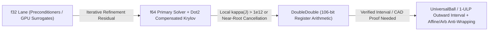
- **Portable IEEE `1-ULP` Outward Rounding (`Audit F5, G6`)**: Because WebAssembly (`wasm32`) provides no dynamic hardware `fesetround` rounding-mode control register, [interval.rs](../../crates/algebra-core/src/interval.rs) and `UniversalBall` enforce bit-exact `f64::next_up`/`f64::next_down` outward inflation after arithmetic operations (strictly rejecting `NaN`/inverted intervals, enforcing `[0,0]*[inf,inf]` / `0/0` / pole-aware trig semantics, and applying Smith scaling for complex division `Audit F4`), paired with Affine Arithmetic / Taylor Models / `Arb` midpoint-radius balls (`Section 25.1`) to tame interval wrapping in iterative ODE/Krylov loops and `.total_cmp()` across all float sorts (`Audit E6`).
- **Transparent Precision Escalation**: Whenever a local dense pivot, Vandermonde FDM stencil, `AAA` Loewner SVD, or `cad/mod.rs` polynomial discriminant encounters $\kappa > 10^{12}$, URAE automatically promotes that local sub-block to `DoubleDouble` (`f128` hi+lo pair) or exact `auto-promoters` rational arithmetic without forcing the entire global mesh into slow multiprecision.

### 17.3 Shewchuk Adaptive Precision Geometric Predicates
- Implements exact floating-point expansion cascades for `orient2d`, `orient3d`, `incircle`, and `insphere`, backed by `auto-promoters` exact `BigInt` determinant fallback on degenerate coplanar/cospherical ties. Eliminates topological mesh inversion, `B-Rep` CSG boolean self-intersections, and `CutFEM` sliver crashes permanently.

### 17.4 Complete 27-Format Numeric & Precision Lattice Integration
Incorporates the full 27-format precision lattice from [precision.rs](https://github.com/Spodeian/ai-designer/blob/dev/crates/shared/src/spec/precision.rs) and [GLOSSARY_AND_NOTATION.md](https://github.com/Spodeian/ai-designer/blob/dev/docs/GLOSSARY_AND_NOTATION.md) directly into URAE's arithmetic, mixed-precision solvers, and AI quantization analyzer:
- **Standard & Minifloat IEEE/OCP Microscaling**: `FP64`, `FP32`, `TF32`, `FP16`, `BF16`, `FP8` (`E4M3FN`, `E4M3FNUZ`, `E5M2`, `E5M2FNUZ`), `FP4E2M1`, and OCP shared-scale `MXFP8`, `MXFP6` (`E3M2`/`E2M3`), and `MXFP4`.
- **Integer, Ternary & Sub-Bit**: `INT32`, `INT16`, `INT8` (sym/asym), `UINT8`, `INT4` (sym/asym), `NF4`, `SF4`, `INT2`, `BitNet158b` ($\{-1, 0, +1\}$ multiplication-free ternary), and `BinaryXnor` (1-bit popcount).
- **Non-IEEE Scientific, Lattice & Cryptographic Formats**:
  - **Tapered-Precision `Posit8_0`, `Posit8_1`, `Posit16_1` + Exact Quire Accumulator**: Delivers higher accuracy near $\pm 1$ and fused exact dot products without intermediate rounding.
  - **Logarithmic Number System (`LNS8`)**: Converts multiplications into exact fixed-point additions for DSP and neuromorphic kernels.
  - **`E8LatticeQTIP` (2.5-Bit Vector Quantization)**: Directly connects URAE's `E8Lattice` (240 roots in [exceptional_lie.rs](../../crates/algebra-engine/src/exceptional_lie.rs)) to 8D kissing-sphere lattice quantization of neural weights and ROM bases!
  - **Verifiable & Encrypted Substrates**: `ZKMLFiniteFieldFp`, `CKKSRingLWE`, and `IBPCROWNIntervalBounds`.

## 18. Positivity-Preserving, Entropy-Stable, Well-Balanced Schemes & Guaranteed Error Certificates

### 18.1 Structure-, Positivity- & Entropy-Preserving Numerical Schemes
- **Zhang–Shu Positivity-Preserving Limiters**: Scales high-order `WENO5` / `DG` / `FVM` polynomial reconstructions linearly toward cell averages whenever quadrature points approach negative density $\rho \le 0$ or internal energy $e \le 0$—preserving formal high order in smooth regions while preventing vacuum/near-shock NaN crashes.
- **Tadmor Entropy-Conservative & Entropy-Stable Fluxes**: Couples two-point entropy-conservative volume/face fluxes ($\llbracket \mathbf{v} \rrbracket^T \mathbf{\Phi}^* = \llbracket \boldsymbol{\psi} \rrbracket$) with matrix entropy dissipation (using entropy variables $\mathbf{v} = \partial_{\mathbf{U}} \eta$) so discrete Second-Law entropy satisfies $\partial_t \eta(\mathbf{U}_i) + \text{fluxes} \le 0$ unconditionally.
- **Well-Balanced & Divergence-Cleaning Schemes**: Implements Audusse hydrostatic reconstruction (zero spurious gravity-wave currents on resting lakes/atmospheres) and Generalized Lagrange Multiplier (`GLM`) / Constrained Transport ($\nabla_h \cdot \mathbf{B} \equiv 0$) for MHD and plasma `PIC`.

### 18.2 Guaranteed Constant-Free Error Bounds & Computer-Assisted Proofs
- **Prager–Synge Equilibrated Flux Reconstruction**: Alongside goal-oriented **DWR** indicators, reconstructs an $H(\operatorname{div})$-conforming flux $\boldsymbol{\sigma}_h$ satisfying $-\nabla \cdot \boldsymbol{\sigma}_h = f$ locally on vertex patches to provide a **mathematically guaranteed, constant-free upper bound** on the true energy error:
  $$
  \| \nabla(u - u_h) \|_{L^2(\Omega)} \le \| \nabla u_h + \boldsymbol{\sigma}_h \|_{L^2(\Omega)}
  $$
- **Radii-Polynomial Banach Contraction Certificates**: For critical nonlinear ODE/PDE equilibria and periodic orbits, pairs URAE's Newton-Krylov approximations with `Interval`/`UniversalBall` Newton–Kantorovich operators ($Y_0 + (Z_1 - 1) r + \frac{1}{2} Z_2 r^2 < 0$) to yield rigorous computer-assisted proofs of true continuous solution existence and uniqueness inside an explicit error radius $r^*$.

---

# Part XI — User Quality of Life (QoL), Explainable Auto-Pilot & Cross-Ecosystem Ergonomics

## 19. Progressive Disclosure, "Why This Method?" Provenance, Method Arena & Self-Healing Diagnostics

### 19.1 Three-Level Progressive Disclosure API
Users interact at their exact desired altitude without boilerplate cliffs:
- **Level 0 — Zero-Config Automagic (`solve_auto!`)**: Write the physical equation or drop a CAD file + boundary loads; URAE automatically verifies SI dimensional consistency (`physics.rs`), infers named boundary groups, selects and couples methods, and streams progressive answers.
- **Level 1 — Declarative Knob Overrides**: Override single intents without rewriting solver plumbing: `solve_auto!(problem, accuracy = 1e-8, prefer_method = Bem, preserve = [Energy, Mass], budget = ResourceBudget::DEFAULT)`.
- **Level 2 — Full Explicit Composition (`compose_solvers!`)**: Complete `OpenHypergraph` control over every subdomain, coupling morphism, preconditioner, precision tower, and time stepper.

### 19.2 Interactive "Why This Method?" Provenance & Side-by-Side Method Arena
- **Structured `OrchestrationProvenance` Inspection**: Every auto-solved result exposes an expandable provenance card in `urae-notebook` / `urae-wasm` / `urae-cli`:
  - Computed dimensionless numbers ($\operatorname{Re}, \operatorname{Ma}, \operatorname{Pe}, \operatorname{Kn}, \operatorname{We}, \kappa$) with clickable `DocRegistry` explanations.
  - Exact decision trace explaining *why* each subdomain received `IGA`, `FVM-HLLC`, `FMM-BEM`, `DFSPH`, or `VEM`, *why* `IQN-ILS` or `Costabel` coupling was attached, and how many iterations the Tier-0 `FNO`/`POD-ROM` warm-start saved.
  - One-click **"Export as Explicit `compose_solvers!` Pipeline"** button turning any automagic run into editable, reproducible explicit code!
- **Side-by-Side Method Arena**: One click runs alternative discretizations (e.g., `IGA` vs. `FEM-Tet10` vs. `RBF-FD` vs. `VPINN`) on the user's exact problem and renders a live **Accuracy vs. Wall-Clock Time vs. Memory Pareto Frontier** plot.

### 19.3 Self-Healing Solver Diagnostics & Automatic Recovery Matrix

| Failure / Pathology Detected | Automatic Root-Cause Diagnosis | Automated Self-Healing Recovery Action |
| :--- | :--- | :--- |
| **Singular FEA Stiffness ($\det \mathbf{K} = 0$)** | Detects exact near-zero rigid-body nullspace vectors (translation/rotation modes) via SA-AMG tentative prolongator | Pinpoints unconstrained CAD body/DOF in 3D viewport and offers 1-click **Inertia Relief** (for free-flying structures) or minimal-constraint virtual springs |
| **Non-Watertight CAD Gap / Self-Intersection** | Boundary edge loop check + `BvhTree` self-intersection scan highlights open naked edges in bright red | Offers automatic tolerance-controlled edge stitching, or switches seamlessly to `VEM` / `CutFEM` / `SdfField` Dual Contouring |
| **CFD Divergence / Negative Density or Carbuncle** | Monitors cell CFL, positivity violation ($\rho, e \le 0$), and shock alignment | Automatically halves time step, enables Zhang–Shu positivity limiter + local `Rusanov`/entropy fix on shock faces, and rolls back cleanly from previous step |
| **Newton Stalls Near Fold / Snap-Through Buckling** | Detects line-search step collapse and Jacobian smallest eigenvalue $\lambda_{\min} \to 0$ | Automatically switches from load-controlled Newton to **Pseudo-Arclength Continuation**, tracing past the limit point |
| **BEM Near-Resonance or Fictitious Frequency** | Detects condition spike in exterior Helmholtz operator $\kappa(\mathcal{A}) \gg 10^8$ | Automatically engages **Burton–Miller** combined integral formulation ($\text{CBIE} + i\eta\,\text{HBIE}$) |
| **PINN Loss Plateau / Mode Collapse** | `eNTK` eigenvalue spread exceeds $10^6$ across PDE vs. BC terms | Dynamically rebalances residual weights via NTK trace ratio, adds `RAR` collocation points at high-residual peaks, and switches from Adam to **L-BFGS** |
| **55+ AI Architecture & Hardware Defects** ([diagnostics.rs](https://github.com/Spodeian/ai-designer/blob/dev/crates/shared/src/advisor/diagnostics.rs)) | Flags coupled RoPE in `MLA`, Euler drift on Hamiltonian nets, unnormalized `Muon` 1D vectors, non-orthogonal `abliteration` vectors, and `OOM` sequence horizons | Applies 1-click AST `SpecMutation` quick-fixes (`SetDecoupledRoPE`, `SetSymplecticEnergyConservationLoss`, `SetCurlFreeConstraint`, `SetCBFQPConstraint`, `EnableMuonPartitioning`) |

## 20. Live Interactive (`60 Hz` Default / `15 Hz` Soft Min) Scrubbing, `const` Embedded/WASM Codegen, Seed-42 Parity & Cross-Crate Integration

- **Sub-Frame Parametric Tangent Scrubbing (`TargetFps` Planner Policy)**: When dragging CAD/physics parameter sliders in `urae-notebook` ([app.rs](../../crates/urae-notebook/src/app.rs)) or `urae-wasm`, `ExecutionPlanner` uses interactive `TimeConstraint::TargetFps` (scaling to live monitor headroom) to evaluate first-order adjoint sensitivity updates $\mathbf{u}(\mathbf{p}_0 + \Delta\mathbf{p}) \approx \mathbf{u}(\mathbf{p}_0) + \left(\frac{\mathrm{d}\mathbf{u}}{\mathrm{d}\mathbf{p}}\right)\Delta\mathbf{p}$, `POD-DEIM`/`FNO`, or `const` precomputed kernels in `< 1–8 ms`, while background workers ([worker.rs](../../crates/urae-notebook/src/notebook/worker.rs)) refine smoothly to full `AccuracyGoal` (`atol`/`rtol`/`Exact`) when interaction pauses.
- **Compile-Time `const` & Zero-Alloc `#![no_std]` / WASM Deployment (`codegen.rs`, `const_eval!`)**: Distills verified symbolic systems (`ExprGraph`, stencils, quadrature, `Remez` minimax kernels, LQR/kinematic policies) directly into dependency-free Rust `const fn` evaluators, `#![no_std]` embedded fixed-point (`Q16.16`/`f32`) binaries, and minimal `wasm32-simd128` modules—solving static subproblems during compilation and leveraging full LLVM optimization passes.
- **Seed-42 Transitive Parity & 6-Track Export (`urae-aid-bridge`)**: Integrates [parity_verifier.rs](https://github.com/Spodeian/ai-designer/blob/dev/crates/shared/src/analysis/parity_verifier.rs) (deterministic Seed-42 activation range and NaN/Inf condition sweeps), [universal.rs](https://github.com/Spodeian/ai-designer/blob/dev/crates/shared/src/format/universal.rs) (`.aid` CRC32 binary & `.aidpkg` 64-byte page-aligned `safetensors` bundles), and [bridge/src/lib.rs](https://github.com/Spodeian/ai-designer/blob/dev/crates/bridge/src/lib.rs) 6-track export (`PyTorch 2` + `torch.compile`, `JAX/Equinox`, `Rust Candle`, `WebGPU WGSL`, `OpenAI Triton`, `GGUF`) with cross-backend `verify_and_bench.py` parity harnesses.
- **`Viewport3D` Multiphysics & AI Visualizers**: Native GPU/projected rendering of deformed CAD meshes, principal stress streamlines, CFD LIC/velocity ribbons, SPH/DEM/3D-Gaussian-Splat particles, cut-plane slices, persistence barcodes, and AI Hessian/WeightWatcher spectra & tropical decision polytopes.
- **`urae-lsp` ([urae-lsp/src/lib.rs](../../crates/urae-lsp/src/lib.rs))**: Live inline dimensional-unit warnings (`DimVector`), mesh aspect-ratio/Jacobian quality hints, hover cards displaying compiled FDM stencil weights and PDE classification (`Elliptic`/`Hyperbolic` + stiffness), and code actions converting `solve_auto!` $\to$ explicit `compose_solvers!`.
- **`urae-py` ([urae-py/src/lib.rs](../../crates/urae-py/src/lib.rs)) & `urae-ffi` ([urae-ffi/src/lib.rs](../../crates/urae-ffi/src/lib.rs))**: Zero-copy `DLPack` / `Buffer Protocol` / `Arrow` interop exporting `CsrMatrixF64`, `SoA` particle clouds, and `NeuralSystemGraph` weights directly to NumPy, PyTorch, JAX, and ParaView (`VTU`/`XDMF`/`HDF5`).
- **`cat-lang` ([cat-lang/src/lib.rs](../../crates/cat-lang/src/lib.rs))**: Canonical lossless **`UraeScript` / `CatScript` (`Part XIX §§42–45`)** round-trips all matrices, sets, integrals, units (including `PlaneAngle`), `define`/`let`/`assume`/`declare`, and isolated JS-style lexical `ScopeFrame` blocks without `"opaque"` losses (`Track I3`), while binary `.catb` persistence caches compiled `BytecodeProgram` kernels, `POD-DEIM` hyper-reduction bases, and `BvhTree` hierarchies alongside notebook expressions for instantaneous zero-cold-start re-opening.
- **Autonomous `CurriculumPhase` Studio, `TelemetryDashboard` & Federated Ecosystem Closed Loop**: Adopting [studio.rs](https://github.com/Spodeian/Risky-Business/blob/dev/crates/cli/src/studio.rs), [tearsheet.rs](https://github.com/Spodeian/Risky-Business/blob/dev/crates/backtest/src/tearsheet.rs), and [federated_ecosystem_blueprint.md](https://github.com/Spodeian/Risky-Business/blob/dev/docs/microstructure/federated_ecosystem_blueprint.md):
  - **Curriculum Progression (`StudioSessionState` / `CurriculumPhase`)**: Stages SciML/agent training seamlessly through *(1) Cache Replay* (warm historical/CAS snapshots) $\to$ *(2) Synthetic Rough-`fBM` & Jump-Diffusion Shocks* $\to$ *(3) Continuous Live Tick & `TGN`/`ABM` Contagion*, streaming BSON/JSON/CSV and standalone HTML Chart.js `TelemetryDashboard` tearsheets (`PerformanceReport`: Sortino, Calmar, Omega, Kelly).
  - **4-Repo Federated Feedback Contract (`Risky Business <-> spodeian-lake <-> spodeian-ml <-> algebra-engine`)**: Pairs URAE's `urae-aid-bridge` (`.aidpkg`/6-track `ai-designer` loop) with a parallel federated discovery loop: `Risky Business` emits synthetic crisis/microstructure trajectories $\to$ `spodeian-lake` persists anomaly-pinned `SHA-256` Parquet partitions $\to$ `spodeian-ml` distills `CrisisEngramBank` + `SAM` + Dual-Speed `RLS` models $\leftrightarrow$ **`algebra-engine` supplies neural-guided MCTS formula discovery (`mcts.rs`), multi-prime Schwartz–Zippel equivalence checks, and Gröbner lemma mining (`lemma_miner.rs`)**, deploying verified `.safetensors` weights and `const`/WASM evaluators back into real-time inference.

---

# Part XII — Concrete Workspace Crate Blueprint, Eight-Wave Roadmap & Verification Matrix

## 21. Concrete Crate, Module & Macro Architecture Blueprint

### 21.1 Module & Crate Placement Map

| Target Crate / Directory | New / Expanded Files | Key Traits, Structs & Responsibilities |
| :--- | :--- | :--- |
| **`crates/algebra-core`** | `src/linalg_num.rs` *(new)*, `src/compensated.rs` *(new)*, `src/precision_lattice.rs` *(new)*, `src/interval.rs` *(exp)*, `src/vm.rs` *(exp)* | `SoA` buffers, `TwoSum`/`TwoProd`/`Dot2`, `DoubleDouble` (`f128`), Shewchuk predicates, full **27-Format Precision Lattice** (`FP64`–`BinaryXnor`, `MXFP*`, `Posit`+Quire, `LNS8`, `E8LatticeQTIP`), directed-rounding `Interval` zonotopes, SIMD `BytecodeProgram` lanes. |
| **`crates/cat-core`** & **`cat-anytime`** | `cat-core/src/coupling.rs` *(new)*, `cat-anytime/src/scheduler.rs` *(fix B9 + DWR)* | `CouplingEdge` hypergraph descriptors; genuine progressive refinement in `AnytimeHandle`; DWR & Prager–Synge tolerance stopping criteria. |
| **`crates/algebra-engine`** *(Solvers, Multi-Solution, MOR, TT & UQ)* | `src/solvers/{mod.rs, sparse_num.rs, krylov.rs, amg.rs, hmatrix.rs, nonlinear.rs, multi_solution.rs, quadrature.rs, aaa.rs, rom_deim.rs, tensor_train.rs, uq_gpc.rs, parareal.rs}` *(new)* | `CsrMatrixF64`, Sparse Cholesky/LU, compensated PCG/MINRES/GMRES/FGMRES/BiCGSTAB, SA-AMG, `HMatrix` (ACA+), JFNK, Pseudo-Arclength Continuation, `MultiSolutionExplorer` (`FBB` Deflated Newton, `BKK` Polyhedral Homotopy, `Krawczyk`, Bifurcation Branch-Switching, `MAP-Elites`/`SVGD`), `AAA` rational/NEP, `POD`/`LSPG`/`Q-DEIM`/`ECSW`, `TensorTrain`/`AMEn`, `gPC`/`MLMC`/`QMC`, `Parareal`/`MGRIT`, Duffy/Sinh-Tanh quadrature. |
| **`crates/algebra-engine`** *(Curve, Spline, Series & Resummation Expansions)* | `src/expansions/{mod.rs, splines.rs, ph_clothoid.rs, puiseux_transseries.rs, pade_resum.rs, remez_orthogonal.rs}` *(new)*; `src/series.rs` *(fix A6/B5/C12)*; `src/iga.rs` *(exp)* | `ExpansionRepresentation` conversion graph; `AS-T-Splines`, `LR`/`THB`/`PHT`-Splines, centripetal `Catmull–Rom`/`TCB`/`PCHIP`/`Akima`/`Steffen`/Tension/`P-Splines`/`TPS`; planar/quaternion `PH` curves & `RMF` exact offsets, `Clothoid`/`LAC`/Elastica; Frobenius/Lidstone/Newton–Polygon `Puiseux`/Écalle `Transseries`/`WKBJ`; SVD `Padé`, `Hermite–Padé`, `QD`/`Thiele` CF, `Borel–Padé`/`Wynn`/`Levin`/`Weniger`; `Chebyshev`/`Zernike` FFT, `Remez` minimax, `EFD`, `Prony`/Matrix-Pencil. |
| **`crates/algebra-engine`** *(Discretization Trait Spine, Continuum, Kinetic & Cloth/Real-Time)* | `src/discretize/{mod.rs, traits.rs, fdm_sbp.rs, rbffd.rs, fvm.rs, bem.rs, sph.rs, mpm.rs, lbm.rs, spectral.rs, vem_hdg.rs, feec_dec.rs, fracture_peridynamics.rs, dem_vpm_kinetic.rs, cloth_xpbd_ipc.rs, coupling.rs}` *(new)*; `src/pde/{fea.rs, cfd.rs, numerical.rs}` *(exp)*; `src/iga.rs` *(fix C1)* | `DiscretizationCarrier`, `DiscreteOperator`, `CouplingMorphism` (`Mortar`, `Nitsche`, `CostabelFemBem`, `ConservativeFvmSph`, `CutFemIbm`, `ArlequinMpc`, `MAE–DtN`), `FvmSolver` (`HLLC`, `WENO5`, Zhang–Shu, Tadmor), `BemSolver` (`KIFMM`, `BurtonMiller`), `SphSolver` (`WCSPH`, `IISPH`, `DFSPH`), `VemHhoSolver`, `HdgSolver`, `FeecDecComplex`, `PhaseFieldFracture`, `PeridynamicsSolver`, `DemSolver`, `VpmBiotSavart`, `DsmcPicSolver`, `ClothCipcSolver` (`DiscreteShells`, `Cosserat` yarns, `C-IPC`+`CCD`, compliance `XPBD`, `ProjectiveDynamics`, `Featherstone ABA`), `CfdDriver`, `Iga` sum-factorized Bézier extraction. |
| **`crates/algebra-engine`** *(CAD, Envelopes, MAT & DiffCad)* | `src/cad/{mod.rs, brep.rs, sdf.rs, subdivision_tpms_mat.rs, litvin_envelopes.rs, implicit_param.rs, meshing.rs, diff_cad.rs, engineering.rs, bvh.rs}` | Real Collins–McCallum–Lazard CAD + VAS/Sturm QE (fix C3), B-Rep + STEP/IGES, SDF + Dual Contouring + `TPMS` lattices, `Catmull–Clark`/`Loop` Stam evaluation, `MAT` 3D $\to$ Shell/Beam dimensional reduction, 3D Tet/Hex/Prism + Mosaic Poly-Hexcore meshing, Litvin conjugate gearing/cams/undercuts + cycloidal/internal/non-circular gears (fix C4), Sylvester/Bézout/Dixon implicitization $\leftrightarrow$ genus-0/`Puiseux`/`PH` parameterization, Class-A Willmore fairing & curvature combs, `DiffCad`. |
| **`crates/algebra-engine`** *(Universal Cross-Domain File Format & Lake Hub)* | `src/io_hub/{mod.rs, scene_bundle.rs, cad_patterns.rs, cae_cfd.rs, usd_gltf_vdb.rs, robotics_fmi.rs, viz_zarr.rs, arrow_duckdb.rs}` *(new)* | `UraeSceneBundle` (`.urae`/`.catb`) hub with `(SolidId, FaceId, PatchId, UV)` topological naming, `64B` `mmap`, `Zfp`/`Blosc2` compression; `STEP AP242`/`IGES`/`DXF-AAMA`; `Gmsh`/`ExodusII`/`Abaqus`/`Nastran`/`CGNS`/`OpenFOAM`/`Fluent`; `OpenUSD`/`glTF 2.0`/`Alembic`/`OpenVDB`/`NanoVDB`; `URDF`/`MJCF`/`Modelica`/`FMI 3.0`; `VTK`/`XDMF`/`Zarr`, **`ArrowColumnarBatch` / `Parquet` / `DuckDbQueryBuilder` WASM SQL**, **Anomaly-Pinned `SHA-256` `CAS`**, `UniverseRegistry`, and `TelemetryDashboard` (BSON/JSON/CSV/HTML). |
| **`crates/algebra-engine`** *(Quantitative Risk, `EVT`, Rough SDEs, Econometrics, `ADMM`-QP & `ABM`/`LOB`)* | `src/stochastic_risk/{mod.rs, evt_copula.rs, rough_fbm_milstein.rs, econometrics_admm.rs, abm_lob.rs}` *(new)*; `src/distributions.rs` *(fix A7)*, `src/linprog.rs` *(exp)* | `GEV` MLE (Fisher SEs), `POT GpdParams` (`VaR`/`CVaR`), Hill estimator, Copulas (`Gaussian`/`StudentT`/`Gumbel`/`Clayton`), `RiskSpectrum`, Silverman `GaussianKde`, `CRPS`/`KL` reconciliation; Higham `nearest_psd_matrix`, `Ledoit–Wolf`, `ADMM` $L_1$-simplex/box QP (`optimize_portfolio`), `ERC`/`HRP`/`CVaR`/`Black–Litterman`, `ols_newey_west_hac`, `ADF`/`KPSS`/`Ljung–Box`, `White RC` & `Hansen SPA`; `RoughVolatilityParams`, `HurstEstimator`, $O(1)$ `MarkovianOuSumApproximation`, `MertonJumpDiffusionParams`, `AdaptiveMilsteinSolver`, `FokkerPlanckSolver`, `RealizedQuadraticVariation` (`BV`/`RQ`), OU calibration; FIFO `LimitOrderBook`, `ABM` (`Avellaneda–Stoikov`) & `AlmgrenChrissImpact`. |
| **`crates/algebra-engine`** *(Time, JIT, Auto-Setup, Orchestration & QoL)* | `src/ode/numerical.rs` *(exp)*, `src/orchestrator/{mod.rs, fingerprint.rs, selector.rs, pipeline.rs, auto_setup_lod.rs, roofline_pareto.rs, diagnostics_qol.rs}` *(new)* | `IMEX-ARK`, `ETD-RK4`, `BDF1–6`, `RKMK` Lie-group, `SAV`, `MultiRateAVI`, `GenericDiscreteGradient`, `Revolve`; `AutoOrchestrator` (`BuckinghamPi` + PDE/lifting + Virtual Defeaturing + Auto-$y^+$ + `Pantelides` DAE Index Reduction + Island Sleeping + Event Location + **`ExecutionPlanner` (`TimeConstraint` / `AccuracyGoal` / `MemoryConstraint` vs Hardware + Overrides)** + `cat-anytime` DWR/Prager–Synge), `Roofline` + `Pareto`, `OrchestrationProvenance`, Method Arena, self-healing diagnostics. |
| **`crates/algebra-engine` & `algebra-advanced`** *(Lifting, Function Families & `const` / Embedded Codegen)* | `src/lifting/{router.rs, cleaner.rs, numerical_lifter.rs, function_family_lattice.rs}`, `src/simplify/bridges.rs`, `algebra-advanced/src/codegen.rs` *(fix C13 + `const_eval!`)* | `NumericalLifter` (`TypeHint`-guided `PSLQ`/`LLL` + `TraceExpr` + `AAA`/`SINDy`), `FunctionFamilyLattice` (`Heaviside`/`Sigmoid`/`tanh`/`erf`/`Algebraic`/`SmoothStep`, `max`/`min`/`LSE`/`smin_k`/`p-Norm`/`Algebraic`, impulses & friction ad-hoc swapping via shared Padé/`Remez` cores), and compile-time `const fn`, `#![no_std]` (`Q16.16`/`f32`/`f64`), and `wasm32-simd128` codegen. |
| **`crates/algebra-engine`** *(SciML & AI Analysis)* | `src/pinn.rs` *(exp)*, `src/neural_ode.rs` *(fix C6 + SDE/CfC)*, `src/sciml/{fno.rs, deeponet.rs, structure_preserving.rs, kan_deq_optnet.rs, inr_splatting.rs, muon_meta.rs, engram_rls_tgn.rs}` *(new)*, `src/ai_analysis/{mod.rs, ir.rs, symbolic.rs, numerical.rs, rmt_slt_xai.rs, surgery.rs, validation_leakage.rs}` *(new)* | Symbolic-to-VPINN/XPINN/cPINN, `FNO`, `DeepONet`, `MeshGraphNet`, `HNN`/`pHNN`/`GENERIC`/Solenoidal, Multi-Basis `KAN`/`DEQ`/`OptNetKKT`/`CBF_QP`/`ICNN`/`CRATE`, `GaussianSplatting3D`/`MultiresHashGrid`/`NG-RC`, `Muon`/`Sophia-G`/`Grokfast`, **`CrisisEngramBank` + `SAM` + `DualSpeedAdaptationManager` (`OnlineRlsFilter`/`OnlineRlsFilter64`) + `TemporalSpilloverGraph` (`TGN`) + `MonotonicQuantileHead`**, `NeuralSystemGraph`, `Tropical`/`SMT`/`CROWN`/`ZKML`/`CKKS`, `Equivariance`, `SINDy`, `Lanczos`/`eNTK`, `Lyapunov`, `Zonotope`, `TDA`, `WeightWatcher`/`LLC`/`GrokkingPhase`, **`MultiTierExplainer` (`XaiLevel 0–3`)**, **`PointInTimeRecord`/`PurgedKFold`/`PSR`/`DSR`/`cscv_pbo`**, `LEACE`/`ROME`/`TIES`. |
| **`crates/algebra-advanced` & `crates/urae-lean-kernel`** *(Formal Kernel, Certifying Tactics & `HoTT`)* | `src/formal_kernel/{cic.rs, typeclass.rs, tactics_cert.rs, hott_cubical.rs}` *(new)*, `src/{proof.rs, morphism.rs, galois.rs, finite.rs, crypto.rs, surreal.rs}` *(fix A9/A13/A15/A16/B16)* | Small trusted de Bruijn `CiC` kernel (`Sort(u)`, $\Pi/\Sigma$, inductives, `Quot`), tabled typeclasses, proof-producing tactics (`ring`/`field_simp`/`Farkas lin_arith`/`Cooper omega`/`Positivstellensatz` SOS/`Nullstellensatz`/`EUF`), `HoTT`/Cubical Univalence backing `EquivalenceClassifier`, and witness checking for numerical/ML solvers (`Sec 23, 26`). |
| **`crates/algebra-engine`** *(Complete Symbolic CAS, Commutative/Homological Algebra, Group/Lie/Number Theory & Special Atlas)* | `src/cas_complete/{risch_trager_meijerg.rs, contour_residue.rs, gosper_zeilberger_karr.rs, kovacic_ode.rs, f4_f5_fglm_rur.rs, factor_van_hoeij.rs, primary_syzygy_snf.rs, group_lie_rep.rs, number_fields_ec.rs, umbral_lattice.rs}` *(new)*, `src/{risch.rs, series.rs, poly/mod.rs, systems/diophantine.rs, systems/polynomial.rs, topology.rs, smt.rs}` *(fix A5/A6/A8/A12/A14/B1/B5/B6/B13/B14/B20/C12/C16/C17)* | `AssumptionsContext` (`ScopeFrame`) + demand-driven `Piecewise` probing + Unwinding $\mathcal{K}(z)$, `Bronstein–Risch–Trager`, `Meijer G`/`Fox H` convolution, Cauchy residues, `Gosper`/`Zeilberger`/`Karr` $\Pi\Sigma$ sums, `Kovacic` Liouvillian ODEs, `F4`/`F5` + `FGLM` + `RUR`, `van Hoeij` `LLL` factoring, Primary Decomposition & Schreyer Syzygies, `Kannan–Bachem` `HNF`/`SNF`, `Schreier–Sims`/`Todd–Coxeter`/`Young` RSK, Stauduhar Galois + $\mathcal{O}_K$/Class Group/`SEA`/`Tate`/`ECPP`, Rota–Roman `Umbral` + `RationalResidue` integer/discrete numerical analysis, Conway Normal Form Surreals, DLMF atlas, and "Show Steps" `DerivationTree` (`Sec 24`). |
| **`crates/algebra-engine` & `cat-*`** *(Certified `Arb` Balls, Matrix Eqs, Acoustics, `IRT`, `ZX`-Calculus, Sheaves, `DDG`/OT, Sparse AD & `NUTS`)* | `src/solvers/{arb_ball.rs, matrix_eqs_feast.rs}`, `src/acoustics_hoa.rs`, `src/psychometrics_irt.rs`, `src/zx_stabilizer_dmrg.rs`, `src/sheaf_ddg_ot.rs`, `src/sparse_ad_ppl.rs` *(new)*; `cat-tangent/src/{functor.rs, colombeau.rs}` *(fix B17/B18)*; `cat-numbers/src/lyndon.rs` *(fix B15)*; `cat-lang/src/elaborator.rs` *(fix B19)* | Arbitrary-precision `Arb` balls + `FLINT` NTT/`Log8`–`Log32` LNS, `QZ`/`Sylvester`/`CARE`/`DARE`/`FEAST`, `Hoa3Frame`/`SOFA HRTF`/Ray-Tracing/`STFT`, `IRT`/`CFA`/`CAT`, `ZX`-Calculus + `Stabilizer` + `DMRG`/`MPO`, Cellular Sheaf Cohomology + exact $\mathbb{Z}$-homology (`A14`) + `DDG`/`Sinkhorn` OT, `RDC` Optics + `TangentFunctor` (`B18`), `CDCL` (`LRAT`)/`ROBDD`/`ZDD`, Coleman–Moré sparse AD, `NUTS`/`HMC`/`ADVI`, and `FlatPoly`/`SmallRational` shared zero-copy arena (`Sec 25–26`). |
| **`crates/urae-aid-bridge`** *(new)*, **`crates/algebra-advanced`**, **`urae`** & **Frontends** | `urae-aid-bridge/src/lib.rs`, `algebra-advanced/src/{codegen.rs, proof.rs, clifford.rs, stochastic.rs, statmech.rs}`, `urae/src/macros.rs`, `urae-notebook`, `urae-wasm`, `urae-lsp`, `urae-py`, `urae-ffi`, `cat-lang` | Lossless `AiDesignSpec` $\leftrightarrow$ `NeuralSystemGraph` converter, `.aid`/`.aidpkg` codec, Seed-42 parity verifier, 6-track codegen (`PyTorch 2`, `JAX`, `Candle`, `WGSL`, `Triton`, `GGUF`), **`StudioSessionState` (`CurriculumPhase`) & 4-repo `Risky Business <-> spodeian-lake <-> spodeian-ml <-> algebra-engine` federated loop (`mcts`/`lemma_miner`/`.safetensors`)**, unified VM/`const`/`WGSL` JIT (Audit C13), real `Lean 4`/`Coq` proofs (Audit A9), macros, `60 Hz` tangent scrubbing, Method Arena UI, `DLPack`/`VTU`/`STEP` export. |
| **Part XIV — Parametric Zero-Silo Carriers (`D1–D14`), Spines & Auto-Discovery** (`algebra-core`, `algebra-engine`, `algebra-advanced`, `cat-*`) | `algebra-core/src/{carriers.rs, dimensions.rs, math_value.rs, registry.rs}`, `cat-core/src/dimensions.rs` *(fix D13)*, `cat-egraph/src/buckingham_pi.rs` *(fix D13)*, `src/spines/{tensor_index_agm.rs, structural_nullspace.rs, spectral_eigen.rs}` *(new)* | **`DenseMatrix<R>`**, **`CsrMatrix<R>`**, **`SparseTensor<R>`**, **`GradedForm<K>`**, **`CayleyDickson<K,G>`**, **`Multivector<K,S>`**, **`Pose<K>`**, **`Padic<I>`**, **`Adele<K,Arch>`**, **`StateSpaceSystem<M>`**, **`WeylDOperator<K>`**, **`DiffPolynomial<K>`**, **`MetricTensor<K>`**, **`Tropical<T>`**, exact **`DimVector<Ratio<i32>>`** + fraction-free `BuckinghamPi` (`D13`), symbolic `MGF`/cumulants (`D14`), shared `TensorIndexGraph`/`StructuralNullspace`/`SpectralEigenEngine` spines, `DynamicCarrierPromotion`, and declarative **`#[urae_subsystem]` / `SubsystemRegistry`** (`Sec 3.3, 27–29`). |
| **Part XV — Universal Physics Domains** (`algebra-engine/src/physics_domains/` & `algebra-advanced`) | `src/physics_domains/{analytical_mechanics.rs, thermo_field.rs, quantum_many_body.rs, astro_nuclear_hep.rs, geophys_biophys.rs, gr_optics_plasma.rs}` *(new)* | `Euler–Lagrange`/`Dirac–Bergmann`/`Noether`/Lie-`Deprit` `KAM`; `Bridgman` Maxwell tables, cubic/Helmholtz `EOS`/`CALPHAD`, `Chang–Cooper` `BTE`/`Fokker–Planck`, `RG`, `Cahn–Hilliard`, `LLG`, `Beris–Edwards`; `DVR`/`SSFM`/`Numerov`, `RHF`/`KS-DFT`/`DIIS`, Bloch/Fukui Berry/Chern, `DMRG`/`MPS`/`TEBD`, `GPE`/`BCS`; `FLRW`, `TOV`, `PN`+`FMM`, `Bateman` decay, `Mandelstam`, `DGLAP`, `Yang–Mills` anomalies; `FWI` `Revolve` adjoint, `QG` Rossby, `Hodgkin–Huxley`/`Bidomain`, `ADM` GR & `FDTD`/`RCWA`/`Stix` optics/plasma (`Sec 28.7, 30–32`). |
| **Part XVI — Universal CS, Pure/Applied Math, Causal & Non-Classical Logics** (`algebra-engine` & `algebra-advanced`) | `algebra-engine/src/{cs_engines/, math_asymp_causal/, opt_conic_game.rs}`, `algebra-advanced/src/nonclassical_logic/` *(new)* | `SA-IS`/`FM-Index`/`rANS`, `Fortune`/`Welzl`/`GJK`, streaming sketches + `Tamaki` treewidth, `NbE` + Polyhedral loop tiling + `Octagon`, **`AGM` `GenericJoin`** (`E-Graph`/`DuckDB`/`einsum`), `Petri` P/T-invariants/`CRDT`/`Jackson` queues, `Blahut–Arimoto`/`LDPC`/`R1CS`/`PLONK`; `DDE`/`IDE`/`FDE`/`Pantelides` `DAE`, Conic `SDP`/`SOCP`/`MILP`/`CP`, `DSP`/`UKF`, `Boyer–Myrvold` $K_5/K_{3,3}$, `Lemke–Howson`/Nash/`Shapley`, Homological `Schreyer`/`Ext`/`Tor`; `WKBJ`/`Van Dyke`/Multiple Scales/`Ulam`, `Radon`/`Hankel`/`Mellin`/`Hilbert`, `TV`/`FISTA`/`EnKF`/`4D-Var`, `Barvinok` Ehrhart, `Girsanov`/`Hawkes`/`Sobol` `DoE`/`Conformal`/`Pearl do-Calculus`; Modal/`Kripke`, `LTL`/`CTL*`/`Hoare`/`Separation`, Linear Logic, `Belnap`/`ASP`, Superposition ATP & Gentzen Cut-Elimination (`Sec 28, 33–35`). |
| **Part XVII — Three-Pillar `AnalysisPlan` Spine** (`crates/algebra-engine`, `crates/urae`) | `algebra-engine/src/analysis_plan.rs`, `urae/src/{macros.rs, prelude.rs}` | Unified **`AnalysisPlan`** compiler (`E-Graph` CSE + `AGM` treewidth contraction/join scheduler + Polyhedral L1/L2 tiling + `Dot2` guards + `Revolve` + dynamic `ExecutionObjective` re-JIT + incremental DAG invalidation) backing `quant!`, `cas!`, and `sim!` zero-glue pipelines (`Sec 16.7, 36–37`). |
| **Part XVIII–XIX — Function Universe, Metric/Domain Contracts & Unified `UraeScript` / Context System** (`algebra-core`, `algebra-engine`, `cat-lang`, `urae-{cli,kernel,lsp,py,wasm,notebook}`) | `algebra-core/src/{functions.rs, metrics.rs, domains.rs, context.rs, lexer.rs, urscript.rs, dialects/*}`, `algebra-engine/src/{function_contract.rs, source_miner.rs, query.rs, session.rs}`, `cat-lang/src/{ast.rs, parser.rs, elaborator.rs}`, `urae-kernel`, `urae-py`, `urae-lsp`, `urae-cli` | Canonical `FunctionId` + `DisplayAliasTag` + top-of-script `define` mappings, `FunctionConnectionGraph`, cross-cutting `MetricSpec` + `SeriesDispatchMatrix`, `MathDomain` + Two-Tier `SourceMiner` + `FunctionContract`; zero-regex spanned `UraeScript` core (`f(x+1)` function-aware tokenization, deterministic zero-clarity defaults, reconciled `define`/`let`/`assume`/`declare`, `SyntaxFlags`, `AlternativeParse`), Rayon-safe segmented `ExprGraph`, O(1) CoW `ScopeFrame` + bitset facts, `DIM_ANGLE` + `Torque` fix, `NumericRep` dynamic precision + Umbral discrete analysis, `ExecutionObjective`, auto-detected Calculus & Logic–Probability continuum, ingress dialect adapters, & lockable cell UI metadata (`PortableNotebookIR`, `Sec 38–45`). |

### 21.2 Unified Ergonomic Macro & API Surface (`urae::prelude`)

| Macro / Entry Point | Purpose & Operating Mode |
| :--- | :--- |
| `quant!(data_or_stream, target \| infer => ...)` | **Quantitative Analysis Pillar**: Infers exact SI `DimVector<Ratio<i32>>` + `BuckinghamPi` scaling groups, audits confounding via `Pearl do`-calculus, fits symbolic/`SINDy`/`AAA`/spline laws, and runs Sparse-AD `NUTS`/`EnKF`/Conic/`EVT` estimation with Conformal prediction envelopes (`Sec 36–37`). |
| `cas!(expr_or_claim, op \| assume => ...)` | **Symbolic CAS & Formal Pillar**: Runs guarded Tier 1–3 Risch/`Meijer G`/`Zeilberger`/`F4`–`RUR`/Noether/`WKBJ` derivations, `FunctionFamilyLattice` morphing, and `< 1 ms` `CiC`/`SMT`/`HoTT` witness verification (`Sec 23–26, 36`). |
| `sim!(model, carrier_or_objective => ...)` | **High-Performance Simulation Pillar**: Lowers variational/continuum/quantum/agent models through `AnalysisPlan` (`AGM` + Polyhedral + `DynamicCarrierPromotion` + dynamic `ExecutionObjective` runtime adaptation) with zero-restart switching (`Sec 3.3, 16.7, 37`). |
| `causal_do!(scm, query \| P(Y \| do(X = x)))` / `variational_derive!(lagrangian, q)` | Resolves `Pearl do`-calculus interventional identifiability symbolically before estimation; derives `Euler–Lagrange` / `Dirac–Bergmann` constraints, `Noether` conserved currents, and discrete `DEL` symplectic integrators automatically (`Sec 30, 34, 36`). |
| `conic_solve!(obj, cones_or_milp)` / `model_check!(spec, logic => Modal \| Ltl \| Separation \| Linear)` | Solves `SDP`/`SOCP`/`MILP`/`CP`/`SOS` problems cleanly with `BigRational` post-solve verification; decides or synthesizes invariants across Modal, Temporal, Separation, Girard Linear, and Gentzen Sequent Logics (`Sec 28.2, 35`). |
| `solve_auto!(problem, budget)` / `simulate_auto!(cad, physics, bcs)` | **Level 0/1 Automagic Mode**: Runs virtual defeaturing, Mosaic auto-$y^+$ meshing, `Pantelides` DAE index reduction, dimensionless fingerprinting, symbolic lifting, dynamic multi-method coupling, island sleeping, `cat-anytime` DWR/Prager–Synge refinement, and `OrchestrationProvenance`. |
| `discover_solutions!(system_or_pde, domain, method => DeflatedNewton \| BkkHomotopy \| Krawczyk \| Bifurcation \| MapElites)` | Finds multiple/all equilibrium branches, post-buckling modes, complex/real roots (with completeness certificates), bifurcation switch branches, or `MAP-Elites` design families from a single declaration. |
| `simulate_realtime!(scene, target_hz => 60, atol => 1e-4, mem_cap => ...)` | **Constraint-Driven Real-Time Driver**: Passes an `ExecutionObjective` (`TargetFps` / `AccuracyGoal` / `MemoryConstraint`) into `ExecutionPlanner`, adapting LOD, sleeping islands, `NumericRep`, and `XPBD` / `Projective Dynamics` / `C-IPC` steps dynamically against local hardware headroom. |
| `const_eval!(expr_or_solver)` / `compile_const_solver!(system, target => RustConst \| NoStdFixed \| WasmSimd \| Wgsl)` | Compiles symbolic expressions/solvers into pure Rust `const fn` (solving static pieces at compile time), `#![no_std]` fixed-point/float embedded kernels, `wasm32-simd128`, or `WGSL`. |
| `lift_numerical!(closure_or_data, hints => [QuadraticRadical, PiMultiple])` / `swap_family!(expr, role => SwitchGate \| SmoothMax, prefer => Algebraic \| CompactSupport)` | Lifts floats, numerical code, or sampled curves back into symbolic `ExprGraph`s using `TypeHint` (`PSLQ`/`LLL` + `TraceExpr` + `AAA`/`SINDy`) and switches *ad hoc* across semantically connected functional families. |
| `import_scene!(path)` / `export_scene!(bundle, path, preserve_ids => true)` | Zero-copy `mmap` ingestion and export across `STEP AP242`, `DXF-AAMA`, `Gmsh`, `ExodusII`, `Abaqus`, `CGNS`, `OpenFOAM`, `OpenUSD`, `glTF 2.0`, `Alembic`, `OpenVDB`, `URDF`/`MJCF`, `FMI 3.0 .fmu`, `VTK`, `Zarr`/`HDF5`, and **`ArrowColumnarBatch`/`Parquet`/`DuckDbQueryBuilder`/`TelemetryDashboard`**. |
| `compose_solvers! { ... }` / `couple_domains! { ... }` / `split_operators! { ... }` | **Level 2 Explicit Composition Mode**: User explicitly maps methods (`FEA`, `IGA`, `VEM`, `HDG`, `FEEC`, `FVM`, `FDM`, `BEM`, `SPH`, `MPM`, `LBM`, `DEM`, `VPM`, `DSMC`, `PIC`, `XPBD`, `C-IPC`, **`ABM`/`LimitOrderBook`**, `PINN`, `FNO`, `KAN`, `DEQ`) to subdomains/operators and selects exact `CouplingMorphism` and `TimeIntegrator`. |
| `fvm_solve!`, `bem_solve!`, `sph_solve!`, `cfd_solve!`, `iga_solve!`, `fea_solve!`, `vem_solve!`, `hdg_solve!` | Direct ergonomic entry points for standalone single-paradigm simulations with full configuration overrides. |
| `fit_evt!(data, method => GevMle \| GpdPot \| Hill \| Copula \| GaussianKde)` / `econometrics_test!(series, test => Hac \| Adf \| Kpss \| LjungBox \| HansenSpa)` | Fits GEV/GPD tails w/ Fisher SEs & VaR/CVaR spectra, Hill thresholds, tail copulas (`Gaussian`/`StudentT`/`Gumbel`/`Clayton`), Silverman `GaussianKde` + `CRPS` (`Audit A7`), and econometrics (`Newey–West HAC`, unit-root, `White RC`/`Hansen SPA`). |
| `admm_portfolio_qp!(mu, cov, config)` / `sde_rough_simulate!(params, solver => MarkovianOuSum \| AdaptiveMilstein \| JumpDiffusion \| FokkerPlanck)` | Runs Higham `nearest_psd_matrix` + `Ledoit–Wolf` + `ADMM` $L_1$-simplex/box QP (`ERC`/`HRP`/`CVaR`/`Black–Litterman`), rough `fBM` $O(1)$ Markovian OU sums, Milstein/jump SDEs, `BV`/`RQ` jump decoupling, and `ABM`/`LimitOrderBook` sweeps. |
| `prove_certified!(claim, tactic => Ring \| FarkasLinarith \| PositivstellensatzSos \| CooperOmega \| Nullstellensatz \| Euf \| HoTT)` | Dispatches decidable proof-producing tactics or untrusted external/SDP/Gröbner witness generators and verifies certificates cleanly inside the trusted `CiC` kernel. |
| `integrate_complete!(expr, wrt, assumptions)` / `sum_hypergeometric!(term, k, bounds)` | Runs guarded **Bronstein–Risch–Trager**, `Meijer G` / `Fox H` convolution, Cauchy residue contours, and `Gosper`/`Zeilberger`/`Petkovšek`/`Karr` $\Pi\Sigma$ summation with unwinding numbers and optional "Show Steps" derivation trees. |
| `groebner_f4_rur!(polys, vars, field)` / `galois_number_field!(poly)` | Computes `F4`/`F5` `Grevlex` Gröbner bases + `FGLM`/`RUR`, Primary Decomposition, Syzygies, `van Hoeij` `LLL` factoring, `Stauduhar` Galois groups, $\mathcal{O}_K$ class/unit groups, and `SEA`/Mordell–Weil elliptic curve invariants. |
| `arb_eval!(expr, prec_bits)` / `umbral_transform!(lattice_state, op => FallingFactorial \| RationalResidue)` | Evaluates DLMF/special functions and differential systems in arbitrary-precision midpoint-radius `Arb` balls, or runs Rota–Roman umbral discrete calculus and `RationalResidue` sub-grid updates. |
| `zx_optimize!(circuit)` / `sheaf_cohomology!(sheaf, complex)` / `hmc_nuts_sample!(log_prob, init)` | Optimizes quantum circuits via `ZX`-calculus + `Stabilizer`/`DMRG`, computes Cellular Sheaf Cohomology / exact $\mathbb{Z}$-homology / `Sinkhorn` OT, and samples Bayesian posteriors with sparse-AD-colored `NUTS`/`HMC`. |
| `curve_expand!(obj, basis => Nurbs \| Ph \| Clothoid \| Efd \| Chebyshev)` / `to_nurbs!` / `to_ph_curve!` | Converts symbolic curves/surfaces, point clouds, or implicit zero-sets (`Sylvester`/`Dixon`) into `NURBS`, `AS-T-Splines`, exact-offset Pythagorean-Hodograph (`PH`), `Clothoid`/`LAC`, or `EFD` representations with `ErrorCertificate` & curvature combs. |
| `remez_minimax!(fn, interval, degs)` / `resum_series!(series, method => BorelPade \| WynnEpsilon \| LevinU \| HermitePade \| Puiseux)` | Computes $L_\infty$ minimax polynomial/rational kernels for `BytecodeVM`, algebraic branch-cut `Hermite–Padé`, Newton–Polygon `Puiseux`/Frobenius/transseries expansions, and `Borel–Padé`/`Wynn`/`Levin` resummations. |
| `conjugate_envelope!(cutter_or_tooth, kinematics)` / `fair_surface!(nurbs, energy => Willmore)` | Solves Litvin's conjugate meshing $\mathbf{n}_1 \cdot \mathbf{v}_1^{(12)} = 0$, checks undercut cusps, and runs Class-A variational fairing with curvature-comb/zebra diagnostics. |
| `rom_reduce!(op, snapshots, method => EcsW / QDeim)` / `uq_propagate!(model, dists, method => Gpc / Mlmc)` | Model order reduction (`POD`/`LSPG`/`DMD` + hyper-reduction) and uncertainty propagation (`gPC`/`MLMC`/`QMC`) returning `cat_core::UncertaintyKind` intervals/spreads. |
| `diff_cad!(cad_expr, wrt => params)` / `optimize_shape!(cad, objective, constraints)` | Differentiable CAD geometry sensitivities $\frac{\partial \mathbf{x}}{\partial \mathbf{p}}$, `TPMS` grading, and adjoint-driven shape/topology optimization. |
| `analyze_ai_symbolic!(model, queries)` | Extracts tropical polytope regions, runs `CAD`/`SMT-LIB2`/`CROWN`/`ZKML`/`CKKS`/`Lean 4` verification, checks Lie symmetries/conservation, and runs SINDy/Ritt–Wu identifiability. |
| `analyze_ai_numerical!(model, dataset, precision)` / `explain_tiered_xai!(model, input, level => Level0Off \| Level1Inline \| Level2Surrogate \| Level3DeepAsync)` | Computes Lanczos Hessian/`eNTK` spectra, Lyapunov chaos spectrum, Zonotope/Taylor/`CROWN` enclosures & Lipschitz bounds, TDA persistence, `WeightWatcher` MP/$\alpha$, `LLC`/Grokking, budget-aware **4-tier `MultiTierExplainer` XAI**, and 27-format (`E8LatticeQTIP`/`MXFP`/`BitNet`) quantization conditioning. |
| `validate_leakage_pbo!(records, folds, trials)` / `surgery_ai!(model, op => Leace / Rome / TiesMerge / DareSoup)` / `export_ai_bundle!(spec, targets)` | Enforces `PointInTimeRecord` (`available_at <= as_of`), `UniverseRegistry`, `PurgedKFold` + `PSR`/`DSR`/`cscv_pbo`/`stationary_block_bootstrap_ci` checks; applies `LEACE`/`ROME`/`SLERP`/`TIES`/`DARE`, Seed-42 parity, `.aidpkg`/6-track export & `spodeian-ml` `.safetensors` sync. |

---

## 22. Eight-Wave Delivery Roadmap & Gold-Standard Verification Matrix

### 22.1 Eight-Wave Phased Implementation Schedule

```mermaid
flowchart LR
    W1["Wave 1: Zero-Silo Carriers (D1-D14), Shared Spines, Compensated Krylov/SA-AMG, const/WGSL & Audit Fixes"] --> W2["Wave 2: Multi-Rep CAD + Litvin/PH/Implicit + IoHub (STEP/CGNS/USD/VDB/FMI/Arrow) + DiffCad"]
    W2 --> W3["Wave 3: FVM/FMM-BEM/IGA/VEM/HDG/FEEC + AnalysisPlan Polyhedral/AGM Optimization"]
    W3 --> W4["Wave 4: SPH/MPM/LBM + DEM/VPM/DSMC/PIC + Cloth C-IPC/XPBD/ABA + Acoustics + Rough SDEs/LOB"]
    W4 --> W5["Wave 5: Cross-Method Couplers (Mortar/Calderon/FVM-SPH/FSI) + Explicit Composition DSL"]
    W5 --> W6["Wave 6: Zero-Touch Auto-Setup + Live Rung/Carrier Morphing + SubsystemRegistry + quant! Studio"]
    W6 --> W7["Wave 7: Multi-Solution + Expansions + EVT/Risk + Physics Domains (Secs 30-32) + Conic/Asymp + CAS Complete"]
    W7 --> W8["Wave 8: SciML/XAI/Federated + Formal CiC Kernel + CS Engines (AGM/SA-IS/GJK) + Non-Classical Logics"]
```

| Wave | Scope & Deliverables | Hard Exit Gate |
| :--- | :--- | :--- |
| **Wave 1** | Implement `DiscretizationCarrier`/`DiscreteOperator`/`TimeIntegrator`, **`ScalarRing` vs `ContextualAlgebra`** (`G2`), **`D1–D14` zero-silo parametric carriers (`DenseMatrix<R>`, `CsrMatrix<R>`, `SparseTensor<R>`, `GradedForm<K>`, `Multivector<K,S>`, `Pose<K>`, `Padic<I>`, `Adele<K,Arch>`, `StateSpaceSystem<M>`, `WeylDOperator<K>`, `DiffPolynomial<K>`, `MetricTensor<K>`, `Tropical<T>`, `DimVector<Ratio<i32>>` + `buckingham_pi.rs`, symbolic `MGF`/cumulants)**, three shared spines (**`TensorIndexGraph`**, **`StructuralNullspace<R>`**, **`SpectralEigenEngine`**), & `FlatPoly`/`SmallRational` + `SoA`/Morton arenas; build `TwoSum`/`Dot2`/`DoubleDouble`, **portable `wasm32` `1-ULP` outward rounding (`G6`, `F5`)**, Shewchuk predicates, Krylov, `SA-AMG`, JFNK, **`RadauIIA5` full coupled Newton–Krylov solver (`F9`)**, `IMEX`/`ETD`/`RKMK`/`SAV`/`MultiRateAVI`/`Revolve`, **Higham `nearest_psd_matrix`**, **Silverman `GaussianKde`/`CRPS` (`Audit A7`)**, & **`ADMM` / Phase-I Simplex (`F12`, `linprog.rs`)**; unify `BytecodeVM` (`eval_dual` complete `F3`) + **`ConstLoweringPass` (`G3`) `const fn` / `#![no_std]` (`Q16.16`/`f32`/`f64`) / dual `baseline`+`simd128` WASM + `WGSL` JIT** (`codegen.rs` C13, `F16`); remediate Audit `C1, C5–C7, C10, B2, B9–B10, B13–B15, B17–B20, A2, A7, A9, A13–A14, C17`, **`E1–E8`** (iterative depth-capped AST walkers, `PortableExpr`, `catch_unwind` FFI handles, `web_time` + `stream.rs` `Drop` wake guard, `total_cmp()` sorts, `.clamp()` guards, UTF-8/UTF-16 cursor safety, `Uint::from` demotion/serde), **`F1–F16`** (`Airy Ai`, `Bessel Y/K`, Smith complex `Div`, Plane Strain + B-matrix `von_mises` FEA, 1D Poisson Dirichlet load lift, `matrix_rank` row loop, spherical/cylindrical transforms, `LARGE_PRIME_64` `u128`/`p-1` Schwartz–Zippel, `0/0` e-graph guard), & **`G4`, `G8`**. | All 720+ baseline + adversarial crash/FFI/WASM tests pass (`miri`/`asan` FFI + strict non-`\|\| true` WASM CI); FEA/IGA speedup $\ge 20\times$ on $10^4+$ DOF meshes; compensated `Dot2` Krylov converges cleanly at $\kappa = 10^{12}$; Bareiss exact `DenseMatrix<BigRational>`, 32-blade $\operatorname{Cl}(4,1,0)$ CGA `Multivector`, and `DimVector<Ratio<i32>>` `1/5` Blasius + `BuckinghamPi` pivot LCM pass; Plane Strain, von Mises, Poisson Dirichlet, `matrix_rank`, `RadauIIA5`, `Airy`/`Bessel Y/K`, `NaN`/parser fuzz (`"X ~ )("`, 2-dollar delimiters), & `PortableExpr` roundtrips pass oracles cleanly; `const fn` matches `f64` oracle without `ExprGraph` leakage. |
| **Wave 2** | Full Collins–McCallum–Lazard CAD + VAS/Sturm QE (`C3`); Litvin conjugate envelopes + cycloidal/internal/profile-shifted/non-circular gears + involute $2\,\operatorname{inv}(\alpha)$/$z\ge 42$/tooth-guard & BVH signed `Ray3D` fixes (`C4`, `F11`); planar/quaternion `PH` exact-offset curves, `Clothoids`/`LAC` & Class-A `Willmore` fairing; bidirectional Sylvester/Bézout/Dixon implicitization $\leftrightarrow$ genus-0/`Puiseux` parameterization; B-Rep + `io_hub` (`STEP AP242`, `IGES`, `DXF-AAMA`, `Gmsh`, `ExodusII`, `Abaqus`, `Nastran`, `CGNS`, `OpenFOAM`, `Fluent`, `OpenUSD`, `glTF`, `Alembic`, `OpenVDB`/`NanoVDB`, `URDF`/`MJCF`/`FMI 3.0`, `VTK`/`Zarr`, **`ArrowColumnarBatch`/`Parquet`**, **Anomaly-Pinned `SHA-256` `CAS`**); Dual Contouring `SDF`/`TPMS`; `Catmull–Clark`/`Loop`; `MAT` 3D $\to$ Shell/Beam; Mosaic Poly-Hexcore + Auto-$y^+$; `DiffCad`. | Watertight Euler characteristic checks on all CAD parts (`0`-tooth/`pitch<=0` rejected with `Err`, valid STEP `PLANE` surfaces); `PH` exact-offset rational residual $= 0$; `Litvin` conjugate sliding/transmission error $< 10^{-10}$; `BVH` zero false-positive parallel hits; `STEP -> Mosaic Mesh -> CGNS/USD/FMU` persistent `(SolidId, FaceId)` roundtrips preserve 100% of BCs; `DiffCad` gradients match `HyperDual` ($< 10^{-12}$); $10\times$ DOF reduction via `MAT`; anomaly-pinned `CAS` blocks LRU eviction of extreme events. |
| **Wave 3** | Production `FVM` (`MUSCL`, `WENO5`, `HLLC`, `AUSM+-up`, Zhang–Shu, Tadmor entropy stability), `BEM` (Duffy/Sinh–Tanh + `ACA+` `HMatrix` + `KIFMM` + Burton–Miller), sum-factorized Bézier `IGA` (`F8` $u_{\max}$ endpoint + `[u_min,u_max]` fix) with `AS-T-Splines`/`LR`/`THB`/`PHT`-splines, `FDM/SBP-SAT`, `RBF-FD`, `Spectral` (`Chebyshev`/`Zernike`), polyhedral `VEM`/`HHO`/`HDG`, `FEEC`/`DEC` cochain solvers, and **`AnalysisPlan` (`E-Graph` CSE + `AGM` treewidth contraction/join scheduler + Polyhedral loop tiling + SIMD/`WGSL` emission)**. | MMS $O(h^{p+1})$ convergence verified across FEM, IGA (`AS-T`/`THB` incl. boundary $u_{\max}=1$ partition of unity), VEM, HDG, FVM, SBP, and BEM; $\mathrm{d}_{k+1}\mathrm{d}_k \equiv \mathbf{0}$ exact; zero spurious Maxwell cavity modes; `AnalysisPlan` polyhedral tiling hits L1/L2 bandwidth ceilings cleanly across `einsum` and `Arrow` joins. |
| **Wave 4** | Production `SPH` (`WCSPH`, `IISPH`, `DFSPH` + KGC), `MLS-MPM`, `LBM`, `ClothCipcSolver` (2D `DXF-AAMA` draping, `DiscreteShells`, yarn `Cosserat`, `C-IPC` + cubic `CCD` + **`IpcSafeEntryProjection` (`G5`)**, compliance-calibrated `XPBD`, `ProjectiveDynamics`, `Featherstone ABA`), `Phase-Field Fracture`, `XFEM`, `Peridynamics`, `DEM`, `VPM` (`KIFMM`), `DSMC`/`PIC`, unified `CFD` (`SIMPLE`/`PIMPLE`/compressible/`RANS`/`LES`/`PLIC-VOF`), **Physical Acoustics (`Hoa3Frame`/`SOFA HRTF`/Ray-Tracing/`STFT`)**, **Rough `fBM` ($O(1)$ `MarkovianOuSumApproximation` + Volterra FFT), `AdaptiveMilsteinSolver`, `MertonJumpDiffusionParams`, `FokkerPlanckSolver`, `RealizedQuadraticVariation` (`BV`/`RQ`)**, and **Discrete-Event `LimitOrderBook` / `ABM` (`Avellaneda–Stoikov` + `AlmgrenChrissImpact`)**. | Ghia Lid-Driven Cavity, Sod Shock Tube, NACA 0012 $C_L/C_D$, 3D Mie Scattering + `HOA`/`HRTF` binaural parity, 3D Dam Break, Mode-I/II Brittle Branching, zero-penetration `C-IPC` reef knot, garment fold & **penetrated `XPBD -> C-IPC` recovery tests** (`G5`), `60 Hz` (`15 Hz` soft floor) `XPBD` $\to$ `Projective Dynamics` $\to$ `C-IPC`, Fluidized Bed DEM–CFD, `MarkovianOuSum` vs exact Volterra, & `ABM`/`LOB` FIFO matching + `BV` jump separation pass cleanly. |
| **Wave 5** | Implement all `CouplingMorphism` bridges (`Mortar`, `Nitsche`, `CostabelFemBem`, `ConservativeFvmSph`, `ALE` & `CutFEM/IBM` FSI with `IQN-ILS`, `Arlequin` Peridynamics–FEM, `DSMC–FVM`, `MAE–DtN` asymptotic-numerical) + Explicit Composition DSL (`compose_solvers!`, `couple_domains!`, `split_operators!`). | Patch tests pass to machine precision across IGA–FEM & VEM interfaces; mass/momentum drift $< 10^{-10}$ across dynamic FVM–SPH transition; Turek–Hron FSI2/3 validated. |
| **Wave 6** | Build `AutoOrchestrator` + `auto_setup_lod.rs` + `NumericalLifter` + `FunctionFamilyLattice` + **`SubsystemRegistry`** (`#[urae_subsystem]` + zero-orphan CI check): Virtual Defeaturing & Composite Faces, Auto-$y^+$/`Mosaic`/`NanoVDB` sizing, **Symbolic `Pantelides` + Dummy-Derivative `DAE` Index Reduction**, **Active Island Sleeping + Predictive Wakeup**, dense-output Event Location, **live `DynamicCarrierPromotion` (`Posit`/`LNS`/`f32 -> f64 -> DoubleDouble -> Arb`), mid-trajectory stepper/method `ConservativeHandoff` hot-swap (`Tsit5 <-> IMEX <-> RadauIIA5`, `G7`), & Continuous `ExecutionPlanner`** (replacing fixed Rungs with `(TimeConstraint, AccuracyGoal, MemoryConstraint)` optimization vs local capabilities & user overrides), **`TypeHint`-guided lifting**, **`quant!` one-drop `BuckinghamPi` + `Pearl do`-causal + Conformal profiler**, `cat-anytime` DWR + Prager–Synge bounds, `OrchestrationProvenance`, Method Arena & Branch Explorer UI, self-healing diagnostics, `urae-lsp` (UTF-16 + stateful `UraeSession`), `urae-py`/`DLPack`, **`DuckDbQueryBuilder` WASM SQL**, **`StudioSessionState` (`CurriculumPhase`)**, & **`TelemetryDashboard`**. | `solve_auto!` & `simulate_realtime!` shrink index-3 DAEs cleanly to index $\le 1$ with $< 10^{-10}$ constraint drift, achieve `> 5×` sleeping island speedup, trigger `DynamicCarrierPromotion` at $\kappa > 10^{10}$, preserve invariants across `ConservativeHandoff`, satisfy `TargetFps` / `atol` / `rtol` / `MemoryConstraint` tradeoffs smoothly, recover `TypeHint` symbolic forms, execute `quant!` workflows & WASM `DuckDB` SQL cleanly, and pass 100% `SubsystemRegistry` Zero-Orphan gate. |
| **Wave 7** | Deploy `expansions`, `multi_solution.rs`, **`stochastic_risk`**, **`cas_complete`**, **`physics_domains` (`§§30–32`)**, **`math_asymp_causal` (`§34`)**, & **`opt_conic_game` (`§28`)**: `MultiSolutionExplorer`, **`EVT`/Copulas/`RiskSpectrum`**, **Econometrics & `PurgedKFold`/`DSR`/`cscv_pbo`**, **`Bronstein–Risch–Trager`, `Meijer G`/`Fox H`, Residues, `Gosper`/`Zeilberger`/`Karr`, `Kovacic`, `F4`/`F5`/`FGLM`/`RUR` (`F12` basis reduction fix), `van Hoeij`, Syzygies, Galois/`O_K`/`SEA`/`ECPP`, `Umbral`, Surreals (`B16`, `F13`), `Arb` Balls + `FLINT`, `QZ`/`Sylvester`/`CARE`/`DARE`/`FEAST`, `IRT`/`CFA`/`CAT`**, **`Euler–Lagrange`/`Dirac–Bergmann`/`Noether`/Lie-`Deprit` `KAM`, `Bridgman` Maxwell/`EOS`/`CALPHAD`/`BTE`/`RG`/`LLG`/`Cahn–Hilliard`, `DVR`/`SSFM`/`KS-DFT`/Bloch-Chern/`DMRG`/`GPE`/`BCS`, `FLRW`/`TOV`/`PN`+`FMM`/`Bateman`/`Mandelstam`/`DGLAP`, `FWI`/`QG`/`Hodgkin–Huxley`/`ADM`/`FDTD`/`Stix`**, **`DDE`/`IDE`/`FDE`, Conic `SDP`/`SOCP`/`MILP`/`CP`, `DSP`/`UKF`, `Boyer–Myrvold`/Nash/`Shapley`**, **`WKBJ`/`Van Dyke`/`Ulam`/`Radon`/`TV`/`EnKF`/`4D-Var`/`Barvinok`**, `series.rs` (`A6`/`B5`/`C12`), `Ferrari` complex quartics (`F12`), `Hensel` mod-$p$ guard (`F13`), `Hermite–Padé`/`Borel–Padé`/`Remez`/`AAA`, `POD`/`ECSW`, `TensorTrain`, `gPC`/`MLMC`/`QMC`, `Parareal`. | `FBB`/`BKK`/`Krawczyk` certify roots & branches; `Ferrari` finds all 4 complex quartic roots; `Hermite–Padé`/`Borel–Padé`/`Remez` pass bounds; `GPD`/`HRP`/`PurgedKFold` pass; Risch/`Zeilberger`/`Kovacic`/`F4`–`RUR` emit checked certificates; `Arb` encloses DLMF functions; **`Noether` invariants, `Bridgman` identities, `KS-DFT`/`DMRG` benchmark energies, `Bateman` matrix-exp, `WKBJ` Airy matching, Conic `SDP`/`BigRational` `MILP` KKT, and `Boyer–Myrvold` $K_5/K_{3,3}$ witnesses pass within tolerance**. |
| **Wave 8** | Expand `pinn.rs` (VPINN/XPINN/cPINN + NTK), `sciml` (`FNO`, `DeepONet`, `MeshGraphNet`, `HNN`/`pHNN`/`GENERIC`/Solenoidal, `LTC`/`CfC`, `KAN`/`DEQ`/`OptNetKKT`/`CBF_QP`/`ICNN`/`NG-RC`/`3DGS`, `Muon`/`Sophia-G`, **`CrisisEngramBank` + `SAM` + `DualSpeedAdaptationManager` + `TGN` + `MonotonicQuantileHead`**), `ai_analysis` (`Tropical`, `CAD`/`SMT`/`CROWN`/`ZKML`/`CKKS`/`Lean4`, `WeilJet`, `SINDy`, `Ritt–Wu`, `Lanczos`/`eNTK`, `Lyapunov`, `Zonotope`/`TaylorModel`, `TDA`, `WeightWatcher`/`LLC`, **`MultiTierExplainer` XAI Levels `0–3`**, `IG`/`LiSSA`, `LEACE`/`ROME`/`TIES`), **`formal_kernel` (`CiC` + `Farkas`/`Positivstellensatz`/`Cooper`/`Nullstellensatz`/`EUF`/`HoTT`/`CDCL LRAT`/`ROBDD`)**, **`cs_engines` (`SA-IS`/`FM-Index`/`rANS`, `Voronoi`/`Delaunay`/`GJK`, `Tamaki` Treewidth/`AGM` `GenericJoin`, `NbE`/Polyhedral SSA, `Petri`/`CRDT`/`Jackson`, `LDPC`/`R1CS`/`PLONK`, `Hopcroft`/`Büchi`/`IC3`/Timed `DBM`/`FPTaylor`)**, **`nonclassical_logic` (Modal `K–S5`/`DEL`, `LTL`/`CTL*`/`Hoare`/`Separation`, Girard Linear Logic, `Belnap`/`ASP`/`Dung`, Superposition ATP, Gentzen `LK`/`LJ` Cut-Elimination, Ordinals — unified over ordered Logic–Probability semiring hierarchy)**, `ZX`-Calculus/`Stabilizer`, Cellular Sheaves/`DDG`/`Sinkhorn` OT (`F15` `cat-*` fixes), Sparse AD/`NUTS`, 27-format lattice, `urae-aid-bridge`, **Federated Spodeian Loop**, and **`quant! <-> cas! <-> sim!` end-to-end integration**. | Parity with `docs/physics_informed_benchmarks/` ($< 10^{-6}$); exact tropical vs. forward equivalence; `Zonotope`/`CROWN` soundness; non-crossing `MonotonicQuantileHead`; `Level1Inline` XAI fits `< 1 ms` inside interactive `TargetFps` budgets; `DualSpeed` `RLS` adapts on `CrisisEngramBank`; `CiC` verifies all witness certificates in `< 1 ms`; **`AGM` `GenericJoin` meets `WCOJ` bound; Gentzen Cut-Elimination, `Separation` frame soundness, and Linear-Logic resource conservation hold; full `quant! -> cas! -> sim!` pipeline passes noiseless/noisy recovery oracles**; 59/59 `ai-designer` & federated `.safetensors` artifacts pass Seed-42 parity + `Lean 4` proofs. |

### 22.2 Gold-Standard Verification & Benchmark Matrix

| Verification Category | Representative Test Cases & Oracles | Required Acceptance Criteria |
| :--- | :--- | :--- |
| **Crash, FFI, WASM, Overflow & Adversarial Property Harness (`Tracks E–J`)** | Parser fuzz (2-/3-dollar delimiters, `"X ~ )("`, `\operatorname{sin}(x)`, nested `x^{2^{3}}`, `"e^tan(x)"`, `[1 2; 3 4]` inside `.cat` scripts, LaTeX delimiters vs `#1` line refs, `f(x+1)` unbound function vs `a(b+c)` scalar product, implicit vs explicit mul, `(a,b)`/`[a,b]` zero-clarity defaults, $10^4$-deep ASTs); `i64::MIN`/`mul_lossless`/`ConstRational`/`solve_pell(61)`/`lagrange(25)`/`clifford(dim=68)`/`p==0,1`/`special.rs gamma(25)` & `beta(10, 12)` (`H2`) invariants; `NaN`-injected vectors across `.clamp()`, `total_cmp()` sorts, `Expr::equiv`, `smt::eval_interval`, `linprog`; `urae-ffi` concurrent threads + panic stress under `miri`/`asan`; `urae-kernel` UTF-8 (`π`, `∫`) cursor tests & `%`/`%%` magics; `XPBD` penetrated mesh $\to$ `IpcSafeEntryProjection` $\to$ `C-IPC`; `RealInterval` `wasm32` `1-ULP` outward bounds; `PortableExpr` save/reload permutation invariance; `wasm32` (`baseline` + `+simd128` + headless browser) CI tests; **plus `FunctionId` / `DisplayAliasTag` / top-of-script `define` mappings, half-integer Bessel $\leftrightarrow$ trig collapse, Gudermannian/branch-cut congruence, `MetricSpec` ($L_0$–$L_\infty$/Frobenius/Sobolev/Wasserstein) oracle checks, `FunctionContract` (`PartialWithExclusions`, Range vs Codomain, `SourceMiner`) (`H1–H5`), `UraeScript`/ingress `DialectAdapter`/`PortableNotebookIR <-> Script` round-trips (`I1–I6`), and Rayon segmented `ExprGraph` stress + `ScopeFrame` JS-style shadowing / `LockMode` snapshots / Torque `[Angle^-1]` dimensional isolation (`J1–J6`)** | **Zero panics, zero UB, zero WASM traps, and zero hangs (`depth <= max_ast_depth`) across 100% of fuzz/property vectors**; `NaN` pairs NEVER return `Equiv::true`, `Optimal`, or `Sat`; `PortableExpr` & `PortableNotebookIR` roundtrip losslessly; `XPBD -> C-IPC` restores $d > 0$ cleanly on first Newton iteration; `wasm32` CI fails loudly on any compile or test regression; Rayon parallel arena writes never deadlock; zero-regex lexer/Pratt grammar respects `SyntaxFlags`, `SafetyPolicy`, isolated `ScopeFrame` shadowing, and demand-driven `Piecewise` collapsing cleanly. |
| **Method of Manufactured Solutions (MMS)** | Smooth fields on FEM ($P_1, P_2$, B-matrix Plane Strain / thermo-elasticity / `Tri6`–`Hex8`), IGA ($p=2,3,4$ + `AS-T`/`THB` incl. clamped $u_{\max}$), VEM/HDG on non-convex polyhedra, FVM (`WENO5`), FDM (`SBP4`), BEM, SPH (KGC), non-zero Dirichlet 1D Poisson | Observed $L^2$ and $H^1$ spatial convergence rates match theoretical order $O(h^{p+1})$ / $O(h^p)$ within $\pm 5\%$; non-zero Dirichlet & plane-strain stress match exact analytic formulas to $< 10^{-12}$. |
| **Zero-Silo Carriers (`D1–D14`), Spines & Dynamic Adaptation** | Bareiss `DenseMatrix<BigRational>`, `CsrMatrix<Complex<f64>>` + `SparseTensor<ExprId>`, 32-blade $\operatorname{Cl}(4,1,0)$ CGA `Multivector`, high-precision `Padic` ($O(p^{100})$), `DimVector<Ratio<i32>>` $1/5$ Blasius + `BuckinghamPi` pivot LCM, `DynamicCarrierPromotion` at $\kappa = 10^{14}$, live `Tsit5 -> IMEX -> RadauIIA5` switch, `FunctionFamilyLattice` homotopy annealing, `SubsystemRegistry` zero-orphan reflection test | Exact Bareiss/tensor contraction (`D1–D3`) vs reference algebra; zero $\operatorname{Cl}(4,1,0)$ truncation (`D4`); `DimVector` + `BuckinghamPi` discovers 100% of fractional $\Pi$-groups (`D13`); `DynamicCarrierPromotion` + stepper switch converge without NaN or restart; 100% of modules exposed cleanly via `SubsystemRegistry` (`D9`). |
| **Universal Curve, Spline, Series & Resummation** | Quintic `PH` exact offset vs. discrete curve offset; centripetal `Catmull–Rom`/`PCHIP` overshoot check; Newton–Polygon `Puiseux` on gear undercut & ramification cusps; quadratic `Hermite–Padé` on $\sqrt{1 - z^2}$; `Borel–Padé` & `Wynn` $\varepsilon$ on Euler/Stirling/anharmonic divergent series; `Remez` $L_\infty$ on `erfc`/`bessel_j`; Sylvester/Dixon implicitization roundtrip; Litvin asymmetric/non-circular meshing + curvature combs | `PH` rational offset residual $= 0$ (exact algebraic identity); monotone `PCHIP`/`Steffen` zero overshoot; `Hermite–Padé` branch-cut jump $< 10^{-12}$; `Borel–Padé` / `Wynn` $\varepsilon$ recovers analytical continuation to $< 10^{-14}$; `Remez` equioscillating extrema variance $< 10^{-11}$; `Litvin` conjugate sliding/transmission error $< 10^{-10}$. |
| **Multi-Solution Discovery, Bifurcation & Index Reduction** | 1D/2D Bratu multiple solutions & Rayleigh–Bénard multistability (`FBB` Deflated Newton); 6R Stewart–Gough kinematic closures (`BKK` Polyhedral Homotopy); bounded transcendental systems (`Krawczyk`); Euler elastica Pitchfork & airfoil flutter Hopf switching; `MAP-Elites` 2D compliance mechanisms; Slider-Crank / Modelica index-3 DAE (`Pantelides` reduction) | `FBB` finds 100% of known equilibria (2 symmetric + asymmetric branches); `BKK` tracks 40 complex/real Stewart–Gough closures with $0$ lost roots; `Krawczyk` returns valid `CompletenessCertificate`; DAE constraint violation stays $< 10^{-11}$ over $10^5$ cycles. |
| **Compile-Time `const`, `TypeHint` Lifting & `FunctionFamilyLattice`** | Symbolic LQR/Gauss-Legendre/Remez evaluation via `const fn` & `#![no_std]` `Q16.16` + `wasm32-simd128`; `PSLQ`/`LLL` constant recovery (`0.70710678...` w/ `QuadraticRadical`, `2.35619449...` w/ `PiMultiple`); `TraceExpr` branched piecewise recovery; ad-hoc substitution across `Heaviside`/`Sigmoid`/`tanh`/`erf`/`Algebraic`/`SmoothStep` & `max`/`LSE`/`smin_k`/`p-Norm`/`Algebraic` in `CAD` vs. convex opt | `const fn` / `#![no_std]` output matches runtime `f64` oracle within target ULP / `Q16.16` bound with zero heap allocations; `TypeHint` `PSLQ` recovers 100% exact symbolic constants; `FunctionFamilyLattice` swaps preserve shared origin slope / Padé order while satisfying `TargetConstraint` (`CompactSupport`, `PurelyAlgebraic`, `Convex`). |
| **Formal Proofs (`CiC`/Tactics), Complete CAS, `Arb`, `ZX`/Sheaves & Witness Co-Mingling** | `CiC` typechecker + `ring`/`Farkas lin_arith`/`Positivstellensatz` SOS/`Cooper omega`/`Nullstellensatz`/`EUF` vs. Mathlib theorems; `Bronstein–Risch` non-elementary proof (e.g. $\int e^{-x^2}\mathrm{d}x$), `Meijer G` definite integrals, `Zeilberger`/`Karr` $\Pi\Sigma$ recurrences, `Kovacic` non-Liouvillian ODEs, `F4`–`RUR` cyclic-5 & degree $\ge 2$ triangular ideals (`A12, C16`), `van Hoeij` Swinnerton-Dyer polynomials, `SNF` $d_i \mid d_{i+1}$ & exact $\mathbb{Z}$-homology (`A14, B13`), `SEA`/`Tate`/`ECPP`, Conway Surreals (`B16`), `Arb` balls at $\kappa > 10^{20}$, `QZ`/`CARE`, `Hoa3Frame` rotation, `IRT` likelihood, `ZX` Clifford T-count reduction, `Sinkhorn` OT, `NUTS` ESS | 100% of theorem tactics, SOS, Nullstellensatz cofactors, `Risch` antiderivatives, `ECPP`, and `LRAT` SAT certificates check cleanly inside `< 1 ms` `CiC` verifier (`0` unsound `EquivalenceClassifier` positives); `Arb` intervals strictly contain exact analytical values with width $< 10^{-50}$; `F4`–`RUR` finds 100% of cyclic-5 & high-deg triangular roots; `Hoa3Frame` preserves unit-sphere norm; sparse AD + `FlatPoly` matches `FLINT`-class single-digit $\mu\text{s}$ latency. |
| **Universal Physics Pipelines (`§§30–32`)** | Kepler/double-pendulum `Euler–Lagrange` + `Dirac–Bergmann` constrained pendulum + `Noether` invariant check; `Bridgman` Maxwell thermo table identities & Peng–Robinson spinodal/binodal hull; `DVR`/`KS-DFT` Helium/H$_2$O SCF energy + Haldane model Berry curvature/Chern number + `DMRG` Heisenberg spin-1 Haldane gap; `Bateman` 20-nuclide decay chain vs analytic; `Mandelstam`/anomalies on $SU(5)$/$E_6$; `FWI` `Revolve` adjoint gradient vs centered FD; `Hodgkin–Huxley` action potential | `Noether` charge drift $< 10^{-12}$; 100% of `Bridgman` Jacobian identities verify symbolically; `KS-DFT`/`DMRG` energies match NIST/reference within `< 10^{-6}` Ha & Chern $\in \mathbb{Z}$ exact; `Bateman` matrix-exp error $< 10^{-13}$ under stiffness ratio $10^{12}$; `FWI` adjoint gradient relative error $< 10^{-8}$. |
| **CS, Conic Opt, Asymptotics, Non-Classical Logics & `quant!`/`cas!`/`sim!`** | `SA-IS` LCP + `GJK`/`EPA` convex proximity + `Boyer–Myrvold` $K_5/K_{3,3}$ witness + **`AGM` `GenericJoin`** triangle/clique joins + `Petri` Net P/T-invariants; `WKBJ` Airy turning-point matching + `Radon` FBP + `TV` denoising; Conic `SDP`/`BigRational` `MILP` post-solve + `Lemke–Howson` bimatrix Nash; `Pearl do`-calculus back-door/front-door identifiability + Split Conformal calibration; Modal `S4`/`S5` `Kripke` countermodels + `Separation` frame soundness + Girard Linear-Logic linear conservation + Gentzen `LK`/`LJ` Cut-Elimination; full `quant! -> cas! -> sim!` noisy pendulum recovery | `AGM` `GenericJoin` satisfies strict `WCOJ` $O(\text{AGM})$ scaling; `Boyer–Myrvold` emits valid planar embedding or minimal Kuratowski witness; `WKBJ` turning-point connection error $< 10^{-6}$; `Conformal` empirical coverage $\ge 1 - \alpha$ distribution-free; `Pearl do`-DAG matches ground-truth interventional distribution; Gentzen `Hauptsatz` removes 100% of cuts preserving end-sequent; `AnalysisPlan` polyhedral loop tiler cuts L2 traffic by $\ge 2.5\times$. |
| **EVT, Rough SDEs, Econometrics, `ABM`/`LOB` & Anti-Leakage Validation** | Block-maxima `GEV` Fisher SEs & `POT GpdParams` `VaR`/`CVaR` vs analytical Pareto; `GaussianKde` + `CRPS` vs `FokkerPlanckSolver` PDF; Higham `nearest_psd_matrix` + `ADMM` $L_1$-simplex/box QP vs KKT conditions; `MarkovianOuSumApproximation` vs exact Volterra rough `fBM` convolution; `RealizedQuadraticVariation` `BV`/`RQ` jump-diffusion separation; FIFO `LimitOrderBook` price-time priority & `Avellaneda–Stoikov` spread equilibrium; `PointInTimeRecord` / `PurgedKFold` / `DSR` / `cscv_pbo` planted-lookahead trap | `GPD VaR`/`CVaR` error $< 10^{-10}$ on synthetic Pareto tails; `FokkerPlanckSolver` mass drift $< 10^{-12}$ and `KL` convergence with `GaussianKde`; Higham projection $\lambda_{\min} \ge 0$; `ADMM` QP KKT residual $< 10^{-9}$; `MarkovianOuSum` approximates $K(u)$ kernel within $< 1\%$ at $O(1)$/tick; `BV` isolates Poisson jumps at $> 99\%$ recall; FIFO `LOB` preserves zero crossed/lost quantities; `PurgedKFold` + `DSR`/`cscv_pbo` reject 100% of synthetic lookahead & overfit strategies (`PBO >= 0.5`). |
| **Cloth `C-IPC`, Adaptive `ExecutionObjective` & Cross-Domain Interchange** | Reef-knot tightening, twist buckling & parachute inflation (`C-IPC` + exact `CCD`); multi-garment `DXF-AAMA` sewing & aerodynamics (`FVM`/`IGA` FSI); adaptive `XPBD -> Projective Dynamics -> C-IPC` warm-start refinement driven by `(TargetFps, AccuracyGoal, MemoryConstraint)`; sleeping island cascade; `STEP AP242` / `Abaqus` / `CGNS` / `OpenUSD` / `NanoVDB` / `URDF` / `FMI 3.0` / `Arrow` / `Parquet` + `DuckDB WASM` SQL roundtrips | **Strict zero interpenetration** ($d_{\min} > 0$ on 100% of triangles/edges/vertices across `C-IPC` steps); interactive `TargetFps` holds smooth frame budgets under load while warm-starting cuts tight-tolerance `C-IPC` Newton iterations by $\ge 40\%$; `CGNS`/`STEP`/`FMI 3.0`/`Parquet` interchange preserves exact IDs and `SHA-256 CAS` checksums cleanly. |
| **Discrete Conservation, Entropy & Positivity** | Long-horizon Kepler (`HNN` + `Yoshida4`), `FEEC`/`DEC` Maxwell cavity, `GENERIC` bar, `FVM-SPH` mass/momentum transfer, high-Mach Sedov blast (`Zhang–Shu`), `Tadmor` Burgers | Hamiltonian drift $< 10^{-8}$ over $10^6$ steps; $\mathrm{d}_{k+1}\mathrm{d}_k = 0$ exact; Sedov positive $\rho, e > 0$ with zero NaNs; FVM–SPH mass drift $< 10^{-10}$; Prager–Synge upper bound strictly $\ge$ exact $H^1$ error. |
| **Canonical Multiphysics & High-Dim Benchmarks** | 2D Lid-Driven Cavity ($\operatorname{Re}=100, 1000, 3200$); Sod/Lax Shock Tubes; NACA 0012 viscous flow; 3D Mie scattering (`FEM–BEM`); Turek–Hron FSI2/3; L-shaped brittle fracture (`Phase-Field`); Involute/Cycloidal gear contact (`IGA` + `DiffCad`); 6D Boltzmann (`TT-AMEn`) | Peak velocities, shock locations, $C_L/C_D$, RCS profiles, FSI oscillation amplitude/frequency, crack path, and Hertzian stress agree within $< 1\text{–}2\%$ of peer-reviewed reference data; `MOR-ECSW` error $< 1\%$ at $\ge 250\times$ speedup. |
| **AI Symbolic, Numerical, RMT/SLT, Continual XAI & Federated Loop** | ReLU MLP tropical polytope extraction; $SE(3)$ equivariance audit on `SteerableConvLayer` vs. MLP; Lyapunov spectrum on Lorenz/`NG-RC`; Lanczos vs. dense Hessian; Zonotope/`CROWN`/TaylorModel soundness vs. PGD; 27-format quantization bound; `WeightWatcher` MP/$\alpha$; **`CrisisEngramBank` + `DualSpeedAdaptationManager` (`OnlineRlsFilter`) continual stream**, **`MonotonicQuantileHead`**, **`TemporalSpilloverGraph`**, **`MultiTierExplainer` (`Level0–3`)**, `LEACE` $\operatorname{Cov}(\mathbf{P}^T\mathbf{X}, \mathbf{Y}) = \mathbf{0}$; 59 `ai-designer` templates + federated `.safetensors` loop | Zero counterexamples inside SMT/`CROWN`/Zonotope $\epsilon$-balls; exact `WeilJet` equivariance $\equiv 0$; Lanczos eigenvalues $< 10^{-10}$; `MonotonicQuantileHead` zero quantile crossing; `Level1Inline` XAI fits Rung-0 frame budget; `Level3DeepAsync` 8-pt IG matches finite-diff gradient; `LEACE` $< 10^{-12}$; all 59 `.aidpkg` blueprints & federated `Risky Business <-> spodeian-lake <-> spodeian-ml` `.safetensors` artifacts pass Seed-42 parity. |

---

# Part XIII — Universal Formal (`Lean 4`), Symbolic (`Wolfram/Mathematica`), Scientific Computing & Cutting-Edge Math/CS Completeness (`Sections 23–26`)

## 23. Formal Type Theory, `Lean 4`/`Mathlib` Kernel, Certifying Tactics & `HoTT`

To ensure URAE can express, verify, and prove anything handleable in **Lean 4 / Mathlib / Coq** without relying on unverified heuristics ([proof.rs](../../crates/algebra-advanced/src/proof.rs) `Audit A9`, [morphism.rs](../../crates/algebra-advanced/src/morphism.rs) `Audit A13`), `formal_kernel` establishes a tiny, audit-isolated type-theoretic trusted core alongside high-speed proof-producing automation:

### 23.1 Trusted `CiC` Kernel & Tabled Typeclass Mathematical Hierarchy
- **De Bruijn Calculus of Inductive Constructions (`CiC`) Micro-Kernel (`formal_kernel/cic.rs`)**: Supports cumulative universe polymorphism (`Sort u`), dependent $\Pi$-types (`∀ x : A, B x`) and $\Sigma$-pairs (`∃ x : A, B x`), strict inductive families with positivity/structural-recursion guard checks, quotient types (`Quot` / `Quotient.sound`), and $\beta\delta\iota\zeta\eta$ conversion with definitional proof irrelevance (`Prop`) and efficient normalized term hashing.
- **Tabled Typeclass Resolution Over Expanded Algebraic/Analytic Towers**: Replaces the partial `DomainCategory` taxonomy in [domain.rs](../../crates/algebra-core/src/domain.rs) (`Audit C17`) with an indexed, cycle-tabled typeclass graph spanning Algebra (`Magma -> Semigroup -> Monoid -> Group -> Semiring -> Ring -> CommutativeRing -> IntegralDomain -> UFD -> PID -> EuclideanDomain -> DedekindDomain -> Field -> AlgebraicallyClosedField`), Order (`Poset -> Lattice -> HeytingAlgebra -> BooleanAlgebra -> LinearOrderedField`), Topology & Analysis (`TopologicalSpace -> UniformSpace -> MetricSpace -> CompleteSpace -> NormedSpace -> BanachSpace -> HilbertSpace -> SmoothManifold`), and Measure/Probability (`MeasurableSpace -> MeasureSpace -> ProbabilitySpace`) via Bourbaki/Mathlib-style filter limits.

### 23.2 Proof-Producing Decision Procedures & Certifying Tactics
Every algebraic simplification, inequality bound, or numerical claim compiles a checkable proof term inside the kernel (`prove_certified!`):
- **`ring` & `noncomm_ring`**: Normalizes commutative polynomials into Horner/sorted canonical forms and non-commutative expressions (matrices, quaternions, Weyl operators) into free associative words with explicit associativity/distributivity proof traces.
- **`field_simp` & Guarded Division**: Discharges rational identities over fields by clearing denominators while emitting explicit non-zero side-obligation subgoals ($q_i(\mathbf{x}) \neq 0$) routed into `AssumptionsContext` (`ScopeFrame`) or `omega`/`linarith`.
- **`linarith` (Farkas' Lemma)**: Runs Simplex/Fourier–Motzkin over exact `BigRational` matrices on the negated linear system; extracts non-negative Farkas dual multiplier vector $\boldsymbol{\lambda} \ge \mathbf{0}$ such that $\boldsymbol{\lambda}^T \mathbf{A} = \mathbf{0}, \;\boldsymbol{\lambda}^T \mathbf{b} < 0$, checking the single dot-product contradiction inside the kernel in $O(m)$.
- **`omega` (Cooper's Presburger Quantifier Elimination Over $\mathbb{Z}$)**: Decides linear integer arithmetic (`Div`, `Mod`, divisibility predicates $d \mid a$) via Cooper normalization, infinite-minus projection, and finite least-common-multiple boundary substitution.
- **`positivity` & Putinar / Schmüdgen `Positivstellensatz` SOS Certificates**: Synthesizes Sum-of-Squares polynomial decompositions $p(\mathbf{x}) = \sum_i g_i(\mathbf{x}) \sigma_i(\mathbf{x})$ by solving an untrusted floating-point SDP (`CSDP`/ADMM) for a Gram matrix $\mathbf{Q} \succ 0$, projecting and rounding to an exact `BigRational` LDL$^T$ Gram certificate whose entrywise rational residual $\mathbf{m}(\mathbf{x})^T \mathbf{Q} \mathbf{m}(\mathbf{x}) - p(\mathbf{x}) = 0$ checks deterministically in polynomial time.
- **Hilbert's `Nullstellensatz` Cofactor Certificates**: Given inconsistent polynomial constraints $f_1 = \dots = f_m = 0$ over $\mathbb{C}$ or bounded reals, F4/Buchberger emits cofactor polynomials $\{h_i\}$ verifying $1 = \sum_i h_i f_i$ directly in the kernel.
- **`norm_num` & `congr` (`EUF` Congruence Closure)**: Evaluates closed rational/elementary numeric goals via exact `BigRational`/`Arb` interval bounds (`norm_num`) and resolves uninterpreted functions + equality chains via Nieuwenhuis–Oliveras proof-producing `EUF` congruence forests (`congr`), paired with `aesop`-style best-first backward/forward search.

### 23.3 Homotopy Type Theory (`HoTT`) & Cubical Univalence
- **`hott_cubical.rs`**: Extends identity types $a =_A b$ with interval dimension variables $i \in \mathbb{I}$, path abstraction/application, Kan composition (`hcomp`/`transp`), **Voevodsky's Univalence Axiom $(A \simeq B) \simeq (A =_{\mathcal{U}} B)$** transport across isomorphic carriers (e.g., $\mathbb{H} \cong M_2(\mathbb{C})$ and `Discrete <-> Continuous` representations), and Higher Inductive Types (`HIT`s: $S^1$, $T^2$, suspensions, pushouts)—repairing `EquivalenceClassifier` ([morphism.rs](../../crates/algebra-advanced/src/morphism.rs), `Audit A13`) so structural equivalence classifications never fall through falsely.

---

## 24. Wolfram Mathematica / Maple / Magma / Macaulay2 Symbolic CAS Completeness

### 24.1 Guarded Domain, Per-Symbol Knowledge (`AssumptionsContext`) & Demand-Driven `Piecewise` Branching (`K(z)`)
To match Mathematica's `Assuming[...]` / `Refine` while eliminating unsound branch-cut errors and minimizing RAM/time:
- Per-symbol facts live out-of-line in dense **`SymbolId`-indexed `ScopeFrame` slots** (`predicates: u64` bitpacked implication flags, unified `DimVector` including `PlaneAngle`, fast bounds, inline `CompactValue: MathValue`, plus cold `Arc<ColdFacts>` for `BigRational`/matrices/`BranchCut`s) paired with $O(1)$ Copy-on-Write parent overlays for JS-style isolated shadowing (`Section 44`).
- **Guarded Simplification, Demand-Driven Branching & Unwinding Number $\mathcal{K}(z)$**: Identities like $\sqrt{x^2} \to |x|$ (and $\to x$ under `x >= 0`), $(a^b)^c \to a^{bc}$ (for $a > 0$ or $c \in \mathbb{Z}$), and $\ln(e^z) = z - 2\pi i\,\mathcal{K}(z)$ ($\mathcal{K}(z) = \lceil (\operatorname{Im} z - \pi)/(2\pi)\rceil$) never invent unproven assumptions about unknown symbols: simplifications skip unsafe cancellations or probe case partitions **on demand** (at singularities/type jumps like $n = -1$ or $i^n \bmod 4$, downstream queries, or cost/speedup breakthroughs), automatically **collapsing algebraically equivalent leaves** (`|x|^2 -> x^2` on $\mathbb{R}$) instead of emitting bloated piecewise trees.

### 24.2 Complete Symbolic Integration, Summation & Differential/Difference Galois Theory
Elevating [risch.rs](../../crates/algebra-engine/src/risch.rs) (`Audit A5`), [calculus.rs](../../crates/algebra-engine/src/calculus.rs) (`Audit B1`), [weyl_dmodules.rs](../../crates/algebra-engine/src/weyl_dmodules.rs) (`Audit A8`), and `ode/symbolic.rs` to full coverage:
- **Complete Transcendental & Algebraic `Bronstein–Risch–Trager`**:
  - Full rational/transcendental tower (Hermite reduction, Rothstein–Trager / Lazard–Rioboo–Trager resultant logarithmic parts, Risch differential equation polynomial/rational integration) *plus* **Bronstein–Trager–Davenport Algebraic Integration** over algebraic curves $y^n + \dots = 0$ via integral bases and **Coates' divisor-torsion algorithm** (solving elliptic/hyperelliptic vs. elementary decidability).
  - Returns either an exact verified antiderivative ($F'(x) \equiv f(x)$) or a **proof of non-elementarity** (automatically escalating to `DLMF` special functions or Holonomic/Series forms).
- **`Meijer G` & `Fox H` Universal Definite-Integral & Transform Convolution Engine**: Expresses $>95\%$ of elementary and special functions ($e^{-x}, \sin, \cos, J_\nu, K_\nu, \operatorname{erf}, \operatorname{Ei}, \,_pF_q$) as single `MeijerG` / `FoxH` Mellin–Barnes contour integrals; computes definite integrals $\int_0^\infty f_1(ax) f_2(bx)\,\mathrm{d}x$ and Laplace/Mellin/Hankel transforms via Adamchik–Marichev Slater convolution rules before simplifying back to standard `DLMF` special functions.
- **Cauchy Residue & Contour Definite Integration (`contour_residue.rs`)**: Automated Jordan-lemma upper/lower half-plane semicircles, indented poles on the real axis, keyhole contours for $x^\alpha R(x)$, rectangular contours for periodic/exponential integrands, and branch-cut dogbone contours.
- **Complete Symbolic Summation & Difference Fields (`Gosper`, `Zeilberger`, `Petkovšek`, `Karr` $\Pi\Sigma$-Fields)**: Fixes `Audit B1` & `Audit A8` with **Gosper's algorithm** (indefinite hypergeometric summation), **Zeilberger's fast creative telescoping** (yielding certified polynomial recurrence + rational certificate $R(n, k)$), **Petkovšek's `Hyper` algorithm** (all hypergeometric solutions of linear recurrences), and **Karr / Schneider $\Pi\Sigma^*$-difference field theory** for nested harmonic sums $H_n^{(r)}$ and non-hypergeometric sequences.
- **Kovacic's Picard–Vessiot Differential Galois ODE Solver (`kovacic_ode.rs`)**: Completely solves any second-order linear homogeneous ODE $y'' + a(x) y' + b(x) y = 0$ with $a, b \in \mathbb{C}(x)$ for all **Liouvillian** solutions across Cases I–III (rational log-derivative, quadratic algebraic extension, tetrahedral/octahedral/icosahedral finite subgroups of $\operatorname{SL}_2(\mathbb{C})$), proving non-Liouvillianity otherwise and routing to `Heun`/`Painlevé`/Frobenius.

### 24.3 Fast Polynomial, Commutative & Homological Algebra (`FLINT` / `Singular` / `Macaulay2`)
Remediating `Audit A12, B13, B14, C12, C16`:
- **Packed Monomials & Modular Polynomial Arithmetic**: 64-bit packed exponent words with true **`Grevlex`** (`Audit B14`), Brown & Zippel sparse modular multivariate GCD, **Wang / Monagan–Pearce EEZ–GCD**, and **Cantor–Zassenhaus + Berlekamp + quadratic Hensel lifting**.
- **Exact Factoring (`van Hoeij` Knapsack LLL)**: Factors arbitrary degree univariate polynomials in $\mathbb{Z}[x]$ and $\mathbb{Q}[x]$ deterministically without exponential subset explosion by reducing logarithmic derivative recombination traces with `LLL` lattice reduction.
- **Faugère `F4`/`F5` Gröbner Bases, `FGLM` & Rouillier's `RUR` (`Audit A12, C12, C16`)**: Replaces dense `f64` Buchberger and the no-op `groebner_basis` with sparse Macaulay-matrix linear-algebra reduction (`F4`), signature-based useless-pair avoidance (`F5`), polynomial-time `Grevlex -> Lex` basis conversion (`FGLM` for $0$-dimensional ideals), and **Rouillier's Rational Univariate Representation (`RUR`)** isolating *all* complex and real roots of arbitrary degree $\ge 2$ zero-dimensional systems cleanly without Shape-Lemma failures (`Audit C16`).
- **Primary Decomposition, Free Resolutions & Normal Forms**: Implements **Gianni–Trager–Zacharias (`GTZ`) / Shimoyama–Yokoyama** primary decomposition and radical extraction; Hilbert functions/polynomials; **Schreyer's algorithm for minimal graded free resolutions & Betti tables ($\operatorname{Tor}_i, \operatorname{Ext}^i$)**; and **`BigInt` Kannan–Bachem / Havas–Majewski–Matthews LLL Hermite & Smith Normal Forms (`HNF`/`SNF`)** strictly enforcing $d_1 \mid d_2 \mid \dots \mid d_r$ (`Audit B13`).

### 24.4 Computational Group, Lie, Representation, Number Theory & Rota–Roman `Umbral` Calculus
- **Finite & Infinite Groups + Representation Theory (`group_lie_rep.rs`)**: **Schreier–Sims Base & Strong Generating Sets (`BSGS`)** for $O(\text{polylog }|G|)$ membership/order/sylow/centralizer queries in $S_n$; **Todd–Coxeter coset enumeration**; **Knuth–Bendix** string rewriting for finitely presented groups/monoids; **Young Tableaux & Symmetric Functions** (Schur/Hall–Littlewood, `RSK` bijection, Hook-Length formula, Littlewood–Richardson tensor multiplicities, Kazhdan–Lusztig heuristics).
- **Full Lie Theory Beyond `E8` (`Audit B15` Fixed)**: Fixes `LyndonWord::shirshov_factorization` sweep direction (`B15`), adds full Cartan–Killing classification ($A_n, B_n, C_n, D_n, E_6, E_7, E_8, F_4, G_2$), Serre generators, PBW bases, **Dynkin / Freudenthal weight multiplicities & Weyl Character Formula**, Verlinde fusion, and higher-order Baker–Campbell–Hausdorff (`BCH`).
- **Algebraic Number Theory, Galois Groups & Elliptic Curves (`Audit A15, A16`)**: Replaces stubs in [galois.rs](../../crates/algebra-advanced/src/galois.rs), [finite.rs](../../crates/algebra-advanced/src/finite.rs), and [crypto.rs](../../crates/algebra-advanced/src/crypto.rs) with Conway polynomials & full $\mathbb{F}_{p^n}$ arithmetic; **Dedekind Frobenius cycle-type sampling + Stauduhar's descent** identifying exact transitive $\operatorname{Gal}(K/\mathbb{Q})$ groups with explicit **Lagrange resolvent radical expressions**; Zassenhaus `Round-2` rings of integers $\mathcal{O}_K$; Buchmann/Hafner–McCurley **Ideal Class Groups & Dirichlet Unit Groups**; **Elliptic Curves** (projective Weierstrass group law, Schoof–Elkies–Atkin `SEA` point counting, Tate's Kodaira reduction, 2-descent Mordell–Weil rank & BSD invariants); **Dirichlet/Hecke $L$-functions**; and **`APR-CL` / Atkin–Morain `ECPP` primality certificates**.
- **Rota–Roman `Umbral` Calculus, Discrete–Continuous Bridge & Integer Numerical Analysis ([umbral.rs](https://github.com/Spodeian/spodeian-core/blob/dev/crates/sml-runtime/src/umbral.rs))**: Integrates `UmbralLatticeScalar` falling/rising factorials $x^{\underline{n}}, x^{\overline{n}}$, shift/forward/backward differences ($E, \Delta_h, \nabla_h$), explicit bidirectional continuous–umbral conversion ($D \leftrightarrow \frac{1}{h}\ln(I+h\Delta_h)$, $e^{hD} - I = h\Delta_h$, Euler–Maclaurin bridge, Newton–Gregory series, and standard monomial $\sum c_k x^k \leftrightarrow$ Sheffer/Appell/Bell/Bernoulli/Euler polynomial bases), plus **`RationalResidue` (`N + P/Q`)** sub-lattice carries—allowing URAE's differential/Taylor/ODE/quadrature pipelines to run **exact integer and rational discrete numerical analysis** without floating-point step cancellation.

### 24.5 Complete DLMF Special Function Atlas, Conway Surreals & Step-by-Step `DerivationTree`
- **Unified Special Functions & Analytic Lattice**: Generalized hypergeometric $_pF_q(\mathbf{a};\mathbf{b};z)$ & $q$-hypergeometric $_r\phi_s$, `AppellF1..F4`, `MeijerG`, `FoxH`, Weierstrass $\wp/\zeta/\sigma$, Jacobi theta $\vartheta_1..\vartheta_4$, **Carlson Symmetric Elliptic Integrals ($R_F, R_D, R_J, R_C$)** & Legendre $F, E, \Pi$, `HurwitzZeta`, `LerchPhi`, multi-branch `LambertW(k, z)`, `Struve`/`Kelvin`/`Mathieu`/`Spheroidal`/`Coulomb`, incomplete $\Gamma/B$, generalized/confluent `Heun` connection matrices, and `Painlevé` $P_{\text{I}}\text{–}P_{\text{VI}}$ isomonodromic Stokes multipliers—all canonically normalized under **`FunctionId` (`Sec 38`)**, cross-linked via **`FunctionConnectionGraph` (`Sec 39`)**, and domain-checked via **`FunctionContract` (`Sec 41`)**.
- **Conway Normal Form Surreal Hahn Series (`Audit B16` Fixed)**: Unifies [surreal.rs](../../crates/algebra-advanced/src/surreal.rs) and [cat-numbers/src/surreal.rs](../../crates/cat-numbers/src/surreal.rs) via canonical Hahn series $\sum_{\beta < \lambda} r_\beta \omega^{y_\beta}$ (removing finite `f64` `approx` short-circuits on transfinite ordinals $\omega$ and infinitesimals $\epsilon = \omega^{-1}$).
- **Wolfram-Style Pedagogical `DerivationTree` ("Show Steps")**: Every symbolic solver (`risch`, `solver`, `limits`, `linsolve`, `grobner`, `simp`) records optional lightweight rule applications (`DerivationStep { rule_name, before, after, assumption_used, doc_key }`) renderable in notebook cells without touching hot numerical inner loops.

---

## 25. Certified `Arb` Ball Arithmetic, Scientific Computing, Acoustics, Psychometrics & Cutting-Edge Math/CS

### 25.1 Midpoint-Radius `Arb` Ball Arithmetic & `FLINT` Fast Multiprecision
- **Midpoint-Radius Balls (`arb_ball.rs`: `ArbFloat`, `AcbComplex`, `ArbPoly`)**: Standard inf–sup `Interval` arithmetic blows up via dependency wrapping in deep linear algebra and iterative integration. `Arb` separates an arbitrary-precision floating-point **midpoint $m$** (`MPFR`-grade mantissa) from a small outward-rounded **error radius $r$** (`[m ± r]` using portable IEEE `1-ULP` bit shifts `f64::next_up`/`next_down` so `wasm32` targets remain exact without FPU `fesetround`, `Section 17.2`)—cutting wrapping overhead to $O(1)$ per scalar, powering Taylor power-series jet arithmetic (`ArbPoly`), **rectangular/binary splitting**, rigorous root polishing (`Krawczyk`/`Rump–Ogita`), certified contour integrals, and guaranteed `DLMF` special function evaluation ($_pF_q$, $\zeta(s)$, $\Gamma$, `Bessel`, `Elliptic`) at arbitrary bit precision.
- **High-Speed Multiprecision & Logarithmic Arithmetic (`Log8`/`Log16`/`Log32`)**: Pairs **Harvey–van der Hoeven $O(n \log n)$ NTT**, Schönhage–Strassen / Karatsuba thresholds, and multi-modular SIMD Chinese Remainder Theorem reconstruction (`auto-promoters`) with **`spodeian-core`'s [logarithmic.rs](https://github.com/Spodeian/spodeian-core/blob/dev/crates/sml-runtime/src/logarithmic.rs)** (`Log8`, `Log16`, `Log32` LNS scalars, $O(1)$ Gaussian log-addition LUTs, and WGSL shaders) plus `InputErrorEstimate` noise-propagating adaptive ODE steppers ([solvers.rs](https://github.com/Spodeian/spodeian-core/blob/dev/crates/sml-runtime/src/solvers.rs)).

### 25.2 Matrix Equations, Generalized Pencils & Contour Eigensolvers (`LAPACK` / `SLICOT` / `FEAST`)
- **Advanced Matrix Decompositions & Control Riccati (`matrix_eqs_feast.rs`)**: Rank-revealing `QR`/`URV`, Generalized Schur **`QZ`** ($\mathbf{A} - \lambda\mathbf{B}$ for singular DAE pencils), **Bartels–Stewart** continuous/discrete **Sylvester ($\mathbf{A}\mathbf{X} + \mathbf{X}\mathbf{B} = \mathbf{C}$)** & **Hammarling** Cholesky-factor **Lyapunov**, Newton–Kleinman / Schur **`CARE`/`DARE` Algebraic Riccati equations** upgrading [control.rs](../../crates/algebra-engine/src/control.rs) (`Audit C7`), Higham scaling-and-squaring Padé `expm`/`logm`/`sqrtm`, Schur–Parlett arbitrary matrix $f(\mathbf{A})$, and **Polizzi `FEAST` / Sakurai–Sugiura contour-integral eigensolvers** isolating all interior eigenvalues inside custom complex contours.

### 25.3 Physical & Spatial Acoustics (`HOA`, `SOFA HRTF`, Ray-Tracing) & Psychometrics (`IRT`, `CFA`, `CAT`)
- **Physical & Spatial Acoustics (`acoustics_hoa.rs`)**: Integrates and generalizes [RainAI/crates/audio](https://github.com/Spodeian/RainAI/blob/dev/crates/audio/src/physical.rs):
  - Coupled physical source models (**Gunn–Kinzer** terminal velocity, **Ulbrich** Gamma drop-size distribution, **Minnaert** resonant bubble acoustics, modal surface strike resonators) linked directly to `BEM` Helmholtz radiation (`Sec 6.5`);
  - **Higher-Order Ambisonics (`HOA`: `Hoa3Frame` [hoa.rs](https://github.com/Spodeian/RainAI/blob/dev/crates/audio/src/hoa.rs))** full $SO(3)$ Wigner-$D$ spherical-harmonic rotation (extending azimuth-only rotation across all $m, l$ degrees), ITU 7.1.4 decoding, **`SOFA` HRTF** binaural convolution ([hrtf_sofa.rs](https://github.com/Spodeian/RainAI/blob/dev/crates/audio/src/hrtf_sofa.rs)), **specular + diffuse 3D acoustic ray-tracing** ([ray_tracing.rs](https://github.com/Spodeian/RainAI/blob/dev/crates/audio/src/ray_tracing.rs)), and **multi-resolution `STFT` loss** ([stft_loss.rs](https://github.com/Spodeian/RainAI/blob/dev/crates/utilities/src/stft_loss.rs)).
- **Hierarchical Psychometrics & Latent Measurement (`psychometrics_irt.rs`)**: Generalizes [Revisited IPIP-NEO](https://github.com/Spodeian/Revisited-IPIP-NEO/blob/dev/crates/shared/src/questionnaire.rs) multi-tier latent hierarchy (`Facet -> Trait -> MetaTrait`) into **1PL/2PL/3PL & Graded-Response (`GRM`) Item Response Theory (`IRT`)** calibrated via marginal MLE / EM, classical/composite reliability (**Cronbach's $\alpha$, McDonald's $\omega_t$**), **Exploratory/Confirmatory Factor Analysis (`EFA`/`CFA`)**, differential item functioning (`DIF`), and **Fisher-information Computerized Adaptive Testing (`CAT`)**.

### 25.4 Applied Category Theory (`RDC` Optics, Cellular Sheaves), `ZX`-Calculus & `DDG`/Optimal Transport
- **Complete Tangent Categories & Reverse-Derivative Optics (`cat-tangent` `Audit B18`)**: Completes `TangentFunctor::lift_hypergraph` across every `HyperOp` variant (`Sub`, `Neg`, `Div`, `Pow`, transcendentals) and adds **Cruttwell–Gavranović–Wilson Reverse-Derivative Categories (`RDC`) & Parameterized Lenses (`Optic`)** unifying backprop, PDE adjoints, and `generics` cleanly.
- **Cellular Sheaf Cohomology & Exact $\mathbb{Z}$-Homology (`sheaf_ddg_ot.rs`, `Audit A14`)**: Fixes `SimplicialComplex::betti_numbers` using exact `SNF` torsion homology $H_k(X; \mathbb{Z})$ (`Audit A14`), and implements **Cellular Sheaves $\mathcal{F}$ over Graphs & Simplicial Complexes** ($\mathcal{F}(v \le e)$ restriction maps), **Sheaf Laplacians $L_{\mathcal{F}} = \delta^T \delta$**, harmonic consensus/opinion-dynamics diffusion, and sheaf-neural message passing.
- **`ZX`-Calculus, Gottesman–Knill `Stabilizer` Simulation & `DMRG`/`MPO` (`zx_stabilizer_dmrg.rs`)**: Upgrades [quantum_circuit.rs](../../crates/algebra-engine/src/quantum_circuit.rs) with spider fusion, local complementation, and pivoting **`ZX`-calculus T-gate reduction**, polynomial-time **Gottesman–Knill `Stabilizer` tableau** Clifford simulation ($10^4+$ qubits), and **Matrix Product Operator (`MPO`) / `DMRG` ground-state eigensolvers** sharing the `TensorTrain` core (`Sec 5.6`).
- **Discrete Differential Geometry (`DDG`), Optimal Transport & Information Geometry**: Adds Crane **Geodesics-in-Heat**, **Discrete Conformal Parameterization** (`CETM`/Yamabe flow), **Discrete Mean-Curvature / Willmore Flow**, **Entropic `Sinkhorn–Knopp` & Unbalanced Optimal Transport** (Wasserstein-1/2 barycenters + Fréchet means on point clouds/meshes), and **Information Geometry (`Fisher–Rao` metric, $\alpha$-connections, Natural Gradient)**.

### 25.5 Theoretical CS (`CDCL LRAT`, `ROBDD`/`ZDD`), Abstract Interpretation, Sparse AD & `NUTS`
- **Verified Logic, SAT (`LRAT`) & Canonical Decision Diagrams**: Upgrades `logic.rs`/`smt.rs` with a watched-literal **`CDCL` SAT solver** emitting checkable **`DRAT`/`LRAT` unsat proofs**, **Reduced Ordered Binary Decision Diagrams (`ROBDD`)**, and Minato **Zero-Suppressed Decision Diagrams (`ZDD`)** for exact combinatorial set-family/polynomial manipulation.
- **Cousot Abstract Interpretation Domains**: Complements neural `Zonotope` (`Sec 12.3`) with relational **Octagon ($\pm x_i \pm x_j \le c$)** and **Convex Polyhedra** domains equipped with widening ($\nabla$) and narrowing ($\Delta$) operators for static invariant synthesis over loops and hybrid automata.
- **Sparse Graph-Colored AD & Probabilistic Programming (`sparse_ad_ppl.rs`)**: Implements **Curtis–Powell–Reid (columns)** and **Coleman–Moré / Gebremedhin–Manne acyclic/star graph coloring** so sparse PDE Jacobians and Hessians compute in $O(\chi(G))$ AD sweeps rather than $O(N)$, plus Hamiltonian Monte Carlo / **No-U-Turn Sampler (`NUTS`)**, **Sequential Monte Carlo (`SMC`)**, and **Automatic Differentiation Variational Inference (`ADVI`)** over symbolic `ExprGraph` probabilistic models.

---

## 26. The Certifying Algebra–Numeric–Formal Co-Mingling Spine ("Zero Correctness Loss & Zero Time/Memory Sacrifice")

The central engineering risk of combining **Lean-grade formal proof**, **Mathematica-grade symbolic algebra**, **SciML/AI search**, and **HPC numerical simulation** is that naively translating every inner loop through symbolic `ExprGraph` nodes or heavy proof terms destroys speed and memory, while naively trusting raw heuristics compromises soundness. URAE resolves this dichotomy cleanly through **Three Co-Mingling Invariants**:

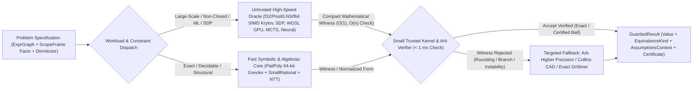

1. **Untrusted Fast Discovery + Small Trusted Witness Checking (Zero Correctness Loss at Maximum Speed)**:
   - Heavy search runs in fast unboxed floating-point, SIMD, GPU `WGSL`, or ML heuristics; **only a compact, algebraically checkable certificate enters the trusted verifier**. Searching for a sum-of-squares decomposition, integer relation, root box, or SAT unsat trace may take milliseconds; *verifying* the witness takes microseconds:

| Problem Domain | Fast Untrusted Discovery Path | Compact Witness Verified in Kernel (`O(1)`–`O(n)`) | Strict Guarantee Achieved |
| :--- | :--- | :--- | :--- |
| **Polynomial Optimization / Lyap.** | Interior-point `SDP` / `ADMM` (`f64`) | Exact rational $LDL^T$ Gram matrix $\mathbf{Q} \succeq 0$ + `FlatPoly` subtraction | Global Positivity / `Positivstellensatz` |
| **Linear Inequalities / LP / MPC** | Floating-point Simplex / Barrier / `ADMM` | Exact rational Farkas multipliers $\boldsymbol{\lambda} \ge \mathbf{0}, \;\boldsymbol{\lambda}^T\mathbf{A}=\mathbf{0}$ | Exact Feasibility / Infeasibility |
| **Symbolic Integral / Sum / ODE** | Heuristic pattern / Neural `MCTS` / `Meijer G` | Exact symbolic derivative $F'(x) \equiv f(x)$ or Zeilberger $R(n, k)$ check | Exact Antiderivative / Recurrence Identity |
| **Nonlinear Root & Eq. Isolation** | Deflated Newton / Homotopy / Durand–Kerner | `Arb` midpoint-radius **`Krawczyk`** / **Radii-Polynomial** contraction box | Proven Existence, Uniqueness & Enclosing Radius |
| **Zero-Testing & Identities** | Randomized `Schwartz–Zippel` multi-prime | Rational polynomial replay or multi-prime union bound $< 2^{-128}$ + `ring` | Zero False Algebraic Equality (`Audit A13`) |
| **Number Theory & Primality** | Miller–Rabin / ECM / Schoof–Elkies | Pratt / Atkin–Morain **`ECPP` elliptic certificate** | Deterministic Primality Proof |
| **Boolean / SMT Constraints** | Watched-literal `CDCL` / Bit-blasting | `LRAT` resolution proof chain replay | Sound SAT/UNSAT Certificate |

2. **Zero-Copy Shared Representation Spine (Zero Memory Duplication, No Marshalling Bottlenecks)**:
   - Rather than copying ASTs between subsystems, numerical kernels and formal verifiers borrow one shared slab hierarchy: **`FlatPoly` (packed 64-bit `Grevlex` exponent vectors + flat coefficient slices)**, **`SmallRational` (128-bit inline numerator/denominator promoting seamlessly via `auto-promoters` only on overflow)**, **`SoA` aligned buffers (`Arb`, `f64`, `Dual`)**, and compiled **`BytecodeVM` / `const fn` kernels**.
   - Formal tactics (`ring`, `Nullstellensatz`, `Positivstellensatz`) operate directly on `FlatPoly` slices rather than allocating heap `ExprId` trees per term; numerical evaluators compile straight out of normalized `E-Graph` / `FlatPoly` DAGs with zero interpreter overhead.
3. **Composable `GuardedResult` Lattice (Seamless Mixed Symbolic–Numeric–Formal Interop)**:
   - Every expression and output value carries lightweight tagged metadata: `AssumptionsContext` (bitpacked `ScopeFrame` guards & non-zero side conditions), `EquivalenceKind` (`SyntacticIdentity`, `AlgebraicEquality`, `HomotopyEquivalence`, or rigorous `Arb` enclosure + `UniversalBall`), and optional lazy `DerivationTree` / `ProofCertificate`.
   - Symbolic cancellation preserves exact identities before falling into numerical quadrature; certified **`Arb` balls** hand exact rigorous bounds cleanly to `FEM`/`IGA`/`ODE`/`CAD`/`SMT` solvers without ever silently laundering floating-point roundoff or unverified ML predictions as exact theorems.


---

# Part XIV — Cross-Engine Algebraic Generalization & Residual Domain Completeness (`Sections 27–29`)

## 27. Cross-Crate Generalization Architecture: Unified Carriers, Arbitrary Dimensions & Zero-Silo Abstractions

Closing **Audit D1–D14** in [CODEBASE_AUDIT_AND_REMEDIATION_PLAN.md](../audits/CODEBASE_AUDIT_AND_REMEDIATION_PLAN.md), URAE eliminates places where legacy modules hardcode `f64`, dense arrays, fixed dimensions ($2\times 2$ or $3$-generator), or duplicate representations across `algebra-core`, `algebra-engine`, `algebra-advanced`, and `cat-*`. Replacing these silos with uniform parametric carriers lets exact symbolic CAS, `Arb` balls, modular primes, differentiable AD, and SIMD/GPU `f64`/`f32` run over the *exact same mathematical algorithms* via the **three shared spines and dynamic runtime morphing protocols** elevated in **`Section 3.3`**:

### 27.1 Concrete Silo Eliminations (Code-Verified Remediation Table)

| Current Silo / Hardcoding (Verified Source) | Mathematical Failure Mode Today | Generalized Parametric Carrier |
| :--- | :--- | :--- |
| **`MatrixBuffer { data: Vec<f64> }`** ([matrix.rs](../../crates/algebra-engine/src/matrix.rs#L16-L20)) | Cannot execute the Bareiss integer-preserving determinant promised in its own doc header, nor complex/interval/finite-field linear algebra without separate types | **`DenseMatrix<R: Ring>`** + **`CsrMatrix<R: Ring + Zero>`** unified over `f64`, `f32`, `Complex<f64>`, `BigRational`, `UniversalBall`, `FiniteFieldElem`, and `ExprId` |
| **`CsrMatrix { values: Vec<ExprId> }`** ([sparse.rs](../../crates/algebra-engine/src/sparse.rs#L13-L22)) | Forces DAG heap/arena interning even on `10^6`-DOF numerical FEM/CFD Poisson solves | Generic `CsrMatrix<R>` with block-sparse (`BSR` / `ELLPACK`) view traits sharing one `Krylov` / `AMG` / exact Bareiss/Wiedemann solver |
| **Triple Tensor/Form Engine**: `SymbolicTensor` ([tensor.rs](../../crates/algebra-engine/src/tensor.rs#L26-L80), empty `contract()`), `cat-numbers::Tensor` (`Vec<f64>`), dense $2^D$ `DifferentialForm` ([differential_forms.rs](../../crates/cat-numbers/src/differential_forms.rs#L16-L31)), `cartan.rs` | Separate APIs; dense $O(2^D)$ form vector blows up for $D > 16$; symbolic tensor contraction returns empty components | Single **`SparseTensor<R: Ring>`** + **`GradedForm<K: Ring>`** (sparse `BladeMask` / sorted multi-index `SmallVec` storage), executing Einstein contractions and [butler_portugal.rs](../../crates/cat-numbers/src/butler_portugal.rs) index canonicalization over *both* scalars and `ExprId` |
| **Quadruple Geometric/Hypercomplex Types**: `BigRational`-locked `Quaternion`/`Octonion` ([numbers.rs](../../crates/algebra-core/src/numbers.rs#L9-L67)), `[f64; 8]` `CocycleMultivector` ([cat-core scalar.rs](../../crates/cat-core/src/scalar.rs#L45-L99)), `clifford.rs`, `Se3Rotor` ([se3_rotor.rs](../../crates/cat-anytime/src/se3_rotor.rs#L8-L92)) vs `Pose<T: Float>` ([urscript_pose.rs](../../crates/algebra-engine/src/urscript_pose.rs#L15-L53)) | `[f64; 8]` overflows beyond 3 generators—breaking 4D Projective GA $\operatorname{Cl}(3,0,1)$ (`16` blades) and 5D Conformal GA $\operatorname{Cl}(4,1,0)$ (`32` blades); two incompatible rigid-body pose types | **`CayleyDickson<K: Field, const GRADE: usize>`** (covers $\mathbb{C}, \mathbb{H}, \mathbb{O}, \mathbb{S}$ sedenions over any ring/expr) + **`Multivector<K: Ring, S: Signature>`** (stack `SmallVec<[_; 16]>` for fast 3D/PGA/STA, heap-sparse `BTreeMap` for high $D$), with `Pose<K>` defined as normalized even-grade motors in $\operatorname{Cl}(3,0,1)$ |
| **Duplicate $p$-Adics & `f64`-Locked Adeles** ([numbers.rs](../../crates/algebra-core/src/numbers.rs#L71), [padic.rs](../../crates/algebra-advanced/src/padic.rs#L16-L40), [adele.rs](../../crates/algebra-advanced/src/adele.rs#L28-L55)) | `is_zero()` checks magic `valuation > 50` (breaks at user precision `> 50` digits!); `Adele` locks `archimedean: f64` and restricts to $\mathbb{Q}$ | Unified **`Padic<I: PrimeInt>`** with explicit `valuation: Option<i64>` zero / $O(p^N)$ truncation precision + **`Adele<K, Arch>`** generic over `f64`, `BigRational`, or `UniversalBall` and algebraic number fields $K/\mathbb{Q}$ |
| **$2\times 2$ / `f64`-Locked Control, Weyl $D$-Modules, Differential Algebra & Tropical** ([control.rs](../../crates/algebra-engine/src/control.rs#L28), [weyl_dmodules.rs](../../crates/algebra-engine/src/weyl_dmodules.rs#L50), [diffalg.rs](../../crates/algebra-engine/src/diffalg.rs#L41), [tropical.rs](../../crates/algebra-engine/src/tropical.rs#L14-L60), [curvature.rs](../../crates/algebra-engine/src/curvature.rs#L20)) | `f64` coefficients destroy left Gröbner bases and Wu–Ritt pseudo-division via pivot cancellation; `ControlOpKind` isolates $2\times 2$ scalar paths; `MaxPlus`/`MinPlus` cannot express exact integer/symbolic tropical ideals | Parameterize `WeylDOperator<K: Field>`, `DiffPolynomial<K: Field>`, `MetricTensor<K>` (using exact `BigRational` / `ExprId` for analytic Schwarzschild/Kerr/FLRW spacetimes!), `StateSpaceSystem<M: LinearOperator>` (continuous/discrete/descriptor $E\dot{x}=Ax+Bu$/LPV/symbolic $A(s)$ for general $n$), and `Tropical<T: Ord + Add>` ($\mathbb{Z}, \mathbb{Q}, \mathbb{R}, \operatorname{Interval}$) |
| **`scaled_twelfths` Dimensional Limits & Float Bindings** ([dimensions.rs](../../crates/cat-core/src/dimensions.rs#L31-L68), [operation.rs](../../crates/algebra-core/src/operation.rs#L162-L172,L557-L561)) | `scaled_twelfths: [i16; 8]` cannot encode rational exponents like $1/5$ (Blasius friction), $1/7$, or symbolic scaling exponents $\nu$; `Evaluate::bindings` accepts only `f64` | Generalize dimension vectors to **`DimVector<Ratio<i32>>`** (exact small rational powers + `PlaneAngle` with `Symbolic(ExprId)` extension, matching `Section 32`) and lift `Evaluate::bindings` / `PhysicsOpKind` to typed **`MathValue`** (`Exact(ExprId)`, `Complex`, `Interval`, `Ball`, `Matrix`, `Tensor`, `Quantity`) |

### 27.2 Four Cross-Engine Meta-Abstractions Eliminating Algorithm Duplication

1. **Unified Coordinate & Charted Manifold Abstraction (`ChartedField<M: Manifold>`)**: Unifies Cartesian $\mathbb{R}^n$, Cylindrical/Spherical, IGA `NURBS` parameter patches, [hecs.rs](../../crates/algebra-engine/src/hecs.rs) hexagonal lattices `Hecs<T>`, and general Riemannian [curvature.rs](../../crates/algebra-engine/src/curvature.rs) charts. Writing gradient, divergence, curl, covariant derivative $\nabla_X$, or discrete Hodge star once over `ChartedField` immediately works across FEA/CFD, hexagonal cellular automata, CAD `UV` surfaces, and general relativity!
2. **Universal Fixed-Point & Continuation Engine (`ContinuationSolver<P: FixedPointProblem>`)**: One generic predictor-corrector (`Anderson` acceleration / `Newton–Krylov` / pseudo-arclength continuation / `Broyden` quasi-Newton) shared identically across nonlinear `FEM`/`CFD` equilibria, collocation `BVP`s, homotopy algebraic polynomial continuation, `Hensel` $p$-adic root lifting, fixed-point `RL` Bellman backups, and `Nash`/Fisher market equilibria.
3. **Polymorphic Approximation & Curve Basis (`ApproximationBasis<K>`)**: Treats `Monomial`, `Chebyshev` (1st/2nd kind), `Legendre`/`Jacobi`/`Laguerre`/`Hermite`, `Bernstein`/`B-Spline`/`NURBS`, `Fourier`/`Trig`, `Wavelet`, `Pade`/`AAA` rational, and `RBF` uniformly under `Basis::evaluate_jet`, `Basis::differentiate_matrix`, `Basis::integrate_rule`, and `Basis::degree_elevate`, so any solver (`ODE`, `PDE`, `PINN`, `IGA`, `CAD`, or series approximator) can hot-swap bases or adapt degree without rewriting discretization code.
4. **Equivariant Symmetry & Action Mixin (`GroupAction<G, V>`)**: Shares group generators, orbits, irreps, and Reynolds quotient reduction across crystal/lattice meshes, dihedral involute/helical gear symmetries, gauge symmetries ($SU(N), SO(3), SE(3)$), graph isomorphism canonical labeling (`Nauty`/`McKay` backtrack), and $SE(3)$-equivariant `GeometricDL` neural layers.

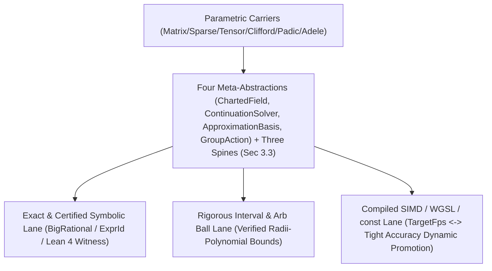

---

## 28. Residual Mathematical, Scientific & Computer Science Domain Closures

To match and surpass Mathematica, Maple, MATLAB/Simulink, Lean 4/`Mathlib`, and Julia SciML inside a single coherent Rust architecture:

1. **Delay (`DDE`/`NDDE`), Integro-Differential (`IDE`/`VIDE`), Fractional (`FDE`) & Higher-Index `DAE` Systems**:
   - **Delay & State-Dependent `DDE`s**: Method of steps + continuous dense-output (`Dormand–Prince` / `Radau IIA` cubic/quartic Hermite) history buffer locating derivative discontinuities at $\tau_i(t, \mathbf{y}(t))$ so variable steps never stride blindly across delay kinks.
   - **Volterra/Fredholm Integral & `IDE` Solvers**: Piecewise polynomial collocation and graded-mesh `Nyström` / `Alpert` hybrid Gauss quadrature for Cauchy principal-value ($\operatorname{p.v.} \int$) and weakly singular $|t - s|^{-\alpha}$ kernels (`Abel`, boundary integral acoustics).
   - **Fractional Calculus (`FDE`s)**: Upgrade `FractionalCalculus` (`B2` fix) with Mittag-Leffler $E_{\alpha,\beta}(z)$ analytical series/asymptotic evaluation and Lubich fractional linear multistep convolution quadrature ($O(N \log N)$ via FFT history sum).
   - **Higher-Index `DAE` Structural Index Reduction**: Pantelides bipartite graph differentiation-index detector + dummy-derivative reformulation turning index-2/3 constrained multibody, robotics (`Featherstone`), and circuit `MNA` systems automatically into solvable index-1 DAEs/ODEs.
2. **Convex, Conic (`SDP`/`SOCP`/`QP`), Mixed-Integer (`MILP`/`MINLP`), Constraint (`CP`) & Bilevel Optimization**:
   - **Conic Interior-Point Kernel**: Homogeneous self-dual primal-dual Mehrotra predictor-corrector over $\mathbb{R}_+^n \times \mathcal{Q}^m \times \mathbb{S}_+^k$ with Nesterov–Todd scaling, plus `SOS` (Sum-of-Squares polynomial Lyapunov positivity) via `SDP` relaxation!
   - **Exact & Floating-Point `MILP` / `MINLP` / `CP`**: Branch-and-Cut (`Gomory`, `MIR` mixed-integer rounding, conflict clauses from [logic.rs](../../crates/algebra-engine/src/logic.rs) `CDCL`, `McCormick` bilinear relaxations for spatial `MINLP`), exact rational Simplex verification (`Applegate–Cook` post-solve over `BigRational` for zero false feasibility!), and finite-domain constraint propagation (`AllDifferent`, `Element`, `Cumulative`).
   - **Bilevel & Variational Inequalities**: Strong-duality / KKT complementarity (`MPCC`) and projected gradient descent for Stackelberg games, obstacle contact problems, and `CBF-QP` robotics/safety filters.
3. **Signal Processing, Filter Synthesis, Spectral Estimation & Nonlinear Bayesian Filtering (`DSP`)**:
   - **Filter Design & Fixed-Point Proof**: `IIR` (`Butterworth`, `Chebyshev I/II`, `Elliptic`) and optimal minimax `FIR` (`Parks–McClellan` Remez exchange), bilinear `z <-> s` transform, paired with `Z3`/`Interval` verification against overflow/limit-cycle oscillations under quantized coefficients.
   - **Time-Frequency, Subspace & Mode Decomposition**: `STFT`, continuous/discrete wavelets (`CWT` Morlet/Morse, `DWT`/`MODWT` lifting), parametric spectral estimation (`MUSIC`, `ESPRIT`, `Burg AR`, `MVDR` beamforming), and Variational Mode Decomposition (`VMD`) / Hilbert spectral envelopes.
   - **State Estimation**: Linear Kalman (`LKF`), Square-Root `EKF`/`UKF` (Sigma-point Cholesky update), Cubature Kalman (`CKF`), Sequential Monte Carlo (`Particle Filter` with systematic resampling), and Rauch–Tung–Striebel (`RTS`) fixed-interval smoother.
4. **Combinatorial Graph Theory, Matroids, Network Flows & Certified Planarity**:
   - Dinic ($O(E\sqrt{V})$ unit-cap) & Highest-Label Push-Relabel Max-Flow, Cost-Scaling Min-Cost Circulation, Edmonds Blossom general weighted matching, Gomory–Hu all-pairs min-cut tree, matroid intersection/partition (`Lovász` extension submodular optimization), and **Boyer–Myrvold linear-time planarity testing emitting either a valid planar embedding or a minimal Kuratowski $K_5/K_{3,3}$ witness subgraph**.
5. **Algorithmic Game Theory, Equilibrium, Mechanism Design & Cooperative Values**:
   - **Equilibrium Solvers**: `Lemke–Howson` pivotal complementarity for 2-player bimatrix Nash equilibria, simplicial homotopy (`Govindan–Wilson`) for $N$-player Nash, Linear Program for Correlated Equilibria, and `Eisenberg–Gale` convex Fisher market clearing.
   - **Mechanisms & Cooperative Coalitions**: `VCG` pivotal tax payments, `Myerson` ironed virtual-valuation auctions, `Gale–Shapley` / `TTC` stable allocation, `Schulze`/`Tideman` Condorcet voting, and stratified/exact **Shapley & Banzhaf power indices** bridging directly into Risky Business / `ai-designer` XAI attributions.
6. **Theoretical CS: Automata, Symbolic Model Checking, Process Algebra & Numerical Roundoff Verification**:
   - **Automata & Regular/$\omega$-Languages**: Brzozowski/Antimirov derivative regex $\leftrightarrow$ Thompson `NFA` $\leftrightarrow$ `Hopcroft` minimal `DFA` $\leftrightarrow$ `Büchi` $\omega$-automata emptiness (nested DFS).
   - **Symbolic & Timed Model Checking**: Bounded `BMC` & `IC3`/`PDR` invariant synthesis, explicit/symbolic `CTL`/`LTL` model checker, and Zone/DBM **Timed Automata** (`UPPAAL`-style clock constraints for real-time cyber-physical & robotics deadlines!).
   - **Static Numerical Error Bounds (`FPTaylor` / Affine Arithmetic)**: Given any Rust/C/WGSL kernel lowered from URAE, computes rigorous worst-case IEEE-754 / `BF16` / `FP8` / fixed-point rounding error polynomial over user input boxes, paired with **Liquid / Refinement Type** checks (`SmtExpr`) at API boundaries.
7. **Covariant General Relativity, Polarized/Wave Optics & Plasma Dispersion**:
   - **Spacetime & Geodesic Engine**: Symbolic `MetricTensor<ExprId>` auto-derives $3+1$ `ADM` lapse/shift, Weyl Petrov scalars ($\Psi_0 \dots \Psi_4$), horizon trapped-surface expansions, and symplectic/RK4 geodesic raytracing (photon rings, Shapiro delay, gravitational lensing).
   - **Optics & Electromagnetics**: `Yee`-cell `FDTD` with Convolution `PML`, Rigorous Coupled-Wave Analysis (`RCWA`) periodic gratings, and Stokes/Mueller polarized raytracing; `Stix` cold/warm plasma kinetic dispersion tensor roots.
8. **Homological Algebra, Commutative Syzygies & Elliptic/Pairing Cryptography**:
   - Full `Schreyer` free resolution engine computing `Betti` tables, $\operatorname{Ext}^i$ / $\operatorname{Tor}_i$, and functorial **Diagram Chasing** (`Snake` lemma, spectral sequence pages $E_r^{p,q}$) with step-by-step witness traces; complete **Rational Univariate Representation (`RUR`) / `FGLM`** basis conversion (`C16`) and bilinear pairing curves (`BN254`, `BLS12-381`, `curve25519`) wired into ZKML/ZK-proof verification.

---

## 29. Backend-to-Command (`MathOperation`) & Auto-Discovery Registry Contract (`SubsystemRegistry`)

To permanently eliminate `Audit D9` (20+ existing Rust modules missing from [executor.rs](../../crates/algebra-engine/src/executor.rs), [operation.rs](../../crates/algebra-core/src/operation.rs), and [urae-notebook](../../crates/urae-notebook/src/ui/palettes.rs)):

- **Declarative `#[urae_subsystem]` / `OperationDescriptor` Trait**: Every mathematical, CAD, physics, formal, or SciML module registers one descriptor record exporting:
  1. **Canonical Signature & Typed Schema**: Name, category path, argument types (`MathValue`, `ExprId`, `MeshRef`, `Tensor`), default parameter values, physical unit & domain bounds.
  2. **Multi-Frontend Adapters**: Parser alias table + Natural-Language intent triggers, LaTeX / Unicode / `MathML` / `SmtLib2` / `Lean4` serializers, JSON Schema for [urae-cli](../../crates/urae-cli/src/json_api.rs) / [urae-wasm](../../crates/urae-wasm/src/lib.rs) / [urae-lsp](../../crates/urae-lsp/src/lib.rs) / [urae-kernel](../../crates/urae-kernel/src/lib.rs) / [urae-py](../../crates/urae-py/src/lib.rs) / [urae-ffi](../../crates/urae-ffi/src/lib.rs).
  3. **GUI Metadata**: Auto-generated Builder Wizard fields, recommended interactive visualizer kind (`Plot2D`, `DomainColoring`, `VectorField`, `Mesh3D`, `ZXGraph`, `TreeVisualizer`, `Timeline`, `MatrixHeatmap`), and semantic `AccessKit` / Speech summary template.
- **CI Completeness Gate**: A workspace build test asserts that every public solver/operator module in `algebra-core`, `algebra-engine`, `algebra-advanced`, and `cat-*`—alongside canonical `FunctionId` families, `MetricSpec` policies, and `FunctionContract` domain/range/property inspectors (`Part XVIII §§38–41`)—has $\ge 1$ live entry in `SubsystemRegistry`, a `DocRegistry` card, and a reachable `WorkspaceTab` / `CommandPalette` entry—making silent orphans impossible by construction.


---

# Part XV — Universal Physics Domains & Covariant Analytical-to-Quantitative Pipelines (`Sections 30–32`)

## 30. Classical Analytical Mechanics, Thermodynamics & Statistical Field Theory

URAE connects variational symbolic mechanics directly to geometric numerical integration and empirical estimation—eliminating manual equation transcription:

### 30.1 Analytical Mechanics & Variational Symmetry Engine (`cas!` $\to$ `sim!`)
- **Automatic Variational Derivation**: Given any symbolic Lagrangian $L(t, q, \dot{q}, \dots)$ or field density $\mathcal{L}(\phi, \partial_\mu \phi)$, computes Euler–Lagrange equations $\frac{\delta S}{\delta q^i} = 0$, higher-order Ostrogradsky equations, Rayleigh dissipation terms, and discrete variational integrators (symplectic Veselov–Marsden discrete Euler–Lagrange `DEL` preserving momentum maps identically!).
- **Legendre Transform & Dirac–Bergmann Constrained Systems**: Classifies degenerate Hessians $\det(\partial^2 L / \partial \dot{q}^i \partial \dot{q}^j) = 0$, generates primary/secondary/tertiary constraints $\phi_m(q,p) \approx 0$ recursively, separates First-Class (gauge) from Second-Class constraints via Poisson bracket matrix inversion, and constructs exact **Dirac Brackets** $\{f, g\}_D$.
- **Noether's First & Second Theorems**: Infers continuous variational infinitesimal symmetries (Galilean, Lorentz, scaling, internal $U(1)/SU(N)$) and extracts conserved Noether charges $Q_\alpha$ and continuity currents $\partial_\mu J^\mu = 0$ as executable runtime monitor invariants for `sim!`.
- **Hamilton–Jacobi, Routhians & `KAM` Perturbation Theory**: Automates cyclic-coordinate Routhian reduction, Type I–IV canonical generating functions ($F_1..F_4$), **Lie-transform Deprit perturbation** normalization, action-angle $(J, \theta)$ extraction, and Kolmogorov–Arnold–Moser (`KAM`) resonant denominator diagnostics.

### 30.2 Thermodynamics, Equations of State (`EOS`) & Non-Equilibrium Field Theory
- **Symbolic `Bridgman` Thermodynamic Derivative Algebra**: Treats $(T, P, V, S, U, H, F, G, \mu, N)$ on the $1$-form equilibrium Gibbs manifold $\mathrm{d}U = T\,\mathrm{d}S - P\,\mathrm{d}V + \sum_i \mu_i\,\mathrm{d}N_i$, automatically rewriting any measurable derivative $(\partial X / \partial Y)_Z$ via Maxwell relations and Jacobian identities into heat capacity $C_P, C_V$, compressibility $\kappa_T$, and thermal expansion $\alpha_P$.
- **Cubic/Virial `EOS` & `CALPHAD` Multi-Phase Equilibrium**: Solves Ideal, van der Waals, Redlich–Kwong, Peng–Robinson, and Helmholtz-energy multiparameter equations of state; finds spinodal instabilities ($\partial P / \partial V = 0$), binodal coexistence via common-tangent convex hull (`Gibbs` free-energy minimization), and stoichiometric Law of Mass Action equilibrium constants.
- **Kinetic Transport, Critical Phenomena & Soft Matter**:
  - **Boltzmann (`BTE`) & Fokker–Planck / Master Equations**: Chang–Cooper positivity-preserving discrete velocity & Fokker–Planck solvers plus Kramers–Moyal diffusion expansions bridging stochastic SDEs ([stochastic.rs](../../crates/algebra-advanced/src/stochastic.rs)) and [statmech.rs](../../crates/algebra-advanced/src/statmech.rs).
  - **Renormalization Group (`RG`) & Phase Field**: Symbolic Gell-Mann–Low $\beta$-function fixed points, Wilson–Fisher $\varepsilon = 4 - d$ anomalous critical exponents, **Cahn–Hilliard / Allen–Cahn** spinodal decomposition (`SAV` unconditional energy-stable splitting), **Landau–Lifshitz–Gilbert (`LLG`)** midpoint-norm-preserving micromagnetics, and Beris–Edwards $Q$-tensor active nematic liquid crystals.

---

## 31. Quantum Many-Body, Condensed Matter, Astrophysics, Cosmology & Nuclear/HEP

### 31.1 Quantum Mechanics, Condensed Matter & Electronic Structure
- **Single & Few-Body Quantum Wave Mechanics**: Exact symbolic creation/annihilation ladder operators ($[a, a^\dagger] = 1$), hydrogenic/harmonic analytic solutions via hypergeometric/`Weierstrass` special functions, coupled with fast **Split-Step FFT (`SSFM`)**, unitary **Crank–Nicolson**, **Discrete Variable Representation (`DVR`)**, and **Numerov** bound-state eigenvalue shooting.
- **Electronic Structure & Lattice Topology**:
  - **Self-Consistent Mean Field (`SCF`)**: Closed/open-shell **Hartree–Fock (`RHF`/`UHF`)** and **Kohn–Sham `DFT`/`TDDFT`** (`LDA`/`GGA` exchange-correlation kernels over Gaussian/Plane-Wave bases with `DIIS` Pulay extrapolation and Pulay Hellmann–Feynman forces).
  - **Bloch Band Theory & Topological Phases**: Tight-binding Wannier Hamiltonians $H(\mathbf{k})$ across irreducible Brillouin zones, Fermi surface extraction, Fukui–Hatsugai–Suzuki discrete **Berry curvature & Chern numbers**, $\mathbb{Z}_2$ Kane–Mele invariants, and **BCS** gap equation self-consistency.
  - **Strongly Correlated Tensor Networks**: **DMRG** matrix product state (`MPS` with `SVD` bond-dimension truncation), `TEBD` real/imaginary time evolution, `PEPS`/`MERA` variational ansatz, and nonlinear **Gross–Pitaevskii (`GPE`)** superfluid vortex dynamics—bridging seamlessly with [quantum_circuit.rs](../../crates/algebra-engine/src/quantum_circuit.rs) and `ZX`-calculus.

### 31.2 Astrophysics, Cosmology, Nuclear Physics & High-Energy Phenomenology
- **Cosmology & Relativistic Astrophysics**: Exact symbolic + numerical Friedmann–Lemaître–Robertson–Walker (`FLRW`) scale-factor evolution ($H(z)$, luminosity/angular distances $d_L(z), d_A(z)$), linear **Einstein–Boltzmann** perturbation hierarchy ($C_\ell^{TT,EE}$ acoustic peaks), hydrostatic **Tolman–Oppenheimer–Volkoff (`TOV`)** neutron-star mass-radius curves, and $O(N \log N)$ **`FMM` + Post-Newtonian (`PN`) + Symplectic WHFast** gravitational $N$-body integration paired with multi-band `S_N` Discrete-Ordinate / Monte Carlo **Radiative Transfer**.
- **Nuclear & HEP Phenomenology (Extending [qft.rs](../../crates/algebra-engine/src/qft.rs), [cft.rs](../../crates/algebra-engine/src/cft.rs) & [exceptional_lie.rs](../../crates/algebra-engine/src/exceptional_lie.rs))**:
  - **Exact `Bateman` Decay & Burnup Networks**: Matrix-exponential and symbolic Laplace residue solutions for arbitrary branching transmutation chains $\mathrm{d}\mathbf{N}/\mathrm{d}t = \mathbf{A}\mathbf{N}$ with zero stiff-eigenvalue instability.
  - **Relativistic Kinematics & Gauge Theory**: Symbolic **Mandelstam $(s, t, u)$** Dalitz phase-space integrals, Breit–Wigner resonance shapes, **Altarelli–Parisi (`DGLAP`)** splitting convolutions, `Yang–Mills` covariant field-strength $F_{\mu\nu}^a = \partial_\mu A_\nu^a - \partial_\nu A_\mu^a + g f^{abc} A_\mu^b A_\nu^c$, and Lie-algebra anomaly cancellation ($\operatorname{Tr}(\{T^a, T^b\} T^c) = 0$) checked directly across $SU(N)/SO(N)/E_6/E_7/E_8$.

---

## 32. Geophysics, Climate/Atmospheric Fluid Dynamics, Biophysics & Unified SI Engine (`D13`)

- **Geophysics & Geophysical Fluid Dynamics (`GFD`)**: Elastodynamic `P/S`/Rayleigh seismic wave propagators with Full-Waveform Inversion (`FWI`) Revolved adjoint gradients, **Shallow-Water / Quasi-Geostrophic (`QG`) Rossby wave & baroclinic instability** spectral solvers, and correlated-$k$ atmospheric radiative-convective equilibria.
- **Quantitative Biophysics & Electrophysiology**: Exact conductance-based **Hodgkin–Huxley / FitzHugh–Nagumo** excitable ODEs (`Rosenbrock`/`TR-BDF2` stiff integrators) coupled to anisotropic **Monodomain/Bidomain** cardiac reaction-diffusion FEA, and coarse-grained Langevin/`MD` polymer/biomolecular potential sampling.
- **Unified Exact SI + Angular Dimensional Algebra (`Audit D13` + `J5` Remediation)**: Consolidate 7D `f64` `Dimensions` ([physics.rs](../../crates/algebra-engine/src/physics.rs#L12-L125)) and 8D `[i16; 8]` [DimVector](../../crates/cat-core/src/dimensions.rs#L31-L68) onto exact **`DimVector<Ratio<i32>>`** unifying all angular units (`rad`, `deg`, `arcmin`, `arcsec`, `grad`, `turn`, `sr = Angle^2`) directly inside `DIM_ANGLE` (`PlaneAngle`, removing `AngleUnit` as separate state). **Fix Torque vs. Energy (`dimensions.rs:153`)**: distinguish Work/Energy `[M L^2 T^-2]` from generalized rotational Torque $\tau = \partial W / \partial \theta$ **`[M L^2 T^-2 Angle^-1]`** (`J/rad` / `N·m/rad`, with `r x F` casting through the 1-radian unit gauge and optional `N·m` display alias) and Moment of Inertia `[M L^2 Angle^-2]`, so $\tau \cdot \omega$ yields exact Watts and Torque can never silently sum with Energy. Replace truncating integer division in [buckingham_pi.rs](../../crates/cat-egraph/src/buckingham_pi.rs#L86-L88) with fraction-free Hermite/Smith rational nullspace scaling by pivot LCM.

---

# Part XVI — Universal Computer Science, Mathematics & Non-Classical Logic Completeness (`Sections 33–35`)

## 33. Complete Computer Science Foundations: Algorithms, Geometry, Compilers, Concurrency & Join Optimization

URAE brings formal, symbolic, and sub-millisecond numerical tooling across the entire CS landscape:

| CS Domain | Symbolic / Formal / Exact Engine | High-Performance Numerical / Algorithmic Kernel |
| :--- | :--- | :--- |
| **Stringology & Data Compression** | Exact entropy bounds $H_k$, suffix/recurrence invariants, regular-language equivalence | `SA-IS` $O(n)$ Suffix Array + `LCP`, Suffix Automaton (`SAM`), `BWT`/`FM-Index`, Aho–Corasick, Myers bit-parallel edit distance, `rANS`/`tANS` entropy coder |
| **Computational Geometry & Spatial Structures** | Exact rational/Shewchuk predicate certificates, exact convex-hull / hyperplane arrangements | `Fortune` Voronoi & Constrained `Delaunay` triangulation, **`Welzl`** minimal enclosing ball, Minkowski sum + **`GJK`/`EPA`** proximity, rotating calipers, `R*`-Tree / `BVH` / dynamic octree |
| **Streaming, Sketching & Parameterized Graphs** | Analytic variance & $(\varepsilon, \delta)$ Chernoff concentration proofs per sketch config | **HyperLogLog++**, **Count-Min Sketch**, **t-digest** streaming quantiles, **Johnson–Lindenstrauss** projections, **Tamaki** treewidth decomposition + Courcelle dynamic programming |
| **Programming Languages & Optimizing Compilers** | Untyped/Simply-Typed/System $F_\omega$ / NbE evaluator; **Knuth–Bendix** rewrite completion (`LPO`/`KBO`) | `SSA` dominance frontier builder, **Polyhedral Loop Dependence & Tiling Optimizer** (emitting AVX/NEON/`WGSL`/`const` Rust), **Octagon & Double-Description Polyhedra** abstract domains |
| **Concurrency, Distributed Systems & Queuing** | **`Petri` Net P/T-invariants** via integer nullspace, `CSP`/`CCS`/$\pi$-calculus bisimulation, **CRDT join-semilattice proofs** | Token-game state-space explorer, Jackson open/closed multiclass queuing networks (`M/M/c`, `M/G/1`, Little's Law, `MVA`), consensus fault-injection timeline simulator |
| **Information Theory, Coding & ZK Circuits** | Generator/parity-check matrices, symbolic mutual information $I(X;Y)$, polynomial **`R1CS` / `PLONK` arithmetization** | **Blahut–Arimoto** channel capacity & rate-distortion, **LDPC / Polar / BCH** belief-propagation (`EXIT` charts), **`LLL`/`BKZ`** lattice `SVP` reduction ([crypto.rs](../../crates/algebra-advanced/src/crypto.rs)) |
| **Relational Algebra & Query Engines (`AGM`)** | Codd Relational Algebra $\leftrightarrow$ Datalog $\leftrightarrow$ Conjunctive Query normalizer | **Atserias–Grohe–Marx (`AGM`) Worst-Case Optimal `GenericJoin`** unifying E-Graph saturation ([egraph.rs](../../crates/cat-egraph/src/egraph.rs)), `DuckDB` SQL joins, and treewidth-optimal tensor `einsum` contractions! |

---

## 34. Complete Pure & Applied Mathematics Extensions: Analysis, Asymptotics, Inverse, Geometry & Causal Quantitative Math

1. **Measure Theory, Functional & Harmonic Analysis**: Symbolic and quadrature $L^p$ / Sobolev $W^{k,p}$ norm evaluators; Fredholm alternative & self-adjoint **Sturm–Liouville** eigenfunction expansions; **Mercer** RKHS kernel decompositions; **Gabor/STFT Frames**; and complete symbolic + FFT-accelerated integral transforms (**Hankel, Mellin, Abel, Hilbert, Z, Chirp-Z, and exact Filtered Back-Projection / algebraic `Radon` Tomography**).
2. **Symbolic Perturbation, Asymptotic Matching & Nonlinear Dynamics ([analysis.rs](../../crates/algebra-engine/src/analysis.rs))**:
   - **Matched Asymptotic & Turning-Point Engines**: **Van Dyke** inner/outer asymptotic matching, **WKBJ** exponential phase + Airy turning-point connection formulas, **Lindstedt–Poincaré** & **Multiple-Scales** automated secular-term cancellation.
   - **Invariant Manifolds & Ergodic Operators**: Center-manifold Taylor projection, Poincaré–Dulac normal forms, **Floquet** periodic monodromy multipliers, Finite-Time Lyapunov Exponent (**FTLE** / Lagrangian coherent structures), and **Ulam Perron–Frobenius** transfer operator matrix for invariant SRB measure & almost-invariant basin extraction.
3. **Ill-Posed Inverse Problems & Data Assimilation**: Tikhonov–Phillips / **Morozov** discrepancy parameter selection, **Total Variation (`ROF`) / $L_1$ Compressed Sensing (`FISTA`/`Split-Bregman`)**, **Ensemble Kalman Filter (`EnKF`)**, **`4D-Var` Revolved Adjoint Assimilation**, and **Laplace / `NUTS` Bayesian Inverse PDE Solvers**.
4. **Classical Projective Geometry & Polytope Lattice Theory**: Homogeneous cross-ratios, projective duality, Bezout/Cayley–Bacharach intersection bounds, oriented matroid covectors, and **Barvinok Ehrhart generating-function lattice-point counting** in convex rational polytopes $P \cap \mathbb{Z}^d$.
5. **Measure-Theoretic Probability, Experimental Design, Conformal & Causal Inference**:
   - **Symbolic Characteristic & Cumulant Algebra (`Audit D14` fix)**: Closed-form moment-generating $M_X(t)$, characteristic $\varphi_X(t)$, and cumulant generators $\kappa_n$ over convolutions, affine maps, and mixtures alongside [distributions.rs](../../crates/algebra-engine/src/distributions.rs).
   - **Point Processes & Survival**: **Girsanov** Radon–Nikodym drift transform, self-exciting **Hawkes** / Cox intensities, Kaplan–Meier & Cox Proportional Hazards regression.
   - **Principled Quantitative Uncertainty**: Sobol / Halton Quasi-Monte-Carlo, Latin Hypercube (`LHS`) `DoE` + Global **Sobol Sensitivity Indices**, distribution-free **Split/Jackknife+ Conformal Prediction**, and **Pearl `do`-Calculus Structural Causal Models (`SCM`s)** resolving back-door, front-door, and instrumental identifiability symbolically before estimation!

---

## 35. Universal Non-Classical Logics, Substructural Proof Theory & Automated Reasoning

Completing coverage across philosophy, computer science, formal hardware/software verification, and foundations ([logic.rs](../../crates/algebra-engine/src/logic.rs), [smt.rs](../../crates/algebra-engine/src/smt.rs), `Part XIII`), **auto-detected by default** and algebraically unified onto one **Ordered / Residuated Semiring Continuum** (`Boolean {0, 1}` $\subset$ `Heyting / Quantum Orthomodular / Kleene K_3` $\subset$ `Łukasiewicz [0, 1]` $\subset$ **`Probability / Measure Semiring ([0, 1], +, ·)`** as the continuous extension of logic $\subset$ `Tropical (max, +)` log-probability):

1. **Modal, Epistemic, Deontic & Dynamic Logics (`K`, `T`, `S4`, `S5`, `GL`, `DEL`, `PDL`)**: Analytic **Tableau** decision procedures, **Kripke Frame** finite-model counterexample extractors, standard translation to guarded First-Order Logic, **Dynamic Epistemic Logic (`DEL`)** belief revision for multi-agent plans, and deontic permission/obligation consistency checkers for regulatory/safety specs.
2. **Temporal & Program Verification Logics (`LTL`, `CTL*`, `μ`-Calculus, `Hoare`, `Separation Logic`)**: Weakest-precondition verification condition generator (`VCGen`), Floyd–Hoare loop invariant synthesis, and **Separation Logic (`*` separating conjunction / `-*` magic wand / frame rule)** to certify disjoint memory ownership across generated C/`WGSL` kernels & [urae-ffi](../../crates/urae-ffi/src/lib.rs).
3. **Substructural, Resource-Sensitive, Fuzzy & Paraconsistent Logics**:
   - **Girard Linear Logic (`!`, `?`, `⊗`, `⅋`, `⊕`, `&`)**: Enforces exact single-use resource conservation—naturally typing physical conservation laws, quantum no-cloning qubits, and Rust affine/move semantics!
   - **Continuum Fuzzy (`Łukasiewicz`/`Gödel`/`Product`), Paraconsistent (`Belnap` 4-Valued `FDE`) & Non-Monotonic (`ASP` / `Dung`)**: Handles contradictory sensor telemetry gracefully without explosion (`ex falso quodlibet`) and computes stable/grounded extension sets in Answer-Set Programming and structured argumentation.
4. **Proof Theory, First-Order Superposition & Ordinal Analysis**:
   - **Superposition ATP + Gentzen `LK`/`LJ`**: Paramodulation / superposition modulo `KBO`/`LPO` term orderings paired with Gentzen **Sequent Calculus** outputting explicit constructive **Cut-Elimination (`Hauptsatz`)** traces and Gödel–Gentzen Classical $\leftrightarrow$ Intuitionistic translations.
   - **Ordinal Notations ($\varepsilon_0$, Veblen, Buchholz) & Model Theory**: Exact transfinite Cantor normal form arithmetic connecting directly into [hyperop.rs](../../crates/algebra-engine/src/hyperop.rs) Ackermann tiers and [surreal.rs](../../crates/algebra-advanced/src/surreal.rs) Conway numbers!

---

# Part XVII — High-Performance Quantitative Analysis, Symbolic CAS & Numerical Analysis Unified Spine (`Sections 36–37`)

## 36. Three-Pillar Zero-Glue Convergence (`quant!` $\leftrightarrow$ `cas!` $\leftrightarrow$ `sim!`)

To make URAE simultaneously an effortless **quantitative analysis engine**, a complete **symbolic CAS**, and a blazing **numerical simulation/estimation platform**, all three modes operate over the *exact same* `ExprGraph` + `DimVector` + `ArrowColumnarBatch` + `AnalysisPlan` pipeline:

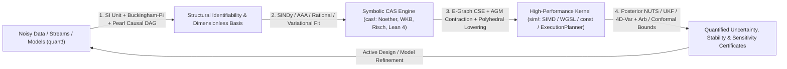

- **Effortless `quant!` Pipeline (1-Line End-to-End Quantitative Workflow)**:
  1. Ingest tabular/streaming data (`CSV`/`Parquet`/`Arrow`/sensor buffers), tagging columns automatically with SI dimensions (`Audit D13`) and missing/censored/uncertainty masks.
  2. Discover scaling laws via fixed **Buckingham-$\Pi$**, audit confounding symbolically via **Pearl `do`-calculus**, fit candidate parametric/symbolic dynamics (`SINDy` / splines / `AAA`), and estimate posterior parameters via **Sparse AD + `NUTS` / `EnKF` / `UKF` / Conic `QP`**—emitting finite-sample Conformal prediction intervals and `Arb` validated sensitivities.
- **Exact Symbolic `cas!` Analysis on Fitted Models**: Lift any discovered quantitative law (`NumericalLifter`) back into symbolic closed form to simplify, prove conservation invariants (`Noether`), derive asymptotic limits (`WKB`/`Van Dyke`), check formal consistency (`SMT`/`Lean 4`), or swap smooth surrogates (`FunctionFamilyLattice`).
- **Real-Time & Precision-Adaptive `sim!` Execution**: Compile symbolic equations or fitted empirical surrogates straight to vectorized `VmCompiler` / `WGSL` / `const fn` kernels driven continuously by `ExecutionObjective` (`TargetFps` interactive scrubbing up to certified `DoubleDouble`/`Arb` tolerances).

---

## 37. High-Performance `AnalysisPlan` Compiler & Execution Engine

Every `quant!`, `cas!`, and `sim!` invocation lowers into one unified **`AnalysisPlan`** optimization pass before execution:

1. **Algebraic Graph Compression (`E-Graph` CSE + Algebraic Factorization)**: Rewrites repeated trigonometric, exponential, polynomial, and Jacobian sub-DAGs into Horner / FMA factored forms minimizing multiplications and catastrophic cancellation.
2. **Treewidth-Guided `AGM` Contraction & Join Scheduler**: Uses one shared hypergraph treewidth optimizer (`Section 3.3, 33`) to minimize FLOPs and peak intermediate tensor/table memory across tensor contractions (`einsum`), Bayesian factor graphs, Kalman covariances, finite-element assembly, and relational `Arrow`/`DuckDB` joins.
3. **Polyhedral Loop Nesting + Mixed-Precision / `Dot2` Lowering**: Tiles loop nests for L1/L2 cache residency (`Section 16.7`), inserts hardware `FMA` + compensated `Dot2`/`TwoSum` accumulators on ill-conditioned reductions, and enables binomial `Revolve` adjoint checkpointing on long horizons.
4. **Live Runtime Adaptation & Incremental Re-JIT (`Section 3.3`)**: `ExecutionPlanner` auto-routes and dynamically re-JITs kernels against active `(TimeConstraint, AccuracyGoal, MemoryConstraint)` targets and [ResourceBudget](../../crates/algebra-core/src/config.rs) ceilings, executing `DynamicCarrierPromotion` (`Posit`/`LNS`/`f32 -> f64 -> DoubleDouble -> Arb`), live stepper swaps (`Tsit5 <-> IMEX <-> RadauIIA5`), and `SHA-256`-keyed incremental DAG invalidation upon interactive parameter or `AssumptionsContext` (`ScopeFrame`) edits.

---

# Part XVIII — Generalized Function Universe, Inter-Family Analytic Bridges, Metric Lattice & Source-Mined Domain Contracts (`Sections 38–41`)

## 38. Canonical Function Registry (`FunctionId`), Arities, Signature Standardization & Top-of-Script `define` Mappings

Today across `algebra-core` and `algebra-engine`, function nodes store raw string identifiers ([ExprKind::Function { name: SymbolId, args }](../../crates/algebra-core/src/expr.rs#L75-L79)), forcing downstream evaluators, symbolic integrators, limits, holonomic $D$-modules, and rewrite engines to repeat ad-hoc string lists (`"atan" | "arctan"` duplicated independently across [vm.rs](../../crates/algebra-core/src/vm.rs#L285), [numeric.rs](../../crates/algebra-engine/src/numeric.rs#L1296), [limits.rs](../../crates/algebra-engine/src/limits.rs#L297), [executor.rs](../../crates/algebra-engine/src/executor.rs#L3344), and [risch.rs](../../crates/algebra-engine/src/risch.rs#L491); `"lambert_w" | "LambertW"` / `"bessel_j" | "besselj"` / `"si" | "Si"` in [special.rs](../../crates/algebra-engine/src/special.rs#L357-L389); `"hermite_h" | "hermiteh"` in [weyl_dmodules.rs](../../crates/algebra-engine/src/weyl_dmodules.rs#L649)). Meanwhile, silent arity/parameter ambiguities (`atan(x)` vs 2-arg `atan2(y,x)`, natural `ln(x)` vs `log10(x)` vs `log(b, x)`, normalized `sinc_pi` vs unnormalized `sinc`, physicist $H_n$ vs probabilist $He_n$ Hermite, Jacobi elliptic $m = k^2$ vs $k$) are standardized cleanly through **unambiguous canonical `FunctionId` variants + lightweight top-of-script `define` mappings**—eliminating stateful ambient `ConventionProfile` switching altogether:

```rust
/// Canonical mathematical operator identity inside algebra-core.
#[derive(Debug, Clone, Copy, PartialEq, Eq, Hash)]
pub struct FunctionId(pub u32);

/// Preserves exact surface notation inputted by the user for lossless printer round-trips.
#[derive(Debug, Clone, Copy, PartialEq, Eq, Hash)]
pub struct DisplayAliasTag(pub u16); // e.g., "atan" vs "arctan" vs "tg^{-1}", "ln" vs "log"
```

### 38.1 Canonical Normalization Taxonomy (Synonymous Aliases, Arity Overloads & `define` Remaps)

| Overload / Family Class | Surface Names & Aliases (`DisplayAliasTag`) | Canonical Lowered Form (`FunctionId`) | Semantic / Analytical Distinction & Exact Bridge |
| :--- | :--- | :--- | :--- |
| **Pure Synonymous Spelling** | `atan` / `arctan` / `tan^-1` / `tg^{-1}`; `asin` / `arcsin`; `asinh` / `arcsinh` / `arsinh`; `sgn` / `sign` / `signum`; `Heaviside` / `Theta` / `unit_step` | `FnId::Arctan`, `FnId::Arcsin`, `FnId::Arsinh`, `FnId::Signum`, `FnId::Heaviside` + `DisplayAliasTag` | Zero semantic difference; E-graph, calculus, limits, and VM match once on `FunctionId`, while printers emit user's original notation cleanly (`round-trip invariance`). |
| **Arity Overload: `atan(x)` vs `atan2(y, x)`** | `atan(x)` (1-arg), `atan2(y, x)` / `arg(x + i y)` (2-arg) | `FnId::Arctan` (1-arg, range $(-\frac{\pi}{2},\frac{\pi}{2})$) vs `FnId::Atan2` (2-arg, range $(-\pi, \pi]$) | Quadrant-aware $\operatorname{atan2}(y, x) = \operatorname{atan}(y/x) + \frac{\pi}{2}(1-\operatorname{sgn}(x))\operatorname{sgn}(y)$ for $x\neq 0$; smooth differential form $\mathrm{d}(\operatorname{atan2}(y,x)) = \frac{x\,\mathrm{d}y - y\,\mathrm{d}x}{x^2+y^2}$ (winding without $x=0$ jump!). |
| **Arity / Base Overload: Logarithms & Exponentials** | `ln(x)`, `log(x)`, `log10(x)`, `log2(x)`, `log(b, x)`, `log1p(x)`, `expm1(x)` | `FnId::Ln(x)` (default natural `ln`), `FnId::Log10`, `FnId::Log2`, `FnId::LogBase { base, arg }`, `FnId::Ln1p`, `FnId::Expm1` (overridable via `define log(x) := log10(x)` or import preset) | Parameter-order signature disambiguation (`Mathematica` / `Python` adapters remap cleanly at parser ingress); automatic algebraic bridge $\log_b(x) = \ln(x)/\ln(b)$ & precision-preserving `log1p`/`expm1` lowering near $0$. |
| **Complete vs Incomplete Special Pairs** | `gamma(a)` vs `gamma(a, x)` / `gamma_lower(a, x)` / `gamma_inc_reg(a, x)`; `elliptic_k(m)` vs `elliptic_f(phi, m)`; `zeta(s)` vs `zeta(s, a)` | Distinct arity-keyed `FunctionId` variants (`Gamma`, `UpperGamma`, `LowerGamma`, `RegGammaP/Q`, `EllipticK`, `EllipticF`, `Zeta`, `HurwitzZeta`) | Exact specialization bridges: $\Gamma(a, 0) = \Gamma(a)$, $F(\frac{\pi}{2}, m) = K(m)$, $\zeta(s, 1) = \zeta(s)$, $\Gamma(n) = (n-1)!$, fixing `special.rs:201,260` silent `i64` saturation & debug overflow via checked `BigInt`/gcd-before-mul. |
| **Unambiguous Canonical Signatures + `define` Header Mappings** | Standard `sinc(x)` vs DSP `sinc_pi(x)`, `fourier(f, t, w, a, b)`, `elliptic_k(m)` / `elliptic_k_mod(k)`, `hermite_h` / `hermite_he`, `spherical_harmonic` | Distinct canonical `FunctionId`s (`SincUnnorm`, `SincPi`, `FourierStandard`, `FourierUnitary`, `EllipticM`, `EllipticModK`, `HermitePhys`, `HermiteProb`) + top-of-script **`define` remappings** | Users importing DSP/Mathematica/SciPy scripts place clear top-of-file aliases (`define sinc(x) := sinc_pi(x)`) without hidden runtime profile flips; exact transforms bridge $\operatorname{sinc}_{\pi}(x) = \operatorname{sinc}(\pi x)$ and $He_n(x) = 2^{-n/2}H_n(x/\sqrt{2})$. |
| **Real vs Principal Complex Radicals & Powers** | `sqrt(x)`, `cbrt(x)`, `surd(x, n)` (real odd root), `pow(x, p/q)` | `FnId::PrincipalPow` vs `FnId::RealOddRoot` | Resolves real vs principal complex ambiguity on $x < 0$: $\operatorname{surd}(-8, 3) = -2$ vs $(-8)^{1/3}_{\text{principal}} = 1 + i\sqrt{3}$ tracked via `AssumptionsContext` (`Decision A1`). |

---

## 39. Universal Inter-Family Analytic & Transformation Connection Graph (`FunctionConnectionGraph`)

Expanding beyond the stubbed rules in [bridges.rs](../../crates/algebra-engine/src/simplify/bridges.rs#L174-L185) (`ComplexExponential` and 2 lines for `sin/cos(i*x)`) and unifying with `FunctionFamilyLattice` (`Section 14.5`), URAE encodes a first-class typed **Transformation Connection Graph** (`FunctionConnectionGraph`) partitioned into **Exact Analytic Identities** (guarded by `AssumptionsContext` in `ScopeFrame` & [branch.rs](../../crates/algebra-engine/src/branch.rs) Riemann sheet congruence) and **Local / Asymptotic Surrogate Edges**:

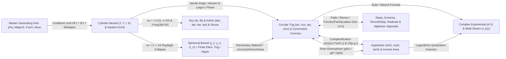

### 39.1 Bessel $\leftrightarrow$ Trigonometric / Hyperbolic / Confluent Connections

1. **Half-Integer Elementary & Spherical Collapse (`SpecialFunctions::evaluate_special` Upgrade)**:
   - Automatic exact Rayleigh reduction whenever order $\nu = n + \frac{1}{2}$ ($n \in \mathbb{Z}$):
     $$
     j_n(z) = \sqrt{\frac{\pi}{2z}}\,J_{n+1/2}(z) = (-z)^n \left(\frac{1}{z}\frac{\mathrm{d}}{\mathrm{d}z}\right)^n \frac{\sin z}{z}, \qquad J_{1/2}(z) = \sqrt{\frac{2}{\pi z}}\sin z, \qquad J_{-1/2}(z) = \sqrt{\frac{2}{\pi z}}\cos z
     $$
     and likewise $y_n(z), h_n^{(1,2)}(z) \leftrightarrow e^{\pm iz}\sum_{k=0}^n \frac{(n+k)!}{k!(n-k)!(\mp 2iz)^{k+1}}$, while modified Bessel functions at half-integer orders collapse identically into elementary hyperbolic/exponential forms: $I_{1/2}(z) = \sqrt{\frac{2}{\pi z}}\sinh z$, $I_{-1/2}(z) = \sqrt{\frac{2}{\pi z}}\cosh z$, $K_{1/2}(z) = \sqrt{\frac{\pi}{2z}}e^{-z}$.
2. **Spectral, Generating & Addition Bridges**:
   - **Jacobi–Anger Fourier–Bessel Bridge**: $e^{iz\cos\theta} = \sum_{n=-\infty}^\infty i^n J_n(z) e^{in\theta}$, $\cos(z\sin\theta) = J_0(z) + 2\sum_{k=1}^\infty J_{2k}(z)\cos(2k\theta)$, $\sin(z\sin\theta) = 2\sum_{k=0}^\infty J_{2k+1}(z)\sin((2k+1)\theta)$ — enabling closed-form spectral FM synthesis, periodic BEM waveguide diffraction, and Hankel transforms.
   - **Hansen–Bessel Integral, Neumann/Graf Addition & Lommel/Wronskian Simplifiers**: Exact Wronskian elimination $J_\nu(z) Y'_\nu(z) - J'_\nu(z) Y_\nu(z) = \frac{2}{\pi z}$ and $I_\nu(z) K'_\nu(z) - I'_\nu(z) K_\nu(z) = -\frac{1}{z}$ plus holonomic three-term recurrence canonicalization ($J_{\nu+1} = \frac{2\nu}{z}J_\nu - J_{\nu-1}$) inside E-graphs.
3. **Neighboring Special & Hypergeometric Reductions**:
   - **Airy $\leftrightarrow$ Modified/Ordinary Bessel**: $\operatorname{Ai}(z) = \frac{1}{3}\sqrt{z}[I_{-1/3}(\zeta) - I_{1/3}(\zeta)] = \frac{1}{\pi}\sqrt{\frac{z}{3}}K_{1/3}(\zeta)$ ($\zeta = \frac{2}{3}z^{3/2}$), linking Stokes airwaves and turning-point `WKBJ` layers uniformly.
   - **Kelvin & Struve**: $\operatorname{ber}_\nu(x) + i\operatorname{bei}_\nu(x) = J_\nu(x e^{3\pi i/4})$ (skin-effect AC EM eddy currents); half-integer Struve $\mathbf{H}_{\pm 1/2}$ reduces to Fresnel/elementary trig; all Bessel/Airy families lower cleanly to $_0F_1(; \nu+1; -z^2/4)$ / Whittaker $M_{\kappa,\mu}, W_{\kappa,\mu}$ and `MeijerG`.

### 39.2 Trigonometric $\leftrightarrow$ Hyperbolic $\leftrightarrow$ Exponential $\leftrightarrow$ Gudermannian $\leftrightarrow$ Logarithmic Bridges

| Connection Axis | Bidirectional Exact Formula & Identity Schema | Branch-Cut / Domain Congruence Guard ([branch.rs](../../crates/algebra-engine/src/branch.rs) + `AssumptionsContext`) |
| :--- | :--- | :--- |
| **Complexification & Clifford $\operatorname{Cl}(p,q,r)$** | $\sin(iz)=i\sinh z,\; \cos(iz)=\cosh z,\; \tan(iz)=i\tanh z,\; \sinh(iz)=i\sin z,\; \cosh(iz)=\cos z$; separated rectangular form $\sin(x+iy)=\sin x\cosh y + i\cos x\sinh y$; unified signature rotor $\exp(\theta B)$ where $B^2=-1$ ($\cos^2+\sin^2=1$) vs $B^2=+1$ ($\cosh^2-\sinh^2=1$) | Analytic entire functions (unconditional over $\mathbb{C}$ for $\sin,\cos,\sinh,\cosh$); meromorphic pole exclusions $\cos z = 0$ / $\cosh z = 0$ propagated cleanly for $\tan,\tanh,\sec,\operatorname{sech}$. |
| **Real Gudermannian Bijection $\operatorname{gd}(x)$** | $\operatorname{gd}(x) = 2\arctan(\tanh(x/2)) = \arcsin(\tanh x)$ ($x \in \mathbb{R} \leftrightarrow \phi \in (-\frac{\pi}{2}, \frac{\pi}{2})$): $\sin(\operatorname{gd} x)=\tanh x,\; \cos(\operatorname{gd} x)=\operatorname{sech} x,\; \tan(\operatorname{gd} x)=\sinh x$, inverse $\operatorname{gd}^{-1}(\phi)=\ln(\sec\phi+\tan\phi)=\operatorname{arsinh}(\tan\phi)$ | Strictly real, $C^\infty$ analytic bijection on $\mathbb{R} \leftrightarrow (-\pi/2, \pi/2)$ with derivative $\frac{\mathrm{d}}{\mathrm{d}x}\operatorname{gd}(x) = \operatorname{sech} x$ (links Mercator map coordinates, inverted pendulum separatrix, and $\tanh$ kink solitons without complex numbers!). |
| **Inverse Trig $\leftrightarrow$ Inverse Hyperbolic $\leftrightarrow$ Logarithmic** | $\arcsin z = -i\operatorname{arsinh}(iz) = -i\ln(iz+\sqrt{1-z^2})$;\; $\arctan z = -i\operatorname{artanh}(iz) = \frac{i}{2}\ln\frac{1-iz}{1+iz}$;<br>$\operatorname{arsinh} z = \ln(z+\sqrt{z^2+1})$;\; $\operatorname{arcosh} z = \ln(z+\sqrt{z-1}\sqrt{z+1})$ | **Guarded Branch-Cut Congruence**: Avoids naive $\sqrt{z^2-1}$ squaring mistakes along $z < -1$; splits $\operatorname{artanh}(x)=\frac{1}{2}\ln\frac{1+x}{1-x}$ ($|x|<1$) vs $\operatorname{arcoth}(x)=\frac{1}{2}\ln\frac{x+1}{x-1}$ ($|x|>1$); tracks exact sheet index $k \in \mathbb{Z}$ (`BranchSelection::Sheet(k)`). |
| **Surrogate Continuity Bridge (`Sec 14.5`)** | Connects exact piecewise/trig/hyperbolic targets (`Heaviside`, `signum`, `sinc`, `max`/`min`) ad hoc to `Sigmoid`, `tanh`, `erf`, `atan`, `SmoothStep`, algebraic radicals, and `Chebyshev`/`Padé` kernels | Tags swaps in `GuardedResult` with exact approximation order $O(x^k)$, $L_\infty$ or $L^2_w$ metric discrepancy (`MetricSpec`), and updated Lipschitz constants (`Audit G7`). |

---

## 40. Cross-Cutting Metric Lattice (`MetricSpec`) & Generalized `SeriesDispatchMatrix`

### 40.1 Generalized Metric, Norm & Divergence Family Lattice (`MetricSpec`)

Per architecture policy, **`MetricSpec`** is a single first-class cross-cutting policy object shared identically by **Approximation & Series Selection (`Sec 40.2`, `Sec 5.9`)**, **Optimization (`Remez`, `SINDy`, `L_1`/`ADMM`, `IRLS`)**, **`Quant` (`quant!`) tolerances & residual fitting**, and **`Equivalence` / `NumericalLifter` error measurement**:

```rust
pub enum MetricSpec {
    // Vector & Sequence Minkowski / Sparsity Family
    L0Modal { zero_tol: f64, smooth_epsilon: Option<f64> }, // Cardinality / mode / Hamming sparsity
    L1Manhattan,                                              // LAD, median, compressed sensing
    L2Euclidean,                                              // RMS / Hilbert l^2
    LpMinkowski { p: BigRational },                           // 0<p<1 quasi-norm | p>=1 Banach
    LInfinityMinimax,                                         // Sup / Chebyshev minimax

    // Matrix, Tensor & Subspace Family
    Frobenius,                                                // Hilbert-Schmidt ||A||_F = ||sigma||_2
    SchattenP { p: BigRational },                             // Nuclear S_1 | Frobenius S_2 | Spectral S_inf
    InducedOperator { p: BigRational, q: BigRational },         // sup_{||x||_p=1} ||Ax||_q
    GroupSparse { inner_p: BigRational, outer_q: BigRational }, // L_{2,1} structured sparsity
    SpdManifold { kind: SpdMetricKind },                      // AffineInvariant | LogEuclidean | BuresWasserstein
    Subspace { kind: SubspaceMetricKind },                    // Grassmann | Stiefel | Procrustes

    // Function-Space, Geometric & Information Divergences
    LebesgueWeighted { p: BigRational, weight: Option<ExprId>, domain: DomainId }, // L^p(Omega, w dmu)
    Sobolev { order_k: usize, p: BigRational, domain: DomainId },                  // W^{k,p} / H^s / BV
    RiemannianTensor { metric_tensor: ExprId, manifold_coords: Vec<SymbolId> },    // ds^2 = g_ij dx^i dx^j
    UltrametricPAdic { prime: u64 },                                               // |x|_p non-Archimedean
    CurveShape { kind: CurveMetricKind },                     // Hausdorff | Frechet | Chamfer
    Divergence { kind: DivergenceKind },                      // Wasserstein(p) | KL | JSD | TV | Hellinger | FisherRao | CRPS
    CustomNorm { fn_expr: ExprId, properties_verified: bool },
}
```

| `MetricSpec` Family | Mathematical Definition / Invariants | Driven URAE Solvers & Approximation Selection | Exact Dual / Conjugate & Numerical Equivalence Role |
| :--- | :--- | :--- | :--- |
| **Modal / Sparse `L_0`** | $\|x\|_0 = \#\{i : \|x_i\| > \tau\}$; Hamming $d_H(u,v)$; smooth $\sum(1-e^{-x_i^2/\epsilon})$ | Drives **`SINDy`** / `OMP` / `IHT` sparse equation discovery, **`PSLQ`**, and E-graph **`MinOps`/`MinLeaf`** symbolic compression (`quant!` model parsimony). | Modal tie-breaking & symbolic support selection (`Quant` minimum description length, `Audit D1` sparse pivots). |
| **Manhattan `L_1` / Total Variation** | $\|x\|_1 = \sum \|x_i\|$, $\operatorname{TV}(f) = \int \|f'\|$ | Drives **Least-Absolute-Deviations (`LAD`)**, **`FISTA` / `Split-Bregman`**, **`ADMM` $L_1$-QP**, and outlier-robust inverse PDE recovery (`Sec 34`). | Dual to $L_\infty$; preserves sharp shock fronts & piecewise slopes in `FVM` and piecewise regression without Gibbs overshoot. |
| **Euclidean / **Frobenius (`L_2`)** & Weighted $L^2_w$** | $\|x\|_2 = \sqrt{\sum x_i^2}$, $\|\mathbf{A}\|_F = \sqrt{\operatorname{Tr}(\mathbf{A}^T\mathbf{A})}$, $\langle f, g\rangle_w$ | Drives **Legendre/Fourier/Jacobi/Laguerre/Hermite Galerkin orthogonal projections**, SVD low-rank truncation (**Eckart–Young optimal in both $\|\cdot\|_F$ and $S_\infty$**), Higham `nearest_psd_matrix`, and `LSPG`/`POD`. | Hilbert inner-product orthogonality gives optimal $O(N\log N)$ Clenshaw/DCT spectral decay and closed-form normal equations. |
| **Minimax / Chebyshev (`L_\infty`)** | $\|f - g\|_\infty = \sup_{x \in S} \|f(x) - g(x)\|$ | Drives **`Remez` equioscillating polynomial/rational kernels**, **`AAA` rational approximation**, **`Parks–McClellan` FIR**, and **`const`/`no_std`/`BytecodeVM` bit-width guarantees**. | Directly certifies worst-case ULP error envelopes (`Arb`/`UniversalBall` bounds & `ErrorTermKind::CertifiedBound`). |
| **Schatten-$p$ & Induced $\ell_{p\to q}$** | $\|\mathbf{A}\|_{S_p} = \|\boldsymbol{\sigma}(\mathbf{A})\|_p$ ($S_1$ nuclear, $S_2 = \|\cdot\|_F$, $S_\infty$ spectral) | Drives **`WeightWatcher` RMT**, tensor-train / `HMatrix` `ACA+` low-rank approximation, matrix completion, and `Muon` orthogonalized updates. | Condition number $\kappa_2 = \|\mathbf{A}\|_{S_\infty}\|\mathbf{A}^{-1}\|_{S_\infty}$ gates adaptive `NumericRep` escalation cleanly inside `ExecutionPlanner`. |
| **Sobolev $W^{k,p}$ & Riemannian $g_{ij}$** | $\|u\|_{W^{k,p}} = (\sum_{|\alpha|\le k}\|\partial^\alpha u\|_{L^p}^p)^{1/p}$,\; $ds^2 = g_{ij}\,\mathrm{d}x^i\mathrm{d}x^j$ | Drives **`FEM`/`IGA` `DWR` & `Prager–Synge` energy-norm error**, `PINN` derivative losses, CAD surface geodesic/arc-length metrics, and General Relativity tensors (`curvature.rs`). | Guarantees derivative fidelity $\nabla u_h \to \nabla u$ where raw $L^2$/$L^\infty$ value error hides boundary-layer gradient spikes. |
| **Divergences (`W_p`, `KL`, `CRPS`, `Fisher–Rao`)** | $W_p(\mu,\nu) = (\inf_\gamma \int d^p\mathrm{d}\gamma)^{1/p}$,\; $\operatorname{KL}(\mu\|\nu)$ | Drives **Optimal Transport `Sinkhorn`** barycenters, **Natural Gradient**, **`GaussianKde`/`EVT` `CRPS` calibration**, and **`NUTS`/VI variational posteriors**. | Quantifies discrepancy consistently across probability distributions, empirical histograms, and noisy PDE fields. |

### 40.2 Generalized `SeriesDispatchMatrix`: Multi-Basis Series Expansion Selector

Extending `Section 5.9` and [series.rs](../../crates/algebra-engine/src/series.rs), `SeriesDispatchMatrix::expand(fn_or_expr, domain_or_center, metric, budget)` inspects singularity type (via `FunctionConnectionGraph` + `BranchCutGeometry`) **and** active `MetricSpec` to construct exact truncated expansions (`ErrorTermKind`: `BigO | LagrangeRemainder | CertifiedBound | BareTruncated`) OR lazy `SeriesGenerator` streams (`ExprKind::Sum` + `HolonomicFunction` recurrence):

| Expansion Family | Triggering Center / Singularity / Domain Geometry | Metric Affinity | Representative Canonical Behavior Across Diverse Functions |
| :--- | :--- | :--- | :--- |
| **Taylor / Maclaurin & `WeilJet`** | Analytic ordinary point $z_0$ inside disk $\|z - z_0\| < R$ | Local point jet; $O((z-z_0)^{N+1})$ | $\sin z$, $e^z$, $J_n(z)$ ($n \in \mathbb{Z}_{\ge 0}$, entire: $R=\infty$!), $\operatorname{erf}(z)$ (entire), $\ln(1+z)$ ($R=1$), $\arctan z$ ($R=1$). |
| **Laurent + Cauchy Residues** | Isolated pole of finite order $m$ at $z = z_0$ | Punctured disk $0<\|z-z_0\|<R$ | $\Gamma(-n+\epsilon)$ simple poles w/ residue $\frac{(-1)^n}{n!}$, $\zeta(s)$ at $s=1$ ($\frac{1}{s-1}+\gamma+\dots$), $\tan(z)$ at $z=\frac{\pi}{2}$, $1/\sin z$. |
| **Newton–Polygon `Puiseux`** | Algebraic branch point $z_0$ ($F(z, y) = 0$) or fractional power $(z-z_0)^{p/q}$ | Multi-sheeted wedge | $J_\nu(z) = (z/2)^\nu \sum \frac{(-z^2/4)^k}{k!\Gamma(\nu+k+1)}$ ($\nu \notin \mathbb{Z}$), $\sqrt{1-z^2}$, Bring–Jerrard / quintic `RootOf`, bifurcation branches near Fold points. |
| **Logarithmic `Frobenius`** | Regular singular point of D-finite ODE where indicial $r_1 - r_2 \in \mathbb{Z}_{\ge 0}$ | Slit punctured neighborhood | Bessel second-kind **$Y_n(z)$ & $K_n(z)$ around $z=0$** yielding $\frac{2}{\pi}\ln(z/2)J_n(z)$ + finite negative $z^{-n}$ sum + digamma $\psi$ regular sum! |
| **Asymptotic Poincaré, `WKBJ` & Écalle Transseries** | Irregular singularity ($z \to \infty$ or $\epsilon \to 0^+$) across Stokes sectors | Superasymptotic optimal truncation + `Borel–Padé` | $J_\nu(z), Y_\nu(z) \sim \sqrt{\frac{2}{\pi z}}\cos(z - \frac{\nu\pi}{2} - \frac{\pi}{4})$;\; $I_\nu, K_\nu \sim e^{\pm z}/\sqrt{2\pi z}$;\; Stirling $\Gamma(z)$;\; $\operatorname{Ai}(z)$ turning-point Airy connection;\; $\operatorname{Ei}(z), \operatorname{erfc}(z)$. |
| **Chebyshev $T_k$, Legendre $P_k$, Fourier & Orthogonal Spectral** | Compact real interval $[a, b]$, circle/torus $S^1$, unit disk ($Z_n^m$), or weighted $\mathbb{R}/\mathbb{R}_+$ | **`L_inf` minimax-near (Chebyshev) or weighted `L^2_w`** | Smooth global fits on $[a,b]$ even when poles near the real axis restrict Taylor $R$; Clenshaw/DCT $O(N\log N)$; `Remez` upgrade for exact $L_\infty$ minimax kernels. |
| **Dirichlet Series $\sum a_n n^{-s}$** | Half-plane $\operatorname{Re}(s) > \sigma_c$ for multiplicative arithmetic functions | Half-plane analytic continuation | $\zeta(s) = \sum_{n\ge 1} n^{-s}$, $\eta(s) = \sum (-1)^{n-1}n^{-s}$, $1/\zeta(s) = \sum \mu(n) n^{-s}$, Dirichlet $L(s, \chi)$, prime zeta, Euler products. |
| **Umbral / Newton–Gregory Factorial** | Lattice/integer shift grids $x_0 + h\mathbb{Z}$ (`umbral.rs`, finite-difference operators) | Discrete lattice / combinatorics | $(1+\Delta)^x$ factorial polynomials $x^{\underline{n}}$, binomial/Stirling generating functions, difference equations. |
| **Continued Fractions (`S`/`J`/`T` & `Thiele`) & `Hermite–Padé` / `AAA`** | Meromorphic / square-root branch-cut continuation far outside Taylor disk | Rational / quadratic algebraic `L_2`/`L_inf` | $\tan z$, $\operatorname{erf}/\operatorname{erfc}$, $\operatorname{Ei}$, Stieltjes integral transforms, quadrature Gauss-Kronrod nodes from Jacobi $J$-fractions. |

---

## 41. Unified `MathDomain`, Two-Tier Source Mining & `FunctionContract` (`check_compatibility`, `infer_range_or_codomain`, `infer_properties`)

Today `algebra-core`'s [Domain](../../crates/algebra-core/src/domain.rs#L25-L77) (coarse algebraic tags), `algebra-engine`'s [MathSetRepresentation](../../crates/algebra-engine/src/sets.rs#L39-L75) (intervals/set-builders/booleans), and [BranchCutGeometry](../../crates/algebra-engine/src/branch.rs#L42-L59) exist as isolated islands with no unified membership, image propagation, or signature-compatibility engine. URAE merges all three under one **`MathDomain`** + **`FunctionContract`** API:

### 41.1 Unified Domain, Set, Manifold & Function-Space Model (`MathDomain`)

```rust
pub enum MathDomain {
    /// Algebraic carriers unifying Domain + DomainCategory lattice
    AlgebraicCarrier(Domain), // N, Z, Q, R, C, H, O, S, Q_p, A, No, Z/nZ, GF(p^k), Matrix, Tensor, Bool
    /// Real/extended intervals (closed, open, half-open, rays, discrete singletons)
    Interval { lo: BoundEndpoint, hi: BoundEndpoint, inc_lo: bool, inc_hi: bool },
    /// Punctured / excluded / slit domains: e.g. R \ {0}, R \ {pi/2 + k*pi}, C \ (-inf, 0]
    Difference { base: Box<MathDomain>, excluded: Box<MathDomain> },
    /// Boolean set combinations & predicate comprehensions (bridging MathSetRepresentation)
    Union(Vec<MathDomain>),
    Intersection(Vec<MathDomain>),
    Comprehension { var: SymbolId, carrier: Box<MathDomain>, predicate: ExprId, units: DimVector<Ratio<i32>> },
    /// Geometric, linear-algebraic & metric manifolds
    MatrixManifold { kind: MatrixManifoldKind, dim: usize, scalar: Domain }, // SPD, PSD, SO(n), SE(3), Orthogonal, Unitary, GL(n)
    MetricBall { center: MathValue, radius: ExprId, metric: MetricSpec },
    /// Product domain for n-ary functions like atan2: (R x R) \ {(0,0)} or log base/arg
    Product(Vec<MathDomain>),
    /// Functional regularity spaces bridging SobolevSpaceKind (Sec 3.1)
    FunctionSpace { sobolev: SobolevSpaceKind, domain: Box<MathDomain>, codomain: Box<MathDomain> },
}

pub enum DomainInput {
    ExplicitSet { domain: MathDomain, declared_codomain: Option<MathDomain> },
    ElementOrValue { value: MathValue, context_expr: Option<ExprId> },
    /// Two-tier source mining (Decision A2): inspects internal AST/Registry OR Rust/Python/Parquet source
    TypedSource(TypeSourceQuery),
}
```

### 41.2 Two-Tier Source Mining (`SourceMiner`)

When a caller passes a symbolic variable, element, custom Rust value/function, or imported dataset handle (`DomainInput::TypedSource`), `SourceMiner` extracts its effective `MathDomain`, physical units, and active codomain invariants in two lossless tiers:

1. **Tier 1 — Internal URAE Reflection (Zero External Compilation Required)**:
   - Walks the `ExprGraph` DAG around the target expression/symbol to extract active relational constraints (`x > 0`, `|x| <= 1`, `n in Z`), propagates exact rational `DimVector<Ratio<i32>>` SI+Angle units (flagging dimensional errors such as Torque vs Energy or incompatible units inside transcendental functions), queries `AssumptionsContext` (`Positivity`, `Integer`, `BranchSelection`), pulls outward-rounded `Interval`/`Arb`/`TaylorModel` enclosures, and inspects `SubsystemRegistry` typed operator schemas.
2. **Tier 2 — Optional Static AST & Data Schema Mining (`source-miner` Feature)**:
   - **Rust Source & Doc-Contract Mining (`syn` + rustdoc)**: Parses trait bounds (`Float`, `RealField`, `Signed`, `Unsigned`, `Ring`), constrained newtypes (`NonZeroU64`, `NonZeroI64`, `PositiveF64`, `Bounded<L, U>`, `UnitQuaternion`, `SpdMatrix<N>`), and explicit doc/attribute contracts (`#[requires(x > 0.0)]`, `#[ensures(ret >= 0.0 && ret <= 1.0)]`) into exact `MathDomain` restrictions without running unsafe foreign code.
   - **Tabular & Polyglot Schema Mining**: Reads `Arrow`/`Parquet`/`CSV` schema metadata (`DataType`, nullable masks, min/max parquet column statistics, `DimVector` unit tags) and Python numerical type annotations (`Annotated[float, Gt(0), Lt(1)]`, `NDArray[Shape["N,N"], Float64]`) into unified `MathDomain` objects.

### 41.3 Compatibility, Range vs. Codomain & Mathematical Property Inference (`FunctionContract`)

Calling `FunctionContract::inspect(target_fn_or_expr, input, optional_metric)` returns one structured, deterministic **`FunctionContractReport`**:

```rust
pub struct FunctionContractReport {
    pub function_id: Option<FunctionId>,
    pub effective_domain: MathDomain,
    pub compatibility: CompatibilityStatus,
    pub image: ImageInference,
    pub properties: FunctionProperties,
    pub branch_cuts_active: Vec<BranchCutGeometry>,
}

pub enum CompatibilityStatus {
    /// Total on every element of effective_domain under active DimVector & AssumptionsContext
    CompatibleTotal,
    /// Partially compatible: returns active punctured sub-domain + exact excluded points/cuts/sheets
    /// plus opt-in codomain promotions (e.g. Reals -> Complex via SafetyPolicy / AssumptionsContext, Decision A1)
    PartialWithExclusions {
        active_domain: MathDomain,
        excluded: MathDomain,
        singularity_notes: Vec<(MathDomain, SingularityKind)>, // Pole, Essential, BranchCut, ZeroDiv, UnitError
        available_promotions: Vec<DomainPromotionSuggestion>, // e.g. promote R -> C to evaluate sqrt([-4, -1])
    },
    /// Structural type, matrix shape, or SI dimension violation (e.g. sin(3 meters), 2x2 * 3x3)
    Incompatible { reasons: Vec<CompatibilityFailure> },
}

pub struct ImageInference {
    pub set: MathDomain,                  // Exact range f(S) or tight outer enclosure / codomain
    pub tightness: ImageTightness,        // ExactRange | CertifiedOuterEnvelope | NominalCodomain
    pub declared_codomain_fit: Option<bool>, // True if f(S) subseteq declared_codomain
}

pub struct FunctionProperties {
    pub totality: TotalityKind,           // Total | PartialOnDomain | UndefinedEverywhere
    pub multi_valued: Option<SheetSpec>,  // SingleValued (principal) vs MultiValued(sheet k in Z)
    pub injectivity: PropertyCert,        // Yes/No/Conditional(on sub-interval) + witness inverse f^-1
    pub surjectivity: PropertyCert,       // Evaluated specifically onto supplied or canonical codomain T!
    pub bijectivity: PropertyCert,        // Exact invertible bijection + constructive InverseMap
    pub monotonicity: MonotonicitySummary,// StrictlyIncreasing | Decreasing | Constant | PiecewiseSegments
    pub parity: ParityKind,               // Even | Odd | Hermitian | None
    pub periodicity: Option<ExprId>,      // Fundamental period T (e.g., 2*pi, pi, 2*pi*i)
    pub continuity: ContinuityClass,      // Discontinuous | C0 | C(k) | CInf | Analytic | Entire | Meromorphic | Holonomic
    pub convexity: ConvexityKind,         // Convex | StrictlyConvex | Concave | Quasiconvex | NonConvex
    pub metric_bounds: Option<MetricPropertyReport>, // Lipschitz L_f, Banach contraction (< 1), Isometry under MetricSpec!
}
```

#### Worked Contract Inference Examples (Verified Pipeline Flow)

| Function Query | Input `DomainInput` (+ Target Codomain $T$) | `compatibility` | `image` (`Range` vs `Codomain`) | Inferred `properties` |
| :--- | :--- | :--- | :--- | :--- |
| **`tan(x)`** | `Set(Reals)`, target $T = \mathbb{R}$ | `PartialWithExclusions`: active $\mathbb{R} \setminus \{\frac{\pi}{2} + k\pi\}$, poles order 1 (`No` unit dimension checked) | **`ExactRange`**: $\mathbb{R}$ (`ImageTightness::ExactRange`) | `Partial`, **Not Injective** (period $\pi$), **Surjective** onto $\mathbb{R}$, **Odd**, Meromorphic ($C^\omega$ on active domain); **Bijective** once restricted to $(-\frac{\pi}{2}, \frac{\pi}{2})$ with inverse $\arctan$! |
| **`sin(x)`** | `Set([0, pi])`, target $T = [-1, 1]$ vs $T = [0, 1]$ | `CompatibleTotal` (entire analytic on $\mathbb{R}$) | **`ExactRange`**: $[0, 1]$ (via derivative critical point $x=\frac{\pi}{2}$) | `Total`, **Not Injective** on $[0,\pi]$ ($\sin x = \sin(\pi-x)$); **Surjective onto $[0,1]$**, **Not Surjective onto $[-1,1]$**; `Lipschitz(L=1)` under $L_2$/$L_\infty$! |
| **`sqrt(x)`** | `Element(-4)` or `Set([-9, 4])` (`Reals`) | `PartialWithExclusions`: active $[0, 4]$, excluded $[-9, 0)$ in $\mathbb{R}$ + **`DomainPromotionSuggestion(Reals -> Complex)`** via `SafetyPolicy`/`AssumptionsContext` (`Decision A1`) | Under $\mathbb{R}$ active $[0, 4]$: **`ExactRange` $[0, 2]$**; if promoted to $\mathbb{C}$: $\{[0, 2]\} \cup \{i y : y \in (0, 3]\}$ (`Sheet(0)`) | `Total` on $\mathbb{R}_{\ge 0}$, **Injective & Strictly Increasing**, $C^0([0,\infty)) \cap C^\infty((0,\infty))$; not Lipschitz at $0^+$. |
| **`atan2(y, x)`** | `Set(R^2)`, target $T = (-\pi, \pi]$ | `PartialWithExclusions`: active $\mathbb{R}^2 \setminus \{(0, 0)\}$ (branch singularity at origin) | **`ExactRange`**: $(-\pi, \pi]$ (`ImageTightness::ExactRange`) | `Partial` on $\mathbb{R}^2$, `Total` on $\mathbb{R}^2 \setminus \{(0,0)\}$, discontinuous along negative $x$-axis branch cut $(-\infty, 0]\times\{0\}$, zero-homogeneous $f(\lambda y, \lambda x) = f(y,x)$ ($\lambda>0$). |
| **`custom_f(x: NonZeroU64)`** *(Rust Source Mined)* | `TypedSource(syn + rustdoc #[ensures(ret > 0)])` on `1.0 / (x as f64)` | `CompatibleTotal` (`NonZeroU64` eliminates $x=0$ pole!) | **`ExactRange`**: discrete $\{1/k : k \in \mathbb{Z}_{\ge 1}\} \subseteq (0, 1]$ (`ImageTightness::ExactRange` for discrete sub-set or certified envelope $(0, 1]$) | `Total`, **Injective**, **Strictly Decreasing** on $\mathbb{Z}_{\ge 1}$, **Not Surjective** onto $\mathbb{R}_{>0}$. |
| **`bessel_j(0, x)`** | `Set([0, inf))` (`Reals`), target $T = \mathbb{R}$ | `CompatibleTotal` ($J_0(x)$ is entire!) | **`TightOuterEnvelope`** $[-1, 1]$ (refined to exact `[min J_0(j_{1,1}), 1.0]` $\approx [-0.402759, 1.0]$ via Bessel zero/extremum root finder!) | `Total`, **Even**, $C^\infty$ / Entire / Holonomic rank 2, oscillatory ($O(x^{-1/2})$ decay), **Not Injective**, **Not Surjective** onto $\mathbb{R}$. |

---

# Part XIX — Canonical Permissive Language (`UraeScript`), Unified Context System & API Parity (`Sections 42–45`)

## 42. Codebase Language Audit, Zero-Regex `UraeScript` & Reconciled Declaration Semantics

Audit of `algebra-engine` exposed six fragmented, non-composable parser and execution layers (`Track I1–I6` in [CODEBASE_AUDIT_AND_REMEDIATION_PLAN.md](../audits/CODEBASE_AUDIT_AND_REMEDIATION_PLAN.md)):

1. **String-Munging Pre-Passes & Token Collisions ([parser.rs](../../crates/algebra-core/src/parser.rs#L46-L413))**: `normalize_latex_input` executes destructive `.replace(...)` passes prior to lexing (2-/3-dollar slicing panics, `\operatorname{sin}(x)` & nested `^{...}` corruption, blind `** -> ^`), while `ExprParser` locks `[...]` strictly to `parse_bracket_matrix` (conflicting with intervals `[a, b]` and trailing SI units `[m/s^2]` stripped manually in [urae-cli/src/json_api.rs](../../crates/urae-cli/src/json_api.rs#L126-L145)), hardcodes `%` as modulo, and treats contiguous adjacency asymmetrically (`2sin(x)` parses, `sin x` fails).
2. **Duplicate String-Prefix NL Parsers ([parser.rs:796-2989](../../crates/algebra-core/src/parser.rs#L796) vs. [query.rs:553-636](../../crates/algebra-engine/src/query.rs#L553-L636))**: Two disconnected heuristic string pipelines rewrite `"e^x" -> "exp(x)"` (`e^tan(x)` breaks), collide on `" is "` (`DomainDeclaration` vs. `Define`), and treat `integrate`/`solve`/`det`/`proof` as top-level command strings instead of composable expressions.
3. **Lossy `cat-lang` `CatScript` / `CatPad` ([cat-lang/src/parser.rs](../../crates/cat-lang/src/parser.rs#L30-L96), [elaborator.rs](../../crates/cat-lang/src/elaborator.rs#L34-L84))**: `parse_script` splits blindly on `;` (breaking `[1 2; 3 4]` matrices), discards `: Dim` annotations, omits `FunctionDef` parsing, flattens `BigRational` to `f64`, drops complex `.im` parts, degrades integrals/derivatives/sets/sums/matrices to `CatExpr::Call { func: "opaque" }`, and is unwired from `UraeSession`.
4. **Disconnected Frontends & Fragmented Declaration Verbs ([operation.rs:696-734](../../crates/algebra-core/src/operation.rs#L696-L734), [session.rs](../../crates/algebra-engine/src/session.rs#L340-L468), [urae-notebook/src/notebook/parser.rs](../../crates/urae-notebook/src/notebook/parser.rs#L342-L576), [urae-kernel](../../crates/urae-kernel/src/lib.rs#L114-L221), [urae-py](../../crates/urae-py/src/lib.rs#L31-L150), [urae-lsp](../../crates/urae-lsp/src/lib.rs#L75-L150))**: `UraeSession` performs raw string macro replacement (`expand_definitions`), notebook dollar-number references collide with LaTeX `dollar` delimiters, `MathOperation` scatters `Declaration`, `UncertainDeclaration`, `Distribution`, `SetBuilder`, `DomainRestriction`, and `Substitute`, while `urae-py`/`urae-lsp`/`urae-ffi` lack unified session/context APIs.

### 42.1 Phased Consolidation Pipeline (Zero-Regex Core First, Transient Ingress Adapters Over Shared IR)

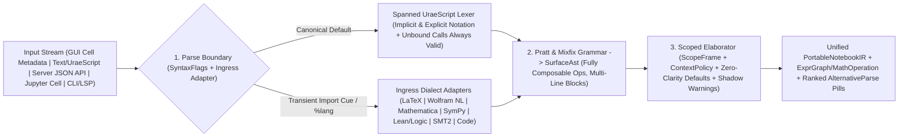

- **Priority 1 — Standardize Canonical `UraeScript` (`.urae` / Lossless `.cat`) First**: One concise, human-friendly, permissive canonical syntax engineered so simple math (`x^2 + 2x = 0`, `f(x) = sin(x)/x`, `solve sin(x) = 1/2`, `integrate x*e^(-x^2), x`) needs zero boilerplate, unbound symbols and implicit/explicit notation always work cleanly, and server scripts, notebooks, and CAS APIs gain full composability, SI+Angle units, sets, logic, multiphysics, and JS-style isolated scopes.
- **Priority 2 — Zero-Regex Discipline & Transient Ingress Dialects (No Runtime `DialectMode` / `ConventionProfile`)**: Core tokenization, brace matching, unit extraction, LaTeX command reading, Mathematica brackets, SymPy infix, and Lean binders use **deterministic finite-state lexers, trie keyword tables, and recursive-descent Pratt parsers** (zero regex in core grammar). Input syntax adapters (`LaTeX`, `WolframNL`, `Mathematica`, `SymPyCode`, `LeanLogic`, `SmtLib2`) normalize **strictly at parser ingress** straight into canonical `SurfaceAst` (optionally emitting top-of-script `define` mappings such as `define sinc(x) := sinc_pi(x)` for DSP/SciPy conventions), carrying zero ambient dialect or convention profile state into runtime evaluation!

### 42.2 Reconciled Four-Verb Declaration Semantics (`define` / `let` / `assume` / `declare`)

Unifying scattered `Declaration`, `UncertainDeclaration`, `Distribution`, `SetBuilder`, `DomainRestriction`, and `Substitute` variants in [operation.rs](../../crates/algebra-core/src/operation.rs#L696-L734) onto four orthogonal semantic acts:

| Canonical Form | Semantic Act | Scope & Shadowing Behavior | Examples & Convention Mapping Role |
| :--- | :--- | :--- | :--- |
| **`define`** *(or `:=`)* | **Definitional Equivalence / Symbolic Formula / Alias** | Binds symbolic rule/macro evaluated lazily on invocation; isolates in nested `ScopeFrame`s with a **shadowing warning** if already defined. Replaces ambient `ConventionProfile` cleanly via top-of-script mappings. | `define sinc(x) := sinc_pi(x)`, `define tau := (r × F) / 1 [rad]`, `define f(x: Length) -> Area := x^2` |
| **`let`** *(or statement-level bare `x = expr`)* | **Eager Value Assignment** | Evaluates RHS in active `ScopeFrame` and binds `CompactValue` (`MathValue`). Rebinding in the same or inner scope **never fails**—it cleanly shadows in `ScopeFrame` and emits a **shadowing warning** (plus unit/type change note when dimension shifts). | `let roots = solve x^2 - 2 = 0`, `let m = 5.0 [kg]` |
| **`assume`** *(or inline `where` / `given`, `∈`, `~`)* | **Constraint, Domain Fact or Probability Prior** | Attaches `Predicate` flags, intervals, algebraic traits, or distributions (`X ~ Normal(0, 1)`) without fixing a scalar number. `where`/`given` scope locally to one expression. Inner-scope overrides shadow with warning; conflicting same-scope constraints flag unsatisfiable domain. | `assume x > 0, n in ℤ`, `assume A is Hermitian`, `assume X ~ Normal(0, 1)`, `simplify sqrt(x^2) where x >= 0` |
| **`declare`** *(or `: Type`, UI dropdown/pill metadata)* | **Optional Structural Sort, `DimVector` or `NumericRep`** | Attaches `DimVector` (incl. `DIM_ANGLE`), shape, `NumericRep`, or UI slider metadata (`SymbolRoleKind`) without defining a formula or forcing boilerplate on generic math symbols. | `declare theta : Angle`, `declare k : Posit(32, 2)`, `declare A : Matrix<Complex>(3, 3)` |

*(Pure non-mutating expression evaluation `substitute x = 2 in expr` / `expr |_{x=2}` lowers separately without mutating `ScopeFrame` state.)*

---

## 43. Context-Aware Disambiguation, Function Awareness (`f(x+1)`) & Zero-Clarity Defaults

To let users write concise mathematical expressions *without* verbose constructors while preventing silent misinterpretation when notations collide, URAE combines **Function-Aware Longest-Known Tokenization**, **Context-Type Disambiguation**, **Deterministic Zero-Clarity Defaults**, and **Inline Force Sigils**:

### 43.1 Function-Aware Tokenization (`f(x + 1)` Composition vs. Multiplication & Multi-Char Symbols)

Unbound symbols and both implicit and explicit notation are **always allowed** (`sin x`, `sin(x)`, `2x`, `2*x`, `f(x + 1)`). URAE applies a deterministic three-rule resolver so `f(x + 1)` never fails just because `f` was not pre-declared:

1. **Known Bindings & Unbound Function Awareness**:
   - Bound callables (`define`d functions, canonical `FunctionId`s `sin`/`bessel_j`/`gamma`, `FunctionSpace` variables) followed by `(...)` parse as **Function Application** (`sin(x)`, `f(g(x))`); symbols bound as scalar constants, parameters, or dimensional quantities (`a = 5`, `m: 2 [kg]`) followed by `(...)` default to **Implicit Multiplication** (`a(x + 1) -> a * (x + 1)` unless `@fn a(x)`).
   - When an **unbound** identifier `id` precedes `(` **with zero whitespace** (`f(x + 1)`, `g(h(x))`, `P(x)`, `u(x, t)`): multi-arg calls, definition heads (`f(x + 1) := ...`), differential/ODE/chain contexts (`diff(f(g(x)), x)`), primed `f'(x)`, and canonical function names resolve cleanly as **Symbolic Function Application (`ExprKind::Function`)** rather than multiplication, while `2(x + 1)`, `(a+b)(c+d)`, whitespace `a (b + c)`, or obvious scalar polynomial coefficient use resolve to multiplication (`*`).
   - Ambiguous unbound `ident(expr)` attaches a clickable **`AlternativeParse`** toggle (`"Interpreted f(x+1) as Function Application — Switch to f * (x+1)?"`); explicit composition uses `f o g` / `f ∘ g` / `(f ∘ g)(x)`.
2. **Longest-Known Atom & Differential Boundaries**:
   - Lexer recognizes longest bound/registered identifier (`theta_dot`, `bessel_j`, `sinc_pi`, subscripts `x_1`, `v_0`) cleanly as one atom; digit-to-letter transitions (`2x`, `3sin(x)`, `2(x+1)`) split into implicit multiplication without spaces; well-spaced functions (`sin x`) apply unary trig precedence; differentials inside `∫ f(x) dx` / `d/dx` bind `dx` cleanly while leaving standalone `dx` usable as a variable name.

### 43.2 Ambiguous Delimiter Collision Table & Deterministic Zero-Clarity Defaults

Whenever syntactic context *and* user input omit explicit disambiguators, execution **never hangs**—it selects the deterministic **Zero-Clarity Default** below while attaching `alternatives: Vec<AlternativeParse>` metadata for optional 1-click UI/API inspection:

| Ambiguous Form | Competing Meanings | Contextual Evidence Used First | **Zero-Clarity Default** (When No Cue Present) | Concise Force Sigil (Instant Override) |
| :--- | :--- | :--- | :--- | :--- |
| **`(a, b)`** | Tuple/Point vs. Open Interval $(a, b)$ vs. $\gcd(a, b)$ vs. Binomial | Inside `in`, `∪`, `∩`, `\`, or set expressions $\to$ Interval; `<(1,2),(3,4)>` or 3+ elems $\to$ Tuple | **Ordered Tuple / Coordinate Point** | `#[interval](a, b)`, `#[open](a, b)`, `gcd(a, b)`, `binomial(a, b)` |
| **`[a, b]` / `[a b; c d]`** | Matrix/Vector vs. Closed Interval $[a, b]$ vs. Mathematica Call `F[x]` vs. Index `v[i]` vs. Unit `[m/s]` | Follows `ident` without operator (`F[x]`/`v[i]`); follows number/expr with SI+Angle atoms (`9.8 [m/s^2]`, `30 [deg]`); follows `in` $\to$ Interval; `;` rows $\to$ Matrix | **Row Vector / Matrix** (inside `[...]` w/ scalars); **SI/Angle Unit** if `[unit]` follows literal/quantity | `@mat[a, b]`, `@vec[a, b]`, `#[interval][a, b]`, `unit(m/s^2)` |
| **`\|x\|`, `{x \| P}`, `\|ψ⟩`** | Abs/Norm/Det/Cardinality vs. Set-Builder Such-That vs. Dirac Ket vs. Divides / OR | `{ var ... \| pred }` $\to$ Set-Builder; `\|...⟩` $\to$ Ket; paired `\|M\|` typed by arg (Matrix $\to \det$, Set $\to$ card, Vec $\to$ norm) | **`abs(x)` / Norm** for symmetric `\|...\|`; `\|\|` or `or` for Boolean | `det(A)`, `card(S)`, `norm(v, p)`, `{ x in R \| P }`, `a divides b` |
| **`=`, `:=`, `==`** | `let` Value Binding / `define` Formula vs. Equation vs. Equivalence Test | Inside `solve`/`where`/`given`/`system` or compound LHS (`x^2 + y^2 = 1`) $\to$ Equation; bare `x = val` $\to$ `let`; `:=` $\to$ `define` | **`let` Binding** on bare `sym = ...`; **`define`** on `f(args) := ...` / `:=`; **Equation** on compound LHS | **`let` / `define`**, **`:=`** (def), **`==`** (equality test) |
| **`^`, `*`, `%`, `line refs`** | `^`: Pow vs. XOR vs. Wedge; `%`: Mod vs. Magic vs. Prev; `ref`: Line vs. LaTeX | Leading `%` / `%%` at col 0 $\to$ Magic; balanced non-digit LaTeX math delimiters $\to$ LaTeX expr; `#N` / ref digits $\to$ Line Ref | **`^` = Power**; **infix `%` = Modulo**; **`*` = domain-typed Mul** | `xor`, `/\` (wedge), `@` (matmul), `mod(a, b)`, `#N` (unambiguous cell ref) |

---

## 44. Unified Context System (`ExprGraph` Rayon Arena, `ScopeFrame`, `ContextPolicy`, `NumericRep` & `ExecutionObjective`)

Audit of the live codebase (`Track J`) exposed **six fragmented, out-of-sync context types** ([domain.rs:373](../../crates/algebra-core/src/domain.rs#L373) `MathContext`, [executor.rs:45](../../crates/algebra-engine/src/executor.rs#L45) `ExecutionContext`, [numeric.rs:16](../../crates/algebra-engine/src/numeric.rs#L16) `EvalContext`, [logic.rs:322](../../crates/algebra-engine/src/logic.rs#L322) `AssumptionsContext`, [cat-lang/src/elaborator.rs:19](../../crates/cat-lang/src/elaborator.rs#L19) `Elaborator::env`, and `urae-notebook` `ParsedLine::scoped_context`), causing live bugs: `ExecutionContext` lacks `MathContext` (`SetContext` inside `OperationExecutor` is a no-op, `SystemCommandKind::Context` prints hardcoded `MathContext::default()`, `ExecutionContext::default()` initializes `precision_digits = 0`, 20+ internal solvers overwrite context with `EvalContext::default()`, and `bindings` drops anything non-`f64`). URAE replaces all six silos with **four orthogonal, zero-silo layers**:

### 44.1 Layer 0 — Lock-Free Rayon-Compatible Expression Arena (`ExprGraph` + `AlgebraEnv`, `Track G2`/`J2`)
- **Decoupled Syntactic `ExprNode` ([expr.rs:139](../../crates/algebra-core/src/expr.rs#L139))**: Remove `pub domain: Domain` from hash-consed AST nodes so identical expressions (`x + 1`) are shared once across `Reals`, `Complex`, `Integers`, or local scopes without duplicate interning.
- **Wait-Free Reads + Sharded Rayon Writes ([graph.rs:19](../../crates/algebra-core/src/graph.rs#L19))**: Replace `Arc<RwLock<Vec<ExprNode>>>` (whose read/write guards risk re-entrant Rayon deadlocks during `.par_iter()` work-stealing) with a **lock-free power-of-two segmented append slab** (`get(ExprId)` is wait-free `O(1)` without locking!), backed by worker-local scratch arenas and deterministic sharded `intern_batch` commits under `ContextualAlgebra`.

### 44.2 Layer 1 & Layer 2 — Parse `SyntaxFlags` + Ambient `ContextPolicy` & `LockMode`
```rust
#[derive(Debug, Clone, PartialEq, Eq, Hash, Serialize, Deserialize)]
pub struct SyntaxFlags {
    pub implicit_mul: ImplicitMulMode,     // PermissiveDefault (allows both implicit & explicit)
    pub caret_is_xor_in_code: bool,        // false in math (power); optional in code blocks
    pub prime_mode: PrimeNotationMode,     // DerivativeVsTransposeAuto
}

#[derive(Debug, Clone, PartialEq, Serialize, Deserialize)]
pub struct ContextPolicy {
    pub number_system: MathDomain,                   // Default: Generic/Reals; auto-promoted per SafetyPolicy
    pub non_commutative: NonCommutativePolicy,       // AutoByType (default) | ForceCommutative | ForceNonCommutative
    pub calculus_mode: AutoOr<CalculusSystem>,       // AutoDetect (default) -> Leibniz | Umbral(h) | Caputo(alpha) | Variational | QuantumCommutator | JacksonQ(q) | StochasticIto
    pub logic_mode: AutoOr<LogicSystem>,             // AutoDetect (default) -> Boolean | Heyting | Quantum | KleeneK3 | Lukasiewicz [0,1] | ProbabilitySemiring | Tropical
    pub metric: MetricSpec,                          // Default L2Euclidean (Sec 40)
    pub numeric_rep: NumericRep,                     // Dynamic type-driven precision & arithmetic carrier
    pub safety_policy: SafetyPolicy,                 // Coercion / probabilistic-vs-certified / lossless gates
    pub lock_mode: LockMode,                         // UnlockedRepl | Locked(SnapshotId)
}
```
- **Auto-Detected Non-Commutativity, Calculuses & Unified Logic–Probability Continuum**: By default, `non_commutative` detects matrices, rank $\ge 1$ tensors, Clifford multivectors, and quantum/differential Weyl operators automatically (while staying overridable via a flag). Likewise, `calculus_mode` and `logic_mode` auto-detect fractional/umbral/Itô/quantum operators or non-classical/probabilistic connectives, executing logics and probability over one **Ordered / Residuated Semiring Continuum** (`Boolean {0, 1}` $\subset$ `Heyting / Quantum / Kleene / Łukasiewicz [0, 1]` $\subset$ `Probability Measure ([0, 1], +, ·)` $\subset$ `Tropical`).
- **Dynamic Type-Driven `NumericRep` + Umbral Bridge (Replacing Fixed `precision_digits: usize`)**:
  - `NumericRep` adapts precision dynamically to representation (`Exact { Integer | BigInt | Rational }`, `HWFloat(F16 | BF16 | F32 | F64 | F80 | F128)`, `SWFloat { bits, rounding }`, `ArbBall { prec_bits }`, `Posit { n_bits, es }`, `Logarithmic { total_bits, frac_bits, base }`, `FixedPoint { total_bits, frac_bits }`, `Modular { modulus }`, `FiniteField`, or `AutoFromOperands`).
  - Paired seamlessly with **Rota–Roman Umbral Calculus** ($E, \Delta_h, x^{\underline{n}} \leftrightarrow D, \int, x^n$, Sheffer/Appell bases, `RationalResidue`), allowing discrete integer/rational numerical analysis alongside real/posit/floating solvers.

### 44.3 Layer 3 — Minimum Time/Memory Per-Symbol Knowledge (`ScopeFrame`) & Demand-Driven Branching
- **Dense `SymbolId`-Indexed Slots + Bitpacked Closure + CoW `ScopeFrame` Stack**: Replacing six scattered `HashMap`s with:
  1. `SymbolId.as_usize()` direct dense/chunked indexing (`O(1)` lookup, zero string hashing, zero allocation for unknown symbols);
  2. **`predicates: u64` bitflag** packing `Real | Positive | Negative | NonNegative | NonZero | Integer | Even | Odd | Prime | Commutative | Hermitian | Unitary | Idempotent | Bounded`, so implication closure (`Even => Integer | Real`) and consistency (`Positive & Negative == 0`) execute in **single CPU bitwise ops** instead of heap `HashSet` traversals;
  3. Inline fast-path slot (`predicates: u64`, unified `DimVector` with `DIM_ANGLE` + Torque `[M L^2 T^-2 Angle^-1]`, fast `(f64, f64)` bounds, `CompactValue: MathValue`), allocating cold `Arc<ColdFacts>` *only* for rare `BigRational`/`Matrix`/`Tensor`/`BranchCut` payloads;
  4. **JS-Style Isolated CoW `ScopeFrame` Overlays**: Entering a `{ ... }` block or cell pushes a sparse `ScopeFrame -> parent: Arc<ScopeFrame>` delta in `O(1)` time/RAM—never cloning outer tables, keeping outer variables untouched, safely shared read-only across Rayon workers, and emitting a **shadowing warning** cleanly rather than failing bindings whenever an inner symbol shadows an outer one.
- **Demand-Driven, Equivalence-Collapsing Piecewise Probing**: Unknown symbols never cause errors and never force blind cancellations. Instead, simplifications/solvers skip unsafe rules or probe discrete/sign/interval partitions **on demand** (when hitting singularities/type jumps like $n = -1$ or $i^n \bmod 4$, downstream queries, or major cost/speedup wins) and **collapse identical leaves automatically** (`|x|^2 -> x^2` on $\mathbb{R}$ stays one node with zero `Piecewise` bloat).

### 44.4 Layer 4 — Continuous `ExecutionObjective` + `ExecutionPlanner` (Replacing Fixed `Rung 0/1/2`)
- Combines optional `TimeConstraint` (`None | TargetFps { target_hz, min_hz } | MaxWallTime`), `AccuracyGoal` (`Exact | Tolerance { atol, rtol, confidence } | MinRep(NumericRep) | BestEffort`), `MemoryConstraint` (`SoftLimitBytes | HardLimitBytes | StreamingPreferred`), and explicit `SolverOverrides`, resolved live against local hardware capabilities (`CPU`/`SIMD`/`WGSL`/`WASM` RAM/Monitor Hz).
- Passed **explicitly by reference (`&RuntimeEnv`) into every internal solver** (`limits`, `solver`, `calculus`, `risch`, `matrix`, `analysis`), eliminating silent `EvalContext::default()` resets (`Track J4`).

---

## 45. Unified NL Commands, API Parity & Lockable GUI Cell Metadata (`PortableNotebookIR`)

1. **Zero-Regex Natural Language Intent Engine (Unifying `QueryEngine` & `parse_permissive_intent`)**:
   - Tokenizes English math phrases (`solve`, `find`, `given ... find ...`, `derivative of ... wrt ...`, `integrate ... from ... to ...`, `limit of ... as x -> ...`, `simplify`, `factor`, `series`, `prove`, `is ... isomorphic to ...`, `check contract of ... on ...`) through one phrase-structure parser that embeds arbitrarily nested `SurfaceAst` expressions—returning **Top-1 Execution Result + `Interpreted as: <canonical UraeScript / LaTeX>` + clickable `AlternativeParse` pills**.
2. **Full Cross-API Parity & Binary-Appropriate Default Goals**:
   - Fixes `CatScript` (`cat-lang`), `OperationExecutor`, `UraeSession`, `urae-kernel` (`%`/`%%` magics + multi-line `{ ... }` blocks), `urae-ffi`, `urae-py`, `urae-lsp`, and `urae-cli json_api.rs` so **every frontend/API exposes identical `ContextPolicy`, `ScopeFrame`, `ExecutionObjective`, `SyntaxFlags`, `define`/`let`/`assume`/`declare`, and `PortableNotebookIR` schemas**, differing *only* in default latency-vs-accuracy objective (`GUI` favors interactive FPS; `CLI`/`Server`/`Lean` favor accuracy/exactness).
3. **REPL Inheritance + External Cell Dropdowns + Context Locking (`PortableNotebookIR`)**:
   - **No Script Knowledge Required**: GeoGebra-style curve/slider cards, Matrix grids, Equation System setups, Domain/Property inspectors, and Multiphysics pipelines mutate **`PortableNotebookIR`** directly, while notebook cells store context settings (**Algebra/Unit Lock, `NumericRep`, Calculus/Logic override, Non-Commutative/Safety flags, `ExecutionObjective`, and Lock toggle**) cleanly in **UI dropdowns/pills outside the math text**.
   - **Lockable REPL Contexts**: Unlocked cells inherit top-to-bottom like a REPL with visible **shadowing warnings** whenever a symbol is shadowed; clicking a cell's **Lock** freezes its resolved parent `ScopeFrame` + `ContextPolicy` snapshot so reordering or unlocking upstream cells later never silently alters downstream math.
   - **1-Click `[</>] View/Edit Script` Round-Trip**: Any cell, system, or notebook toggles losslessly between visual controls and canonical `.urae`/`.cat` script (`define`/`let`/`assume`/`declare` + serialized lock headers) with zero `"opaque"` losses.
