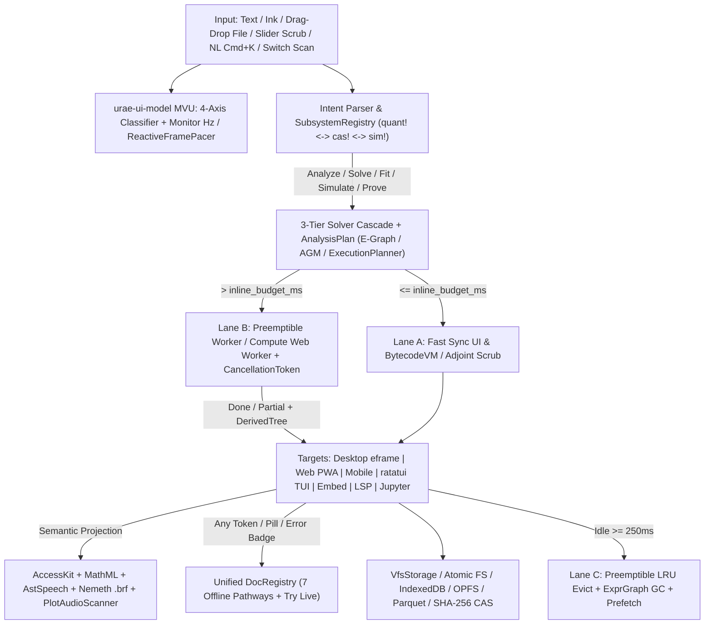
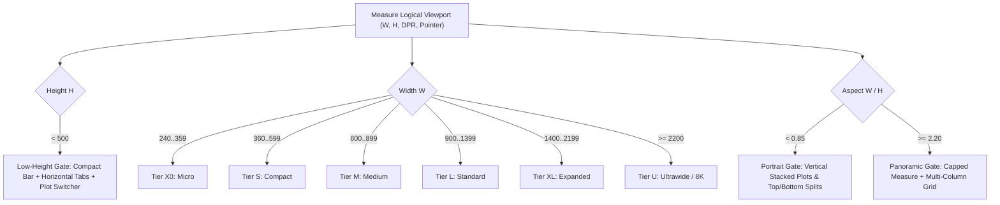
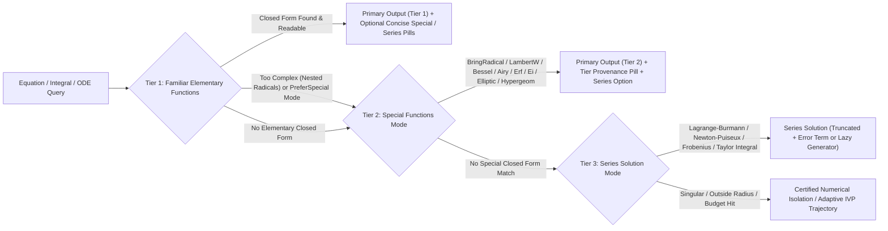
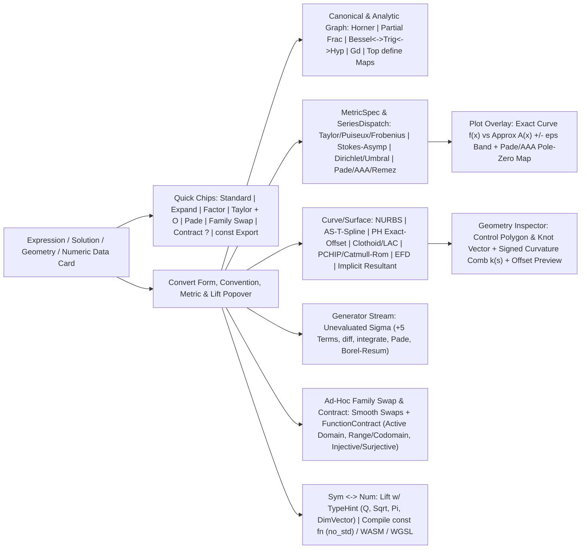
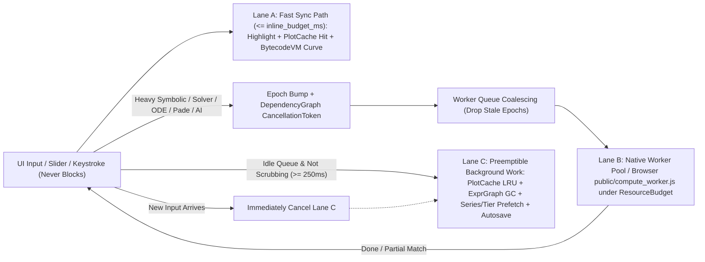
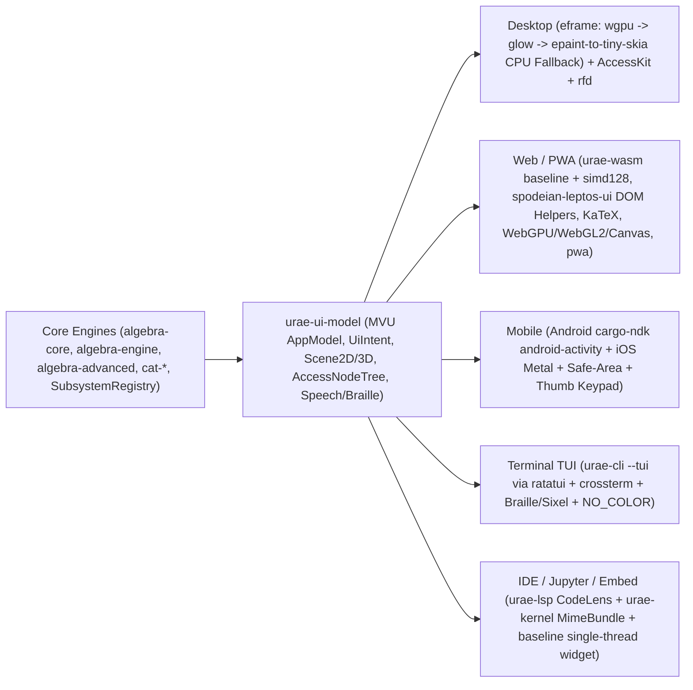

# URAE Cross-Platform GUI, Accessibility, Interactive Workflow & Documentation Architecture Plan

> [!NOTE]
> **Specification; mostly unstarted.** What is built is the notebook's `.tex`, `.py` and `.lean` export, the printable HTML report and workspace-tab routing (ledger entry `A11`); the rest of this plan is unstarted. Its place in the order of work is in [`../PLANNING.md`](../PLANNING.md) (alongside milestone M2 and later, as capacity allows); defects are in [`../LEDGER.md`](../LEDGER.md).

**Universal Rust Algebra Engine (URAE)**  
*Unified Platform-Agnostic UI/UX (`urae-ui-model` MVU + upstream `spodeian-core` alignment), Extreme-Viewport Resilience (`280×280` to `7680×4320`), WCAG 2.2 AAA Semantic Accessibility (`AccessKit`/Speech/Braille/Sonification), Three-Tier Solution & Three-Pillar (`quant!` $\leftrightarrow$ `cas!` $\leftrightarrow$ `sim!`) Ergonomics, Generalized Function Connections / Metrics / Series / Domain Contracts, 100% Backend Feature Exposure, and Monitor-Paced Non-Blocking Execution across Desktop (`wgpu`/`glow`/`epaint -> tiny-skia`), Web/PWA (`urae-wasm` `baseline` + `+simd128`), Mobile (`Android`/`iOS`), Terminal TUI (`urae-cli`), Embeds, LSP (`urae-lsp`), and Jupyter (`urae-kernel`)*

---

## Architecture Map (Table of Contents)

- **Part I — Foundation, Unified MVU Model & Responsive Design Tokens (`Sections 1–4`)**
  - Section 1: Executive Summary, Six Non-Negotiable Invariants & Unified End-to-End Flow
  - Section 2: Audited Codebase Bottlenecks (`urae-wasm`, `urae-notebook`, `spodeian-core` Duplication Gaps)
  - Section 3: Canonical 4-Axis Screen Classification & 15 Reference Profiles (`280×280` to `7680×4320` + Mobile/TUI)
  - Section 4: Shared `spodeian-tokens` Palettes, WCAG AAA Parity, CVD Encodings & Bundled Font Assets
- **Part II — Chrome, Adaptive Layouts, High-DPI Graphics & Core Accessibility Contract (`Sections 5–9`)**
  - Section 5: Global Navigation, Chrome Budget & Unified `ViewMode` / `WorkspaceState` Reconciliation
  - Section 6: Component-by-Component Responsive Layout (Q&A, Pad, SmartStream, Workbench, Graph/3D, `quant!` & Modals)
  - Section 7: High-DPI Graphics, Bounded Canvas Memory (`4096 px` Cap), Adaptive Ticks & `ResizeObserver`
  - Section 8: Contained Mathematical Overflow, Pointer/Touch/Pinch Gestures & Mobile Keyboard Handling
  - Section 9: Core WCAG 2.2 AA/AAA Contract, Reduced Motion & Print Media *(Deep Dive in Part VII)*
- **Part III — Complete Functional Breadth, Three-Pillar `quant!`/`cas!`/`sim!` UX & Universal Conversions (`Sections 10–12`)**
  - Section 10: Complete Unified Menu, Tool & Subsystem Taxonomy (100% Backend Exposure Across Math, Physics, CS & Logic)
  - Section 11: Three-Tier Solution Hierarchy (`Elementary -> Special -> Series`) & Multi-Solution Branch UX
  - Section 12: Universal Representation, `MetricSpec`-Coupled Series/Splines, Analytic `FunctionConnectionGraph` (`Bessel <-> Trig <-> Hyperbolic`), Top-of-Script `define` Mappings & Source-Mined `FunctionContract` Inspector
- **Part IV — In-App Documentation of Everything (`Section 13`)**
  - Section 13: Unified `DocRegistry` Single Source of Truth (`urae-docs`) & Seven Multi-Modal Discovery Pathways
- **Part V — Persistence, Guaranteed Monitor-Paced Speed & Blind-Spot Closure (`Sections 14–16`)**
  - Section 14: Comprehensive Save, Persistence (`VfsStorage`/CAS/`DuckDB`), Import & Export Matrix
  - Section 15: Guaranteed Speed, Auto-Detected Monitor FPS, Non-Blocking 3-Lane Runtime & Telemetry
  - Section 16: Consolidated Blind-Spot Audit & Architectural Closure Matrix
- **Part VI — Platform-Agnostic Architecture & Eight-Target Delivery (`Sections 17–18`)**
  - Section 17: Shared `urae-ui-model` MVU Protocol & Full `spodeian-core` Ecosystem Convergence (`D10`)
  - Section 18: Eight-Target Delivery & Rendering Fallback Matrix (Desktop, Web/PWA, Android/iOS, `ratatui` TUI, Embed, LSP, Jupyter, Headless)
- **Part VII — Complete WCAG 2.2 AAA Accessibility, Speech/Braille & Sonification (`Sections 19–20`)**
  - Section 19: Semantic Equation Access (`AccessKit`, Hidden `MathML`, `AstSpeechGenerator`, Sub-Tree Cursor & `Nemeth`/`UEB` Braille)
  - Section 20: Interactive Curve/Field Audio Sonification (`PlotAudioScanner`) & Zero-Drag Motor/Switch Equivalence
- **Part VIII — Maximum Ease of Use, QoL, Interactive Capture & 100% Feature Matrix (`Sections 21–23`)**
  - Section 21: Zero-Friction Capture (Ink-to-Math, OCR, Drag-Drop Auto-Router), Direct AST Manipulation, Assumptions, Diffing & `quant!` Studio
  - Section 22: Exhaustive Backend-to-GUI Feature, Builder Wizard & Specialized Visualizer Audit (`D9`, `D11`)
  - Section 23: Concrete Source-to-Target File Blueprint (`urae-ui-model`, `urae-notebook`, `urae-wasm`, `urae-tui`, `urae-embed`, Core) & Phased Acceptance Matrix (`25` Viewports + Platform/A11y Gates)

---

# Part I — Foundation, Codebase Audit & Responsive Design Tokens

## 1. Executive Summary, Architectural Mandate & Unified System Flow

URAE exposes a single, platform-agnostic interactive interface compiled from one shared declarative Model–View–Update (MVU) core (**`urae-ui-model`**) paired with upstream-aligned [spodeian-core](https://github.com/Spodeian/spodeian-core/blob/dev/crates/spodeian-ui/src/lib.rs) runtime crates and accessibility primitives, driving **Desktop (`wgpu`/`glow`/`epaint -> tiny-skia` CPU fallback)**, **Web/PWA (`urae-wasm` HTML5/KaTeX/Canvas/`spodeian-leptos-ui` DOM helpers, `baseline` + `+simd128`)**, **Mobile (`Android`/`iOS`)**, **Terminal TUI (`ratatui` in `urae-cli`)**, **Embeds (`<urae-widget>` `baseline` WASM)**, **IDE (`urae-lsp`)**, **Jupyter (`urae-kernel`)**, and **Headless CI**. Previously, separate Web HTML (`index.html`), Desktop `egui` (`app.rs`), and ad-hoc utilities duplicated state (`ThemeKind`, `command_palette.rs`, `history.rs`), worked cleanly only on mid-sized landscape windows, hid >80% of backend capabilities behind CLI commands, and lacked semantic math accessibility.

### 1.1 Six Non-Negotiable Architecture Invariants

1. **Logical Pixels Decoupled from Device Pixel Ratio (DPR) Across Every Target**: All responsive breakpoints evaluate in logical CSS `px` / `egui` points (`dp`), never hardware framebuffer pixels, while gracefully projecting down to `80×24` monospace terminal cells in `urae-tui`.
2. **Orthogonal 4-Axis Screen Classification**: Layout decisions depend jointly on `(WidthTier, HeightClass, OrientationMode, PointerModality)`, dynamically reflowing across `280×280` tiles, foldables, mobile portrait/landscape, portrait workstations, 8K ultrawides, and `400%` WCAG zoom without clipping.
3. **Principled Three-Tier Solve + Three-Pillar Convergence (`quant!` $\leftrightarrow$ `cas!` $\leftrightarrow$ `sim!`)**: Solutions escalate seamlessly `Elementary -> SpecialFunction -> Series -> NumericalFallback`, convert freely between exact forms, error-bounded approximants, smooth functional families (`FunctionFamilyLattice`), and lazy `SeriesGenerator` streams, and unify quantitative data estimation, symbolic CAS/proofs, and GPU/SIMD simulation inside one notebook rhythm.
4. **Never-Blocked UI Thread Dynamically Paced to Monitor Hz & Idle Energy**: UI frame budgets track display refresh (`30–360 Hz`) cleanly; only cache hits, interactive `TargetFps`-planned surrogates, and `BytecodeVM` scrubs execute synchronously (`Lane A`), heavy solves run preemptibly on parallel workers (`Lane B`), housekeeping runs lazily on idle (`Lane C`), and [ReactiveFramePacer](https://github.com/Spodeian/spodeian-core/blob/dev/crates/spodeian-ui/src/pacing.rs) drops FPS to zero when stationary.
5. **100% Backend Feature Exposure & Offline Self-Documentation**: Every registered operator across Math, Physics, CAD/Multiphysics, Computer Science, Logic, and AI maps cleanly via `SubsystemRegistry` & `DocRegistry` to searchable `Cmd+K` commands, guided Builder Wizards, specialized visualizers, and seven offline discovery pathways.
6. **WCAG 2.2 AAA, Semantic Math Access & Zero-Drag Equivalence By Construction**: Every pod, curve, mesh, and proof exposes native `AccessKit` trees, hidden semantic `MathML`, prosodic `AstSpeechGenerator` walking, `Nemeth`/`UEB` Braille export, CVD-safe palettes + Okabe–Ito/Viridis/Cividis LUTs, interactive plot/field audio sonification, and complete keyboard/switch alternatives for every drag gesture.

### 1.2 Integrated End-to-End Architecture & Control Flow



---

## 2. Audited Codebase Bottlenecks (Verified Against Repository)

### 2.1 Web Shell Layout & Assets (`crates/urae-wasm/`)

| Component | Current Implementation | Failure Mode / Integration Gap |
| :--- | :--- | :--- |
| Global CSS queries | Zero `@media` and zero `@container` rules in [style.css](../../crates/urae-wasm/public/style.css) | Identical desktop geometry enforced across `280 px` tiles and `5120 px` ultrawides |
| Viewport meta & root sizing | `width=device-width, initial-scale=1.0` ([index.html:5](../../crates/urae-wasm/public/index.html#L5)); `#app_container { width: 100vw; height: 100vh; }` ([style.css:97-105](../../crates/urae-wasm/public/style.css#L97)) | Bottom controls clipped by mobile browser URL bars (`100vh` vs `100dvh`); missing `viewport-fit=cover` and `env(safe-area-inset-*)` notch margins |
| Offline PWA KaTeX gap | [index.html:12-13](../../crates/urae-wasm/public/index.html#L12) loads KaTeX CSS/JS from `cdn.jsdelivr.net`; [sw.js:5-13](../../crates/urae-wasm/public/sw.js#L5) pre-caches only `./pkg/*` & local HTML/CSS | Offline PWA sessions lose KaTeX mathematical typesetting entirely unless KaTeX CSS, JS, and fonts are vendored locally into `PRECACHE_ASSETS` |
| Top navbar | `.qa-navbar` ([style.css:109](../../crates/urae-wasm/public/style.css#L109)) with brand, 5 tabs, status pill, and 3 buttons | Clips/overflows tabs below `~980 px`; unnavigable on `< 600 px` mobile; wastes height on `< 420 px` landscape phones |
| Q&A measure & pods | `.qa-search-wrapper` (`L331`) & `.qa-results-container` (`L591`) fixed `max-width: 900px` | Excessive padding on `< 420 px` phones; wastes `> 75%` horizontal canvas on 4K/32:9 screens |
| Graphing Pad sidebar | `.pad-expr-sidebar` ([style.css:918](../../crates/urae-wasm/public/style.css#L918)) fixed min-width inside horizontal flex | Leaves `0–100 px` for `#pad_graph_canvas` at `320–420 px`; breaks `.layout-split` below `~1050 px` |
| Systems Workbench | `.systems-sidebar` (`L1450`), `.sys-plots-split` (`L1557`), `.sys-slider-row` (`L1539`) | Horizontal overflow below `1024 px`; squeezes Time Series + Phase Plane on portrait monitors; slider tracks crush below `300 px` |
| Canvas `egui` bridge | `setViewMode('canvas')` sets `canvas.width = window.innerWidth; canvas.height = window.innerHeight` ([index.html:707-712](../../crates/urae-wasm/public/index.html#L707)) | Ignores top navbar height (`56px`), ignores DPR, exceeds `4096 px` WebGL texture bounds on 5K/8K, and shares zero storage state with Web Pad (`urae_pad_lines` at `L1968`) |
| Touch & Pointer input | Mouse-only `mousedown`/`mousemove`/`mouseup`/`wheel` ([index.html:1779-1852](../../crates/urae-wasm/public/index.html#L1779)); `.expr-visibility-btn` is `22×22px` | No touch drag pan or two-finger pinch zoom; interactive targets below WCAG/mobile `44×44 px` touch floor |
| Worker role boundary | [crates/urae-wasm/worker.js:1-80](../../crates/urae-wasm/worker.js#L1) is a Cloudflare Edge HTTP handler, not a client browser worker; misses `/api/integrate` and non-atomic init | Browser UI still runs `wasm_structured_query` & systems analysis synchronously on main thread; edge misses advertised route |
| Service Worker, headers, `eval` & WASM config | [sw.js](../../crates/urae-wasm/public/sw.js#L5) precaches missing `./favicon.ico` & omits `./env.js`; [_headers:7](../../crates/urae-wasm/public/_headers#L7) sets `COOP` without `COEP`; [index.html:1575](../../crates/urae-wasm/public/index.html#L1575) calls `new Function` (`'unsafe-eval'`); [env.js:9](../../crates/urae-wasm/public/env.js#L9) swallows C `abort()`; [urae-wasm/Cargo.toml:35](../../crates/urae-wasm/Cargo.toml#L35) enables `wgpu` without `glow`; `.cargo/config.toml` forces `+simd128`; [urae-wasm/src/lib.rs:26](../../crates/urae-wasm/src/lib.rs#L26) unescaped JSON errors | PWA `cache.addAll` fails install on 404 `/favicon.ico`; `SharedArrayBuffer` disabled or cross-origin `<urae-widget>` embeds broken; CSP `'unsafe-eval'` risk; WebGL-only/non-SIMD browsers fail; malformed error JSON (`Audit G8`) |

### 2.2 Native, `egui` Canvas, `spodeian-core` & Satellite Target Bottlenecks (`crates/urae-notebook/`, `urae-{kernel,lsp,cli,py}`)

| Component | Current Implementation | Failure Mode / Integration Gap |
| :--- | :--- | :--- |
| Native window bounds | `.with_inner_size([1100.0, 750.0])` (`L190`) and `.with_min_inner_size([600.0, 400.0])` ([lib.rs:191](../../crates/urae-notebook/src/lib.rs#L191)) | Blocks `320–580 px` OS quarter-screen snaps, embedded handheld panes, and narrow tiles |
| Web `egui` fallback & WASM timers | `canvas.set_width(1100); canvas.set_height(720)` ([lib.rs:257](../../crates/urae-notebook/src/lib.rs#L257)); `std::time::Instant` in [lib.rs:211](../../crates/urae-notebook/src/lib.rs#L211), [worker.rs:18](../../crates/urae-notebook/src/notebook/worker.rs#L18), [scheduler.rs:6](../../crates/cat-anytime/src/scheduler.rs#L6), and [pacing.rs:9](https://github.com/Spodeian/spodeian-core/blob/dev/crates/spodeian-ui/src/pacing.rs#L9) | Panics at runtime on `wasm32-unknown-unknown`; CI masks WASM failures with `\|\| true`; no built-in `Tiny-Skia` `eframe` rasterizer without explicit software painter bridge |
| Layout state split-brain | `ViewMode` ([app.rs:58](../../crates/urae-notebook/src/app.rs#L58)) vs `WorkspaceLayoutPreset` & `WorkspaceTab` ([workspace.rs:10,57](../../crates/urae-notebook/src/ui/workspace.rs#L10)) | Two overlapping layout enums: `Cmd+K` sets presets (`app.rs:1919-1948`), while `ViewMode` switches major screens independently; `DependencyGraph` & `PresentationReport` lack top-bar mode buttons (`L1531-L1533`) |
| Sidebars & docked panels | Left sidebar `.default_size(280.0)` (`L1759`); Docked Settings `300/380.0` (`L1612,L1630,L1690`); Terminal `260.0` (`L1669`) | Crushes `CentralPanel` to `0 px` inside narrow (`< 760 px`) or short (`< 500 px`) windows |
| Fixed-width inputs & bars | `workbench_ui.rs`: Q&A `(avail - 120).max(240)` (`L113`), `240.0` (`L344`), `180.0` (`L597`); `app.rs`: AI Copilot `.desired_width(500.0)` (`L1551`), CLI Terminal `.desired_width(520.0)` (`L2973`) | Pushes Solve/Ask/Run/remove buttons off right edge on `< 580 px` panes; `ui.columns(2)` at `workbench_ui.rs:331,577` and `app.rs:6116` (`ExampleGallery`) overflow below `~700 px` |
| Synchronous & broken persistence/indexing | `NotebookState` skips `BackgroundEvaluator` (`worker.rs:221`); `agent.query(...)` blocks (`app.rs:1558`); `app.rs:612` calls nonexistent `window.__saveNotebookToIndexedDB` via `js_sys::eval`; `session.rs:1153` skips autosave under `CARGO_MANIFEST_DIR`; `mod.rs:375` moves skip `reconcile_line_references_on_shift`; `SymbolMetadata::clamp` (`session.rs:154`) unchecked | UI freezes on heavy solves/AI; Web IndexedDB silently fails save/load; line-reference tokens corrupt on delete/move; `min > max`/`NaN` panics `clamp()`; [viewport3d.rs:125,379,752](../../crates/urae-notebook/src/ui/viewport3d.rs#L379) rebuilds presets every frame, `NaN`-unsafely sorts tris, & writes invalid STEP `FACE_SURFACE` |
| Modals, matrices & plots | `CommandPalette` `.fixed_size([540, 380])` (`L318`); `Matrix` `10×10` grid (`palettes.rs:103`) without scroll; fixed plot `130/200px`; hardcoded `8.0 ms` | Clips `< 560×460` viewports; ignores actual monitor Hz |
| `spodeian-core` API/dep mismatches & bindings (`Audit G1`) | `spodeian-core` umbrella/`sml-kernel` pulls **`wgpu 23.0.1` vs `eframe`'s `30.0.1`**; `spodeian-cache` lacks `OPFS`; `spodeian-audio` has zero `cpal`/WebAudio I/O; `spodeian-leptos-ui` has no `leptos` UI (`prepaint_theme_and_dyslexia_script` lives here, 4-theme only); `configure_accessible_focus` overwrites `pixels_per_point`; `urae-notebook/Cargo.toml` doubles `spodeian-telemetry`; [urae-kernel:612](../../crates/urae-kernel/src/lib.rs#L612) byte-slices UTF-8 cursors; [urae-lsp:309](../../crates/urae-lsp/src/lib.rs#L309) reports byte `.len()` vs UTF-16 | Pulling umbrella breaks `wgpu`; `ReactiveFramePacer` panics on Web + never idles; HiDPI zoom breaks; `π`/`∫` crash Jupyter completion; brand tokens drift (`ThemeMode` 4 vs `ThemeKind` 10) |

---

## 3. Canonical 4-Axis Screen Classification & 15 Reference Profiles

Every layout rule in CSS and `egui` derives from four orthogonal viewport axes:

1. **WidthTier ($W$)** (logical `px` / `dp`): `X0 Micro (240–359)` · `S Compact (360–599)` · `M Medium (600–899)` · `L Standard (900–1399)` · `XL Expanded (1400–2199)` · `U Ultrawide (≥ 2200, validated up to 7680)`
2. **HeightClass ($H$)**: `Cramped (< 360)` · `Short (360–499)` · `Standard (500–899)` · `Tall (≥ 900)`
3. **OrientationMode ($A = W/H$)**: `Portrait (< 0.85)` · `Square (0.85..1.35)` · `Landscape (1.35..2.20)` · `Panoramic (≥ 2.20)`
4. **PointerModality ($P$)**: `Fine` (mouse/trackpad) · `Coarse` (touch: enforces `44–48 px` targets) · `Hybrid` (2-in-1 / stylus + keyboard)

### 3.1 Classification Decision Flow



### 3.2 Fifteen Canonical Profiles: Common & Extreme-but-Feasible Screens

| Profile | Representative Devices / Windows | Logical `W × H` (DPR) | Tuple `(W, H, A, P)` | Top Chrome & Nav | Primary Workspace Topology | Systems & ODE Plot Strategy |
| :--- | :--- | :--- | :--- | :--- | :--- | :--- |
| **Wearable / Micro TFT** | Embedded Pi TFT, companion square frame | `280×280`, `320×240` (1x) | `X0 / Cramped / Square / Coarse` | `36px` bar: logo + cycler + `☰` | Single active pane only; zero sidebars; `Split` disabled | Segmented `[Setup \| Output \| Plot]`; `180px` canvas |
| **Small Legacy Phone** | iPhone SE (1st gen), narrow Android split | `320×568` (2x) | `X0 / Standard / Portrait / Coarse` | `44px` top bar + `48px` bottom dock | Tabbed `Expr \| Graph` toggle in Pad; full-width Q&A | Vertical accordions + single `220px` plot |
| **Narrow Fold Cover** | Z Fold cover screen | `344×882` (2.6x) | `X0 / Standard / Portrait / Coarse` | `44px` top bar + bottom 4-tab bar | `38dvh` pinned top graph + scrollable expression list below | Vertical accordions + `[Time \| Phase]` switcher |
| **Modern Phone Portrait** | iPhone 14–16, Pixel 8/9, Galaxy S24/S25 | `360×800`..`430×932` (3x) | `S / Standard–Tall / Portrait / Coarse` | `48px` header + `52px` thumb dock | Pad: `42dvh` top canvas + `1fr` card list below | Accordions -> full-width plot + `[Time \| Phase]` toggle |
| **Mobile Landscape** | Phones rotated sideways (w/ or w/o soft kbd) | `667×375`, `844×390` (2–3x) | `M–L / Short / Landscape–Pan / Coarse` | `40px` single-line bar | Pad: collapsible `36%` list + `64%` canvas | Collapsible left form + single active plot switcher |
| **Quarter Desktop Tile** | Narrow snap on 1080p/1440p monitor | `512×768`, `480×900` (1–1.25x) | `S / Standard–Tall / Portrait / Fine` | `46px` bar + `☰` overflow menu | Overlay parameter drawer; stacked Editor/Results | Vertical controls -> `[Time \| Phase]` plot toggle |
| **Inner Foldable & Mini Tablet** | Z Fold inner, iPad Mini portrait | `717×512`, `744×1133` (2–3x) | `M / Standard / Square–Port / Coarse` | `50px` bar + `16px` hinge clearance | `280px` collapsible drawer (or top plot in portrait) | Top setup + segmented or stacked plots |
| **Standard Tablet Portrait** | iPad 10th/Air, Surface Go portrait | `768×1024`, `820×1180` (2x) | `M / Tall / Portrait / Hybrid` | `52px` compact icon-label bar | Pad `45%` top plot / `55%` bottom cards; vertical `Split` | Top collapsible form + stacked Time & Phase plots |
| **Standard Laptop** | `1366×768`, MacBook Air scaled (`1280×800`) | `1280×720`, `1366×768` (1–2x) | `L / Standard / Landscape / Fine` | `52–56px` bar; compact status dot `< 1100px` | Dual-column Pad (`340px` list + plot); `Split` unlocked | Left controls (`340px`) + stacked/2-up plots |
| **FHD & Scaled 1440p Desktop** | `1920×1080`, 1080p@125% (`1536×864`) | `1440×900`..`1920×1200` | `XL / Standard–Tall / Landscape / Fine` | Full `56px` bar + shortcuts | `390px` resizable sidebar + plot; 2-col Q&A pods (`>= 1400px`) | Left (`380px`) + side-by-side Time Series & Phase (`1fr 1fr`) |
| **Portrait Workstation Monitor** | Vertical `1080×1920`, `1440×2560` | `1080×1920`, `1440×2560` | `L–XL / Tall / Portrait / Fine` | `56px` top bar | `Split` stacks Q&A above Pad; 1-col prose (`<= 900px`) | **Portrait Override**: `Controls` (`~38dvh`) above stacked plots |
| **QHD / 4K Native Workstation** | 27"–32" `2560×1440`, `3840×2160` | `2560×1440`, `3840×2160` | `U / Tall / Landscape / Fine` | Centered `1920–2200px` header container | 3-pane Studio + pin-able Docs Companion Rail; 2–3 pod masonry | 3-col studio: Config \| Time + Diagnostics \| Phase + Contours |
| **21:9 & 32:9 Super-Ultrawide** | `3440×1440`, `3840×1080`, `5120×1440` | `3440×1440`..`5120×1440` (1x) | `U / Tall / Panoramic / Fine` | Centered max inner chrome (`<= 2200px`) | 4-zone workspace (`Params \| Editor \| Plots \| 3D/Docs`) w/ prose caps | Wide 3-pane Workbench (`DPR` capped cleanly) |
| **8K Display Native** | `7680×4320` wall @ 100–200% | `7680×4320` (1–2x) | `U / Tall / Landscape / Fine` | `2200px` header cap + auto scale suggestion | Stage bounded at `2400px`; **canvas strictly capped `<= 4096 px/axis`** | 3-pane studio w/ vector chrome & bounded framebuffers |
| **Shallow Wide Ribbon** | Bottom IDE/dock strip, kiosk strip | `1280×320`, `1920×360`, `2560×480` | `L–U / Cramped–Short / Panoramic / Fine` | `38px` horizontal strip | `320px` slim list left + wide plot right | `320px` scrollable form + single wide `[Time \| Phase]` plot |

### 3.3 Dynamic Zoom Reflow, Foldables, and Mixed-DPI Monitors

- **WCAG 1.4.10 Reflow (`400%` Browser Zoom & Native `set_zoom_factor`)**: `1280×720` @ `400%` becomes `320×180` (`X0 / Cramped`); [app.rs:1254](../../crates/urae-notebook/src/app.rs#L1254) (`zoom.clamp(0.5, 3.0)`) maps `1920×1080` to `640×360` at `3.0x`. Chrome bars auto-collapse by effective post-zoom logical `(W, H)` so vertical scroll remains 1-dimensional.
- **Hinged Dual-Screen Foldables**: When `@media (horizontal-viewport-segments: 2)` matches, `.pad-container` and `.systems-pane` snap left sidebars to `env(viewport-segment-width 0 0)` and right stages to `env(viewport-segment-left 1 0)`.
- **Heterogeneous Multi-Monitor & Hot-Unplug Clamping**: Recompute `UiMetrics` per frame from `ctx.pixels_per_point()`; clamp every floating `egui::Window` `min_pos` into `[8.0, available_w - 120.0] × [8.0, available_h - 60.0]` on monitor unplug.

---

## 4. Shared Design Tokens, WCAG AAA Parity, CVD Plots & Offline Fonts

### 4.1 Semantic Color, Contrast & Local Font Assets

- **Full Palette Parity (`UraeThemeExtension`)**: Map `spodeian_tokens::ThemeMode` (4 base modes: `Dark`, `Light`, `HighContrastDark`, `HighContrastLight`) cleanly via `UraeThemeExtension` to all 10 `ThemeKind` presets ([theme.rs:11](../../crates/urae-notebook/src/ui/theme.rs#L11) — adding `CatppuccinMocha`, `Nord`, `Dracula`, `SolarizedDark`, `SolarizedLight`, `Cyberpunk`, plus math syntax & studio `#ff7e00`/`#f5a623` accent tokens) across Web `[data-theme="..."]` and native UI, and update `prepaint_theme_and_dyslexia_script` wrapper to recognize all 10 keys without falling back to `'dark'` (`Audit G1`).
- **WCAG 2.2 Contrast Floors**: `>= 4.5:1` text / `>= 3.0:1` UI borders in standard themes; `>= 7.0:1` pure `#000000`/`#ffffff` + `2px` crisp borders in `HighContrast*` presets.
- **CVD-Safe Multi-Curve Plots**: Pair the 8-color Okabe–Ito qualitative palette (`Audit G1` note: added in URAE above `spodeian_tokens::CandlestickColors`) with distinct stroke dashes (`solid`, `dashed`, `dotted`, `dash-dot`) and marker glyphs across all 2D plotters and `egui_plot`.
- **Offline Math Font & Service Worker Integrity**: Vendor local KaTeX `.css`/`.js`/`.woff2` files alongside native `NotoSansMath-Regular.ttf` in `crates/urae-wasm/public/vendor/katex/`, remove non-existent `./favicon.ico`, cache `./env.js`, and wire `populate_service_worker` build-hash/precache placeholders (`__BUILD_ID__`, `/*__PRECACHE_URLS__*/ []`) inside [sw.js](../../crates/urae-wasm/public/sw.js#L5) (`Audit G8`) so air-gapped and offline PWA installs never fail `cache.addAll()`!

### 4.2 Fluid CSS Tokens & Native `UiMetrics`

```css
:root {
  --text-xs:   clamp(0.6875rem, 0.65rem + 0.15vw, 0.75rem);
  --text-sm:   clamp(0.75rem,   0.72rem + 0.20vw, 0.875rem);
  --text-base: clamp(0.875rem,  0.84rem + 0.22vw, 1.00rem);
  --text-lg:   clamp(1.00rem,   0.92rem + 0.35vw, 1.25rem);
  --text-hero: clamp(1.15rem,   0.95rem + 1.10vw, 1.85rem);
  --nav-h:     56px;
  --tap-min:   32px; /* Elevated to 44px under (pointer: coarse) */
  --pad-sidebar-w: clamp(290px, 28vw, 440px);
  --sys-sidebar-w: clamp(300px, 30vw, 460px);
}
```

| `UiMetrics` Field (`egui`) | `Micro (<360)` | `Compact (360–599)` | `Medium (600–899)` | `Standard (900–1399)` | `Expanded/U (>=1400)` |
| :--- | :--- | :--- | :--- | :--- | :--- |
| Base UI font (`dp`) | `12.0` | `13.5` | `14.0` | `14.5` | `15.0` (scaled) |
| Min interactive height (`dp`) | `36.0` (coarse `44.0`) | `36.0` (coarse `44.0`) | `30.0` (coarse `44.0`) | `26.0` (coarse `44.0`) | `26.0` |
| Auto-drawer left sidebar | `true` | `true` | `auto` (`< 760`) | `false` (`250–280`) | `false` (`280–340`) |
| Workbench split threshold | Vertical `1 col` | Vertical `1 col` | `1 col` (`< 720`) | 2-col (`340` + plot) | 2-col or 3-col (`>= 1800`) |

---

# Part II — Chrome, Layout Topologies & High-DPI Interaction

## 5. Global Navigation, Chrome Budget & Unified State Reconciliation

### 5.1 Vertical Chrome Discipline & Mobile Bottom Dock

- **Chrome Ratio Cap**: Persistent navigation bars never exceed **16%** of viewport height (`<= 58px` at `360px` height; `<= 40px` below `360px`).
- **Web Tiered Chrome**: Full `56px` navbar (`>= 900px`) $\to$ hidden subtitle & dot badge (`600–899px`) $\to$ `42px` compact bar (`H < 500px`) $\to$ `44–48px` header + `52px + env(safe-area-inset-bottom)` thumb dock (`< 600px`), automatically hidden while software keyboard is open (`visualViewport.height < 0.72 * innerHeight`).
- **URL Deep-Linking**: Encode restorable app state cleanly into query/hash links (`?q=...&mode=systems&tier=special&form=pade_3_3&doc=special.bessel_j`) for textbook sharing and reproducible bug reports.

### 5.2 Reconciling `ViewMode` & `WorkspaceState` Across Web & Native

Eliminate the split-brain between [app.rs:58](../../crates/urae-notebook/src/app.rs#L58) (`ViewMode`), [workspace.rs:10,57](../../crates/urae-notebook/src/ui/workspace.rs#L10) (`WorkspaceTab`, `WorkspaceLayoutPreset`), and Web `layout-*`:

| Canonical Workspace Role | Native Primary Surface | Web Shell Mode | Automatic Viewport Adaptation |
| :--- | :--- | :--- | :--- |
| **Q&A Solver** | `ViewMode::QaSolver` | `layout-qa` | 1-col (`< 1400px`) $\to$ 2-col balanced pods (`>= 1400px`) |
| **Reactive Notepad / Pad** | `SmartStream` + `FluidNotepad` / `DualHalves` | `layout-pad` | Dual split (`>= 900px` landscape) $\to$ top plot / bottom list (portrait/`M`) $\to$ `Expr \| Graph` toggle (`SimplifiedSingleTab` / `Micro < 360px`) |
| **Systems & ODE Workbench** | `ViewMode::SystemsWorkbench` | `layout-systems` | 2/3-col studio (`>= 900px` landscape) $\to$ vertical stack (portrait) $\to$ segmented plot tabs (`H < 520px` or `W < 600px`) |
| **Dual Split Study** | `WorkspaceLayoutPreset::SplitDual` / `TripleIDE` | `layout-split` | Horizontal `50/50` (`>= 1024px`) $\to$ vertical `50/50` (`720–1023px` or portrait) $\to$ redirects cleanly to active pane (`< 720px`) |
| **Dependency Graph & Presentation Report** | `DependencyGraph` & `PresentationReport` (promoted directly into top `ViewMode` switcher!) | Web Report / Graph modals + Standalone HTML preview | 2-col (`>= 780px`) $\to$ 1-col (`< 780px`); Presentation prose capped `<= 860dp` centered |
| **Quantitative Studio (`quant!`), Proof Assistant & Hypergraph Composer** | `QuantStudio` / `ProofWorkbench` / `PipelineComposer` views inside `urae-ui-model` | One-drop `CSV`/`Parquet` profiler, interactive tactic/sequent pane, `OpenHypergraph` node-wire editor | Multi-col studio (`>= 1200px`) $\to$ stacked accordion + plot switcher (`< 900px`) $\to$ TUI tree/table (`urae-tui`) |
| **Graph / Focus / Zen** | `FocusEditor` + `WorkspaceLayoutPreset::ZenMode` | `layout-canvas` (`#canvas_pane`) | `100%` `<main>` area with DPR-bounded `ResizeObserver` sizing |
| **Native Top Bar & Platform Adaptation** | Full row (`>= 900px`) $\to$ `☰ Menu + 3 Tabs + 🔍` (`600–899px`) $\to$ `URAE + ComboBox + ☰ + 🔍` (`< 600px`) | Same logical menu taxonomy (Sec 10) across Web, Mobile thumb dock, and `ratatui` TUI tabs | Guarantees single horizontal chrome strip (`<= 38dp` tall) or safe-area mobile thumb dock |

---

## 6. Component-by-Component Responsive Layout & Interactive UX Specification

### 6.1 Q&A Symbolic Solver, Quantitative `quant!` Studio & Unified Pod Anatomy

1. **Multimodal Input Bar (`Text | Ink | Voice/OCR | Drag-Drop` + Permissive Syntax)**: Replace `.desired_width((avail - 120).max(240))` ([workbench_ui.rs:113](../../crates/urae-notebook/src/ui/workbench_ui.rs#L113)) with proportional sizing or two-row wrap below `360dp`. Keep Web font `>= 16px` (`1rem`) to stop iOS Safari auto-zoom, dock `.math-keypad.open` as a `44dvh` bottom thumb sheet on `W < 600px` (`>= 48px` keys), accept **Wolfram NL phrases, `UraeScript`, LaTeX, Mathematica `[...]`, SymPy `**`, or Lean/Logic tokens seamlessly via ingress adapters without requiring users to know syntax** (paired with **external Cell Context Dropdowns + Lock Toggle `🔒`** + `SafetyPolicy` / `SyntaxFlags` pills stored outside cell math text, Architecture Plan `Part XIX`), attach an **Offline Ink-to-Math Canvas (`Ctrl+Shift+I`)**, accept pasted equation screenshots (`Ctrl+V`), and auto-route any dropped `.step`/`.cgns`/`.csv`/`.parquet`/`.safetensors`/`.ipynb`/`.urae`/`.cat` file straight into the active workspace (`Sec 21`).
2. **Integrated Pod Stack** (fusing Direct Manipulation, `AssumptionsContext` / Disambiguation Chips, Tier/Form Conversion, Three Pillars, `DocRegistry`, and Accessibility into one clean pod):
   - **Row 1 (Interpretation, Disambiguation, Cell Context Controls & Provenance Badges)**: Shows clear **`"Interpreted as: ..."`** canonical rendering + clickable **`AlternativeParse`** ambiguity switchers (`"Function f(x+1) [Multiply f*(x+1)?]"`, `"Point (a, b) [Open Interval?]"`, `"Row Vector [1, 2] [Closed Interval?]"`) + **external cell metadata dropdowns (`[Domain Lock]`, `[Units: SI+Angle]`, `[Rep: Auto/Posit/Arb/Exact]`, `[Calc/Logic: Auto]`, `[NonComm: Auto]`, `[Lock Context 🔒]`)** + visible **`⚠ Shadow warning`** / `AssumptionsContext` pills (`x ∈ ℝ⁺`, `n ∈ ℤ≥0`, `z ∈ ℂ [k=0]`, `[m/s] <-> [km/h]`, `τ [N·m/rad]`) + `SolveTier` provenance pill (`Tier 1 · Elementary`, `Tier 2 · Special: BringRadical`, `Tier 3 · Series`), plus semantic `AccessKit` / hidden `MathML` mirror (`Sec 19`).
   - **Row 2 (Interactive Primary Output + Morph / Convert Strip)**: KaTeX / 2D Unicode output where sub-expressions support **Click/Drag Term Manipulation** (drag across `=` to invert, click factor to cancel/split) and **Live `FunctionFamilyLattice` Smooth Morphology** (`Heaviside <-> Sigmoid <-> SmoothStep`, `max <-> LSE <-> smin_k`), paired with quick-flip tier tabs and `⇄ Convert Form` (`Sec 12.3`).
   - **Row 3 (Action Chain Strip)**: Wrap-safe chips for `📈 Plot / Sonify (S) / Diff Overlay`, `quant! <-> cas! <-> sim! Escalate`, `✓ Formal Proof / Arb Ball`, `Copy [LaTeX | Unicode | MathML | Nemeth .brf | Rust const]`, `Compare Diff`, and `Open Docs`.
   - **Row 4+ (Collapsible Analysis Grid)**: `Step-by-step Derivation`, `Causal / NUTS / Conformal Uncertainty Summary`, `Alternate Forms / Padé / Generator`, `Noether / Conservation Invariants`, and `Roots / Zeros` flow into 2 balanced columns on `>= 1400px` and cleanly accordion-collapse on `< 600px`.

### 6.2 Graphing Pad (`#pad_pane`), `SmartStream` (`app.rs:3916`) & Plot Parity

- **Web Pad Layout**: Replace fixed `320px` min-width with fluid `--pad-sidebar-w` + `4px` (`20px` hit-slop) draggable splitter on `>= 900px`; switch to `column-reverse` (canvas above cards) on `< 900px` or portrait aspect, with a 3-state height toggle (`18dvh` mini / `42dvh` split / `82dvh` plot focus), and `[Expressions | Graph]` sub-tabs at `< 360px`.
- **Native `SmartStream` Splitter**: Promote left Parameters sidebar into a toggleable drawer `< 760dp`; split horizontal (`>= 620dp` landscape) or vertical top/bottom (`< 620dp` or portrait), removing additive clamps (`available.max(300)` + `180` + `120`). Scale inline plots cleanly (`0.24 * avail_h` clamped `[110, 320]` for 2D, `0.32 * avail_h` clamped `[140, 440]` for 3D).
- **Web <-> Native Plotting Feature Parity**: Port native `PlotScaleMode` (`Linear | SemiLogY | SemiLogX | LogLog`, [app.rs:78](../../crates/urae-notebook/src/app.rs#L78)), `ActiveScrubbing` numeric literal dragging ([app.rs:253](../../crates/urae-notebook/src/app.rs#L253)), and `PeriodicAnalysis` frequency/period annotations ([plot_eval.rs:266](../../crates/urae-notebook/src/notebook/plot_eval.rs#L266)) into Web `#pad_graph_wrapper`!

### 6.3 Systems of Equations & Differential Equations Workbench

Replace unconditional `ui.columns(2)` ([workbench_ui.rs:331,577](../../crates/urae-notebook/src/ui/workbench_ui.rs#L331)) and fixed `240.0`/`180.0` `TextEdit` widths (`L344, L597`) with `metrics.adaptive_two_pane(...)`:
- **`XL–U` Landscape**: Left Config/Sliders (`380–420px`) | Center Diagnostics + Time Series | Right Phase Plane / Implicit Contours (height fluid `(avail_h * 0.45).clamp(160.0, 520.0)` when stacked, `<= 720.0` single).
- **Portrait Monitors (`aspect < 0.85`, even at `1080×1920`)**: Explicit top-controls (`<= 42dvh`) above stacked Diagnostics -> Time Series -> Phase Portrait (`1fr` vertical stack so phase portraits stay square/uncompressed).
- **`M / S / Short` (`W < 600px` or `H < 500px`)**: Compact left/top accordion controls (2-line ODE RHS rows under `340dp` width) + segmented `[Contours]` / `[y_i(t) | Phase]` plot switcher.

### 6.4 Dependency Graph, Report, 3D Viewport, Copilot/CLI Bars & Clamped Modals

- **`DependencyGraph` (`app.rs:6284`) & `PresentationReport` (`app.rs:6384`)**: Switch `L6309` horizontal columns to responsive 2-col (`>= 780dp`) / 1-col (`< 780dp`) stack; center Report body inside `max_width <= 860dp`.
- **AI Copilot (`app.rs:1551`) & CLI Terminal (`app.rs:2973`) Input Bars**: Replace hardcoded `.desired_width(500.0)` / `.desired_width(520.0)` with `(ui.available_width() - 64.0).max(120.0)` wrapped via `horizontal_wrapped` on narrow widths; dispatch `agent.query(...)` (`L1558`) asynchronously on Worker Lane B so network AI requests never freeze frames!
- **Global `clamp_window` Contract**: Enforce `.max_size(metrics.clamp_modal_size(...))` and `.vscroll(true)` on every `egui::Window` (`ExampleGallery` `L6071` collapsing `ui.columns(2)` at `L6116` below `640dp`, `CommandPalette` resizing dynamically from `(W - 24).clamp(240, 600)` × `(0.78*H).clamp(180, 420)`, `Matrix Builder` `10×10` / `6×6` grids wrapped in `ScrollArea::both()`, and `Settings` / `CLI` panels auto-demoting to floating drawers whenever central rect `< 340×280`).

---

## 7. High-DPI Graphics, Bounded Canvas Memory & `ResizeObserver`

```javascript
function computeSafeCanvasSize(cssW, cssH, rawDpr = window.devicePixelRatio || 1) {
  const MAX_EDGE = 4096;          // Prevents >16MP texture / OOM crashes in WASM/GPU
  const MAX_PIXELS = 8_388_608;   // ~33.5 MB RGBA8 per canvas ceiling
  let dpr = Math.min(rawDpr, cssW * cssH > 2_000_000 ? 1.5 : 2.0);
  dpr = Math.max(1.0, dpr);
  let w = Math.max(1, Math.round(cssW * dpr));
  let h = Math.max(1, Math.round(cssH * dpr));
  const scaleCap = Math.min(1.0, MAX_EDGE / Math.max(w, h), Math.sqrt(MAX_PIXELS / Math.max(1, w * h)));
  if (scaleCap < 1.0) { w = Math.max(1, Math.floor(w * scaleCap)); h = Math.max(1, Math.floor(h * scaleCap)); }
  return { backingW: w, backingH: h, scaleX: w / cssW, scaleY: h / cssH };
}
```

- Apply `computeSafeCanvasSize` uniformly to **ALL** canvases: `#pad_graph_canvas` ([index.html:1504](../../crates/urae-wasm/public/index.html#L1504)), Systems plots (`L2109`, `L2150`), AND `#urae_canvas` ([index.html:707-712](../../crates/urae-wasm/public/index.html#L707)), preventing 8K multi-canvas allocation crashes!
- **Adaptive Axis Ticks & Fractional DPI**: Replace fixed `pad = 40` and fixed `8` subdivisions with Wilkinson `1-2-5` nice stepping (`ticksX = clamp(plotW / 85, 3, 12)`, `ticksY = clamp(plotH / 65, 3, 10)`), lift legends above the plot when width `< 320px`, and snap `egui` grid hairlines to `0.5 / pixels_per_point`.
- **Shared `ResizeObserver`**: Replace `setTimeout(..., 50)` / `setTimeout(..., 40)` (`index.html:695,702`) with a single `ResizeObserver` triggering `requestAnimationFrame` on visible panes only.

---

## 8. Contained Mathematical Overflow, Unified Pointer Gestures & Keyboard Handling

- **Overflow Containment**: Enforce `min-width: 0; max-width: 100%;` on every Web flex/grid pod and `.katex-display { overflow-x: auto; }`, plus `ScrollArea::horizontal()` on native Q&A cards (`workbench_ui.rs:167+`), Matrices, and Systems diagnostics (`workbench_ui.rs:333+`).
- **Unified W3C Pointer Events (`touch-action: none`)**: Upgrade all canvases to a single `attachPointerPanZoom`: 1 pointer translates; 2 pointers pinch-zoom around midpoint `(mx, my)`; tap (`< 6px`, `< 280ms`) inspects special points with `12px` (`fine`) / `26px` (`coarse`) radius; parameter lists use `touch-action: pan-y` so vertical scrolling doesn't misfire sliders.
- **Mobile Viewport & Toast Safe-Area**: Update `<meta name="viewport">` ([index.html:5](../../crates/urae-wasm/public/index.html#L5)) to `width=device-width, initial-scale=1.0, viewport-fit=cover, interactive-widget=resizes-content`, pad `.qa-navbar`, bottom dock, and `#urae_update_toast` ([index.html:571](../../crates/urae-wasm/public/index.html#L571)) with `env(safe-area-inset-*)`, and adapt `#app_container` via `window.visualViewport`.

---

## 9. Core Accessibility Contract (WCAG 2.2 AA/AAA), Reduced Motion & Print Media

*(Full semantic math, Braille, sonification, and motor/switch specifications live in **Part VII, Sections 19–20**)*:

- **Semantic Equation Tree & Navigation**: Wire `eframe/accesskit` on Native/Mobile (`D10`) and dual KaTeX + hidden semantic `MathML` (`MathMlFormatter`) on Web; support keyboard AST sub-expression walking (`↑` parent, `↓` child, `←/→` sibling) powered by offline `AstSpeechGenerator` plus `Nemeth`/`UEB` `.brf` Braille & 2.5D tactile SVG/STL curve export (`Sec 19`).
- **Perceptual Contrast, CVD Palettes & Dyslexia Typography**: Unify `ThemeKind` with [spodeian-ui](https://github.com/Spodeian/spodeian-core/blob/dev/crates/spodeian-ui/src/accessibility.rs) `AccessibilityPreferences` (`ThemeMode::HighContrastDark/Light` `>= 7.0:1`, `@media (forced-colors: active)`, **Okabe–Ito** + `Viridis`/`Cividis`/`HighContrastMonochrome` LUTs + shape/dash markers everywhere, bundled `Atkinson Hyperlegible` & `OpenDyslexic`, persistent non-expiring Notification Log, and `44–48px` coarse/motor hit targets).
- **Sonification, Zero-Drag, Reduced Motion & Print**: `PlotAudioScanner` (`S` shortcut) converts curves, zeros, poles, and 2D stress/phase fields into stereo pitch & earcons; *every* drag/orbit/zoom/splitter gesture exposes discrete button/keyboard equivalents (`Sec 20`); halt pulses under `prefers-reduced-motion`; enforce `@media print` white-paper layout cleanly.

---

# Part III — Complete Functional Breadth, Solution Modes & Universal Conversions

## 10. Unified Menu, Tool & Subsystem Taxonomy (100% Ecosystem Exposure)

Every backend capability registered in **`SubsystemRegistry`** across `algebra-core`, `algebra-engine`, `algebra-advanced`, `cat-*`, and `urae-*` exposes matching desktop top menus (`☰ Menu` on `< 900px`), Web/Mobile `🛠 Tools` / Keypad drawers, `ratatui` TUI views, searchable `Cmd+K` commands ([CommandPaletteWidget](https://github.com/Spodeian/spodeian-core/blob/dev/crates/spodeian-ui/src/command_palette.rs)), and `DocRegistry` entries (`D9`, `D11`; detailed panel audit in `Sec 22`):

| Unified Menu Category | Tools, Submenus & Complete Domain Coverage | Backend Crate / Module Backing |
| :--- | :--- | :--- |
| **📐 Algebras & Formal Logic** | • Number System Builder (`ℝ, ℂ, ℚ, ℤ, ℕ, ℍ, 𝕆, 𝕊, ℚ_p, No, 𝔸`, Conway Surreals, `Arb` Balls)<br>• Discrete, Modular, Galois & Number Fields (`ℤ/nℤ`, `GF(p^k)`, Stauduhar Galois, $\mathcal{O}_K$/Class Groups, `SEA`/`Tate`/`Mordell–Weil`, `padic_hodge`, `ECPP`)<br>• Polynomial, Commutative & Homological Algebra (`F4/F5 + FGLM + RUR`, `van Hoeij` factorization, Primary Decomposition, `Schreyer` syzygies $\operatorname{Tor}/\operatorname{Ext}$, `Kannan–Bachem` `HNF`/`SNF`, generic `DenseMatrix<R>`/`CsrMatrix<R>`/`SparseTensor<R>`)<br>• Group, Lie & Umbral (`Schreier–Sims`, `Todd–Coxeter`, `Knuth–Bendix`, Young Tableaux `RSK`, $A..E_8$/Albert Jordan, Clifford $\operatorname{Cl}(p,q,r)$ PGA/CGA/STA, Tropical `MaxPlus<T>`, Rota–Roman `Umbral` & `RationalResidue`)<br>• Classical & Non-Classical Logics (`CDCL` `LRAT`, `ROBDD`/`ZDD`, `SMT-LIB2`, **Modal `K/T/S4/S5/GL`/`DEL`**, **`LTL`/`CTL*`/Separation Logic frame rule**, **Girard Linear Logic `!/?/⊗/⅋`**, **Fuzzy/`Belnap 4-Valued`/`ASP`/`Dung`**, **Superposition ATP**, **Gentzen `LK`/`LJ` Cut-Elimination**, $\varepsilon_0$ Ordinals) | `operation.rs`, `algebra_engine::{cas_complete, formal_kernel, matrix, tensor, sparse, hyperop, tropical, exceptional_lie, logic, sets, smt, combinatorics, padic_hodge, nonclassical_logic}`, `algebra_advanced::{clifford, galois, finite, padic, surreal, adele, crypto}` |
| **🌐 Geometry, CS, CAD & Interchange** | • Active Coordinates (`Cartesian \| Polar \| Cylindrical \| Spherical \| Curvilinear`, `Poincaré ℍ²`, `Spherical 𝕊²`, `Hecs<T>`)<br>• **Computational Geometry & CS Algorithms**: `Fortune` Voronoi, Constrained `Delaunay`, `Welzl` Ball, Minkowski/`GJK`/`EPA`, `R*`-Tree, `SA-IS`/Suffix Automaton/`FM-Index`/`rANS`, **Streaming Sketches (`HyperLogLog`/`Count-Min`/`t-digest`/`Tamaki` Treewidth)**, **`SSA`/Polyhedral Loop Compiler**, **`Petri` Nets/Bisimulation/`CRDT`/`Jackson` Queues**, **`Blahut–Arimoto`/`LDPC`/`Polar`/`R1CS`/`PLONK`**, & Unified **`AGM` Worst-Case Optimal Join/Contraction Planner**<br>• CAD, Meshing & Multiphysics (`2D/3D CSG`, Gear/Litvin/Screw/Airfoil/Spring, `DXF-AAMA`, `SE(3)` Motor `Pose<K>`, `IGA`, `Mosaic Poly-Hexcore`, `FEM`/`VEM`/`HHO`/`HDG`/`FEEC`/`FVM`/`BEM`/`SPH`/`MPM`/`LBM`/`DEM`/`C-IPC`/`XPBD`/`Featherstone`, `LOB`/`ABM`)<br>• **Format & Data Lake Hub (`VfsStorage`)**: `STEP AP242`, `IGES`, `Gmsh`, `ExodusII`, `Abaqus`, `CGNS`, `OpenFOAM`, `OpenUSD`, `glTF`, `Alembic`, `OpenVDB`, `URDF`/`MJCF`, `FMI 3.0`, `VTK`/`XDMF`/`Zarr`, `Arrow`/`Parquet`/`DuckDB WASM SQL`, Anomaly-Pinned `SHA-256 CAS`, `TelemetryDashboard`, & **Cellular Sheaves / Exact $\mathbb{Z}$-Homology / `TDA` Persistence / Knots** | `geometry.rs`, `noneuclidean.rs`, `cad/`, `hecs.rs`, `urscript_pose.rs`, `iga.rs`, `discretize/`, `cs_engines/`, `io_hub/`, `sheaf_ddg_ot.rs`, `topology.rs`, `tda.rs`, `algebra_advanced::knot` |
| **∫ Calculus, Physics & Quantitative Estimation** | • Classical & Special Calculus (`diff`, `Bronstein–Risch–Trager`, `Meijer G`/`Fox H`, Cauchy Residues, directed `limit`, `Gosper`/`Zeilberger`/`Karr`, `series`/`Puiseux`/`Frobenius`, **Asymptotics: `WKBJ`, `Van Dyke`, `Lindstedt–Poincaré`, `Multiple Scales`, `Center Manifold`, `FTLE`/`Ulam`**, Carlson/`Heun`/`Painlevé`)<br>• **All Physics Workbenches**: **Analytical Mechanics** (`Euler–Lagrange`, `Hamilton–Jacobi`, `Dirac–Bergmann`, `Noether`, `Routhian`, `KAM`), **Thermo/Field** (`Bridgman` Maxwell tables, `EOS`/`CALPHAD`, Mass Action, `BTE`, `Fokker–Planck`, `RG`, `LLG`, `Cahn–Hilliard`, `Q`-Tensor), **Quantum Many-Body** (`DVR`, `Split-Step`, `Hartree–Fock`/`KS-DFT`, Bloch/Berry/Chern, `DMRG`/`MPS`, `GPE`/`BCS`, `QFT`/`CFT`), **Relativistic/Astro/Nuclear** (`ADM`/`BSSN`/Petrov/Geodesics, `FLRW`, `TOV`, `FMM+PN`, Radiative Transfer, `Bateman`, `Mandelstam`, `DGLAP`), & **Geo/Bio/Optics/Acoustics** (`FDTD`/`RCWA`/Mueller, `Stix` MHD, seismic `FWI`, `QG`/`Rossby`, `Hodgkin–Huxley`/Bidomain, `HOA`/`SOFA`/`STFT`)<br>• **Quantitative Math, Causality & Psychometrics**: Integral Transforms (`Laplace`/`Fourier`/`Hankel`/`Mellin`/`Abel`/`Hilbert`/`Z`/`Radon` Tomography), Inverse Problems (`TV`/`ROF`/`FISTA`/`EnKF`/`4D-Var`), Symbolic Characteristic/Cumulant algebra, `Itô`/Rough `fBM`/`Milstein`/`Girsanov`/`Hawkes`, `EVT`/`GPD`/Copulas/`gaussian KDE`/`CRPS`, `OLS HAC`/`ADF`/`KPSS`/`Hansen SPA`, `PointInTimeRecord`/`PurgedKFold`/`DSR`/`cscv_pbo`, Sobol/`LHS` `DoE`, **Conformal Prediction**, **`Pearl do`-Calculus SCMs**, & **Psychometrics (`IRT`/`CFA`/`CAT`)** | `calculus.rs`, `risch.rs`, `cas_complete/`, `limits.rs`, `series.rs`, `lagrange.rs`, `cartan.rs`, `diffalg.rs`, `transforms.rs`, `weyl_dmodules.rs`, `physics_domains/`, `math_asymp_causal/`, `distributions.rs`, `stochastic_risk/`, `acoustics_hoa.rs`, `psychometrics_irt.rs`, `physics.rs`, `qft.rs`, `cft.rs`, `quantum_circuit.rs`, `cat_tangent` |
| **🔄 Transformations, Forms, Mappings & Lifting** *(Sec 12)* | • E-Graph Simplifiers (`Standard`, `MinTree`, `MinOps`, `MinLeaf`) & Rigor (`Compare`, `Certified Zero`)<br>• **Canonical Aliases, Arities & Top-of-Script `define` Mappings (`FunctionId`)**: Unambiguous canonical signatures (`sinc` vs `sinc_pi`, `log` base, elliptic `m` vs `k`, `atan` vs `atan2`) + preserved user display aliases (`DisplayAliasTag`) + `define` preset snippet editor; **`FunctionConnectionGraph`** (`Bessel <-> Trig/Spherical`, `Trig <-> Hyperbolic <-> Euler <-> Gudermannian <-> Log`)<br>• **Cross-Cutting `MetricSpec` & Series Forms**: `L0 Modal`, `L1`, `L2/Frobenius`, `Lp`, `Schatten-p`, `L_inf Minimax`, `Sobolev`, `Riemannian g_ij`, `Wasserstein`; `Expand`, `Factor`, `Together`, `Cancel`, `Horner`, `PartialFractions`, `Stieltjes`/`Thiele CF`, SVD `Padé`, `Hermite–Padé`, `AAA`, `Remez`, `Frobenius`/`Puiseux`/`Stokes-Transseries`/`Dirichlet`/`Umbral`/`Borel–Padé`, Lazy `SeriesGenerator`, `NURBS`/`PH`/`Clothoid`/`EFD`<br>• **`FunctionContract` & Lifting**: `check_compatibility` (`PartialWithExclusions` + demand-driven equivalence-collapsing `Piecewise` probing), Range vs Codomain & property inference (`Total/Partial/Injective/Surjective/Bijective/Lipschitz`) over Sets, Elements & Two-Tier Source Mining; `AnalysisPlan` + `const fn`/`#![no_std]`/`wasm32`/`WGSL`; `NumericalLifter` (`TypeHint`) & `FunctionFamilyLattice` | `simplify/`, `lifting/`, `expansions/`, `codegen.rs`, `analysis_plan/`, Architecture Plan `Part XVIII` |
| **⚖ Solvers, Discovery, Formal Proofs & Three Pillars** *(Sec 11)* | • **Three-Pillar Quick Switch (`quant!` $\leftrightarrow$ `cas!` $\leftrightarrow$ `sim!`)** & **`ExecutionObjective` Controls** (`TargetFps` / `atol`+`rtol` / `MemoryConstraint` + `NumericRep`: `Posit`/`LNS`/`Arb`/`HW-SW Float`/`Exact` Umbral)<br>• Multi-Solution (`AutoCascade` Tiers 1–3, `Deflated Newton`, `BKK Homotopy`, `Krawczyk`, Bifurcation continuation, `MAP-Elites`)<br>• **Conic/Discrete Optimization, ODE/DDE/DAE & Control**: **`SDP`/`SOCP`/`QP`/`ADMM`/Exact `MILP`/`MINLP`/`CP`/Bilevel**, **`DDE`/`IDDE`/`FDE`/Pantelides `DAE`**, `IIR`/`FIR`/`UKF`/`CKF`/`SMC`, `Lemke–Howson` Games/Shapley, `QZ`/`CARE`/`DARE`/`FEAST`, `ZX`/`Stabilizer`, **`Lean 4 CiC` Kernel + Certifying Tactics + `Arb` Balls + `NUTS`/`HMC`** | `solver.rs`, `formal_kernel/`, `cas_complete/`, `solvers/`, `analysis_plan/`, `zx_stabilizer_dmrg.rs`, `sparse_ad_ppl.rs`, `orchestrator/`, `ode/`, `pde/`, `linprog.rs`, `stochastic_risk/`, `branch.rs` |
| **📊 Visualizations, XAI & Domain Studios** | • Direct Views (`Notepad`, `Q&A`, `Systems`, `Split`, `quant! Studio`, `Proof Workbench`, `Hypergraph Composer`, `Dependency Graph`, `Presentation Report`, `Zen`)<br>• Specialized Canvases: `2D Linear/Log`, `Complex Domain Coloring + 3D Riemann Sheets`, `Implicit Contours + LIC Vector Field`, `Phase Portrait + Bifurcation + Noether Torus`, `P-V-T/Binodal`, `Brillouin E(k) + Berry`, `Voronoi/GJK`, `Petri Token`, `Kripke/Gentzen Proof Tree`, `ZX-Spider Graph`, `TDA Barcode <-> 3D Cycle`, `Hill/Copula/LOB/Tearsheet`, `NUTS Corner/Conformal`, `Pearl do-DAG`, `Roofline Pareto`, `XaiLevel 0–3` & `Audio Sonification` | `app.rs`, `workbench_ui.rs`, `plot_eval.rs`, `viewport3d.rs`, `visualizer.rs`, `urae-ui-model` |
| **📖 Docs & Accessibility** *(Sec 13, 19–20)* | • `Reference Browser (F1)`, `Hover/Tap ? Inspector (Ctrl+I)`, `Cmd+K ?doc`, `Provenance & Error Explainers`, `[Try Live]` Sandbox, `CLI doc <topic>`<br>• `A11y Drawer` (`ThemeMode HighContrast*`, `ColorblindMode`/Okabe–Ito/Viridis/Cividis, `Atkinson`/`OpenDyslexic`, `FontScale`, `Sonify Plot (S)`, `AstSpeech`, `Nemeth .brf`, `Switch Scan`) | `urae-docs`, `urae-ui-model`, `spodeian_ui::accessibility`, `spodeian_tokens`, `spodeian_audio` |
| **⚙ Settings & Platform Sync** | • Monitor Hz Pacing + `ReactiveFramePacer`, `ResourceBudget`, `XaiLevel (0–3)`, `PointInTimeRecord` Anti-Leakage Lock, `SolutionPreference`, `DefaultErrorTermKind`, Angle/Precision/Sheet `k`, `VfsStorage` Sync Diagnostics (`OPFS`/`IndexedDB`/`FS`), `TelemetryModal`, `spodeian-ml`/Federated Telemetry | `session.rs`, `config.rs`, `urae-ui-model`, `spodeian_cache`, `spodeian_web_utils::pwa` |

---

## 11. Three-Tier Solution Hierarchy & Solution Modes (`Elementary -> Special -> Series`)

Real users expect familiar textbook functions whenever closed forms are readable, special functions when elementary formulas either fail or become bloated, and clean power/Frobenius series when closed forms are impossible.

### 11.1 Current Engine Baseline & Gaps (Verified)

- `SymbolicSolver` ([solver.rs:217-299,343-415,1729-1900](../../crates/algebra-engine/src/solver.rs#L217)) produces rational/radical roots (`deg <= 4`), `lambert_w` (`L1010`), Bring-Jerrard `BringRadical` (`L1864`), and opaque `RootOf` (`L1897`), while mixed equations like $\sin(x) + x = 0$ fail cleanly as `SolveOutcome::Unsupported` (`L260, L2413`).
- `RischIntegrator` ([risch.rs:670-682](../../crates/algebra-engine/src/risch.rs#L670)) handles elementary integrands and selected special cases (e.g., $\int e^{-x^2}\,dx = \frac{\sqrt{\pi}}{2}\operatorname{erf}(x)$), without falling back to Tier 3 term-by-term power-series integration.
- `SymbolicOdeSolver` ([ode/symbolic.rs:1-324](../../crates/algebra-engine/src/ode/symbolic.rs#L1)) handles constant-coefficient, linear, Bernoulli, and Cauchy-Euler ODEs while **Frobenius series reduction is only noted in module docs (`L13`)**, and non-constant second-order Bessel/Airy/Legendre/Hermite forms are not surfaced automatically outside manual PDE calls (`pde/symbolic.rs:288`).

### 11.2 Canonical Three-Tier Cascade & Simplicity Override Heuristic



| Contract Type | Variants & Rules | User & Mathematical Rationale |
| :--- | :--- | :--- |
| **`SolveTier`** (result provenance) | `Elementary` \| `SpecialFunction` \| `Series` \| `ImplicitRootOf` \| `NumericalFallback` | Attached to every `SolveOutcome` and `OperationResult` so users never confuse an approximate series with an exact root or vice-versa. |
| **`SolutionPreference`** (solver mode) | `AutoCascade` **(default)** \| `ElementaryFirst` \| `PreferSpecialFunctions` \| `SeriesOnly` \| `CompareAllTiers` | `AutoCascade`: runs `Elementary -> SpecialFunction -> Series` sequentially.<br>`PreferSpecialFunctions`: emits clean special functions first when available.<br>`CompareAllTiers`: requests sibling tiers lazily in Lane B so users can compare compactness side-by-side. |
| **Conciseness Heuristic (`Nicer Form` surface rule)** | When Tier 1 produces `leaves > 48` or nested radical depth $\ge 3$ while Tier 2 compresses to `leaves <= 16` | In default `AutoCascade`, Tier 1 remains primary **and** URAE displays an inline `"✨ Cleaner Special Form"` toggle pill (e.g., compact trigonometric/hypergeometric or Bring form vs multi-line radical nests). |

| Problem Class | Tier 1: Familiar Elementary (Primary) | Tier 2: Special Functions (Secondary Mode) | Tier 3: Series Fallback (Tertiary Mode) |
| :--- | :--- | :--- | :--- |
| **Polynomials ($P(x)=0$)** | Rational roots, quadratic/binomial/biquadratic/reciprocal exact radicals (`deg <= 4`) | Bring-Jerrard quintics (+ Tschirnhaus reduction of general quintics) -> `BringRadical(a)` ([solver.rs:1864](../../crates/algebra-engine/src/solver.rs#L1864)) | Lagrange-Bürmann / Newton power-series root branches around expansion point $x_0$ for arbitrary high-degree `RootOf` ([lagrange.rs](../../crates/algebra-engine/src/lagrange.rs)) |
| **Transcendental ($f(x)=0$)** | `ln`/`exp`/trig/inverse-trig algebraic isolation (`2^x = 8`, exponential quadratics) | Mixed algebraic-exponential/log -> Lambert $W_k(z)$ (`lambert_w`), Wright $\omega$ across real/complex branches | Local series reversion $x = x_0 + \sum_{k \ge 1} c_k (w - w_0)^k$ when non-invertible in closed form (e.g. $\sin(x) + x/2 - 1 = 0$) |
| **Integrals ($\int f\,dx$)** | Risch differential tower, Hermite/Rothstein-Trager rational reduction, substitution & parts | Gaussian $\mathrm{erf}/\mathrm{erfc}/\mathrm{erfi}$, Fresnel $S/C$, $\mathrm{Si}/\mathrm{Ci}/\mathrm{Ei}/\mathrm{li}$, $\mathrm{Li}_s$, Incomplete $\Gamma$, Elliptic $F/E$ | Term-by-term Taylor / Laurent / Puiseux integration around $x_0$ yielding polynomial $+ O((x-x_0)^{N+1})$ or lazy `SeriesGenerator` |
| **Differential Equations** | 1st-order linear/separable/exact/Bernoulli, 2nd-order const-coeff, Cauchy-Euler, matrix $e^{At}$ | Bessel ($J_\nu, Y_\nu, I_\nu, K_\nu$), Airy ($\mathrm{Ai}, \mathrm{Bi}$), Legendre/Hermite/Laguerre/Chebyshev & holonomic $D$-module solutions | **Frobenius / Taylor Power-Series Method** around ordinary or regular singular point $x_0$ (indicial roots + coefficient recurrence + $O(x^N)$ or `SeriesGenerator`) |

### 11.3 Responsive Solution-Tier UI

- **Query Bar Mode Selector**: Desktop (`>= 900px`) shows a compact dropdown pill `[Solve: Auto ▾]` beside `SOLVE` (with Series Center `x0` / Order `N` sub-controls revealed only when needed, plus `[Discover All Branches]` toggle); `< 900px` collapses into a `44px` touch sheet.
- **Pod Tier Switcher**: Result cards show `[1. Elementary]` / `[2. Special]` / `[3. Series]` tabs (`horizontal scroll` on `< 600px`, optional side-by-side diff view on `>= 1400px`); secondary/tertiary alternatives compute on-demand in Worker Lane B when clicked so fast queries stay instantaneous.

### 11.4 Multi-Solution Branch Explorer, Bifurcation Diagram & `MAP-Elites` Design Gallery UX

- **Branch Pill Switcher (`[🌿 Branches: 1/4 Found]`)**: Whenever `MultiSolutionExplorer` (`Deflated Newton`, `Polyhedral Homotopy`, `Krawczyk`, or `Bifurcation`) uncovers multiple equilibria or disconnected roots, result pods expose a compact horizontal branch strip showing each branch's norm/energy metric, physical admissibility tag, and linear stability badge (**`Stable`** in green, **`Hopf Limit Cycle`** in amber, **`Unstable Saddle`** dashed red).
- **Interactive Bifurcation Map `(s, λ, ||u||)`**: Clicking `[Plot Branches]` opens a live continuation view where solid/dashed curves trace primary and switched daughter branches across Fold/Pitchfork/Hopf points; clicking any point snaps the 2D/3D viewport or curve inspector directly to that branch's state!
- **`MAP-Elites` Topological Design Gallery**: Inverse CAD/topology optimization results render as a scrollable niche grid bucketed by structural descriptors (mass fraction, member count $H_0$, void loop Betti $H_1$) alongside the **`[⚡ ExecutionObjective: TargetFps | atol/rtol | Memory Cap]`** continuous resource–accuracy control strip.

---

## 12. Universal Representation & Approximative Form Engine

Everything in URAE—expressions, algebraic/special roots, antiderivatives, ODE solutions, and numerical constants—can convert freely into any canonical form, error-bounded approximant, or unevaluated series generator.

### 12.1 Audit of Conversion Gaps (Verified)

- `SimplifyStrategy` ([operation.rs:16-39](../../crates/algebra-core/src/operation.rs#L16)) covers E-graph, `Expand`, `Factor`, `Together`, `Cancel`, `Horner`, `PartialFractions`, `Collect`, yet [query.rs:206-236](../../crates/algebra-engine/src/query.rs#L206) exposes only `Expanded` & `Simplified`, and `EulerBridgeGroup` / `TrigIdentityGroup` ([simplify/mod.rs:32](../../crates/algebra-engine/src/simplify/mod.rs#L32)) lack direct user commands.
- `pade!` in [macros.rs:110-122](../../crates/algebra-engine/src/macros.rs#L110) is a **stub** returning dummy symbols `P_num / Q_den` instead of computing rational Padé approximants.
- `ContinuedFraction::from_f64` ([numbertheory.rs:75-105](../../crates/algebra-engine/src/numbertheory.rs#L75)) handles only floating-point scalars, not exact `BigRational` convergents or functional Stieltjes C-fractions.
- `taylor_series`/`laurent_series`/`puiseux_series` ([series.rs:11-213](../../crates/algebra-engine/src/series.rs#L11)) materialize fixed sums eagerly; neither `ExprKind::Sum` ([expr.rs:113](../../crates/algebra-core/src/expr.rs#L113)), `cat_tangent::WeilJet` ([cat-tangent/src/lib.rs:10](../../crates/cat-tangent/src/lib.rs#L10)), nor `cat_core::UncertaintyKind::Asymptotic` ([enclosure.rs:64](../../crates/cat-core/src/enclosure.rs#L64)) is wired into a unified conversion pipeline.

### 12.2 Target Conversion Architecture (`RepresentationForm`)

1. **Exact / Symbolic Canonical Forms (`RepresentationForm`)**:
   - *Polynomial & Rational*: `Expanded`, `Factored`, `Horner(x)` ([transformations.rs:169](../../crates/algebra-engine/src/simplify/transformations.rs#L169)), `Collect(x)`, `Together`, `Cancel`, `PartialFractions(x)` (`L268`), `SquareFree`.
   - *Transcendental & Structural*: `TrigToExp`, `ExpToTrig` (`EulerBridgeGroup`), `HyperbolicToExp`, `TrigReduce` / `TrigExpand`, `LogCombine` / `LogExpand`, `RectComplex (a+bi)` / `PolarComplex (r·e^{iθ})`.
   - *Special-Function & Continued Fraction Equivalences*: `RadicalsToBring` / `SpecialToHypergeometric`, `ContinuedFractionSimple` (exact integer/rational Euclidean quotients `[a_0; a_1, ...]`), `RationalConvergent` ($p_k/q_k$ with error $|x - p_k/q_k| < 1/q_k^2$), analytic `ContinuedFractionStieltjes` / `Jacobi` (via Rutishauser `QD`), and scattered `Thiele` reciprocal-difference CF.

2. **Concrete Approximative & Resummed Forms WITH Explicit Error Terms (`ApproximatedExpr`)**:
   - **Padé, `Hermite–Padé`, `AAA` & Rational Minimax**:
     - **Real Rational Padé $[L/M](x)$** *(replaces `macros.rs:110` stub)*: Extracts exact Taylor coefficients via symbolic derivatives or `cat_tangent::WeilJet` jets, solves the Toeplitz/Hankel system over exact `BigRational` (or SVD Froissart-doublet cleaning in `f64`), returning $P_L(u)/Q_M(u)$ + residual order + pole-zero diagnostics. Supports **Multipoint Padé** and **Matrix Padé**.
     - **Quadratic / Algebraic `Hermite–Padé`**: Represents $\sqrt{\cdot}$ and logarithmic branch cuts cleanly as implicit algebraic curves $P_0 f^2 + P_1 f + P_2 = 0$ instead of pole-filled rational cuts.
     - **Barycentric `AAA` Rational & `Remez` $L_\infty$ Minimax**: Adaptive barycentric rational fits on arbitrary complex/real domains (`AAA`), and equioscillating minimax polynomial/rational kernels (`Remez`) tuned for minimal-ULP `BytecodeVM` execution.
   - **Local, Singular & `Transseries` Approximants**:
     - **Taylor / Maclaurin / Laurent / `Bürmann–Lagrange` / `Lidstone` (Two-Point)** ([series.rs](../../crates/algebra-engine/src/series.rs)), supporting removable singularities (`calculus.rs:489`).
     - **Frobenius ODE Series** (indicial roots + $\ln^m$ terms) & **Newton–Polygon Algebraic `Puiseux` Series** ($x^{p/q}$ branches at cusps/ramifications).
     - **Asymptotic Large-$x$, `WKBJ` & Écalle `Transseries` ($\mathbb{T}$)** for oscillatory/special functions (`bessel_j`, `airy_ai`, `erf`, `Ei`) and exponentially small Stokes corrections.
   - **Divergent Resummation & Orthogonal/Exponential Forms**:
     - **Resummed Divergent Series**: `Borel–Padé`, `Borel–Conformal`, `Wynn` $\varepsilon$, `Levin u/t/v`, and `Weniger` $\delta$ transformations on formal power series cards.
     - **Orthogonal Spectral (`Chebyshev` $T_k$, `Legendre`, `Jacobi`, `Laguerre`, `Hermite`, `Zernike`)** & **Damped Exponential Sums (`Prony` / Matrix Pencil)**.
   - **Four User-Selectable `ErrorTermKind` Modes**:
     1. **`BigO`**: Symbolic Landau remainder $+ O((x - x_0)^{N+1})$ or $+ O((x - x_0)^{L+M+1})$ (`series.big_o(...)`).
     2. **`LagrangeRemainder`**: Symbolic intermediate-point formula $+ \frac{f^{(N+1)}(\xi)}{(N+1)!}(x - x_0)^{N+1}$.
     3. **`CertifiedBound`**: Verified supremum envelope $\varepsilon_{\max} = \max_{x \in [a,b]} |f(x) - A(x)|$ computed via interval arithmetic & `UncertaintyKind::Asymptotic` ([enclosure.rs:64](../../crates/cat-core/src/enclosure.rs#L64)) for direct plot error bands!
     4. **`BareTruncated`**: Pure expression omitting the error token for downstream `BytecodeVM` plotting and Rust/C codegen.

3. **Geometric Curve & Surface Representations (`CurveForm`)**:
   Allows any 2D/3D curve, contour, airfoil, gear flank, or point cloud to convert seamlessly across geometric representations with live error & smoothness readout:
   - *Analytic*: `Explicit y(x)`, `Parametric (x(t), y(t), z(t))`, `Implicit Resultant F(x, y) = 0` (`Sylvester`/`Bézout`/`Dixon` from [geometry.rs](../../crates/algebra-engine/src/geometry.rs)), and **Arc-Length Parameterized** $\mathbf{r}(s)$.
   - *CAD & Adaptive Splines*: `Bernstein–Bézier`, `B-Spline`, rational **`NURBS`** ([iga.rs](../../crates/algebra-engine/src/iga.rs)), **`AS-T-Spline`** / **`THB-Spline`** local refinement, **`Catmull–Rom`** (centripetal), **`TCB`** (`Kochanek–Bartels`), **`PCHIP` / `Akima` / `Steffen`** monotone splines, and **Tension (Exponential) / `P-Spline` (`GCV`)**.
   - *Intrinsic & Exact-Offset*: **Pythagorean-Hodograph (`PH`)** (exact polynomial speed $\|\mathbf{r}'\|$ & exact rational offsets), **Cesàro `Clothoid` / `LAC`** ($\kappa(s) = \sum c_k s^k$), and **Elliptic Fourier Descriptors (`EFD`)** for closed CAD loops.

4. **Unevaluated Series / Lazy Generator Form (`SeriesGenerator`)**:
   Represents infinite or arbitrary-order series without bloating the `ExprGraph` arena:
   ```rust
   pub enum SeriesRule {
       ClosedFormTerm { index_sym: SymbolId, term_expr: ExprId }, // General n-th term formula
       HolonomicRecurrence { operator: HolonomicFunction, seed_terms: Vec<ExprId> },
       LazyDeltaStream { generator_id: u64, computed_count: usize },
   }
   pub struct SeriesGenerator {
       pub var: SymbolId, pub center: ExprId,
       pub start_index: i64, pub fractional_denom_q: u32,
       pub rule: SeriesRule, pub preview_terms: Vec<ExprId>,
   }
   ```
   - Displays via `ExprKind::Sum` ([expr.rs:113](../../crates/algebra-core/src/expr.rs#L113)) as $\sum_{n=n_0}^{\infty} a_n (x - x_0)^n$ in KaTeX/Unicode.
   - Supports lazy streaming (`nth_term(n)`, `take(k)`, `slice(m..n)`), materialization (`materialize(N, ErrorTermKind)`), direct rational/algebraic conversion (`to_pade(L, M)`, `to_hermite_pade(d)`, `resum(BorelPade | WynnEpsilon | LevinU)`), and closed generator algebra (`diff_generator()`, `integrate_generator()`, Cauchy product) before ever unrolling terms!

5. **Ad-Hoc Function-Family Equivalences, Analytic Connection Graph, Metric Policy & `FunctionContract` (`Part XVIII`)**:
   - **Ad-Hoc Role Swapping (`⇔ Family Swap`)**: Any switch/gate (`Heaviside` $\leftrightarrow$ `Sigmoid` $\leftrightarrow$ `tanh` $\leftrightarrow$ `erf` $\leftrightarrow$ `arctan` $\leftrightarrow$ `Algebraic` $\frac{kx}{\sqrt{1+(kx)^2}}$ $\leftrightarrow$ compact `SmoothStep`), extremum (`max`/`min`/`abs`/`ReLU` $\leftrightarrow$ `LogSumExp`/`KS` $\leftrightarrow$ normalized Boltzmann $\leftrightarrow$ compact Quilez `smin_k` $\leftrightarrow$ $p$-norm $\leftrightarrow$ algebraic $\sqrt{x^2+\epsilon^2}$ / $\frac{a+b+\sqrt{(a-b)^2+\epsilon^2}}{2}$ $\leftrightarrow$ `Softplus`/`Huber`), or impulse/friction kernel exposes a 1-click **Family Swap** menu displaying trade-offs (`C^k` order, `Compact Support`, `Purely Algebraic`, `Convex`, `Shared Slope/Padé Core`).
   - **Analytic Bridge, Convention & Metric Selectors (`Part XVIII §§38–40`)**:
     - **Top-of-Script `define` Mappings & Canonical Signatures (`[Define Mappings ▾]`)**: Lets users inspect or load clean top-of-file **`define` aliases** (`define sinc(x) := sinc_pi(x)`, custom `log` base, Fourier `(a, b)`) alongside unambiguous canonical signatures (`elliptic_k(m)` vs `elliptic_k_mod(k)`, `atan` vs quadrant-aware `atan2(y, x)`) while preserving surface display aliases via `DisplayAliasTag` (`Part XVIII §38`).
     - **Analytic Connection Inspector (`[🔗 Connections]`)**: Lets users click any function (`bessel_j`, `sin`, `sinh`, `gd`, `arctan`, `erf`, `gamma`) to transform or expand along guarded `FunctionConnectionGraph` edges (e.g., collapse half-integer spherical `bessel_j(3/2, x)` to elementary `sin`/`cos` polynomials, rotate `sin(i*x) <-> i*sinh(x)` / `gd(x)`, or view logarithmic inverse forms with synchronized [branch.rs](../../crates/algebra-engine/src/branch.rs) sheet cuts).
     - **Cross-Cutting `MetricSpec` Policy Chip (`[Metric: L2 Frobenius | L∞ Minimax | L1 | L0 Modal | Sobolev | Wasserstein]`)**: Selects the norm governing `SeriesDispatchMatrix` projections (Chebyshev/$L_\infty$ `Remez` vs orthogonal $L^2_w$ vs Dirichlet/Umbral/Frobenius), `SINDy`/`OMP` sparsification, `Quant` error bands, and equivalence checks.
   - **Domain Compatibility, Range/Codomain & Property Drawer (`FunctionContract`)**: Pass any `MathDomain`, set expression, element/value, or source-mined Rust/AST/dataset symbol to preview `PartialWithExclusions` (excluded poles/branch cuts + `AssumptionsContext` guards), **Exact Range $f(S)$ vs. Tight Enclosure / Codomain**, and inferred properties (`Total/Partial`, `Injective`, `Surjective` onto target $T$, `Bijective + f^{-1}`, `Parity`, `Periodicity`, $C^k$/Analytic/Holonomic, and `MetricSpec` Lipschitz/Contraction bounds).
   - **Numerical $\to$ Symbolic Lifting w/ `TypeHint` Drawer**: Numerical constants, trajectories, or sampled curves lift back to symbolic expressions guided by optional hints (`ExactRational`, `QuadraticRadical` $\sqrt{d}$, `PiMultiple`, `Polynomial`, `Trig`/`ExpSum`, `ContinuityClass`) via `PSLQ`/`LLL` + `AAA`/`SINDy`.
   - **`const fn` / Embedded / WASM Lowering**: Any symbolic expression/solver exports as optimized compile-time `const fn` Rust (`no_std`, `Q16.16`/`f32`/`f64` w/ `Remez` kernels), `wasm32-simd128`, or `WGSL` shaders.

### 12.3 Interactive Conversion, Curve Inspection, Family Swap & Plot-Comparison UX



---

# Part IV — In-App Documentation of Everything

## 13. Unified `DocRegistry` Single Source of Truth & Seven Discovery Pathways

### 13.1 Current Fragmentation (Verified)

Documentation is currently scattered and incomplete across [app.rs:2082-2171](../../crates/urae-notebook/src/app.rs#L2082) (static 7-section `Help & Syntax Guide`), [command_palette.rs:29](../../crates/urae-notebook/src/ui/command_palette.rs#L29), [urae-lsp/src/lib.rs:118](../../crates/urae-lsp/src/lib.rs#L118), and Web `#examples_modal` ([index.html:516](../../crates/urae-wasm/public/index.html#L516)). Special functions, solver tiers, Padé/approximation semantics, physical units, error codes, and UI workflows have no unified in-app reference.

### 13.2 Shared Compile-Time Indexed `DocRegistry` (`urae-docs`)

Create one zero-network, compile-time indexed registry shared by **Desktop `urae-notebook`**, **Web `urae-wasm`**, **`urae-cli`**, **`urae-lsp`**, and **`urae-kernel`**:

- **`DocEntry` Fields**: `id` & `aliases`, `category` (matching Section 10 taxonomy cleanly: every function, special function, solver/tier, representation/approximation method, algebra/domain, geometry/CAD/IGA tool, numerical ODE/PDE method, SI unit, error diagnostic, and shortcut), `signature`, `math_def_latex` (defining equation/ODE/recurrence), `domain_and_branch_cuts` (synced with [branch.rs](../../crates/algebra-engine/src/branch.rs)), `tier_and_approximations` (canonical power-series/Padé/asymptotic properties), `runnable_examples` (`[Try Live]`, `[Insert in Pad]`, `[Open in Workbench]`), `related_ids`, and peer-reviewed academic references.
- **CI 100%-Coverage Gate**: Automated test asserts that every formatted built-in function, `MathOperation`, `SimplifyStrategy`, `SolveTier`, `RepresentationForm`, `NumericalOdeMethod`, `ThemeKind`, `WorkspaceTab`, and UI keybind has a valid `DocEntry`.

### 13.3 Seven Complementary Ways Users Access Documentation In-App

| Access Pathway | Interaction Trigger | Adaptive Viewport & Technical Integration |
| :--- | :--- | :--- |
| **1. Knowledge Center Browser (`Help -> Reference` / `F1`)** | Full faceted documentation browser with Category Tree + fuzzy search + KaTeX math articles + navigation history | `>= 900px`: `260px` category tree + `<= 75ch` article.<br>`< 600px`: full-screen search index -> single article w/ `< Back` pill. |
| **2. Cursor / Token Hover Inspector (`Ctrl+I` / Hover / Tap `?`)** | Hovering (`Fine`) or long-pressing / tapping `?` (`Coarse`) on any function/operator/solver token shows a lightweight signature + branch cut + definition popover with `[Open Full Doc ->]` | Shares exact text with `urae-lsp::hover`; clamped cleanly via `clamp_window` (zero layout shift). |
| **3. `Cmd+K` / `Ctrl+K` Docs Mode (`?topic`)** | Prefixing `?` (e.g. `?pade`, `?bessel`, `?frobenius`) filters `DocEntry` items inside `CommandPalette` alongside live preview (`L+`) | Reuses clamped responsive `CommandPalette` sizing down to `280px` tiles. |
| **4. Result-Pod Provenance Pills (`Why / About`)** | Output cards display clickable badges (`Used: Tier 2 · BringRadical`, `Approx: Padé [3/3]`, `Method: Tsit5`) that jump directly to the explanation of *why* URAE chose that path and how to switch tiers | Inline wrap-safe pill strip directly linking Documentation <-> Solver Hierarchy <-> Form Converter. |
| **5. Pin-able Studio Context Rail (`XL–U >= 1400px`)** | Optional right-hand Reference Companion rail follows the focused symbol, menu item, or keypad tab while writing | Auto-demotes cleanly into a toggleable drawer when `CentralPanel < 760dp`. |
| **6. Clickable Error & Diagnostic Explainers (`[ℹ Why?]`)** | Parse errors, `DimensionMismatchError`, `SolveOutcome::Unsupported`, and `BudgetStatus::SoftCapExceeded` render inline explanation links opening recovery tips & Tier 2/3 alternatives | Unified across Q&A pods, Pad gutter badges, Systems diagnostics, and CLI/Terminal output. |
| **7. Embedded `[Try Live]` Sandbox + Terminal `doc <topic>`** | Every doc article embeds runnable snippets in an isolated preview (or copies into active workspace); Terminal / `urae-cli` supports `doc <topic>` & `doc search <q>` | Works offline via WASM/native Core and satisfies WCAG screen-reader navigation (`aria-live`). |

---

# Part V — Persistence, Guaranteed Speed & Blind-Spot Closure

## 14. Comprehensive Save, Persistence, Import & Export Formats Matrix

### 14.1 Implemented Formats (Verified) & Unified Completeness Plan

| Category | Format / Extension | Current Support (Verified) | Unified Plan Enhancement |
| :--- | :--- | :--- | :--- |
| **Session & Sync Bridge** | `.json` (`SessionData`), browser `localStorage` + `IndexedDB` + Worker OPFS | Desktop `fs` + Web `egui` ([app.rs:570,592,2017](../../crates/urae-notebook/src/app.rs#L570), [session.rs:1083,1169](../../crates/urae-notebook/src/notebook/session.rs#L1083), note `app.rs:612` calls nonexistent `window.__saveNotebookToIndexedDB` & `session.rs:1153` skips autosave under `CARGO_MANIFEST_DIR`); Web Pad saves separately under `urae_pad_lines` | **Remove `js_sys::eval`**, unify Web Pad & `Canvas egui` onto **`PortableExpr` + `SessionData` (`schema_version`, `#[serde(default)]` on `SymbolMetadata`)** backed by **`spodeian_cache::{AsyncTieredStore, PreferentialStore}` (`IndexedDB`) + direct Worker `FileSystemSyncAccessHandle` OPFS (`Audit G1`)**; atomic `.tmp` rename on desktop (remove `CARGO_MANIFEST_DIR` suppression); OS & browser file pickers. |
| **Compressed Archive** | `.bson` | Desktop & Web `IndexedDB` ([app.rs:566,760,1345](../../crates/urae-notebook/src/app.rs#L760), [session.rs:1093](../../crates/urae-notebook/src/notebook/session.rs#L1093)) | Expose unified Export/Import button & crash-recovery diff detector across both GUIs. |
| **Scripts & Plaintext** | `.math`, `.txt`, `.cat`, `.urae` | Desktop `.math`/`.txt` (`L2018`); Web `.cat` (`L1978`) | Preserve optional YAML/comment header for domain/tier/precision pragmas. |
| **Publications & Web Reports** | `.md`, `.tex`, `.html`, `.ipynb`, `<iframe>`, Print/PDF | `.md`/`.tex`/`<iframe>` (`app.rs:1217,1328,1351`); Engine `StandaloneHtmlExporter` ([html_export.rs:17](../../crates/algebra-engine/src/html_export.rs#L17)); `urae-kernel::MimeBundle` ([urae-kernel/lib.rs:17](../../crates/urae-kernel/src/lib.rs#L17)) | Emit evaluated KaTeX/LaTeX outputs (not only raw input text), expose **Standalone HTML (`KaTeX + Three.js`)** button, `@media print` PDF, & Jupyter **`.ipynb` export/import** via `urae-kernel`! |
| **Streams, Data & Plots** | `.csv`, `.ndjson`, `.svg`, `.png` | `StreamProcessor` ([stream.rs:288-473](../../crates/algebra-engine/src/stream.rs#L288)); WASM `wasm_process_ndjson_stream` ([urae-wasm/src/lib.rs:362](../../crates/urae-wasm/src/lib.rs#L362)) | Add **Batch Stream Runner modal** (drag/drop `.csv`/`.ndjson`), curve/ODE trajectory `.csv` export, and high-DPI **`.svg`/`.png`** plot capture. |
| **3D Meshes & CAD** | `.stl` (Bin/ASCII), `.obj`, `.step` | `Viewport3D` ([viewport3d.rs:30-52](../../crates/urae-notebook/src/ui/viewport3d.rs#L30), note `:752` invalidly sets `FACE_SURFACE` to a `CARTESIAN_POINT`) | Cache preset meshes in `Viewport3D`, fix `total_cmp()` depth sorting (`E6`), fix STEP `PLANE` surface refs (`F16`), and mirror mesh downloads in Web UI. |
| **Code & Formal Proofs** | `.py` (Python SymPy), `.lean` (Lean 4), `.v` (Coq), `.rs`, `.c`, `.smt2` | `.py`/`.lean` ([app.rs:1333,1339](../../crates/urae-notebook/src/app.rs#L1333)); `CodeGenerator` & `ProofTrace` ([json_api.rs:445,454](../../crates/urae-cli/src/json_api.rs#L445)) | Group cleanly inside a 5-tab responsive **Unified Save & Export Dialog** (fixing `json_api` C-to-`python_code` assignment & `codegen.rs` C/Rust syntax bugs `F16`, adding Rust, C, Coq `.v`, SMT-LIB2 `.smt2` alongside Python SymPy & Lean 4). |

---

## 15. Guaranteed Speed, Auto-Detected Monitor FPS, Non-Blocking Execution & Telemetry

### 15.1 Verified Architectural Gaps Today

- `BackgroundEvaluator` ([worker.rs:221](../../crates/urae-notebook/src/notebook/worker.rs#L221)) and `ReactiveComputeMode` ([session.rs:178,1056](../../crates/urae-notebook/src/notebook/session.rs#L178)) exist, **yet `NotebookState`/`UraeNotebookApp` do not route cell or AI evaluations (`app.rs:1558`) through `BackgroundEvaluator`**—and `worker.rs` ignores its cached ASTs/`_dep_graph` (`:289-297`), omits cancellation polling, and calls `std::time::Instant`/`thread::Builder::spawn` without `wasm32` gating (`Audit E2`, paired with `stream.rs:95` `park()` deadlock & `scheduler.rs:6` `Instant` trap).
- [crates/urae-wasm/worker.js](../../crates/urae-wasm/worker.js) handles Cloudflare Edge HTTP routes—there is **no browser Dedicated Compute Web Worker** (`public/compute_worker.js`), so browser WASM calls block the UI main thread, while [index.html:1575](../../crates/urae-wasm/public/index.html#L1575) runs `new Function(...)` (`'unsafe-eval'`).
- `PlotCache` ([cache.rs:36](../../crates/urae-notebook/src/notebook/cache.rs#L36)) uses an unbounded `RwLock<HashMap<...>>`, `spodeian_ui::ReactiveFramePacer` ([pacing.rs:9](https://github.com/Spodeian/spodeian-core/blob/dev/crates/spodeian-ui/src/pacing.rs#L9)) uses un-gated `std::time::Instant` (`wasm32` panic!) and checks `i.raw.focused` (never idling), and `8.0 ms` / `"60 FPS target: <16.6ms"` ([app.rs:2618](../../crates/urae-notebook/src/app.rs#L2618)) are fixed constants ignoring display Hz.

### 15.2 Automatic Monitor Refresh Rate (FPS) Detection & Dynamic Frame Budgets

- **Web `RefreshMonitor`**: Samples `requestAnimationFrame(ts)` inter-frame deltas across active interaction/initial 20-frame calibration (filtering `> 100 ms` background tab sleeps), takes median $\Delta t_{\text{med}}$, snaps within $\pm 4\%$ to hardware cadences (`30, 48, 50, 60, 75, 90, 100, 120, 144, 165, 240, 360 Hz`) or tracks continuous VRR/ProMotion Hz, recalibrating cleanly on `visibilitychange` or `devicePixelRatio` changes.
- **Native & WASM `MonitorPacing` (`FramePacerAdapter`, `Audit G1`)**: Replaces `spodeian_ui::ReactiveFramePacer`'s un-gated `std::time::Instant` and permanently-active `i.raw.focused` check with `web_time::Instant` + explicit input/animation/worker-dirty triggers (`0 FPS` true idle sleep when stationary), measuring active presentation cadence (`i.stable_dt` ring buffer + OS display telemetry) to compute:
  $$\text{frame\_period\_ms} = \frac{1000}{\text{detected\_hz}}, \qquad \text{inline\_budget\_ms} = \min\!\left(8.0,\; 0.50 \times \text{frame\_period\_ms}\right)$$
  (`60 Hz` -> `8.0 ms`, `120 Hz` -> `4.1 ms`, `240 Hz` -> `2.0 ms`, `30 Hz` -> relaxes redundant slider curve recomputation cleanly).

### 15.3 Three-Lane Non-Blocking Architecture & Background Housekeeping



1. **Dual-Rate Scrubbing (`AdaptiveDualRate`)**: Lane A renders reduced-sample `BytecodeVM` curves (`64–120` pts, Marching Squares `grid = 24`, soft-capped IVP steps) at full monitor FPS while dragging; pointer release triggers exact Lane B symbolic/ODE convergence.
2. **Dependency-Selective Preemption**: `DependencyGraph::should_cancel_line` ([worker.rs:180](../../crates/urae-notebook/src/notebook/worker.rs#L180)) cancels only transitive dependents of an edited line while coalescing stale slider epochs (`worker.rs:257`).
3. **Browser Compute Worker Isolation**: Dedicated `public/compute_worker.js` owns a WASM worker instance for `wasm_structured_query`, systems/ODE analysis, Padé/series generation, and batch streams, leaving the browser main thread strictly for `BytecodeVM` gestures & KaTeX DOM diffs.
4. **Hard & Soft Resource Envelopes (`ResourceBudget`)**: Worker loops poll cooperative `CancellationToken` plus [config.rs:40](../../crates/algebra-core/src/config.rs#L40) node/timeout limits so adversarial inputs never wedge worker threads.
5. **Preemptible Lane C Housekeeping (`2–4 ms` idle slices when idle `>= 250 ms`)**:
   - Bounded `PlotCache` LRU eviction (`512` buffers / `24 MB` ceiling) + `ExprGraph` orphaned node compaction (`> 50k` unreachable nodes) via atomic swap.
   - **Predictive Intent Prefetch** (toggleable in Settings): low-priority precomputation of companion derivative/integral/factor/Padé/next-tier forms and initial `SeriesGenerator` terms `0..16`, immediately cancelled on input.
   - Debounced async `.json`/`.bson` autosave (`>= 400 ms` after last keystroke).

### 15.4 Explicit Activity Telemetry & Per-Cell Blocking Indicators

| State | Global Pill & Inline Indicator | Telemetry Popover Details | Interruptibility |
| :--- | :--- | :--- | :--- |
| **1. Idle / Ready** | **Green Dot (`#3fb950`)** + (`L+`) `Idle · 120 Hz (1.8ms)` | Last latency, measured Hz & budget, active `ResourceBudget`, `PlotCache` RAM (`MB`), worker state | Click to open **Telemetry & Memory HUD** (`Clear Cache`, `Run GC`, `Budget Profile`) |
| **2. Background Work (Non-Blocking)** | **Calm Cyan Sweep Ring (`#58a6ff`)** + `Background: Compacting memory…` / `Warming companion forms`; outputs stay **100% live** | Active Lane C job (`PlotCache LRU`, `ExprGraph GC`, `Prefetch`, `Autosave`) | Zero UI obstruction; instantly cancelled by any keystroke or pointer event |
| **3. Blocking Output (Critical Path)** | **Warm Amber Progress (`#ff7e00`)** globally + **Localized Blocking Overlay ONLY on affected pod/line/plot** (`Computing Line #5… [⏹ Cancel]`) | Exact blocking job (`Gröbner`, `Frobenius ODE`, `Padé [6/6]`, `Radau5`), elapsed time vs `timeout_secs` | **`[⏹ Cancel]`** / `Esc` triggers `CancellationToken`, restoring stale output while unrelated cells stay fluid |
| **4. Soft-Cap / Tier Fallback** | **Gold Warning Pill (`#f5a623`)** (`⚡ Budget Cap` / `⚠ Incomplete Roots` / `ℹ Tier 3 Series`) | `BudgetStatus::SoftCapExceeded` / `SolveOutcome` reason + doc link (`Sec 13.3 #6`) | One-click `[Retry HPC Budget]` or `[Switch Solution Mode]` |

- **Per-Cell Stale Shield**: Pending cells retain previous output at `65%` opacity with top-right `⟳ Updating… [×]` to preserve `CLS = 0`.

---

## 16. Consolidated Blind-Spot Audit & Architectural Closure Matrix

All 14 cross-cutting blind spots identified across both audits are resolved explicitly across Sections 2–15:

1. **Bounded Cache & Arena GC** ([cache.rs:36](../../crates/urae-notebook/src/notebook/cache.rs#L36)): Fixed via Lane C LRU cap (`24 MB` / `512` entries) + atomic `ExprGraph` compaction.
2. **File Pickers & Drag-and-Drop**: OS native file dialogs on Desktop + HTML `<input type="file">`, drag-and-drop, & File System Access API (`showSaveFilePicker`) on Web.
3. **Interactive Batch Stream Modal**: Drop `.csv` / `.ndjson` / `.urae` files into GUI using `StreamProcessor` / `wasm_process_ndjson_stream` and export results.
4. **Offline PWA KaTeX Gap (`sw.js` vs `index.html:12`)**: Bundle KaTeX CSS/JS/fonts locally inside `PRECACHE_ASSETS`.
5. **Cloudflare Edge `worker.js` vs Browser `compute_worker.js`**: Separate serverless HTTP routing cleanly from client compute offload.
6. **Web Pad $\leftrightarrow$ `Canvas egui` Client Storage Sync + Schema Migration**: Unify Web `urae_pad_lines` and `SessionData` IndexedDB/localStorage under versioned schemas (`schema_version`) + crash recovery.
7. **Unified Undo/Redo (`history.rs`)**: Extend desktop's `UndoRedoHistory` ([history.rs:21](../../crates/urae-notebook/src/notebook/history.rs#L21)) to Web Pad edits, slider bounds, and `⇄ Convert Form` actions.
8. **Plot Feature Parity (`PlotScaleMode`, `ActiveScrubbing`, `PeriodicAnalysis`)**: Bring log scales (`app.rs:78`), numeric scrubbing (`L253`), and period markers (`plot_eval.rs:266`) to Web Graphing Pad.
9. **Persistent Angle, Complex & Precision Controls**: Top/settings toggles for `Rad/Deg/Grad`, `a + bi` vs `r∠θ`, and `15/50/100` digits synchronized across all views.
10. **GUM Uncertainty Envelopes & Multivalued Riemann Sheet Picker**: Render $f(x) \pm \sigma(x)$ / approximation error bands on plots and surface interactive $k \in \mathbb{Z}$ sheet pills on $\ln, z^{1/n}, W_k(z)$.
11. **Multi-Document / Multi-Tab Workspace Comparison**: Dirty state (`• Unsaved`) + tab splitting (`L–U` screens).
12. **URL Deep-Linking & Embeddable Previews**: Deterministic restore from `?q=...&mode=...&tier=...&form=...&doc=...`.
13. **Zero-Regex Spanned Tokenization & Unicode/LaTeX/Polyglot Clipboard Normalization**: Consistent deterministic state-machine preprocessing (`UraeScript` spanned lexer + modular `Dialect::LaTeX`/`Mathematica`/`SymPy`/`LeanLogic` adapters replacing fragile `.replace()` string-munging in `normalize_latex_input` & `query.rs`, `Architecture Plan Part XIX`) across Q&A, Pad, Systems ODE inputs, and multi-cell notebooks, eliminating dollar-math vs `#N` line-ref collisions and `**` / `−` / `×` / `π` mismatches.
14. **Printer Round-Trip Fidelity Invariant in UI**: UI copy/send-to-pad actions enforce parenthesization & unambiguous printing (`(x - 3)(x - 2)`, `(a + b)/(c - d)^2`) so any copied GUI output parses back identically.

---

# Part VI — Platform-Agnostic Architecture & Eight-Target Delivery (`Sections 17–18`)

## 17. Shared `urae-ui-model` MVU Protocol & Full `spodeian-core` Convergence (`D10`, `G1`)

Currently, [urae-notebook](../../crates/urae-notebook/Cargo.toml#L42-L46) imports `spodeian-tokens`, `spodeian-telemetry` (twice), `spodeian-export`, and `spodeian-web-utils`—yet omits `spodeian-ui`, `spodeian-cache`, `spodeian-leptos-ui`, and `spodeian-audio`, causing direct code duplication (`ThemeKind` vs [ThemeMode](https://github.com/Spodeian/spodeian-core/blob/dev/crates/spodeian-tokens/src/lib.rs#L24), custom [command_palette.rs](../../crates/urae-notebook/src/ui/command_palette.rs) vs [CommandPaletteWidget](https://github.com/Spodeian/spodeian-core/blob/dev/crates/spodeian-ui/src/command_palette.rs), custom `history.rs` vs [UndoStack](https://github.com/Spodeian/spodeian-core/blob/dev/crates/spodeian-ui/src/undo.rs)) and leaving `AccessKit` unpopulated despite `accesskit = ["eframe/accesskit"]`. Critically (**Decision A5 / Audit G1**), `spodeian-core` runtime bugs (`wgpu 30` version alignment across workspace/kernel, `web_time::Instant` + explicit wakeup inside `ReactiveFramePacer`, and `OPFS` backing inside `spodeian-cache`) are upstreamed cleanly into `spodeian-core`, while `urae-ui-model` depends **only on granular `spodeian-*` crates** (never `sml-kernel` `wgpu 23`) and houses URAE-specific adapters (10 themes + Okabe–Ito, DPI-safe focus styling, `AccessKit` math nodes, native clipboard, hardware `cpal`/WebAudio sink over `spodeian-audio`, clamped modals, and `epaint -> tiny-skia` CPU fallback). Meanwhile, browser state (`index.html`), desktop UI (`app.rs`), CLI (`urae-cli`), LSP (`urae-lsp`), and Jupyter (`urae-kernel`) must never diverge in features.

### 17.1 Pure-Rust Platform-Agnostic View-Model (`urae-ui-model`)

Extract all application logic, notebook layout, pod state, solver orchestration, wizard schemas, and accessibility projections into a zero-graphics, `wasm32`/`native`/`no_std`-compatible crate **`urae-ui-model`**:



- **Unified Platform Traits (`PlatformServices` & Verified `spodeian-*` Adapters)**:
  - **`VfsStorage`**: Backed on Desktop/Mobile by atomic `.tmp`-then-rename OS filesystem writes (`dirs`/`rfd`, removing `CARGO_MANIFEST_DIR` autosave suppression in [session.rs:1153](../../crates/urae-notebook/src/notebook/session.rs#L1153)); on Web/PWA by [spodeian_cache::{AsyncTieredStore, PreferentialStore}](https://github.com/Spodeian/spodeian-core/blob/dev/crates/spodeian-cache/src/web.rs) (`IndexedDbStore`) paired with upstreamed Worker **`FileSystemSyncAccessHandle` OPFS support in `spodeian-cache`** (`Decision A5`, wired in `compute_worker.js` + anomaly-pinned LRU layer, `Audit G1`); and on serverless Edge/CI by in-memory `CAS`.
  - **`AudioSink`**: Actual hardware/browser PCM streaming implemented via `cpal` (Desktop/Android), `IosAudioSessionManager` conventions ([ios_audio.rs](https://github.com/Spodeian/RainAI/blob/dev/crates/audio/src/ios_audio.rs)), and WebAudio `AudioWorklet` (Browser), consuming [spodeian-audio](https://github.com/Spodeian/spodeian-core/blob/dev/crates/spodeian-audio/src/lib.rs) strictly for WAV encoding, soft-clipping, and acoustic DSP buffers (note `spodeian-audio` has zero hardware I/O, `Audit G1`).
  - **`UiToolkitAdapter`**:
    - Combines upstreamed `web_time::Instant` + explicit input/worker-dirty idle wakeups in [spodeian_ui::pacing::ReactiveFramePacer](https://github.com/Spodeian/spodeian-core/blob/dev/crates/spodeian-ui/src/pacing.rs) (`Decision A5`) with a thin `FramePacerAdapter` in `urae-ui-model` (eliminating `std::time::Instant` WASM panics and `i.raw.focused` always-awake polling, `Audit E2, G1`).
    - Adopts [spodeian_ui::undo::UndoStack](https://github.com/Spodeian/spodeian-core/blob/dev/crates/spodeian-ui/src/undo.rs) with duplicate-snapshot deduplication and peek labels; imports [spodeian_tokens::AccessibilityPreferences](https://github.com/Spodeian/spodeian-core/blob/dev/crates/spodeian-tokens/src/lib.rs#L563) (not re-exported by `spodeian-ui`); isolates focus-stroke rendering from `configure_accessible_focus`'s `pixels_per_point` override (`src/accessibility.rs:32`) so `ctx.set_zoom_factor` and HiDPI scaling stay intact; wraps [CommandPaletteWidget](https://github.com/Spodeian/spodeian-core/blob/dev/crates/spodeian-ui/src/command_palette.rs) + [telemetry_modal::render_telemetry_dashboard_modal](https://github.com/Spodeian/spodeian-core/blob/dev/crates/spodeian-ui/src/telemetry_modal.rs#L9) inside `clamp_modal_size` + real native clipboard support (`spodeian_web_utils::copy_to_clipboard` is a native no-op); and builds `UraeAccessibleSlider` + 4-axis `UiMetrics` atop `ScreenConstraints` & `AccessibleSlider`!

---

## 18. Eight-Target Delivery & Rendering Fallback Matrix

URAE MUST deliver full mathematical power regardless of GPU availability, screen geometry, input device, or OS:

| Target Platform | Rendering Pipeline & Automatic Fallback Ladder | Storage & Offline Continuity | Input, OS & Hardware Integration |
| :--- | :--- | :--- | :--- |
| **1. Desktop (`Win`/`macOS`/`Linux`)** | `wgpu` (`Vulkan`/`DX12`/`Metal`) $\to$ `glow` (`OpenGL ES`) $\to$ **Explicit `epaint -> tiny-skia` CPU Software Rasterizer** (`softbuffer` window blit + headless RGBA capture; note `eframe` has no built-in software backend, `Audit G1` & Decision A6) | Native atomic `.tmp`-swap files + `rfd` open/save/drop + `TieredMemoryStore` CAS | Native `AccessKit` UIA/VoiceOver/AT-SPI, multi-window popouts, OS dark/HC/reduced-motion sync, gated `x11/wayland` to Linux only |
| **2. Web & Offline `PWA`** | Hybrid DOM + KaTeX + [spodeian-leptos-ui](https://github.com/Spodeian/spodeian-core/blob/dev/crates/spodeian-leptos-ui/src/lib.rs) DOM/telemetry helpers (no `leptos` framework dep) or `egui`; `WebGPU` (`wgpu`) $\to$ **`WebGL2` (`glow` enabled in `urae-wasm`, `Audit G8`)** $\to$ `2D Canvas`; dual **`wasm32` `baseline` + `+simd128`** builds | [spodeian_web_utils::pwa](https://github.com/Spodeian/spodeian-core/blob/dev/crates/spodeian-web-utils/src/pwa.rs) (`__BUILD_ID__`/`__PRECACHE_URLS__` in `sw.js`, removing broken `./favicon.ico`, caching `./env.js` + KaTeX) + `IndexedDbStore`/`Worker OPFS` + 10-theme `prepaint` | Clipboard API, File System Access API, `prefers-contrast` / `forced-colors`, `BytecodeVM` replacing `new Function` (`'unsafe-eval'` removed), `COOP: same-origin` + `COEP: credentialless` for threads |
| **3. Mobile (`Android` `cargo-ndk` & `iOS` Metal)** | Native `winit` + `android-activity` ([urae-notebook Cargo.toml](../../crates/urae-notebook/Cargo.toml#L57-L59)) or `Metal`; strict power-aware `FramePacerAdapter` | App sandbox + OS document picker (`Intent.ACTION_OPEN_DOCUMENT` / `UIDocumentPicker`) + `sw.js` PWA installable | Safe-area notch/home-bar padding, virtual keyboard height tracking (`WindowInsets` / `visualViewport`), collapsible bottom thumb math keypad, Apple Pencil / S-Pen pressure ink, haptic detents |
| **4. Terminal TUI (`urae-cli --tui`)** | **`ratatui` + `crossterm`** (proven pattern from [RainAI TUI](https://github.com/Spodeian/RainAI/blob/dev/crates/utilities/src/bin/tui.rs)): crisp Unicode 2D math + Braille / half-block / **Kitty & Sixel** crisp plot & mesh previews at `80×24`+ | Local FS + stdin/stdout UNIX pipe composability + JSON-lines (`json_api` returns explicit `Err` on bad JSON schema) | 100% keyboard-driven (`vim`/`emacs`/menu bindings), automatic [CliAccessibility](https://github.com/Spodeian/spodeian-core/blob/dev/crates/spodeian-tokens/src/lib.rs#L620-L645) (`NO_COLOR`, `--plain` screen-reader mode without box-drawing clutter, `--json`) |
| **5. Embeddable Micro-Widget (`<urae-widget>`)** | Lightweight Custom Element / `iframe` (`urae-embed`) using **single-threaded `baseline` WASM (no `SharedArrayBuffer` / COOP-COEP header conflict in cross-origin host pages!)** + KaTeX + `const`-compiled surrogate (`< 150 KB` gzip) | URL hash state + `localStorage` opt-in | Sandboxed `postMessage` bridge for textbooks, blog posts, and interactive papers |
| **6. IDE Extension (`urae-lsp`)** | LSP CodeLens / Inlay Hints / Hover Markdown + SVG preview panels inside VS Code, Neovim, Helix, Zed (with real UTF-16 `Range` translation, `Audit E3`, & stdio/TCP server) | Project `.urae` / `.math` workspace + persistent per-document `UraeSession` cache (`Audit C15`) | One-click Code Actions (simplify, unit-check, differentiate, export to Python/Lean/C) |
| **7. Jupyter Kernel (`urae-kernel`)** | Rich multi-MIME `MimeBundle` (`text/plain`, `text/latex`, `text/html` interactive 3D/2D widget, `application/json`, `image/svg+xml`) + **char-to-UTF-8 safe `cursor_pos` slicing** (`Audit E3`, prevents `π`/`∫` panics!) | Host `.ipynb` + `PortableExpr` CAS binary attachments | Interactive parameter sliders directly inside JupyterLab / VS Code Notebooks + ZeroMQ wire loop |
| **8. Headless Batch / Cloud CI** | Zero-display server rendering (Software Rasterizer PNG / vector SVG / `.vtk` / `.glb` / `.mcap` / `.mp4`) | Local / S3 / `Arrow` / `Parquet` via [spodeian-export](https://github.com/Spodeian/spodeian-core/blob/dev/crates/spodeian-export/src/lib.rs) (note `safetensors` enabled explicitly via cargo feature; `Arrow`/`Parquet` via `sml-lake` / `io_hub`) | Used for regression snapshot diffs, nightly physics CI, real failing WASM build checks (no `\|\| true`), and Cloudflare Workers REST edge ([urae-wasm](../../crates/urae-wasm/src/lib.rs) fixing `/api/integrate` & atomic init) |

---

# Part VII — Complete WCAG 2.2 AAA, Mathematical, Cognitive, Motor & Sensory Accessibility (`Sections 19–20`)

## 19. Semantic Equation Access: `AccessKit`, Hidden `MathML`, AST Speech Reader & `Nemeth`/`UEB` Braille

Mathematics tools routinely fail blind, low-vision, color-vision-deficient, dyslexic, and motor-impaired users because equations render as flat `<span>` trees or pixels. URAE treats accessibility as a **first-class mathematical projection** generated directly from the AST in `algebra-core`:

### 19.1 Native `AccessKit` Semantic Nodes & Dual Web Output
- **Native Desktop/Mobile (`eframe/accesskit`)**: Every notebook pod, parameter slider (upgraded to [AccessibleSlider](https://github.com/Spodeian/spodeian-core/blob/dev/crates/spodeian-ui/src/widgets.rs#L151-L189)), 2D plot canvas, and 3D `Viewport3D` registers an explicit `accesskit::Node` containing:
  - Role (`Math`, `Application`, `Slider`, `Image` with structural live summary),
  - Spoken verbalization label (`"Integral from 0 to pi of x times sine of x d x equals pi"`),
  - Numeric/spatial metadata (`min`, `max`, `step`, `valuetext` with physical units, root/extrema summary for plots!).
- **Web Dual-Layer Formula Rendering**: Visually renders crisp KaTeX (`aria-hidden="true"`) synced cleanly with invisible, screen-reader-semantic native **`<math>` (`MathML`)** markup generated by `MathMlFormatter` ([format.rs](../../crates/algebra-core/src/format.rs)) so NVDA, JAWS, VoiceOver, and Orca read structural math natively without spelling raw LaTeX backslashes!

### 19.2 Interactive AST Speech Verbalization, Sub-Expression Navigation & Braille Export
- **Pure-Rust `AstSpeechGenerator` (Zero External API Needed)**: Walks `ExprGraph` nodes with domain-aware prosody (matching `MathSpeak` / `SpeechRuleEngine` conventions) and three user-selectable verbosity tiers:
  1. *Verbose* (`"the fraction with numerator x squared plus 1 and denominator x minus 2"`),
  2. *Terse* (`"quantity x squared plus 1 over quantity x minus 2"`),
  3. *Structural* (announces nesting depth & operator first: `"Fraction: numerator Sum, denominator Difference"`).
- **Keyboard Sub-Expression Structural Walker**: Pressing `Enter` inside any rendered equation card enters AST focus mode:
  - `Down`: Step into first child (e.g., integrand, numerator, matrix row `1`),
  - `Up`: Ascend to enclosing parent expression,
  - `Left` / `Right`: Move between sibling terms / matrix columns / derivative args,
  - `Space`: Speak/announce focused sub-term + its inferred domain/units,
  - `Ctrl+Enter`: Trigger context actions directly on the focused sub-expression (factor just this numerator, differentiate just this term!).
- **Tactile & Braille Export (`BrfBrailleFormatter` + Tactile Relief SVG/STL)**:
  - One-click export of any cell or full notebook to **Nemeth Braille** or **UEB Technical Math Braille (`.brf`)** ASCII Braille ready for refreshable Braille displays or embossers.
  - One-click **"Tactile 2.5D STL / Embosser SVG"** button on any 2D plot or contour map raises curve ridges by `1.8 mm`, differentiates multiple curves by tactile dash/dot texture, and places Grade-1 Braille numeric tick labels along axes for 3D printing or Swell Paper!

### 19.3 Deep Visual, Cognitive & Contrast Controls (`spodeian-tokens` & `spodeian-ui` Integration)
1. **Integrated Accessibility Drawer (`UraeAccessibilityPanel`, `Audit G1`)** (accessible from Top Bar `A11y` icon, Settings, and `Cmd+K`): Imports [AccessibilityPreferences](https://github.com/Spodeian/spodeian-core/blob/dev/crates/spodeian-tokens/src/lib.rs#L563-L615) from `spodeian-tokens` cleanly, wraps [render_accessibility_panel](https://github.com/Spodeian/spodeian-core/blob/dev/crates/spodeian-ui/src/accessibility.rs) (extending its `0.8×..2.0×` font slider to `0.75×..2.5×` & binding high-contrast switches directly to `ThemeKind`), and isolates focus-ring strokes from `configure_accessible_focus`'s `pixels_per_point` mutation (`accessibility.rs:32`) so `ctx.set_zoom_factor` and HiDPI screens stay accurate:
   - **`ThemeMode::HighContrastDark` & `ThemeMode::HighContrastLight` via `UraeThemeExtension`**: Strictly enforced `>= 7.0:1` WCAG AAA text contrast (already in [spodeian-tokens](https://github.com/Spodeian/spodeian-core/blob/dev/crates/spodeian-tokens/src/lib.rs#L172-L240) and extended alongside the 10 `ThemeKind` presets in `command_palette.rs` + top bar!). Web CSS respects `@media (forced-colors: active)` and `@media (prefers-contrast: more)`, preserving visible borders (`>= 2 px` yellow/cyan focus ring) in Windows High Contrast mode.
   - **Perceptual & CVD-Safe Palettes Everywhere (2D Curves + 3D Contour LUTs)**: Integrates `ColorblindMode::{None, Deuteranopia, Protanopia, Tritanopia, Monochrome}` ([spodeian-tokens](https://github.com/Spodeian/spodeian-core/blob/dev/crates/spodeian-tokens/src/lib.rs#L454-L508)) + the **8-color Okabe–Ito qualitative curve palette** (added via `UraeThemeExtension` above `spodeian_tokens::CandlestickColors`) paired with distinct **line styles (`Solid`, `Dashed`, `Dotted`, `Dash-Dot`) AND distinct vertex glyph markers (`●`, `▲`, `■`, `◆`, `×`)** so color is *never* the sole channel; and upgrades `Viewport3D` `StressContour`/`PhaseHue` from rainbow jet to **`SpectrogramColormap::{Viridis, Cividis, HighContrastMonochrome}`** ([spodeian-tokens](https://github.com/Spodeian/spodeian-core/blob/dev/crates/spodeian-tokens/src/lib.rs#L514-L558)) plus explicit `Okabe–Ito` diverging cool-warm and cyclic phase LUTs!
   - **Dyslexia & Low-Vision Typography Controls**: Global `FontScale` (`0.75×` to `2.5×`, reflowing cleanly without clipping), bundled offline **`Atkinson Hyperlegible`** (distinct `1/l/I` and `0/O` shapes critical for algebra!) and **`OpenDyslexic`** optional typefaces controlled by persistent `data-dyslexia` ([spodeian-leptos-ui](https://github.com/Spodeian/spodeian-core/blob/dev/crates/spodeian-leptos-ui/src/lib.rs#L15-L41)), configurable line spacing (`1.2–2.0×`) and operator padding (`"a + b"` visual breathing room toggle), and optional **Bionic / Bracket Rainbow Highlighting** matching deeply nested parentheses by subtle underline/shape-tagged depth!
   - **Reduced Motion & Photosensitivity Protection**: Respects OS `prefers-reduced-motion: reduce` ([MotionPreference](https://github.com/Spodeian/spodeian-core/blob/dev/crates/spodeian-tokens/src/lib.rs#L351-L377)); zeroes `egui` `animation_time`, disables flashing shockwave highlights, throttles rapid field strobes, and keeps time-animation playback strictly user-controlled (`Play`/`Pause`/`Step`).
   - **Persistent Notification Log (No Disappearing Toasts)**: Error/warning banners never auto-dismiss before the user reads them (`aria-live="assertive"` for blocking solver failures, non-expiring Notification Drawer for warnings/recovery tips).

---

## 20. Interactive Plot/Field Sonification & Zero-Drag Motor/Switch Equivalence

### 20.1 Real-Time Mathematical & Spectral Sonification (`PlotAudioScanner`)
Using `spodeian-audio` on Desktop/Mobile and WebAudio `AudioWorklet` on Web:
- **1D Curve Sweep (`S` shortcut or "Sonify Plot" button)**: Scans $x$ left-to-right (adjustable `1×`, `0.5×`, `0.25×` speed + manual frame-scrubbing) mapping horizontal position to **stereo pan** ($L \to R$), $y(x)$ to logarithmic frequency ($130\text{ Hz} \text{ to } 1046\text{ Hz}$, continuous or pentatonic quantized), and firing crisp, distinct **earcons** when crossing:
  - $y = 0$ roots (short warm bell blip),
  - Local minima/maxima ($y' = 0$, brief chime),
  - Inflection points ($y'' = 0$) and vertical asymptotes/NaN domain gaps (filtered soft pink-noise gap).
- **Complex / 2D Field Acoustic Probe**: Moving the keyboard crosshair (`Arrow` / `HJKL`) over a complex domain-coloring plot, FEA Von Mises stress field, or CFD Mach slice translates local **magnitude $\to$ loudness/brightness** and **phase/gradient direction $\to$ binaural stereo azimuth**, letting blind and low-vision engineers explore vortex cores and stress concentrations directly!

### 20.2 100% Zero-Drag Keyboard, Switch & One-Handed Equivalence
No action in URAE may *ever* require pointer dragging, multi-finger pinch, or timed double-clicks:

| Pointer / Touch Gesture | Mandatory Non-Drag Accessible Equivalent | Coarse-Pointer / Motor Safeguard |
| :--- | :--- | :--- |
| **3D Viewport Orbit / Pan / Zoom** | `Arrow` / `Q` / `E` discrete $15^\circ$ orbit buttons; `Shift+Arrows` pan; `+` / `-` zoom; Preset buttons (`Front`, `Top`, `Iso`, `Reset`) | Focus-locked viewport mode (`Enter` enters, `Esc` exits back to tab order without trapping keyboard!) |
| **2D Plot Pan / Zoom / Box Select** | Explicit toolbar `+`/`-`/`←`/`→`/`↑`/`↓` step buttons + numeric `[x_min, x_max, y_min, y_max]` input fields + `Reset View` | Minimum `44×44 px` (Desktop) / `48×48 px` (Coarse/Motor mode) button size with `>= 8 px` inert spacing |
| **Drag Splitters (`SplitRatio`)** | Keyboard shortcut `[` / `]` to step split `5%` + Layout Ratio combo box (`30/70`, `50/50`, `70/30`) | Double-tap or button reset avoids accidental drag |
| **Continuous Parameter Sliders** | Direct numeric input box beside *every* slider + `-` / `+` fine-step & coarse-step (`Shift`) buttons + keyboard `PageUp`/`PageDown` (`10×` step) | Haptic/audio detent click option; optional hold-to-repeat dwell delay (`0–500 ms` tremor filter!) |
| **Single-Switch & Sticky-Key Access** | Full sequential tab order (`Tab` / `Shift+Tab`), automatic row-column scan highlight mode for sip-and-puff / 1–2 switch devices, zero timed popovers | Sticky-modifier support so `Ctrl`/`Shift`/`Alt` combos work sequentially one key at a time |

---

# Part VIII — Maximum Ease of Use, QoL, 100% Backend Matrix & Unified Delivery Blueprint (`Sections 21–23`)

## 21. Zero-Friction Capture, Direct AST Manipulation, Assumptions, Diffing & `quant!` Studio

To elevate day-to-day UX beyond static text notebooks toward effortless interactive exploration across all devices and scientific domains:

1. **Offline Stylus / Touch Ink-to-Math Canvas & Screenshot Formula OCR**:
   - **Ink Drawer** (`Ctrl+Shift+I` or Pen button): Sketch fractions, integrals $\int_a^b$, matrices, radical roots, and simple circuit/free-body/commuting-diagram glyphs directly with mouse, trackpad, Apple Pencil, or S-Pen. An offline local stroke classifier (`tiny-CNN` / geometric template matcher compiled into WASM/native — zero cloud lock-in!) streams live candidate LaTeX pills above the pad for 1-click acceptance into the active cell.
   - **Clipboard Image / PDF Equation Grabber**: Paste any screenshot (`Ctrl+V` bitmap) or drag a PDF equation region to extract structured symbolic syntax + automatically inferred units.
2. **Direct Interactive Formula Manipulation ("Click & Drag Math")**:
   - Directly inside *any* KaTeX / Unicode / `eframe` rendered output pod, hovering highlights selectable sub-AST nodes cleanly:
     - **Drag across `=`**: Dragging $+ b$ to the other side of an equation flips sign automatically ($a + b = c \implies a = c - b$) and logs a verified equivalence step!
     - **Click a common factor or trig pattern**: Offers contextual 1-click chips (`Factor out`, `Cancel common term`, `Split fraction`, `Apply Euler e^(i*x)`, `Convert max <-> smooth LogSumExp`, `Expand Taylor N terms`, `Pin value`) right under the term!
     - **Switch Surrogate / Smooth Approximation Ad Hoc**: Clicking any nonsmooth operator (`abs`, `heaviside`, `relu`, `max`, `min`, `sgn`) opens a live **Smooth Family Morph Picker** (`Heaviside <-> Sigmoid(k*x) <-> Smoothstep <-> Softplus`) checking differentiability order ($C^0, C^1, C^\infty$) & error tradeoff in real time!
3. **Universal Drag-and-Drop File & Snippet Auto-Router**:
   - Drop **any** file onto the window (Native OS or Web DropZone):
     - `.step` / `.iges` / `.stl` / `.obj` / `.glb` / `.usd` $\to$ opens `Viewport3D` + inspects watertightness/normals/bounding dimensions + offers 1-click **CAD-to-FEA/CFD Wizard**.
     - `.csv` / `.tsv` / `.parquet` / `.arrow` / `.json` / `.bson` $\to$ streams into `ArrowColumnarBatch` / [spodeian-export](https://github.com/Spodeian/spodeian-core/blob/dev/crates/spodeian-export/src/lib.rs), infers column types/units, and launches the **`quant!` Quantitative Profiler**.
     - `.safetensors` / `.gguf` / `.onnx` / `.aidpkg` $\to$ launches **AI Neural Architecture & Quantization Roofline / Safety Inspector**.
     - `.math` / `.urae` / `.ipynb` / `.lean` $\to$ imports session preserving cell DAG provenance and variable bindings.
4. **Interactive `AssumptionsContext` Pill Bar, Live Physical+Angle Unit Chips & Cell Context Dropdowns**:
   - Every free symbol (`x`, `n`, `theta`, `tau`, `m`) displays an inline clickable pill showing active `ScopeFrame` facts (`x ∈ ℝ⁺`, `n ∈ ℤ≥0`, `z ∈ ℂ [k=0]`, `v [m/s]`, `θ [deg]`, `τ [N·m/rad]`, plus `⚠ Shadow warning` when shadowing an upstream binding).
   - Cell headers expose **external UI metadata dropdowns (`[Domain]`, `[Dim/Angle]`, `[NumericRep]`, `[NonComm]`, `[Calc/Logic: Auto]`, `[SafetyPolicy]`, `[ExecutionObjective]`, `[Lock Context 🔒]`)** outside the math text, plus `ScopeFrame` toggle pills (`Real / Positive / NonZero / Integer / Bounded Interval`, `m/s <-> km/h`, `N·m/rad` torque checks) without altering cell text!
5. **Visual Snapshot Diffing & Time-Travel Scrubber**:
   - Backed by [spodeian_ui::undo::UndoStack](https://github.com/Spodeian/spodeian-core/blob/dev/crates/spodeian-ui/src/undo.rs) + immutable `SessionCheckpoint` DAGs:
     - Open the **Compare Runs (`Diff`)** drawer to diff *two snapshots*, *fast interactive FPS vs tight-tolerance `Arb` solves*, or *symmetrized vs unsimplified ASTs*, showing: (a) highlighted symbolic structural diff, (b) overlay curve residual $|y_A(x) - y_B(x)|$, (c) FEA displacement delta mesh, and (d) speedup/RAM/error Pareto chart!
6. **Smart Natural-Language Command Bar & Contextual Domain Wizards**:
   - Merging [CommandPaletteWidget](https://github.com/Spodeian/spodeian-core/blob/dev/crates/spodeian-ui/src/command_palette.rs) with the unified zero-regex **`QueryEngine` / Intent Grammar (`Part XIX §45`)** lets `Ctrl+K`/`/` accept UI commands (`"Open Weyl Algebra"`, `"Switch Theme High Contrast Dark"`, `"Sonify Plot"`) *and* natural math/physics queries (`"steady 2D heat on L-bracket copper"`, `"find Nash equilibrium of [[3,0],[5,1]]"`, `"derivative of f(g(x)) wrt x"`), displaying the **`Interpreted as:`** canonical preview, `ContextPolicy` / `ExecutionObjective`, and 1-click alternative chips before running!
7. **One-Drop `quant!` Quantitative Analysis & Causal Discovery Studio**:
   - Dropping any dataset (`CSV`, `Parquet`, `Arrow`, time-series stream) auto-launches the **Quantitative Profiler**: infers SI+Angle units (`DimVector<Ratio<i32>>`) + dimensionless **`Buckingham-Pi`** scaling groups, draws an interactive **Pearl `do`-Calculus Causal DAG** (click intervention `do(X = x)` to highlight back-door adjustments), fits candidate symbolic/spline/`AAA` laws (`NumericalLifter`), and computes **Bayesian `NUTS` Posterior Corner Plots + Split Conformal Prediction Bands + Sobol Global Sensitivity Bars** in one workflow linked bi-directionally to `cas!` & `sim!`!
8. **Zero-Script Visual Setup $\leftrightarrow$ Optional Script Live Toggle (`PortableNotebookIR`, `Decision A5`)**:
   - **No Scripting Knowledge Required**: GeoGebra-style sliders/geometry cards, Equation-System wizards, Matrix builders, Domain/Contract cards, and Multiphysics pipeline wires edit **`PortableNotebookIR`** directly via visual controls, keeping context settings cleanly in **UI dropdowns & Lock toggles outside the math text** so reordering/unlocking cells never corrupts locked cells.
   - **Optional Bidirectional `[</>] View / Edit Script` Drawer & Template Sync**: Users (or educators/researchers) can toggle `[</>] Script View` on *any* setup, pod, system, or whole workspace to inspect canonical lossless `.urae`/`.cat` script (`define`/`let`/`assume`/`declare` + serialized lock snapshots + `%`/`%%` magics), paste text tweaks directly back into the visual workspace, export/import reusable problem templates, or copy ready-to-run server JSON API scripts—eliminating `"opaque"` round-trip data loss in `cat-lang` (`Track I3`).

---

## 22. Exhaustive Backend Module $\leftrightarrow$ GUI Exposure & Specialized Visualizer Audit (`D9`, `D11`)

Directly closing **Audit D9 & D11**: `urae-notebook` today exposes only 6 builders in [palettes.rs](../../crates/urae-notebook/src/ui/palettes.rs) (`Matrix`, `CAD Machinery`, `ODE Wizard`, `Domain Picker`, `Units`, `Branch Cut`), hiding > 80% of implemented crates. Every existing and planned backend capability in URAE MUST map via `SubsystemRegistry` (`Architecture Plan Section 29`) to a first-class interactive Builder Wizard, Dedicated Visualizer, Braille/Speech projection, and Command Palette route:

| Mathematical / Scientific / CS Family (Verified Backend & Architecture Plan Parts) | Dedicated Interactive Builder / Wizard | Specialized 2D / 3D / Graph Interactive Visualizer | Accessible / TUI / WASM Parity |
| :--- | :--- | :--- | :--- |
| **Core CAS, Simplify, Risch, Limits, Series, Asymptotics, `Special` Functions** (`simplify/*`, `calculus`, `risch`, `limits`, `series`, `special`, `transcendents`) | **Expression Rewrite & Series Studio**: pick `SimplifyStrategy`, target form (`Factored`, `Horner`, `Pade`, `B-Spline`), order, expansion point | Step-by-step provenance tree + Asymptotic remainder error band plot + Direct Click/Drag sub-term rewriting | Hidden `MathML`, `AstSpeech`, Nemeth `.brf`, interactive AST cursor in TUI/Web/Native |
| **Riemann Surfaces & Complex Analysis** (`branch.rs`, `analysis.rs`) | **Branch Cut & Analytic Continuation Configurator**: select sheet index $k$, custom cut ray, pole/residue contour $\gamma$ | **Complex Domain Coloring (HSV/Cividis Phase+Modulus)** + **Interactive 3D Multi-Sheet Riemann Surface** with draggable branch-cut knife & winding-number residue probe | Sonify $\arg f(z)$ around poles; numeric pole/residue table for screen readers |
| **Linear Algebra, Tensors, Exterior Calculus & Clifford GA** (`matrix`, `sparse`, `tensor`, `cartan`, `clifford`, `structure_tensor`, `exceptional_lie`, `cat-numbers/butler_portugal`) | **Matrix/Sparse/Tensor Workbench & GA Signature Studio**: configure $\operatorname{Cl}(p,q,r)$ metric, index variance $T^\mu{}_\nu$, Lie root systems (`E6/E7/E8`) | **Eigenvalue & Pseudospectrum Canvas**, **2D/3D Bivector/Rotor Geometric Visualizer** (interactive motor/blade sandwich animation), **$E_8$/Coxeter Root-System Projections**, Matrix Spy sparsity pattern viewer | Sparse matrix summary table; `E8`/blade verbal component readout |
| **Number Theory, $p$-Adics, Adeles, Galois, Elliptic & Crypto** (`numbertheory`, `padic`, `padic_hodge`, `adele`, `galois`, `crypto`, `surreal`, `hyperop`) | **Arithmetic & Tower Explorer**: select prime $p$ / Hensel lift order, quadratic/cyclotomic/finite fields $\mathbb{F}_{p^k}$, Artin product places, Surreal birthday tree | **$p$-Adic Ultrametric Disk / Bruhat–Tits Tree**, **Elliptic Curve Point-Addition Tangent Geometry & Pairings**, Galois Subgroup Lattice, Knuth Up-Arrow tower inspector | Exact digit stream verbalization; navigable ultrametric tree `AccessKit` items |
| **CAD Geometry, Curves, Mesh & Fabrication** (`cad/*`, `iga.rs`, `urscript_pose.rs`) | **Parametric CAD, NURBS & Robot Pose Studio**: involute/helical/bevel/worm/planetary gears, bolts, NACA airfoils, NURBS control nets, `TPMS`/`SDF` gyroids, `URScript Pose<T>` | **GPU `Viewport3D`** with CSG boolean live tree, control-polygon handles, cross-section clipping planes, Gaussian curvature map, tolerance/clearance caliper, zero-drag orbit bar | 3D surface verbal bbox/volume/manifold audit + tactile `.stl` export + ASCII wireframe fallback in TUI |
| **ODE, PDE, DDE, FDE, Symplectic & Continuum Multiphysics (`FEA`, `CFD`, `BEM`, `FVM`, `SPH`, `C-IPC`, `XPBD`)** (`diffeq`, `ode/*`, `pde/*`, `symplectic`, Architecture Parts III–V) | **Automagic / Explicit Multiphysics & Solver Pipeline Builder** (`OpenHypergraph` node-wire editor + "Why This Method?" card + Boundary Group picker) | **Real-Time (`TargetFps`) Field & Streamline Viewport**: Okabe–Ito/Viridis/Cividis stress/temp/pressure heatmaps, vector/LIC streamlines, deformed wireframes, **Phase Portrait + Poincaré Section + Bifurcation Diagrams + Symplectic Energy-Drift Monitor** | Live `TelemetryModal` residual convergence sparks, verbal extrema + field acoustic probe |
| **Topology, TDA, Knots, Sheaves & Homological Algebra** (`topology`, `tda`, `knot`, `sets`, Architecture Parts XIII–XIV) | **Simplicial / Knot / Diagram-Chase Builder**: upload point cloud or enter Gauss/PD knot code, exact sequence arrows | **TDA Persistence Barcode & Birth–Death Scatter Diagram** (hover bar highlights exact $H_0$/$H_1$/$H_2$ cycle on the 3D mesh!), **2D/3D Interactive Knot Diagram + Reidemeister/Jones Tracer**, Snake-lemma chase stepper | Accessible cycle/Betti numeric readout; persistence interval sonification |
| **Logic, SAT, SMT, Lean 4 Proof Assistant, Automata & Model Checking** (`logic`, `smt`, `proof`, Architecture Parts XIII–XIV) | **Interactive Tactic Proof Assistant & Circuit/SMT Workbench**: Lean 4 / Coq goal window, regex/LTL property editor, 3/N-valued truth systems | **Proof Goal Tree / Natural-Deduction / Cut-Elimination Stepper**, **Interactive DFA / Büchi Automaton Graph Layout** (click token step!), SAT `CDCL` implication graph | Text/JSON proof trace tree natively exposed to screen readers & `urae-cli --plain` |
| **Quantum Computing, `ZX`-Calculus, QFT & Statistical Mechanics** (`quantum`, `quantum_circuit`, `qft`, `cft`, `statmech`) | **Quantum Gate / Feynman / StatMech Designer**: drag/tap `H/CNOT/Rz` gates or write Feynman vertex rules, $Z(\beta)$ ensembles | **Interactive `Qubit` Bloch Sphere Grid**, **Draggable `ZX`-Calculus Spider Rewrite Graph**, Feynman 1-loop/tree diagram renderer, Fermi–Dirac/Bose–Einstein occupation sliders | Matrix/Dirac ket (`\vert 00\rangle + \vert 11\rangle`) `AstSpeech` readout; gate-by-gate keyboard stepping |
| **Optimization, Control Theory, Games, Econometrics, DSP & SciML/AI Analysis** (`control`, `linprog`, `distributions`, `geometric_dl`, `pinn`, `neural_ode`, `mcts`, Architecture Parts VI–VIII & XIV) | **Control/RL/Quantization/Optimization Studio**: state-space $n\times n$ + ZOH/LQR/CBF-QP designer, Conic/`MILP` constraints, `DSP` filter spec, 27-dtype quantization picker | **Bode/Nyquist/Root-Locus Plots**, **Pareto Frontier & Hardware Roofline Plot**, **Simplex/SOCP Feasible Polytope Viewer**, **AI Jacobian/NTK Spectrum, Zonotope Verification Tube, Risky Business EVT Tail/Orderbook Depth & Shapley Waterfall** | Unified curve sonification, high-contrast labeled charts, Braille matrix export |
| **Easy Quantitative Analysis, Inverse & Causal Inference** (`quant!`, Architecture Part XVI §34 & Part XVII §36) | **One-Drop `quant!` Data & Estimation Studio**: drop CSV/Parquet $\to$ auto-SI column & `Buckingham-Pi` typer $\to$ Causal `do`-DAG builder $\to$ `SINDy`/`AAA`/Bayesian `NUTS` wizard | **Bayesian Posterior Corner Plot & MCMC Trace/ESS Viewer**, **Conformal Prediction Envelope Chart**, **Inverse PDE Field Tomography Residuals**, **Pearl `do`-Calculus Graph** | Accessible quantile tables, posterior HPD verbal readout, sonified credible intervals |
| **Analytical Mechanics, Thermo, Quantum Many-Body, Astro, Geo & Bio Physics** (Architecture Part XV §§30–32) | **Physics Domain Studio**: Lagrangian/Hamiltonian action editor, `EOS`/Phase reaction builder, `DFT`/Tight-Binding crystal cell editor, `Bateman`/`FLRW` cosmology setup | **Noether Current & Action-Angle Phase Torus Animator**, **Thermodynamic $P$-$V$-$T$ Binodal/Spinodal Surface**, **Brillouin $E(\mathbf{k})$ Band & Berry Curvature Plot**, **$N$-Body/Geodesic Raytracer & Seismic FWI Slice** | Verbal conservation-law audit, phase-boundary sonification, high-contrast contours |
| **Computer Science, Computational Geometry, Compilers, Concurrency & Non-Classical Logics** (Architecture Part XVI §§33 & 35) | **CS & Universal Logic Workbench**: `Petri`/CRDT/TLA+ protocol builder, `GJK`/Delaunay sandbox, Polyhedral loop inspector, Modal/Separation/Linear Logic proof editor | **Interactive Voronoi/Delaunay/Convex-Hull & `GJK` Simplex Viewport**, **`Petri` Net Token/Reachability Animator**, **Polyhedral Loop Tile & `AGM` Contraction Tree**, **Kripke World Graph & Gentzen Sequent Cut-Eliminator** | Stepwise keyboard graph navigation, `NO_COLOR`/`--plain` sequent & state trace output |
| **Canonical Function Universe, Analytic Connections, Metrics & `FunctionContract` (`Architecture Part XVIII §§38–41`)** | **Function, `define`-Map, Metric & Contract Inspector**: inspect unambiguous canonical signatures (`sinc` vs `sinc_pi`, `atan` vs `atan2`, `elliptic_m` vs `elliptic_k_mod`) & top-of-script `define` preset mappings, pick `MetricSpec` (`L0` Modal / `L1` / `L2 Frobenius` / `Lp` / `L∞ Minimax` / `Schatten` / `Sobolev` / `Riemannian` / `Wasserstein`), pass Set / Element / Source-Mined Rust-or-Dataset type | **Interactive Analytic Connection Graph (`Bessel <-> Trig/Spherical`, `Trig <-> Hyperbolic <-> Gudermannian <-> Log`, `MeijerG`)**, **`SeriesDispatchMatrix` Preview (`Taylor`/`Puiseux`/`Frobenius`/`Stokes`/`Chebyshev`/`Dirichlet`/`Umbral`/`CF`)**, **Excluded-Pole/Slit Highlighter** + Exact Range $f(S)$ vs Codomain + `Injective`/`Surjective`/`Bijective` Badges | Keyboard connection-tree walk, screen-reader property verdict table (`Total/Partial`, `Injective`, `Surjective onto T`, `Lipschitz`), tactile excluded-pole markers |
| **Canonical `UraeScript`, External Lockable Cell Contexts & Live IR Sync (`Architecture Part XIX §§42–45`)** | **Zero-Script Visual Setup + `[</>] View/Edit Script` Side Pane + External Cell Metadata Dropdowns & Lock Toggle `🔒`** (`Domain`, `DimVector` SI+Angle, `NumericRep`, `Calc/Logic: Auto`, `NonComm`, `SafetyPolicy`, `ExecutionObjective`, `SyntaxFlags`) + Multi-Cell Magic Runner (`%`/`%%`) | **Live `"Interpreted as:"` Canonical Preview**, **1-Click `AlternativeParse` Ambiguity Switcher** (`f(x+1)` Function vs Mul, `(a,b)` Point vs Open Interval, `[a,b]` Vec vs Closed Interval, `define`/`let`/`=` Def vs Eq) + `⚠ Shadow warning` banners, & **Bidirectional Visual Card $\leftrightarrow$ `.urae`/`.cat` Diff View** | Screen-reader announcement of active context locks & shadowing warnings, keyboard cycling of `AlternativeParse` options, `--plain`/`NO_COLOR` canonical script output in CLI/TUI |

---

## 23. Concrete Source-to-Target File Blueprint & Phased Verification Matrix

### 23.1 Platform-Agnostic View-Model, Terminal TUI & Embed Crates (`urae-ui-model`, `urae-tui`, `urae-embed`)

1. **`crates/urae-ui-model/`**: Pure-Rust MVU `AppModel`, `UiIntent`, `AstSpeechGenerator`, `MathMlFormatter`, `BrfBrailleFormatter`, `PlotAudioSonifier`, `InkRecognizer`, `DirectManipulationAction`, `VfsStorage`, `FramePacerAdapter` (`web_time` + explicit idle/dirty wakeups, paired with upstream `spodeian-core` runtime fixes `Decision A5`), `UraeAccessibleSlider`, `UraeThemeExtension` (extending 4-mode `ThemeMode` to 10 presets + Okabe–Ito), **`EpaintTinySkiaRasterizer`** (`epaint::ClippedPrimitive -> tiny-skia` CPU fallback `Decision A6`), and `PortableExpr` bridged onto upstream-aligned granular `spodeian-{tokens, ui, cache, web-utils, leptos-ui, audio, export, telemetry}` crates (keeping clear of `sml-kernel` `wgpu 23`, `D10` & `G1`).
2. **`crates/urae-tui/`**: Lightweight `ratatui` + `crossterm` binary / `urae-cli --tui` subcommand rendering full notebooks, Unicode/ASCII math, Braille/Kitty/Sixel plots, and `SubsystemRegistry` builder forms inside any SSH session or headless container at `80×24` minimum.
3. **`crates/urae-embed/`**: Lightweight Custom Element (`<urae-widget>`) / sandboxed `iframe` compiled with **`baseline` single-threaded WASM** (avoiding COOP/COEP `SharedArrayBuffer` breakage inside host pages, `Audit G8`), bundling offline KaTeX + single-plot/slider `const`-compiled surrogate (`< 150 KB` gzip).

### 23.2 Web Shell & Compute Worker (`crates/urae-wasm/`)

1. **`public/index.html`, `public/env.js`, `public/_headers` & vendored `public/vendor/katex/`**:
   - Update `<meta viewport>` (`L5`); switch KaTeX links (`L12-13`) to local vendored assets cleanly; update `#urae_update_toast` safe areas (`L571`); render dual semantic `<math>` (`MathML`) cleanly alongside `aria-hidden` KaTeX.
   - Replace `new Function('x', ...)` (`L1575`) with `BytecodeVM` WASM calls and strip `'unsafe-eval'` from `_headers`; pair `COOP: same-origin` + `COEP: credentialless` for threaded desktop/PWA sessions; make `env.js` fail loudly on C `abort()`/`__assert_fail()` instead of silent `console.warn` (`Audit G8`); fix Cloudflare `worker.js` atomic init + `/api/integrate` route.
   - Add mobile utility drawer + bottom thumb dock + Pad `<360px` `[Expr|Graph]` tabs + Systems portrait `[y(t)|Phase]` pills + Query Bar `[Solve: Auto ▾]` selector + inline Pod tier & `⇄ Convert Form` popover + unified `📖 Docs` Knowledge Center & token `?` inspector + 5-tab Export/Import modal + Batch Stream runner modal + Ink/NL Cmd+K/`quant!` profiler modals; guard `start_notebook_web` against repeated re-initialization.
   - Replace `sizeCanvasToBox` (`L2048`), `resizePadGraph` (`L1504`), and `urae_canvas` init (`L707-712`) with `computeSafeCanvasSize` (`DPR`-aware physical pixel sync), shared `ResizeObserver`, `RefreshMonitor` Hz pacing, Wilkinson axis ticks, CVD stroke dashes + vertex glyph markers, and unified Pointer Events `attachPointerPanZoom` + zero-drag toolbar equivalents.
2. **`public/style.css` & `public/sw.js`**:
   - Swap `100vh` $\to$ `100dvh`/`100svh`, add fluid tokens + container query roots + full `@media` ladder (`1400+`, `2200+`, `<=1023`, `<=899/portrait`, `<=599`, `<=359`, `max-height:499`, `horizontal-viewport-segments:2`, `pointer:coarse`, `prefers-reduced-motion`, `forced-colors`, `prefers-contrast:more`, `@media print`), plus all 10 `UraeThemeExtension` variable blocks and `data-dyslexia` (`Atkinson Hyperlegible` / `OpenDyslexic`) fonts cleanly.
   - Remove nonexistent `'./favicon.ico'` from [sw.js](../../crates/urae-wasm/public/sw.js#L10), add `'./env.js'`, `'./compute_worker.js'`, and vendored KaTeX assets, wire [spodeian_web_utils::pwa](https://github.com/Spodeian/spodeian-core/blob/dev/crates/spodeian-web-utils/src/pwa.rs) `'__BUILD_ID__'`/`/*__PRECACHE_URLS__*/ []` placeholders + SW update notification to `#urae_update_toast`, and wire `AsyncTieredStore` (`IndexedDbStore`) + Worker `FileSystemSyncAccessHandle` OPFS.
3. **NEW `public/compute_worker.js` & [urae-wasm/src/lib.rs](../../crates/urae-wasm/src/lib.rs)**:
   - Client Dedicated Web Worker running WASM (`wasm_structured_query`, solver tiers, conversions, Padé/generator streaming, `quant!`/`cas!`/`sim!`, NDJSON batch streams, direct Worker OPFS storage) separately from Cloudflare Edge HTTP handler [worker.js](../../crates/urae-wasm/worker.js).
   - Replace unescaped error string interpolation (`L26,40,84`) with `serde_json` serialization, enable both `wgpu` + `glow` WebGL2 fallback in [urae-wasm/Cargo.toml](../../crates/urae-wasm/Cargo.toml) alongside dual `baseline` + `+simd128` WASM artifacts + unified `getrandom` cfg (`Audit G8`), and export JSON bindings for tiered solves, `RepresentationForm`, `SubsystemRegistry`, and `DocRegistry`.

### 23.3 Native, `egui` Canvas & Satellite Applications (`crates/urae-notebook/`, `urae-{ffi,kernel,lsp,py,cli}`)

1. **NEW `src/ui/responsive.rs`** (exported in `ui/mod.rs`):
   - Frame classifier (`UiMetrics::from_ctx(ctx)`: `ScreenTier`, `HeightClass`, `OrientationMode`, `MonitorPacing`, dynamic `inline_budget_ms`), `clamp_modal_size`, `clamp_window_pos`, and `adaptive_two_pane`.
2. **Updated Existing Modules**:
   - [`lib.rs:190-191,257-258`](../../crates/urae-notebook/src/lib.rs#L190): Lower min size to `[320.0, 240.0]` cleanly; replace `std::time::Instant` (`L211`) with `web_time::Instant`; sync Web `urae_canvas` physical `DPR` backing pixels; wire `wgpu -> glow -> EpaintTinySkiaRasterizer` (`epaint::ClippedPrimitive -> tiny-skia` CPU fallback + `softbuffer`, `Decision A6`, `Audit G1`); gate `x11/wayland` to Linux only & deduplicate `spodeian-telemetry` in [urae-notebook Cargo.toml](../../crates/urae-notebook/Cargo.toml); handle `android-activity` / `iOS Metal` safe areas.
   - [`ui/workspace.rs`](../../crates/urae-notebook/src/ui/workspace.rs) & [`app.rs`](../../crates/urae-notebook/src/app.rs): Reconcile `ViewMode` & `WorkspaceLayoutPreset`; integrate `urae-ui-model` MVU + DPI-safe focus styling + `spodeian_tokens::AccessibilityPreferences` + clamped `CommandPaletteWidget` & `render_telemetry_dashboard_modal` (`G1`) + full `AccessKit` nodes; upgrade top bar (`Full`/`Compact ☰`/`Micro`) with Section 10 complete menus + direct `DependencyGraph`/`PresentationReport` buttons + `active_coord_system` switcher; remove `js_sys::eval("window.__saveNotebookToIndexedDB")` (`L612`); route cell & AI Copilot (`L1558`) execution asynchronously through `BackgroundEvaluator` (with `web_time`/ComputeWorker fallback, cancellation polling & memoized dep graph) + 3-state HUD + Stale Shield; cache static meshes, use `.total_cmp()`, & fix STEP `PLANE` faces in [viewport3d.rs](../../crates/urae-notebook/src/ui/viewport3d.rs); clamp all modals (`app.rs`, [palettes.rs](../../crates/urae-notebook/src/ui/palettes.rs), [command_palette.rs](../../crates/urae-notebook/src/ui/command_palette.rs)).
   - [`ui/workbench_ui.rs`](../../crates/urae-notebook/src/ui/workbench_ui.rs): Pass `&UiMetrics`; fix `L113`, `L331`, `L344`, `L577`, `L590`, `L597`, `L748`; add `SolveTier` mode selector + `⇄ Convert Form` popover + Series Generator widget + approximation error-band plotting.
   - [`notebook/{mod.rs, cache.rs, session.rs, worker.rs}`](../../crates/urae-notebook/src/notebook/cache.rs): Wire `reconcile_line_references_on_shift` on every line move/delete/duplicate (`mod.rs:375`, `Audit E8`), guard `SymbolMetadata::clamp` (`session.rs:154`) against `min > max`/`NaN` (`E6`), add `schema_version` + `#[serde(default)]` across all `SymbolMetadata` fields + atomic `.tmp` saves removing `CARGO_MANIFEST_DIR` suppression (`session.rs:1153`), bounded LRU + Lane C GC in `PlotCache`, `PortableNotebookIR <-> UraeScript` live toggle, and `FramePacerAdapter`.
   - **Satellite Bindings & Cross-API Parity (`Audit E1, E3, E8, F16, I1–I6, J1–J6`)**: Add `catch_unwind` + generational mutex handle table + `urae_last_error()` to [urae-ffi](../../crates/urae-ffi/src/lib.rs); add multi-line blocks, `%`/`%%` cell magics, & codepoint-to-UTF-8 cursor slicing on `π`/`∫` in [urae-kernel](../../crates/urae-kernel/src/lib.rs); add UTF-16 `Range` + stateful per-doc `UraeSession` + `ContextPolicy`/`ScopeFrame` hover diagnostics in [urae-lsp](../../crates/urae-lsp/src/lib.rs); wire `pyo3` + `ExprId` handles + `sympify`-grade Python ingestion in [urae-py](../../crates/urae-py/src/lib.rs); upgrade [urae-cli json_api](../../crates/urae-cli/src/json_api.rs) to accept multi-statement scripts/`ContextPolicy`/`ExecutionObjective`/`SyntaxFlags` payloads (matching full cross-API parity except binary default speed/accuracy objective) with `alternatives` & `contract_report` fields, reject invalid JSON schemas cleanly, and fix `python_code` emission.

### 23.4 Shared Core, Solvers, Approximations & `DocRegistry` Ecosystem

1. **`crates/algebra-core/`**: Add lock-free segmented `ExprGraph` slab + syntactic `ExprNode` decoupled from `Domain` (`J2`), zero-regex spanned `UraeScript` lexer (`lexer.rs`) + composable Pratt parser (`urscript.rs`) + transient ingress `dialects/*` (`LaTeX`, `WolframNL`, `Mathematica`, `SymPyCode`, `LeanLogic`, `SmtLib2`, `Code`), `SurfaceAst`, `ContextPolicy` + `SyntaxFlags` + `LockMode` + `ScopeFrame` + `AssumptionsContext` (bitpacked `u64` closure & CoW overlays `J3`), `NumericRep` (Posit/LNS/HW-SW float/`Arb`/Exact/Umbral `J4`), `ExecutionObjective` (`TimeConstraint`/`AccuracyGoal`/`MemoryConstraint` `J6`), `AlternativeParse`, `FunctionId`, `DisplayAliasTag`, `MetricSpec`, `MathDomain`, `DomainInput`, `FunctionContractReport`, `SolveTier`, `SolutionPreference`, `ErrorTermKind`, `RepresentationForm`, `CurveForm`, `ResummationMethod`, `TypeHint`, `TargetConstraint`, `XaiLevel` (`Level0Off | Level1Inline | Level2Surrogate | Level3DeepAsync`), `CurriculumPhase`, `CopulaKind`, `RiskSpectrum`, `PointInTimeRecord`, `CertificateKind`, `ArbBallMode`, `TransformFormRequest`, plus reconciled `define`/`let`/`assume`/`declare` (`MathOperation::Define`/`Let`/`Assume`/`Declare`), `MathOperation::ConvertForm`, `MathOperation::SwapFunctionFamily`, `MathOperation::InspectFunctionContract`, `MathOperation::LiftNumerical`, `MathOperation::CompileConst`, `MathOperation::DiscoverSolutions`, `MathOperation::FitEvtRisk`, `MathOperation::ValidateLeakagePbo`, `MathOperation::ProveCertified`, `MathOperation::ComputeGroebnerF4Rur`, `MathOperation::ImportExportScene`, and `MathOperation::Doc` variants cleanly in [operation.rs](../../crates/algebra-core/src/operation.rs).
2. **`crates/algebra-engine/`**, **`crates/cat-lang/`** & **`crates/algebra-advanced/`**:
   - Wire **`FunctionRegistry`**, **`FunctionConnectionGraph`** (`Bessel <-> Trig/Spherical`, `Trig <-> Hyperbolic <-> Euler <-> Gudermannian <-> Log Inverses`, `_pF_q`/`MeijerG`/`FoxH`), **`SeriesDispatchMatrix`**, **`FunctionContract` / Two-Tier `SourceMiner`** (`Part XVIII §§38–41`), unified zero-regex **`QueryEngine` + `PermissiveIntent`**, and **lossless `CatScript`/`PortableNotebookIR`** (fixing `cat-lang` semicolon splitting, missing `FunctionDef`/`Dim` annotations, `f64`/`re` truncation, `"opaque"` AST drops, and connecting directly to `UraeSession`, `Part XIX §§42–45`, `Track I1–I6`).
   - Upgrade [solver.rs](../../crates/algebra-engine/src/solver.rs), [risch.rs](../../crates/algebra-engine/src/risch.rs), and [ode/symbolic.rs](../../crates/algebra-engine/src/ode/symbolic.rs) to enforce `Elementary -> SpecialFunction -> Series` cascade cleanly with Tier 2 Bessel/Airy/`BringRadical`/orthogonals + Tier 3 Frobenius/Lagrange-Bürmann/term-series fallback, backed by `MultiSolutionExplorer` (`FBB` Deflated Newton, `BKK` Polyhedral Homotopy, `Krawczyk`, Bifurcation Branch-Switching & `MAP-Elites`) in `src/solvers/multi_solution.rs`.
   - Wire **`src/formal_kernel/`** & **`crates/urae-lean-kernel`** (`CiC` de Bruijn kernel, tabled typeclasses, proof-producing `ring`/`field_simp`/`Farkas lin_arith`/`Cooper omega`/`Positivstellensatz` SOS/`Nullstellensatz`/`EUF`, `HoTT` Univalence, `CDCL` `LRAT`, `ROBDD`/`ZDD`, and fixes for [proof.rs](../../crates/algebra-advanced/src/proof.rs) `A9`, [morphism.rs](../../crates/algebra-advanced/src/morphism.rs) `A13`, [galois.rs](../../crates/algebra-advanced/src/galois.rs) `A15`, [crypto.rs](../../crates/algebra-advanced/src/crypto.rs) `A16`, [surreal.rs](../../crates/algebra-advanced/src/surreal.rs) `B16`) and **`src/cas_complete/`** (`Bronstein–Risch–Trager`, `Meijer G`/`Fox H`, Cauchy Residues, `Gosper`/`Zeilberger`/`Karr`, `Kovacic`, `F4`/`F5`/`FGLM`/`RUR` `A12`/`C16`, `van Hoeij` `LLL` factoring, Primary Decomposition & Syzygies, `Kannan–Bachem` `SNF`/`HNF` `B13`, exact `Grevlex` `B14`, Stauduhar Galois & `O_K`/Class Groups/`SEA`/`Tate`/`ECPP`, Rota–Roman `Umbral` calculus & Step-by-Step `DerivationTree`, plus fixes `A5`, `A8`, `A14`, `B1`, `B15`, `B17–B20`, `C17`).
   - Wire **`src/solvers/{arb_ball.rs, matrix_eqs_feast.rs}`** (`Arb` midpoint-radius balls, `FLINT` NTT/`Log8`–`Log32`, `QZ`/`Sylvester`/`CARE`/`DARE`/`FEAST`), **`src/acoustics_hoa.rs`**, **`src/psychometrics_irt.rs`**, **`src/zx_stabilizer_dmrg.rs`**, **`src/sheaf_ddg_ot.rs`**, **`src/sparse_ad_ppl.rs`**, plus `Physics`/`CS`/`NonClassicalLogic`/`quant!` engines (`Architecture Parts XV–XVII`) behind **`SubsystemRegistry`** (`Architecture Section 29`).
   - Wire `src/lifting/{numerical_lifter.rs, function_family_lattice.rs}` (`TypeHint`-guided `PSLQ`/`LLL` + `TraceExpr` + `AAA`/`SINDy`, and `FunctionFamilyLattice`) and upgrade [codegen.rs](../../crates/algebra-advanced/src/codegen.rs) for compile-time `const fn`, `#![no_std]` embedded (`Q16.16`/`f32`/`f64`), and `wasm32-simd128` export.
   - Wire `src/orchestrator/auto_setup_lod.rs` (Zero-Touch Auto-Setup + Continuous `ExecutionPlanner` over `TimeConstraint`/`AccuracyGoal`/`MemoryConstraint`), `src/discretize/cloth_xpbd_ipc.rs`, and `src/io_hub/` (7-category cross-domain interchange across `STEP`, `CGNS`, `Gmsh`, `ExodusII`, `OpenFOAM`, `OpenUSD`, `glTF`, `Alembic`, `OpenVDB`, `DXF-AAMA`, `URDF`/`MJCF`, `FMI 3.0`, `VTK`/`XDMF`/`Zarr`, `ArrowColumnarBatch` / `Parquet` / `DuckDbQueryBuilder` WASM SQL / Anomaly-Pinned `SHA-256 CAS` / `TelemetryDashboard`) cleanly into GUI Import/Export drawers, SQL inspector, and `Viewport3D`.
   - Wire **`src/stochastic_risk/{evt_copula.rs, rough_fbm_milstein.rs, econometrics_admm.rs, abm_lob.rs}`**, **`src/sciml/engram_rls_tgn.rs`**, and **`src/ai_analysis/validation_leakage.rs`** (`GEV` MLE, `POT GpdParams` `VaR`/`CVaR`, Hill plot, Copulas, `RiskSpectrum`, Silverman `GaussianKde` + `CRPS` fixing [distributions.rs](../../crates/algebra-engine/src/distributions.rs) `Audit A7`, Higham `nearest_psd_matrix`, `Ledoit–Wolf`, `ADMM` $L_1$-simplex/box QP extending [linprog.rs](../../crates/algebra-engine/src/linprog.rs), `ERC`/`HRP`/`Black–Litterman`, `Newey–West HAC`/`ADF`/`KPSS`/`Hansen SPA`, `RoughVolatilityParams` + $O(1)$ `MarkovianOuSumApproximation`, `AdaptiveMilsteinSolver`/`MertonJumpDiffusionParams`/`FokkerPlanckSolver`/`BV`/`RQ`, FIFO `LimitOrderBook`/`ABM`, `CrisisEngramBank` + `SAM`, Dual-Speed `OnlineRlsFilter`, `TemporalSpilloverGraph` `TGN`, `MonotonicQuantileHead`, `MultiTierExplainer` XAI Levels `0–3`, and `PointInTimeRecord` / `PurgedKFold` / `PSR` / `DSR` / `cscv_pbo`).
   - Add **`src/expansions/` (`algebra_engine::expansions`)** wiring universal spline/curve expansions (`NURBS`, `AS-T-Splines`, `THB-Splines`, `PH` exact-offset curves, `Clothoids`/`LAC`, `PCHIP`/`Akima`/`Steffen`/centripetal `Catmull–Rom`/`TCB`, `EFD`), `Sylvester`/`Bézout`/`Dixon` implicitization ([geometry.rs](../../crates/algebra-engine/src/geometry.rs)), `Borel–Padé`/`Wynn`/`Levin` resummation, `Hermite–Padé`, `AAA`, `Remez` $L_\infty$ minimax, `Chebyshev`/`Zernike` transforms, and `Prony` fitting directly into the UI `Convert Form` & geometry inspectors.
   - Remediate [series.rs](../../crates/algebra-engine/src/series.rs) (`Audit A6` Newton–Polygon `Puiseux`, `Audit B5` guarded `lagrange_inversion`, `Audit C12` Frobenius w/ $\ln^m$ + `Lidstone`) & [macros.rs:110](../../crates/algebra-engine/src/macros.rs#L110) (`pade!` stub -> exact `BigRational`/SVD Padé `[L/M]`), upgrade [numbertheory.rs](../../crates/algebra-engine/src/numbertheory.rs) (`BigRational`/`Stieltjes`/`Thiele` CF convergents), `cat_tangent` Weil-jet integration, and lazy `SeriesGenerator` (`ExprKind::Sum`) + `UncertaintyKind::Asymptotic` envelopes in [query.rs](../../crates/algebra-engine/src/query.rs) & [executor.rs](../../crates/algebra-engine/src/executor.rs).
3. **NEW Shared `DocRegistry` (`crates/urae-docs` or `algebra_core::docs`) + Satellite Consumers**: Consumed uniformly by `urae-notebook`, `urae-wasm`, `urae-tui`, `urae-embed`, `urae-cli` (`doc <topic>`), `urae-lsp` ([urae-lsp/src/lib.rs](../../crates/urae-lsp/src/lib.rs)), and `urae-kernel` (`.ipynb` & `MimeBundle` export/import in [urae-kernel/src/lib.rs](../../crates/urae-kernel/src/lib.rs)).

### 23.5 Five-Phase Delivery Roadmap & Automated Platform/A11y CI Gates

| Phase | Scope | Key Deliverables | Exit Criteria |
| :--- | :--- | :--- | :--- |
| **Phase 1: MVU Extraction, Upstream `spodeian-*` Fixes, Tokens & Monitor Hz** | `urae-ui-model` + `spodeian-core` + Web + Native Foundation | Upstream `web_time::Instant` + explicit wakeup in `ReactiveFramePacer`, `OPFS` support in `spodeian-cache`, and `wgpu 30` sync into `spodeian-core` (`Decision A5`); extract `urae-ui-model` MVU depending ONLY on granular `spodeian-{tokens, ui, web-utils, cache, leptos-ui, audio, export, telemetry}` crates (keeping clear of `sml-kernel` `wgpu 23` conflict `G1`); remove double `spodeian-telemetry` dep & gate `x11/wayland` to Linux; update `<meta viewport>`, `100dvh`, vendored KaTeX offline `sw.js` (remove missing `./favicon.ico`, add `./env.js`, wire `populate_service_worker` placeholders `G8`), `COOP + COEP: credentialless`, `style.css` fluid grid/media tokens + `UraeThemeExtension` (10 themes); implement `ui/responsive.rs` (`UiMetrics`, `MonitorPacing`, `FramePacerAdapter`), isolate DPI-safe focus stroke from `configure_accessible_focus`, lower min window `[320, 240]`, reconcile `ViewMode`/`WorkspaceState`, & remove `\|\| true` from `wasm32` CI (`E2`). | Compiles cleanly across native & dual `wasm32` targets (`baseline` + `+simd128` + `wgpu`/`glow`, `clippy -D warnings`); zero `Instant::now()` WASM traps; offline PWA installs & renders KaTeX; zero horizontal overflow at `280px` Web Q&A and `320×240` native `egui`; Monitor Hz calibrated accurately & idles at `0 FPS`. |
| **Phase 2: Async Workers, OPFS/IndexedDB Persistence, 3-State Telemetry & Cache Governance** | Core Runtime & All Frontends | Wire `BackgroundEvaluator` (with `web_time`/ComputeWorker fallback, memoized dep graph & cancellation polling) + async AI Copilot into `app.rs`/`NotebookState`; add Browser `public/compute_worker.js` cleanly separate from fixed Edge `worker.js` (`/api/integrate` + atomic init); replace `new Function` (`'unsafe-eval'`) with `BytecodeVM` and delete `js_sys::eval("window.__saveNotebookToIndexedDB")`; add `PlotCache` LRU + Anomaly-Pinned `SHA-256 CAS` + Lane C `ExprGraph` GC + `PortableExpr` + `SessionData::schema_version` + `SymbolMetadata::clamp` NaN/order guard + `reconcile_line_references_on_shift`; wire `VfsStorage` across atomic FS (`CARGO_MANIFEST_DIR` suppression removed) / `AsyncTieredStore` `IndexedDB` / Worker `FileSystemSyncAccessHandle` OPFS. | UI & slider scrubbing honor `TargetFps` / live Monitor Hz during heavy symbolic/ODE/AI operations, pin tail anomalies against eviction, preserve line-reference tokens across edits, save/reload cleanly on Web & Desktop without JS `eval`, and cancel cleanly via `[⏹ Cancel]`. |
| **Phase 3: 3-Tier Cascade, Function Lattice, `UraeScript`, Tracks `E–J`, Formal Kernel & `const` Lowering** | `algebra-core`, `algebra-engine`, `cat-lang`, `algebra-advanced`, `cat-*`, `urae-{cli,ffi,wasm,py,lsp,kernel}` | Finalize lock-free segmented Rayon `ExprGraph` (`J2`), zero-regex spanned `UraeScript` core (`lexer`, Pratt `SurfaceAst`, `f(x+1)` function awareness, implicit/explicit notation, zero-clarity defaults, reconciled `define`/`let`/`assume`/`declare`), transient ingress `Dialect` adapters, lossless `CatScript`/`PortableNotebookIR`, isolated JS-style CoW `ScopeFrame` + bitset `AssumptionsContext` + shadowing warnings (`J3`), dynamic `NumericRep` + Umbral discrete–continuous analysis (`J4`), `DIM_ANGLE` Torque (`Angle^-1`) fix (`J5`), `ExecutionPlanner` (`J6`), `FunctionId` + `DisplayAliasTag` + top-of-script `define` mappings, `FunctionConnectionGraph`, `MetricSpec`-driven `SeriesDispatchMatrix`, unified `MathDomain` + Two-Tier `SourceMiner` + `FunctionContract` (demand-driven equivalence-collapsing `Piecewise`), `SolveTier`/`SolutionPreference`, `CertificateKind`, `ArbBallMode`, `FunctionFamilyLattice`, `TypeHint`-guided `NumericalLifter`, and two-stage `ConstLoweringPass` (`G3`); remediate **`Tracks A–J`** (`A–H`, `I1–I6`, `J1–J6` across `parser.rs`, `query.rs`, `cat-lang`, `session.rs`, `executor.rs`, `urae-kernel` `%`/`%%` magics, `urae-py` `sympify`, `json_api`); ship `CiC` kernel + complete `CAS` + `EVT`/Rough SDEs. | All Tier 1/2/3 solver, CAS, `FunctionContract`, `MetricSpec`, `UraeScript`/ingress, `PortableNotebookIR`, lock-free Rayon `ExprGraph`, CoW `ScopeFrame`, `DIM_ANGLE` Torque, Umbral discrete numerics, and adversarial `Tracks E–J` fuzz/FFI/`miri`/WASM tests pass with zero panics or traps; witness certificates verify in `< 1 ms`; `Arb` & portable `1-ULP` intervals enclose DLMF functions cleanly; `const fn` / `#![no_std]` kernels match `f64` oracle. |
| **Phase 4: Unified Menus, `SubsystemRegistry`, Lockable Cell Contexts, Accessibility & Visualizers** | All 8 Targets (`urae-ui-model`, Desktop, Web, Mobile, `urae-tui`, `urae-embed`, `urae-lsp`, `urae-kernel`) | Build `SubsystemRegistry` & shared `DocRegistry` + zero-orphan CI gate; ship all 7 in-app doc surfaces; add complete Section 10 menus & all Section 22 interactive builders/visualizers (including **`[</>] View/Edit Script` live sync toggle**, `"Interpreted as:"` / `AlternativeParse` switcher, **external UI Cell Context Dropdowns + Context Lock `🔒` snapshot isolation** + visible **`⚠ Shadow warning`** badges, `FunctionContract` / Connection Graph / `define`-Map Inspector, `quant!` Studio, Physics Domain Studio, CS/Logic Workbench, `Step-by-Step Derivation Tree`, `MAP-Elites` Branches, `ExecutionObjective` strip, `Ink-to-Math`, Click/Drag Math, cached `Viewport3D` presets & valid STEP `PLANE` faces); wire full `AccessKit`, dual `<math>` `MathML`, `AstSpeechGenerator`, `Nemeth`/`UEB` `.brf`, real `cpal`/`AudioWorklet` `PlotAudioScanner`, and zero-drag/switch accessibility. | Zero-Orphan CI check passes (`100%` of `SubsystemRegistry` & canonical function registry reachable); visual-only flows need 0% scripting knowledge while locked cell reordering preserves results safely and `[</>] Script View` roundtrips 100%; WCAG 2.2 AAA (`>= 7.0:1` HC + `Okabe–Ito` $\Delta E$) & `AccessKit`/`axe-core` pass (`0` critical/serious). |
| **Phase 5: Cross-Target Polish, `epaint -> tiny-skia` Fallback, Gestures & Extreme Matrix** | All 8 Targets + Touch + 8K | Ship Pad column-reverse, `<360px` tabs, foldables `viewport-segments`, Portrait Workbench stacking, Web `PlotScaleMode` + `PeriodicAnalysis` + scrubbing, Pointer Events pinch/pan, `computeSafeCanvasSize` (`4096 px` cap), **`EpaintTinySkiaRasterizer`** (`epaint::ClippedPrimitive -> tiny-skia` + `softbuffer` CPU fallback `Decision A6`), `Android` `cargo-ndk` + `iOS Metal` safe areas, `urae-tui` `ratatui` Kitty/Sixel/Braille + `NO_COLOR`/`--plain`, `@media print`, & `baseline` single-thread `<urae-widget>` embeds (`G8`). | Automated multi-target snapshot & verification suite passes all **25 viewports (`280×280` to `7680×4320`)** + all **8 hardware/platform targets** (`Win DX12`, `Linux wgpu/glow/epaint->tiny-skia CPU`, `macOS Metal`, `WASM PWA` offline + `baseline`/`simd128`, `Android`, `iOS`, `80×24` SSH TUI, Headless CI) cleanly with zero OOM, zero clipping, and verified `TargetFps` responsiveness. |

### 23.6 Automated 25-Viewport, 8-Target & Functional Acceptance Vectors

Every release asserts `scrollWidth <= clientWidth`, visible non-zero plot boxes, zero overlapping controls, full modal containment, bounded canvas allocation (`<= 4096 px/axis`), UI frame pacing `< frame_period_ms` under worker saturation, printer & `PortableNotebookIR <-> UraeScript` round-trip parse invariance (`DisplayAliasTag` + top-of-script `define`s + Lock snapshots), `Zero-Orphan` `SubsystemRegistry` & canonical `FunctionId` coverage, `DocRegistry` 100% symbol coverage, programmatic WCAG 2.2 AAA (`>= 7.0:1` HC, CVD $\Delta E$), `AccessKit`/`axe-core` compliance, strict non-`|| true` WASM compilation & browser runs (`baseline` + `+simd128` + `wgpu`/`glow`/`2D Canvas`), `miri`/asan `urae-ffi` safety, adversarial panic/overflow/`NaN`/parser fuzz immunity (`Tracks E–J`), and full pass across all **25 test viewports** and **8 platform targets**:

1. **Extreme Small, Embedded & WCAG 400% Zoom (`X0` / `Cramped`)**: `280×280`, `320×180` (`1280×720` @ 400%), `320×240`, `320×568`, `344×882`
2. **Common & Tall Phones (`S`)**: `360×800`, `390×844`, `430×932`, `480×270` (`1920×1080` @ 400%)
3. **Landscape Phones & Shallow Splits (`M–L / Short`)**: `667×375`, `844×390`, `1280×320`
4. **Foldables, Quarter Snaps & Tablets (`S–M`)**: `480×900`, `717×512`, `768×1024`
5. **Common Laptops & Desktops (`L–XL`)**: `1280×720`, `1366×768`, `1536×864`, `1920×1080`
6. **Portrait Workstations (`XL / Portrait`)**: `1080×1920`, `1440×2560`
7. **Ultrawide, 4K & 8K (`U`)**: `2560×1440`, `3440×1440`, `5120×1440`, `7680×4320` (`canvas.width <= 4096`, `canvas.height <= 4096`)
8. **Hardware & Platform Targets**: Desktop (`Windows DX12`, `macOS Metal`, `Linux wgpu/glow/epaint -> tiny-skia CPU`), Web (`WASM` `baseline`+`simd128`/`PWA` offline/`<urae-widget>` single-thread embed), Mobile (`Android` `cargo-ndk` + `iOS Metal`), Terminal (`ratatui` `TUI` over SSH/HPC at `80×24` minimum with `--plain`/`NO_COLOR`), IDE (`urae-lsp` UTF-16), Jupyter (`urae-kernel` UTF-8 safe), and Headless Batch (`urae-cli`/`epaint -> tiny-skia CPU`/`Arrow`).

