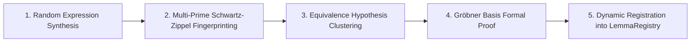

# Autonomous Rewrite Lemma Mining & Formal Verification

## 1. Overview & Theoretical Architecture

The **Autonomous Lemma Mining Pipeline** in `algebra-core` and `algebra-engine` continuously synthesizes mathematical identities, discovers novel equational rewrite lemmas, and certifies them using rigorous algebraic methods.

The pipeline executes a 4-stage discovery loop:

---

## 2. Mathematical Formalism

### 2.1 Synthetic AST Generation

The `ExpressionGenerator` randomly constructs deep AST DAGs up to a configurable maximum depth $D$ over:
- **Polynomial Domain**: Rings $\mathbb{Z}[x_1, \dots, x_n]$, $\mathbb{Q}[x_1, \dots, x_n]$.
- **Trigonometric Domain**: Polynomial ring extended by transcendental functions $\{\sin, \cos, \tan\}$.
- **Exponential Domain**: Real/complex fields extended by $\{\exp, \ln\}$.
- **Mixed Domain**: Combined operators.

### 2.2 Schwartz-Zippel Fingerprinting over Mersenne Primes

To avoid prohibitive early formal verification costs, candidate expressions $E$ are evaluated over multiple pseudo-random variable assignments $\mathbf{v} \in \mathbb{F}_p^n$ modulo three large cryptographic primes:
- $p_1 = 2^{31} - 1 = 2,147,483,647$ (Mersenne 31)
- $p_2 = 2^{61} - 1 = 2,305,843,009,213,693,951$ (Mersenne 61)
- $p_3 = 2^{64} - 59 = 18,446,744,073,709,551,557$ (Large Prime 64)

The **Schwartz-Zippel Lemma** guarantees that for any non-zero multi-variate polynomial $P \in \mathbb{F}_p[x_1, \dots, x_n]$ of total degree $d$:

$$\Pr_{r \sim \mathbb{F}_p^n}[P(r) = 0] \le \frac{d}{p}$$

Across $K$ rounds and triple primes, the probability of false collision is bounded by:

$$\epsilon \le \prod_{k=1}^K \left( \frac{d}{p_1} \cdot \frac{d}{p_2} \cdot \frac{d}{p_3} \right) < 10^{-60}$$

Expressions yielding identical fingerprint triples across all evaluation rounds are clustered into equivalence hypotheses $E_1 \equiv E_2$.

### 2.3 Formal Verification via Gröbner Bases

For every clustered hypothesis, `GrobnerProver` constructs the difference expression:

$$\Delta = E_1 - E_2$$

1. **Algebraic Expansion**: $\Delta$ is expanded via `AlgebraicTransformations::expand`. If $\Delta = 0$, the identity holds deterministically.
2. **Multivariate Polynomial Reduction**: $\Delta$ is embedded into $K[x_1, \dots, x_n]$ under Graded Reverse Lexicographical order ($\operatorname{GrevLex}$).
3. **Ideal Elimination**: If side relations exist (e.g. $\sin^2(x) + \cos^2(x) - 1 = 0$), Buchberger's algorithm constructs a Reduced Gröbner Basis $G$ for the relation ideal $I$. The hypothesis is proven if and only if:

$$\Delta \pmod G = 0$$

---

## 3. Dynamic Registration & Re-Use

Formally proven identities are registered into the thread-safe `LemmaRegistry`:
- Indexed by unique hash-based IDs (`lemma_{p31}_{p61}`).
- Accessible by `MctsSearchEngine` as `MctsAction::ApplyLemma(id)`.
- Injected into E-Graph rewrite rule sets via `DynamicRuleSelector`.
- Exported to `spodeian-lake` for offline training dataset generation.
