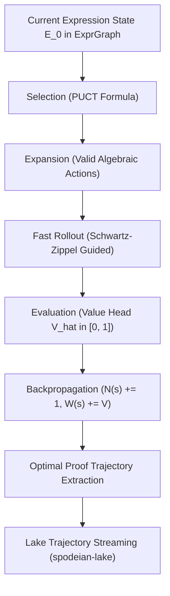

# Monte Carlo Tree Search (MCTS) Proof Guidance & Neural-Symbolic Policy Engine

## 1. Overview & Theoretical Foundations

Traditional automated theorem proving and algebraic expression simplification rely on either greedy heuristics (which frequently succumb to local minima and explosive term expansion) or exhaustive E-Graph equality saturation (which risks combinatorial memory explosions under non-terminating rewrite loops).

The **Universal Rust Algebra Engine (URAE)** overcomes these limitations through a hybrid **Neural-Symbolic Monte Carlo Tree Search (MCTS)** architecture operating directly over the hash-consed Expression DAG arena (`ExprGraph`). Guided by dual neural-symbolic heads trained via `spodeian-ml`, the MCTS engine explores the non-Euclidean state space of algebraic transformations:

$$a^* = \arg\max_{a \in \mathcal{A}(s)} \left( Q(s, a) + c_{\text{puct}} \cdot P(s, a) \cdot \frac{\sqrt{\sum_b N(s, b)}}{1 + N(s, a)} \right)$$



---

## 2. Four-Phase Search Dynamics

### 2.1 Selection: Predictor Upper Confidence Bounds for Trees (PUCT)

At each tree node representing an interned expression `ExprId`, child transitions are evaluated balancing exploitation (accumulated mean reward $Q(s, a)$) and exploration (prior probability $P(s, a)$ from the policy network scaled by visit counts):

$$U(s, a) = c_{\text{puct}} \cdot P(s, a) \cdot \frac{\sqrt{N(s)}}{1 + N(s, a)}$$

Where:
- $c_{\text{puct}} = 1.414$ regulates the exploration trade-off.
- $P(s, a) = \pi(a \mid s)$ is the prior probability assigned by the Policy Head.
- $N(s) = \sum_b N(s, b)$ is the total visit count of the parent state.

### 2.2 Expansion: Context-Aware Algebraic Actions

When an unvisited state or leaf is reached, candidate rewrite actions are instantiated:
- **`Expand`**: Distributes polynomial products and powers $(a + b)(c + d) \to ac + ad + bc + bd$.
- **`Together`**: Puts rational fractions over a common polynomial denominator.
- **`Cancel`**: Cancels greatest common divisors in rational quotients.
- **`Collect(x)`**: Gathers polynomial terms with respect to symbol $x$.
- **`FoldConstants`**: Constant-folds numeric leaves into exact scalars.
- **`TrigReduction`**: Reduces fundamental trigonometric invariants $\sin^2(x) + \cos^2(x) \to 1$.
- **`GrobnerReduce`**: Reduces multivariate polynomials modulo active polynomial ideal bases.
- **`ApplyLemma(id)`**: Rewrites sub-expressions matching autonomous discovered lemmas from `LemmaRegistry`.

### 2.3 Evaluation: The Value Head $\hat{V}(E)$

The value head estimates proximity to the canonical simplified form or target expression:

$$\hat{V}(E) = \begin{cases}
1.0 & \text{if } E \equiv E_{\text{target}} \text{ (exact or Schwartz-Zippel match)} \\
\frac{1 + \cos(\mathbf{e}_E, \mathbf{e}_{\text{target}})}{2} & \text{if target specified (quantized neural embedding)} \\
\frac{1.0}{1.0 + 0.05 \cdot C(E)} & \text{if target omitted (syntactic complexity minimization)}
\end{cases}$$

Where the syntactic complexity $C(E)$ incorporates node count and operator weights ($C(\text{Num}) = 1$, $C(+) = 2 + k$, $C(*) = 3 + k$, $C(/) = 5$, $C(\text{Fn}) = 8$).

### 2.4 Simulation: Fast Rollout

From the newly expanded leaf, the engine executes $H$ rollout steps (default $H = 4$) selecting transitions with maximal policy prior or Schwartz-Zippel identity match, evaluating the terminal state value and propagating it back through all ancestor nodes.

---

## 3. Lake-Backed Continuous Self-Improvement

All generated search trajectories and verified proof paths are exported to `spodeian-lake` as structured datasets:

```json
{
  "root_expr": 42,
  "best_expr": 17,
  "trajectory": [
    {
      "from_expr": 42,
      "action": "Expand",
      "to_expr": 45,
      "value": 0.82,
      "visits": 18
    },
    {
      "from_expr": 45,
      "action": "TrigReduction",
      "to_expr": 17,
      "value": 0.98,
      "visits": 15
    }
  ],
  "best_value": 0.98,
  "iterations": 50,
  "is_target_reached": true
}
```

The offline Python MLOps hub (`spodeian-ml`) periodically consumes these trajectory partitions to re-train the policy and value networks via self-supervised contrastive learning (`InfoNCELoss`), continuously refining heuristic proof efficiency.
